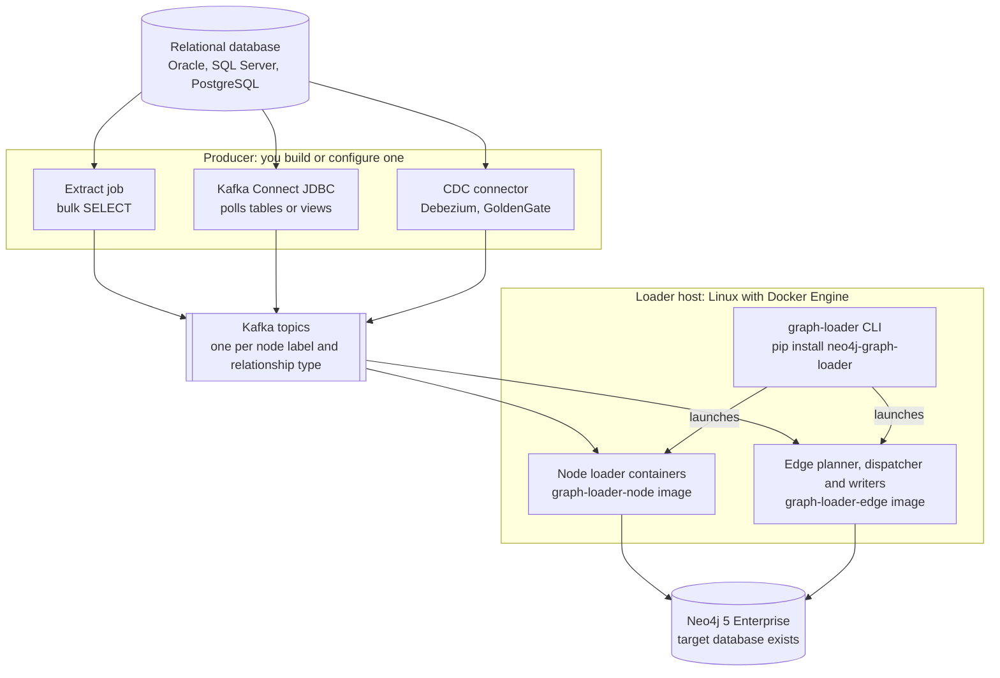
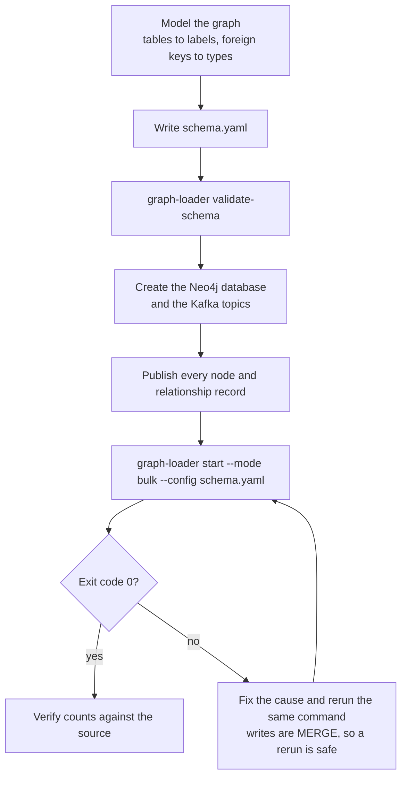
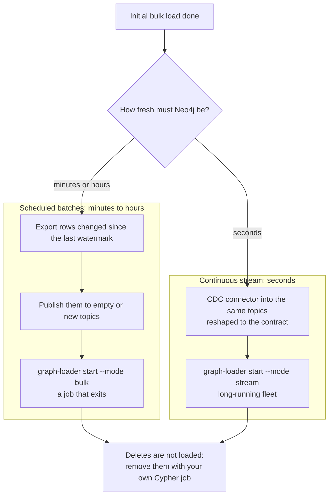
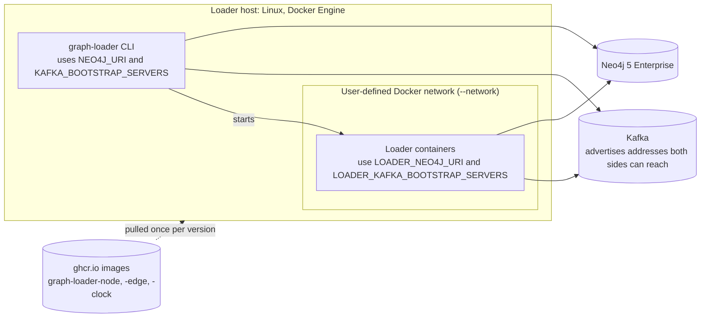

# Loading from a relational database

Related docs: [Bulk load guide](BULK_LOAD.md) | [Incremental load guide](INCREMENTAL_LOAD.md) |
[Usage guide](USAGE.md) | [CLI reference](CLI.md) | [Docker execution](DOCKER_EXECUTION.md) |
[Support and limits](../README.md#support-and-limits)

This guide shows how to put graph-loader behind a relational database such as Oracle, SQL Server,
PostgreSQL or MySQL. It describes a workflow, not a connector: graph-loader never connects to the
database. It reads Kafka topics whose records follow its [input contract](USAGE.md#4-the-input-contract-publishing-records),
so the job on your side is to turn rows into those records.

**What was tested.** The Kafka contract, the loader and the images were tested against Neo4j 5.26 Enterprise
and Kafka 3.7 (see [Support and limits](../README.md#support-and-limits)). No relational database, Kafka
Connect connector or change-data-capture (CDC) tool was tested by this project. The producer side
below is a design pattern on top of that contract, so check it against your own data.

1. [The architecture](#1-the-architecture)
2. [Model the tables as a graph](#2-model-the-tables-as-a-graph)
3. [Turn rows into records](#3-turn-rows-into-records)
4. [Choose a producer](#4-choose-a-producer)
5. [The initial load](#5-the-initial-load)
6. [Keeping the graph current](#6-keeping-the-graph-current)
7. [Where everything runs](#7-where-everything-runs)
8. [Verify the result](#8-verify-the-result)
9. [Checklist](#9-checklist)

## 1. The architecture



Kafka is the only connection between the two halves. Everything above it is yours: which rows, how
often, and in what shape. Everything below it is the package: the `graph-loader` command and the
versioned container images it starts. You can change the producer later, for example a nightly extract
job now and CDC later, without changing the schema or the loader.

## 2. Model the tables as a graph

| Relational structure | Graph element | Notes |
| --- | --- | --- |
| A table with a primary key | A node label | One `nodes[]` entry and one topic. |
| Its primary key column | The node's `key_property` | One property. For a composite key, derive one key column in the view (for example `order_id || '-' || line_no`). |
| Other columns you need | Node properties | Declare each one; a record may carry only declared properties. |
| A foreign key column | A relationship type | Source is the referencing row's node, target is the referenced row's node. Every relationship type declares at least one property; for a bare foreign key, carry a column of the referencing row (a date, a status). |
| A join (associative) table | A relationship type | Each row gives a source key and a target key; its other columns become relationship properties. |
| A lookup or code table | A small label, or a property | A label when you want to traverse it (`Country`), a property when you only filter on it. |

Two rules decide most modeling questions:

* **One relationship per pair.** A relationship type holds at most one relationship per ordered
  `(source, target)` pair. Repeated rows for the same pair `MERGE` into one relationship and update its
  properties. If the same customer can order the same product twice and you need both, model the order
  as a node (`Customer -PLACED-> Order -CONTAINS-> Product`), not as a property-carrying
  `Customer -ORDERED-> Product`.
* **Nodes are matched by key.** A relationship record carries only the two keys. Both nodes must exist
  in Neo4j by the time the relationship is written (section 5).

For the tables `customers`, `orders`, `products` and the join table `order_lines`:

```yaml
loading:
  mode: bulk
  consumer_group_id: shop-graph

nodes:
  - label: Customer
    topic: shop-customers
    key_property: customer_id
    properties:
      customer_id: {type: string, required: true}
      name:        {type: string}
      country:     {type: string}
  - label: Order
    topic: shop-orders
    key_property: order_id
    properties:
      order_id:  {type: string, required: true}
      placed_at: {type: datetime}
  - label: Product
    topic: shop-products
    key_property: product_id
    properties:
      product_id: {type: string, required: true}
      title:      {type: string}
      price:      {type: float}

edges:
  - type: PLACED                       # from orders.customer_id (a foreign key)
    topic: shop-placed
    nodes: {source: Customer, target: Order}
    source_key_property: customer_id
    target_key_property: order_id
    properties:
      placed_at: {type: datetime}      # every relationship type declares at least one property
  - type: CONTAINS                     # from the order_lines join table
    topic: shop-contains
    nodes: {source: Order, target: Product}
    source_key_property: order_id
    target_key_property: product_id
    properties:
      quantity: {type: integer}
```

Check the schema without any service: `graph-loader validate-schema --config shop.yaml`.

## 3. Turn rows into records

Each topic carries JSON values in one of two shapes ([USAGE.md section 4](USAGE.md#4-the-input-contract-publishing-records)):

| Topic kind | Kafka key | JSON value |
| --- | --- | --- |
| Node | The node key, as text | The row's declared properties: `{"customer_id": "C-17", "name": "Ada", "country": "NL"}` |
| Relationship | The **source** key, as text | `{"source": {"order_id": "O-9"}, "target": {"product_id": "P-3"}, "properties": {"quantity": 2}}` |

A relationship value always has all three sections; send `"properties": {}` when a row has no value for
any of the type's optional properties.

A practical way to get there is one database view per topic that returns two columns, the key text and
the finished JSON value. Most databases can build the JSON themselves (Oracle `JSON_OBJECT`, SQL Server
`FOR JSON`, PostgreSQL `json_build_object`). Every producer in section 4 can then read the views
unchanged, and type conversion happens in one place you can test with a plain query.

Type rules that catch relational data:

| Schema type | Must arrive as | Watch out for |
| --- | --- | --- |
| `string` | JSON string | Fixed-width `CHAR` padding; trim it or keys will not match. |
| `integer` | JSON integer | `NUMBER`/`DECIMAL` values that a client turns into `12.0` or a string. |
| `float` | Finite JSON number | `NaN` and infinity are rejected. |
| `date` | `"YYYY-MM-DD"` | Oracle `DATE` also carries a time; choose `date` or `datetime` deliberately. |
| `datetime` | ISO-8601 with `T` and an offset, such as `"2024-01-31T12:00:00Z"` | Timestamps without a time zone; attach the zone the database means. CDC tools often emit epoch numbers by default. |

And three behaviours to plan for:

* **`NULL` never clears a value.** An optional property that is `null` or missing is left out of the
  write, so a column set to `NULL` in the database keeps its old value in Neo4j. Clear such values with
  your own Cypher if it matters.
* **Only declared properties.** A record with an extra field, a missing required field or a wrong type is
  rejected. Select exactly the declared columns.
* **Key relationship records by the source key.** Records of one pair then share a partition, and Kafka
  keeps them in order, which is what "last write wins" follows.

## 4. Choose a producer

| | Extract job | Kafka Connect JDBC source | CDC connector |
| --- | --- | --- | --- |
| What it is | A program or scheduled job that runs the views and produces records | A connector that polls tables or views | A connector that reads the database's change log |
| Good for | The initial load, scheduled batches | Scheduled or near-real-time updates without writing code | Continuous, low-latency updates |
| Record shape | Exactly the contract, from the views | Needs `JsonConverter` with `schemas.enable=false` and a key setting; point it at the views | Needs the change envelope removed and types converted; relationship envelopes usually need the views or a stream-processing step |
| Sees deletes | No | No | Yes, but graph-loader does not apply them (section 6) |
| Pairs with | `start --mode bulk` | Bulk batches or `start --mode stream` | `start --mode stream` |

A common combination is an extract job for the initial bulk load and CDC afterwards.

## 5. The initial load



What the bulk run does, in order:

1. It applies the schema's constraints and indexes, and records each topic's end offsets. That is the
   run's *boundary*: records produced after the start fail the run instead of being half-loaded, so
   publish everything first and keep producers still during the run.
2. It starts node loader containers and loads every label. A label is ready when its topic is fully
   consumed and committed.
3. It plans the relationships into chunks that never share a node, and a pool of writer containers
   writes them as soon as both endpoint labels are ready. There are no lock waits between the loader's
   own transactions.
4. It checks that every chunk was written exactly once and exits `0`.

A relationship whose source or target does not match exactly one node fails a planned run (the chunk is
rolled back). With relational data that usually means a foreign key pointing at a row you did not
export, or keys that differ in type or padding between two views. Fix the export and rerun.
The full procedure, every flag and recovery are in the [bulk load guide](BULK_LOAD.md).

## 6. Keeping the graph current



**Scheduled batches** ([INCREMENTAL_LOAD.md part A](INCREMENTAL_LOAD.md#2-part-a-incremental-bulk-batches)).
Keep a watermark on your side, such as a maximum `updated_at` or a change sequence number, and export
only rows changed since the last successful batch. Each batch is an ordinary bulk run into the existing
graph: nodes and relationships are upserted, and relationships can reference nodes loaded by earlier
batches. Either clear the input topics and node consumer groups before each batch, or give each batch
fresh topic names. Advance the watermark only after the run exits `0`.

**Continuous stream** ([INCREMENTAL_LOAD.md part B](INCREMENTAL_LOAD.md#3-part-b-continuous-streaming)).
A CDC connector writes each change to the topics, and one long-running `graph-loader start --mode
stream` fleet applies it within seconds. Differences from bulk that matter for CDC:

* **Relationships may arrive before their nodes.** Enable `dead_letter` on those relationship types; the
  stream then routes such rows to a dead-letter topic and retries them with backoff until the node exists.
  Rows still unmatched after `max_retry_attempts` are parked and can be replayed with `graph-loader replay-dlq`.
* **Ordering.** Records are applied in partition order. If an older version of a relationship can arrive
  after a newer one (a replay, a late correction), declare `order_by` on a version column such as the
  change sequence number or `updated_at`; then only a newer version is applied (tested with an integer
  version). Nodes have no `order_by` and are applied in arrival order.
* **Create the topics first.** Stream mode refuses to start while a declared topic is missing.
* **Hand-over from bulk.** Keep `loading.consumer_group_id` and the node loaders continue from the
  offsets the bulk run committed. Relationship topics are read once more by the stream, which is safe
  because writes are idempotent ([details](INCREMENTAL_LOAD.md#handing-over-from-a-bulk-load-to-a-stream)).

**Deletes.** Records only create and update. A row deleted in the database, or a CDC delete event, does
not remove anything from Neo4j. Run your own scheduled Cypher cleanup, for example deleting nodes whose
keys no longer appear in a key export, or soft-delete in the database and carry a status property.

## 7. Where everything runs



* **The loader host** runs `graph-loader` and needs a local Docker Engine on Linux. The command pulls
  the images matching its own version once (or uses preloaded ones with `--skip-image-build`) and starts
  the containers on an existing user-defined bridge network.
* **Two sets of addresses.** The CLI reaches Kafka and Neo4j at `KAFKA_BOOTSTRAP_SERVERS` and
  `NEO4J_URI`; the containers use `LOADER_KAFKA_BOOTSTRAP_SERVERS` and `LOADER_NEO4J_URI`. Set both when
  they differ. Kafka must advertise broker addresses that both can reach; a broker that advertises
  `localhost` redirects remote clients back to themselves.
* **Credentials** come from `NEO4J_USERNAME` and `NEO4J_PASSWORD` in the environment. The CLI does not
  read `.env` files. The target database, set with `NEO4J_DATABASE`, must already exist.
* **The database and the producer** can run anywhere that reaches Kafka. They never talk to the loader
  host or Neo4j.

Details: [Docker execution](DOCKER_EXECUTION.md) and [connection variables](USAGE.md#connection-variables).

## 8. Verify the result

Compare what the source says with what Neo4j holds:

* **Nodes:** the count of distinct keys per exported table or view equals the count per label.
* **Relationships:** the count of distinct `(source key, target key)` pairs per relationship view equals
  the count per relationship type. Compare distinct pairs, not rows, because repeated pairs merge.
* **Samples:** a few rows' properties, with dates and numbers, match exactly.
* **Run output:** the exit code is `0`, and the rejection files in the run directory are empty. A
  non-empty one names the records that broke the contract.

[USAGE.md section 8](USAGE.md#8-outputs-monitoring-and-verification) covers the outputs and metrics.

## 9. Checklist

* Each label has one key column, unique and non-null in its view.
* Relationship views return keys of the same type and format as the node views.
* Every record carries only declared properties, with ISO dates and JSON numbers.
* Node records are keyed by the node key, relationship records by the source key.
* Topics exist with at least as many partitions as the node-loader replicas you want (4 is a good start).
* The Neo4j database exists, and Kafka advertises addresses reachable from the loader host and its containers.
* For bulk: everything is published before the run, and producers stay still while it runs.
* For stream: `dead_letter` is set on types whose rows can arrive before their nodes, and `order_by` on
  types that can receive older versions.
* Deletes have their own cleanup.
