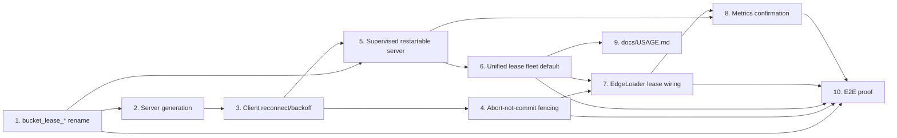

# Phase 5 / Slice 1: Zero-Wait Streaming Relationship Writes via Bucket Leases — Stories

Source: `plan/v5/slices.md` Slice 1, bound by `plan/v5-v6-orchestration.md` (P5-Q1:
leases become the streaming default for relationship write concurrency,
including self-referencing types; the Phase 4 clock/rotation stays available
behind a deprecated opt-in flag for one release, not deleted; the streaming
lease server must be supervised and restartable; loaders reconnect with
bounded backoff; on a lease-server disconnect a writer aborts, never commits,
any transaction still open; held resources are never re-granted while a
holder may still commit; the TCP coordinator's settings are renamed
`bucket_lease_*` to stop colliding with `CoordinationConfig.lease_timeout_ms`).
Wave 3 of the execution order (`plan/v5-v6-orchestration.md`): lands after
P6-S1 (CI) and P6-S2 (metrics catalogue) merge into
`feat/streaming-observability`, and blocks every later Phase 5 slice.

## Decisions this Cartographer is making now (grounded in the merged code)

These are called out up front because `plan/v5/slices.md` leaves two things
as open questions for this document to resolve, and a third thing needs a
concrete, implementable design that the epic only states as a goal.

1. **The Phase 4 clock/rotation machinery is retired from streaming's
   *default* path, not deleted, and not kept for an orthogonal purpose.**
   Direct code inspection shows `coordination.py` (`ClockLease`,
   `GlobalBatchClock`, `CoordinationConfig`), `rotation.py` (`RotationPlan`,
   `build_rotation_plan`), `clock_runner.py` (the clock's container entry
   point), and `src/loader/slot_admission.py` (`SlotAdmission`,
   `SlotAwareAdmissionBuffer`) are reachable **only** from streaming's
   clock-gated dispatch: `cli.py`'s `_run_rotating_relationship_fleet`
   (line 904) and `_run_isolated_relationship_stream_phase` (line 745), and
   `edge_loader.py`'s `slot_admission`/`slot_buffer`/`coordination_poll`
   constructor parameters (line 253-303) and `main()`'s rotation-plan
   construction (line ~1500). None of these four modules is reachable from
   bulk mode at all (`grep` confirms zero bulk call sites). There is no
   orthogonal responsibility to preserve them for — Open Question 1 in
   `plan/v5/slices.md` floats "run-scoped liveness/health reporting
   distinct from TCP-lease-ownership" as a hypothetical, but the clock
   already does nothing bulk mode needs and nothing leases don't already
   cover (leases give the same "is the fleet alive" signal for free through
   `LeaseStats`/the P6-S2 `kind="lease-server"` metrics). Story 6 flips
   streaming's *default* dispatch to a unified lease fleet and keeps the
   old dispatch fully intact and byte-for-byte unchanged behind a new,
   explicitly deprecated `--stream-clock-rotation` flag, satisfying "not
   deleted... for one release" without inventing a new job for retired
   code.
   `src/orchestrator/isolation.py` (`build_relationship_isolation_plan`) is
   the one module in this family that is **not** stream-only: bulk mode's
   `_run_relationship_orchestration` bulk branch (line 873-901) calls it too,
   and that call is unaffected by this slice. Only streaming's use of it
   (today, to carve out a serial self-reference phase) retires.
2. **Self-reference collapse is not new code — it already exists in
   `BucketCellRouter.cell()`** (`src/loader/lease_client.py:143-144`): a
   self-reference's cell is `(resource(label, source_key),
   resource(label, target_key))`, and `resources()` (line 146-149)
   de-duplicates it to one token when they match. Story 6 does not add
   collapse logic; it only stops excluding self-referencing types from the
   fleet that gets the router in the first place (today,
   `_run_rotating_relationship_fleet` explicitly rejects any self-referencing
   edge at line 919-926, and `_run_isolated_relationship_stream_phase` is
   the dedicated serial workaround being retired).
3. **Restart-safety is fencing-by-abort, not distributed consensus, and the
   residual race is bounded by Neo4j's own real MERGE lock, not left
   open.** `BucketLeaseServer` (`lease_server.py`) has no persistent state
   and no generation concept today; a restarted instance starts with zero
   knowledge of what the previous instance granted. The literal risk is: a
   worker acquired a lease from instance N, instance N is killed and
   instance N+1 starts and immediately grants the same resource to a
   second worker, and the first worker's Neo4j transaction — still
   in-flight against Neo4j the whole time, oblivious to the coordinator's
   death — commits after the second worker's, or concurrently with it.
   Building real cross-process consensus (e.g., replicated lease state, a
   fencing token Neo4j itself enforces) is out of proportion to what this
   library needs: **the two transactions are nonetheless each individually
   valid, idempotent `MERGE` statements against the same node**, so the
   worst case if this narrow window is ever hit is a transient Neo4j lock
   wait or a retried deadlock — exactly the behavior leases exist to avoid
   in the common case, momentarily reappearing for at most one
   coordinator-restart transition, never lost or duplicated data. Story 4
   closes the window to "at most the final commit RPC" (not eliminating it
   to zero) by checking the lease connection is still alive immediately
   before `transaction.commit()`, and documents the residual as an accepted,
   time-bounded degradation, not a correctness bug — this is the concrete
   design the epic's "abort rather than commit" bullet asks for.
4. **The TCP bucket-lease coordinator has no schema/pydantic model today —
   it is pure `argparse` state in `cli.py`.** (`--edge-leases`,
   `--lease-buckets`, `--lease-outer-batch-size`, `--lease-keyed-max-nodes`,
   `DEFAULT_LEASE_BUCKETS`/`DEFAULT_LEASE_OUTER_BATCH_SIZE`/
   `DEFAULT_LEASE_KEYED_MAX_NODES` at `cli.py:47-52`, and
   `LEASE_ADDRESS_ENV = "GRAPH_LOADER_LEASE_ADDR"` at `lease_client.py:34`).
   `CoordinationConfig.lease_timeout_ms` (`schema.py:280-308`) is the *only*
   schema-level "lease," and it means something unrelated (the Phase 4
   clock's slot lease). Story 1 renames the CLI/env-var surface to
   `bucket_lease_*` and introduces the one new schema block streaming's
   supervision needs (restart bounds, health-check interval); it does not
   touch `CoordinationConfig.lease_timeout_ms` itself, since that field is
   Phase 4's and stays exactly as-is for the deprecated opt-in path.
5. **No new Prometheus metric name is needed.** The `feat/p6-s2-metrics`
   branch (merging into this integration branch before this slice per
   `plan/v5-v6-orchestration.md`'s wave order) already instruments
   `BucketLeaseExecutionCoordinator` (`kind="edge"`,
   `graph_loader_lease_wait_seconds`) and `BucketLeaseServer`
   (`kind="lease-server"`, `graph_loader_lease_grants_total`/
   `_denials_total`/`_wait_timeouts_total`/`_held_resources`/`_waiters`)
   unconditionally — neither distinguishes bulk from stream. Routing
   streaming writes through the same classes means every one of those
   series is populated for streaming for free, with zero new code. Story 8
   only has to confirm this and document one caveat (counter reset on
   restart).

## Story 1: Rename the Bucket-Lease Coordinator's Settings to `bucket_lease_*`

**As a** Maintainer,
**I want** every CLI flag, environment variable, and internal identifier for
the TCP bucket-lease coordinator renamed with a `bucket_lease_` prefix, with
the old names kept as deprecated, warning-emitting aliases,
**so that** "lease" unambiguously means the zero-wait TCP coordinator
everywhere in this codebase, and `CoordinationConfig.lease_timeout_ms` (the
unrelated Phase 4 clock slot lease) is never confused with it again — a
prerequisite for every later story in this slice, which all add *new*
lease-coordinator settings that must not collide with the old names.

### Technical Context

- **Rename surface** (old → new, old kept as a deprecated alias):
  - CLI flags: `--edge-leases` (kept as-is; it names the *feature*, not a
    setting, and both bulk and — after Story 6 — the streaming default use
    it implicitly) → no change. `--lease-buckets` →
    `--bucket-lease-buckets` (old flag still accepted, maps to the same
    `args` attribute, logs one `DeprecationWarning`-class log line the
    first time it is used per process). Same treatment for
    `--lease-outer-batch-size` → `--bucket-lease-outer-batch-size` and
    `--lease-keyed-max-nodes` → `--bucket-lease-keyed-max-nodes`.
    `argparse` does not support two flags writing one `dest` with different
    defaults cleanly across a rename in one call — use two
    `parser_start.add_argument(...)` calls sharing `dest="lease_buckets"`
    (etc.), with the deprecated one carrying `help=argparse.SUPPRESS` so
    `--help` only advertises the new name, and a small post-parse pass in
    `handle_start` (or `_validate_edge_lease_settings`) that checks
    `sys.argv`/`parser_start.__dict__` isn't reliable for "which one did the
    operator actually type" — instead give the deprecated flags their own
    `dest` (`lease_buckets_deprecated`, etc.) and merge in `handle_start`:
    `if args.lease_buckets_deprecated is not None: warn(...); args.lease_buckets = args.lease_buckets_deprecated`.
  - Constants (`cli.py:47-52`): `DEFAULT_LEASE_BUCKETS` →
    `DEFAULT_BUCKET_LEASE_BUCKETS`, `DEFAULT_LEASE_OUTER_BATCH_SIZE` →
    `DEFAULT_BUCKET_LEASE_OUTER_BATCH_SIZE`, `DEFAULT_LEASE_KEYED_MAX_NODES` →
    `DEFAULT_BUCKET_LEASE_KEYED_MAX_NODES`; same in `lease_client.py:37`
    (`DEFAULT_LEASE_BUCKETS`) and `lease_server.py:58`
    (`DEFAULT_LEASE_PORT` → `DEFAULT_BUCKET_LEASE_PORT`). Keep the old names
    as module-level aliases (`DEFAULT_LEASE_PORT = DEFAULT_BUCKET_LEASE_PORT`)
    for any external importer, since these are public, undocumented-but-
    importable module attributes and this library has no deprecation
    policy precedent to lean on (`grep -rn "deprecat" src/ docs/` returns
    nothing today — this story establishes the *first* deprecation
    convention in the codebase, so keep it simple: a log line, not a
    machine-enforced sunset).
  - Environment variable: `LEASE_ADDRESS_ENV = "GRAPH_LOADER_LEASE_ADDR"`
    (`lease_client.py:34`) → `GRAPH_LOADER_BUCKET_LEASE_ADDR`. Every
    `docker_service.py` launcher that sets this env var
    (`run_node_loader`/`run_edge_loader` — confirm exact set of call sites
    by grepping `LEASE_ADDRESS_ENV` in `docker_service.py`) sets **both**
    the new and the old name to the same value for one release, so an
    edge-loader image built from a slightly older commit (still reading the
    old name only) inside a mixed-version fleet does not silently lose its
    lease address. `lease_client.py`'s own reader of this env var (wherever
    a loader's `main()` resolves its lease address) prefers the new name,
    falls back to the old one, and logs a deprecation line only when it had
    to fall back.
  - `run_bucket_lease_server`/`bucket_lease_address` (`docker_service.py:148,
    178`) are already correctly named — no change there; this story is
    entirely about the *settings*, not the already-well-named coordinator
    class/methods.
- **New schema block**, added by this story since Stories 5-7 need somewhere
  durable to put streaming's supervision tuning (bulk's lease settings stay
  CLI-only, matching owner decision 5's "bulk unchanged" — this is new,
  streaming-only, so it is new schema, not a rename of anything CLI):
  ```python
  class BucketLeaseStreamConfig(BaseModel):
      """Streaming-only tuning for the long-lived bucket-lease coordinator.

      Distinct from CoordinationConfig (the deprecated Phase 4 clock's slot
      lease) and from bulk mode's --edge-leases CLI flags (unchanged).
      """
      model_config = ConfigDict(frozen=True)
      health_check_interval_ms: int = Field(default=2_000, ge=100, le=60_000)
      max_consecutive_restarts: int = Field(default=5, ge=1, le=100)
      restart_backoff_base_ms: int = Field(default=500, ge=1, le=60_000)
      restart_backoff_max_ms: int = Field(default=30_000, ge=1, le=600_000)
      reconnect_timeout_ms: int = Field(default=0, ge=0, le=3_600_000)
      # 0 = unbounded (retry forever with capped backoff); a stream runs
      # indefinitely, unlike bulk's fixed 30s connect_timeout_seconds.

      @field_validator(
          "health_check_interval_ms", "max_consecutive_restarts",
          "restart_backoff_base_ms", "restart_backoff_max_ms", "reconnect_timeout_ms",
          mode="before",
      )
      @classmethod
      def _reject_bool(cls, value): ...  # mirror CoordinationConfig's existing pattern (schema.py:297-304)

      @model_validator(mode="after")
      def _backoff_covers_base(self):
          if self.restart_backoff_max_ms < self.restart_backoff_base_ms:
              raise ValueError("restart_backoff_max_ms must be >= restart_backoff_base_ms")
          return self
  ```
  Nested as `LoadingConfig.bucket_lease: BucketLeaseStreamConfig =
  Field(default_factory=BucketLeaseStreamConfig)`, following
  `CoordinationConfig`'s exact placement (`schema.py:349`) and
  `ConfigDict(frozen=True)` convention. Document defaults in
  `config/graph_schema.yaml` the same way `coordination` is documented
  there today.
- **Deprecation logging helper** (new, since none exists —
  `src/utils/schema_loader.py` or a small new function in `cli.py` near
  `_validate_edge_lease_settings`):
  ```python
  def _warn_deprecated_flag(old: str, new: str) -> None:
      logger.warning("stage=deprecation flag=%s superseded_by=%s", old, new)
  ```
  Called once per process, at argument-merge time, never inside a hot loop.

### Acceptance Criteria

- [ ] `--bucket-lease-buckets 32` and the deprecated `--lease-buckets 32`
      produce byte-identical `args.lease_buckets` and identical downstream
      behavior; only the deprecated form logs
      `stage=deprecation flag=--lease-buckets ...`.
- [ ] Setting only `GRAPH_LOADER_LEASE_ADDR` (not the new name) inside an
      edge-loader container still resolves a working lease address, with
      exactly one deprecation log line, not one per reconnect attempt.
- [ ] A schema YAML with no `bucket_lease:` block loads with every
      `BucketLeaseStreamConfig` default populated; `restart_backoff_max_ms <
      restart_backoff_base_ms` fails schema loading with a clear message.
- [ ] `grep -rn "DEFAULT_LEASE_PORT\|DEFAULT_LEASE_BUCKETS\|LEASE_ADDRESS_ENV"
      src/` still resolves (as back-compat aliases), and every internal
      call site in `src/` (not test fixtures proving the alias) uses the new
      names — a source-scan test enforces this the same way the P6-S2
      metrics catalogue's cardinality-guard test scans for label misuse.

### Definition of Done

- [ ] `tests/test_schema_validation.py` extended for `BucketLeaseStreamConfig`
      defaults/bounds/boolean-rejection, mirroring the existing
      `CoordinationConfig` tests.
- [ ] `tests/test_cli.py`/`tests/test_docker_service.py` extended for the
      flag/env-var alias behavior.
- [ ] `config/graph_schema.yaml` documents the new `bucket_lease:` block.
- [ ] Reviewed and merged.

### Dependencies

Depends on: none new from this phase (P6-S2's metrics catalogue is already
merged per the wave order). Blocks: Stories 2-9 (all touch the renamed
surface or the new schema block). **File-overlap risk:** `src/models/schema.py`
is touched only by this story in this slice — safe to land first with no
rebase risk. `cli.py`'s argument-parsing block and `lease_client.py`'s
`LEASE_ADDRESS_ENV` constant are touched again by Stories 5-7 (different
functions in the same files: this story only touches
`parser_start.add_argument`/`_validate_edge_lease_settings`'s alias-merge
logic, not the launch/dispatch functions Stories 5-7 add) — land this story
first and merge before starting them. **Estimate: 5 points.**

## Story 2: Server-Side Generation and Restart-Safety Fencing in the Lease Protocol

**As a** Pipeline Operator,
**I want** the bucket-lease coordinator to hand every client a fresh,
unguessable generation identifier at `HELLO` that changes every time the
process restarts,
**so that** a client can tell "I am talking to the same coordinator instance
that granted my lease" from "the coordinator restarted and remembers
nothing," which Story 3's reconnect logic and Story 4's abort-before-commit
logic both depend on to log the restart transition accurately (the fencing
*mechanism* — refusing to hand out a resource while a prior holder can still
commit — is closing the client-side window in Story 4, not a server-side
compare-and-swap; the server has no way to know a TCP peer that already
disconnected might still be mid-commit against Neo4j, so it cannot fence on
its own).

### Technical Context

- `src/orchestrator/lease_server.py`'s `BucketLeaseServer.__init__`
  (line 217-236) gains a `generation: str = field(default_factory=lambda:
  uuid.uuid4().hex)` — one random token per process start, never persisted
  (a fresh process is definitionally a new generation; there is nothing to
  recover across a restart, so no durable store is needed or wanted).
- **`HELLO` reply changes shape**: today `HELLO <bucket_count> [<scheme>]`
  replies bare `OK\n` or `ERR ...\n` (`_dispatch`, line 325-333). Change the
  success reply to `OK <generation>\n`. This is a **wire-protocol change**,
  so update the module docstring (line 12-42) in the same change, and bump
  nothing else — `ACQ`/`ANY`/`EXT`/`REL`/`PING` replies are unchanged, only
  `HELLO`'s success line gains one token.
- **`STATS` reply** (`_dispatch` line 336-337, `f"OK {self.stats.render()}
  waiters={len(self._waiters)}\n"`) gains `generation=<token>` in the
  rendered key=value pairs, so `docker logs` on a restarted container and
  the exit-time metrics snapshot (P6-S2 Story 9,
  `write_metrics_snapshot`) both show which generation produced the numbers
  being read — useful for an operator correlating "did the counters reset
  because of a restart" without needing this slice's own new metric.
- **Client changes belong to Story 3**, not this story: this story is
  server-only (`lease_server.py`), so `BucketLeaseClient.connect()`
  (`lease_client.py:182-211`) still sends the same `HELLO` request
  unchanged and, until Story 3 lands, simply ignores the extra token in the
  reply (its `if reply != "OK":` check at line 208 must become `if not
  reply.startswith("OK"):` in *this* story so old-protocol strictness
  doesn't break immediately — Story 3 is the one that actually parses and
  *uses* the generation token). Sequencing this way keeps this story's diff
  contained to `lease_server.py` plus the one-line reply-prefix relaxation
  in `lease_client.py`, and Story 3's diff contained to the parsing/reconnect
  logic.
- No change to `ACQ`/`ANY`/`EXT`/`REL` semantics: a fresh TCP connection
  after a restart has no prior lease IDs on the new server anyway (lease IDs
  are `Owner`-scoped in-memory state, `LeaseTable`, line 101-...; a new
  process starts that table empty), so there is nothing to "fence" at the
  level of an individual lease ID — the fencing this slice needs is
  entirely about the client's own in-flight Neo4j transaction (Story 4), not
  about the wire protocol rejecting a stale lease ID (there is no stale ID
  to reject; the new server has never heard of it, and `REL`/`EXT` on an
  unknown lease already reply `ERR unknown lease`/fail closed, which is
  correct and unchanged).

### Acceptance Criteria

- [ ] `HELLO 16 -` against a fresh server returns `OK <32-hex-char
      token>\n`; two separate `BucketLeaseServer()` instances constructed in
      the same test process never produce the same token (proven with a
      fixed random seed replaced by a monotonic-counter test double, not by
      relying on `uuid4`'s statistical uniqueness).
  - [ ] The same running server instance returns the identical generation
      token on every subsequent `HELLO`/`STATS` call for its entire
      lifetime — generation changes only across a process restart, never
      mid-run.
- [ ] `STATS` includes `generation=<token>` and every existing rendered key
      (`grants=`, `denials=`, etc., per `LeaseStats.render()`) unchanged in
      order and format — a regex-based existing test asserting `STATS`
      shape must still pass without modification beyond appending the new
      key.
- [ ] A client built against the *old* `HELLO` reply shape (bare `OK\n`,
      simulated by a fake server in a test) is still accepted by the
      updated `BucketLeaseClient.connect()`'s relaxed prefix check, proving
      this story alone does not break bulk mode's existing behavior before
      Story 3 lands.

### Definition of Done

- [ ] `tests/test_lease_server.py` extended: generation uniqueness across
      instances, stability across the lifetime of one instance, `STATS`
      shape.
- [ ] Module docstring (`lease_server.py:12-42`) updated with the new
      `HELLO` reply shape.
- [ ] Reviewed and merged.

### Dependencies

Depends on: Story 1 (uses `DEFAULT_BUCKET_LEASE_PORT`; no functional
dependency otherwise). Blocks: Story 3 (parses the new token), Story 5
(supervisor logs generation transitions across a restart). **File-overlap
risk:** `lease_server.py` only, plus one line in `lease_client.py`'s
`connect()` — Story 3 touches `lease_client.py` extensively next, so land
this story first and merge before starting Story 3 to avoid two developers
editing `connect()` concurrently. **Estimate: 3 points.**

## Story 3: Client-Side Generation Tracking and Bounded-Backoff Reconnection

**As a** Streaming Relationship Loader,
**I want** my lease-client connection pool to detect a coordinator
generation change, log it, and retry connecting with capped exponential
backoff for as long as the stream runs — not the fixed 30-second
`connect_timeout_seconds` bulk mode uses today — rather than permanently
marking itself broken after one failed reconnect window,
**so that** a brief lease-server restart (Story 5's supervisor bringing up a
fresh instance) is a transient blip a streaming writer rides out, exactly as
Kafka consumer reconnects and Neo4j driver reconnects already do elsewhere in
this codebase, instead of a fatal error that kills the whole edge-loader
container.

### Technical Context

- `src/loader/lease_client.py`'s `BucketLeaseClient.connect()`
  (line 182-211) today retries only during the *initial* connect, with a
  fixed 0.2 s poll (line 199) up to `connect_timeout_seconds` (default 30s,
  line 160), after which it sets `self._broken = True` permanently
  (line 195) and every future call raises. Add a `generation`
  parameter/attribute (`self._generation: str | None = None`) and change
  the `HELLO` handling (line 207-209) to:
  ```python
  reply = self._request(f"HELLO {self._bucket_count} {self._scheme}")
  if not reply.startswith("OK"):
      self._fail(f"HELLO rejected: {reply}")
  _, _, token = reply.partition(" ")
  if self._generation is not None and token != self._generation:
      logger.info(
          "stage=lease-reconnect address=%s previous_generation=%s new_generation=%s",
          self._address, self._generation, token,
      )
  self._generation = token
  ```
  (`_fail` already sets `self._broken = True` and closes the socket —
  unchanged.)
- **Bounded, capped-exponential reconnect for the coordinator's *pool*, not
  just one client's initial connect.** `BucketLeaseExecutionCoordinator`
  (`edge_execution.py:355-425`) already discards a broken client and builds
  a fresh one via `self._client_factory()` on the next `_checkout()`
  (line 402-408) — this is the right seam, but today `client_factory()`'s
  returned client's own `connect()` still uses the fixed 30s
  `connect_timeout_seconds`/0.2s-poll shape, which is fine for bulk (the
  coordinator is assumed already up before any writer starts) but wrong for
  a stream that must outlast a coordinator restart cycle. Add a
  streaming-specific `client_factory` (constructed by Story 6/7's CLI/
  edge-loader wiring, not by this story, which only builds the *capability*)
  that passes `connect_timeout_seconds` derived from the new
  `BucketLeaseStreamConfig.reconnect_timeout_ms` (Story 1) — `0` means
  unbounded, changing `connect()`'s loop condition from `if self._clock() >=
  deadline:` to `if deadline is not None and self._clock() >= deadline:`
  when `reconnect_timeout_ms == 0`.
- **Capped exponential backoff, not the fixed 0.2 s poll**, for the *unbounded*
  streaming case specifically (bulk keeps its fixed 0.2s poll unchanged —
  bulk's 30s window is short enough that backoff growth wouldn't matter, and
  changing bulk's timing is out of this slice's scope per "bulk mode
  unchanged"). Thread `restart_backoff_base_ms`/`restart_backoff_max_ms`
  (Story 1's new config) through to `BucketLeaseClient`'s sleep call
  (line 199) via a new `backoff_ms: tuple[int, int] | None = None`
  constructor parameter: `None` preserves today's fixed-0.2s bulk behavior
  exactly; a tuple switches to `min(base * 2**attempt, max)` capped
  exponential growth, using the same `2 ** (attempt - 1)` shape
  `ApocLockedEdgeWriter.write_rows` already uses for its own retry delay
  (`edge_execution.py:210`), so this codebase has exactly one backoff
  formula, not two.
- **Do not conflate "unreachable" with "protocol mismatch."** A `HELLO`
  bucket-count/scheme mismatch (line 328-332 in `lease_server.py`, an `ERR
  ...` reply, not a connection failure) means every client in the run was
  launched with inconsistent settings — this is a configuration bug, not a
  transient outage, and must still fail closed immediately (no retry loop),
  exactly as today. Only `OSError` during the TCP `connect()` call itself
  (line 190-199, the peer refusing or being unreachable) is the retryable
  case this story extends; an `ERR` reply after a successful TCP connect is
  unchanged and still calls `self._fail(...)` on the first attempt.

### Acceptance Criteria

- [ ] With `backoff_ms=None` (bulk's default), reconnect timing is
      byte-for-byte unchanged from today (0.2 s fixed poll, 30 s default
      deadline) — a regression test pins this.
- [ ] With `backoff_ms=(500, 30_000)` and `connect_timeout_seconds=None`
      (unbounded), a client whose first 6 connection attempts fail (fake
      unreachable socket) and whose 7th succeeds retries with strictly
      increasing (capped) delays and eventually connects — proven with an
      injected fake clock/sleeper, no real sockets or real time elapsed.
- [ ] A generation change across a reconnect logs exactly one
      `stage=lease-reconnect` line with both the previous and new token;
      the *first* successful `HELLO` of a client's lifetime (no previous
      generation observed yet) never logs this line.
- [ ] A `HELLO` bucket-count mismatch still fails on the first attempt with
      no retry, regardless of `backoff_ms` — proven by a test asserting the
      fake connect function is called exactly once.
- [ ] `BucketLeaseExecutionCoordinator`'s existing
      `test_unreachable_coordinator_fails_before_any_write` (already in
      `tests/test_bucket_lease_execution.py`) still passes unmodified with
      the default (bulk) construction — this story must not change bulk's
      observable failure behavior.

### Definition of Done

- [ ] `tests/test_lease_server.py`/`tests/test_bucket_lease_execution.py`
      extended with the backoff and generation-logging tests above.
- [ ] `lease_client.py` module docstring documents the new
      `backoff_ms`/unbounded-timeout parameters and when to use them
      (bulk vs. stream), so a future reader doesn't have to reverse-engineer
      the distinction from call sites.
- [ ] Reviewed and merged.

### Dependencies

Depends on: Story 2 (parses the `HELLO` generation token). Blocks: Story 4
(needs the same connection object's liveness state), Story 5 (the
streaming `client_factory` this story adds is what actually rides out a
supervised restart), Story 7 (edge-loader wiring passes the new
`backoff_ms`/`reconnect_timeout_ms` for streaming construction). **File-overlap
risk:** `lease_client.py` and `edge_execution.py`'s `_checkout`/`_checkin`
region only — Story 4 edits `edge_execution.py` again but in the
`_write_rows`/worker-transaction region, not the pool region, so the two can
be sequenced back-to-back with a small, reviewable diff each rather than one
large combined change. **Estimate: 8 points.**

## Story 4: Abort, Never Commit, on a Broken Lease Connection

**As a** Pipeline Operator,
**I want** a relationship writer to check, immediately before its Neo4j
`COMMIT`, that the lease connection it used to acquire this cell's resources
is still the same live connection it was when the lease was granted, and to
roll back instead of commit if it is not,
**so that** a lease-server restart can never result in two concurrently
granted, overlapping transactions both committing — the one binding
correctness requirement `plan/v5-v6-orchestration.md` states explicitly
("on a lease-server disconnect, a writer aborts... instead of committing
it").

### Technical Context

- The risk window is exactly between `BucketLeaseClient.acquire_any`/
  `acquire` succeeding (`lease_client.py:213-235`) and
  `transaction.commit()` returning inside whichever writer
  `BucketLeaseExecutionCoordinator` (`edge_execution.py:355-476`) is using
  for a cell — today `ApocLockedEdgeWriter._write_rows`
  (`edge_execution.py:216-231`) runs the whole
  `begin_transaction`/`run`/`consume`/`commit` sequence with **no**
  liveness check on the lease connection anywhere in that span. Add a final
  check right before `transaction.commit()`:
  ```python
  def _write_rows(self, rows, metadata=None, *, lease_liveness_check=None):
      with open_session(self._driver) as session:
          begin = session.begin_transaction(metadata=metadata) if metadata else session.begin_transaction()
          with begin as transaction:
              result = transaction.run(self._query, rows=rows)
              counts = list(result)
              result.consume()
              if (... existing row-count check ...):
                  raise self._error_factory(...)  # unchanged: leaving the block rolls back
              if lease_liveness_check is not None and not lease_liveness_check():
                  raise LeaseCoordinatorError(
                      f"edge={self._edge_type} lease connection broke before commit; aborting instead of committing"
                  )  # leaving the block without transaction.commit() rolls back, exactly like the existing row-count-mismatch path
              transaction.commit()
  ```
  `lease_liveness_check` is a zero-argument callable the
  `BucketLeaseExecutionCoordinator`'s worker binds per-cell to something
  like `lambda: not client.broken and client.ping_ok()` — `client.broken`
  already exists (`lease_client.py:178-180`); add a cheap `ping_ok()` method
  reusing the existing `PING`/`STATS` request path
  (`lease_client.py:259-262`'s `stats()` is almost this shape; add a
  dedicated `def ping(self) -> bool` that sends `PING` and returns `True`/
  catches `LeaseCoordinatorError` and returns `False` instead of raising,
  since a liveness probe failing is an expected outcome here, not a bug).
- **This adds one extra round trip per cell transaction, on the hot path.**
  Justify the cost explicitly: it is one `PING` (a handful of bytes each
  way over an already-open, already-`TCP_NODELAY` persistent socket on the
  same Docker network) per Neo4j transaction, which is already dominated by
  the Neo4j write itself (18-25 µs of *server* CPU per relationship per
  `docs/USAGE.md` §9, plus real network round-trip time to Neo4j) — the
  `PING` is not on the *lease acquisition* path (which already does one
  `ANY`/`ACQ` round trip per cell; this is a second, separate round trip
  timed differently) and must be included in `graph_loader_lease_wait_seconds`
  (Story 8) as part of the same flush's accounted lease-wait time, not left
  invisible.
- **Document the residual race in a code comment at this exact call site**,
  per the "Decisions" section above: the check narrows the window to "the
  time between this `PING` succeeding and the subsequent `COMMIT` RPC being
  acknowledged by Neo4j," which cannot be fully eliminated without two-phase
  commit between Neo4j and the lease coordinator; Neo4j's own real node lock
  is the backstop for that remaining sliver, so the failure mode of hitting
  it is a transient lock wait or a retried deadlock, never lost or
  duplicated data (idempotent `MERGE`).
- **Failure propagation**: a `lease_liveness_check` failure must behave
  exactly like every other write failure in this path —
  `BucketLeaseExecutionCoordinator.execute_pending`'s existing
  `state.record_failure(exc)` (line 458-459) already fails the whole flush
  and reports it through `LaneExecutionResult`, which the caller
  (`EdgeLoader._worker_loop`, `edge_loader.py:478-484`) already turns into a
  `WriterResult("WRITE_FAILURE", exc)` with **no Kafka offset commit** —
  this story adds no new failure-handling path, it only adds one new
  *cause* of the existing one, and should not need to touch
  `edge_loader.py` at all.
- **Bulk mode is unaffected in outcome, only in (negligible) added
  latency**: bulk's `BucketLeaseExecutionCoordinator` construction (
  `edge_execution.py` call sites gated by `--edge-leases`) gets the same
  `lease_liveness_check` for free once wired at the coordinator level,
  which is strictly more correct for bulk too (today bulk has the same
  restart-race exposure, just never exercised because bulk's lease server
  is not supervised/restarted — Story 5 is streaming-only). Confirm with a
  test that bulk's existing lease-mode test suite
  (`tests/test_bucket_lease_execution.py`) still passes with this check
  wired in and never observed to trip in the non-restart case.

### Acceptance Criteria

- [ ] A cell write whose lease connection is confirmed alive right before
      commit behaves identically to today (commits, releases the lease) —
      proven by the full existing `test_bucket_lease_execution.py` suite
      passing unmodified.
- [ ] A cell write whose lease connection's `PING` fails immediately before
      the scheduled commit rolls back (no Neo4j write persists — proven
      against a real or fake Neo4j session asserting no matching node/
      relationship exists afterward) and reports a failure through
      `LaneExecutionResult`, never raising past `execute_pending` uncaught.
- [ ] The flush containing that cell commits **zero** Kafka offsets for the
      whole batch (matching the existing "any coordinator error fails the
      flush" contract) — no partial-offset-commit regression.
- [ ] The added `PING` round trip is observed inside
      `_LeaseFlush.lease_wait_seconds` (verified by asserting the flush's
      logged `lease_wait_ms` in `stage=edge-lease-flush` increases by
      approximately the fake `PING`'s injected latency in a test using a
      fake clock).
- [ ] A code comment at the `lease_liveness_check` call site states the
      residual-race acceptance rationale from the Decisions section, so a
      future reader does not "fix" this into believing a perfect guarantee
      exists.

### Definition of Done

- [ ] `tests/test_edge_execution_writer.py`/`tests/test_bucket_lease_execution.py`
      extended with the abort-not-commit and offset-non-commit tests above.
- [ ] `BucketLeaseClient.ping()` unit tested independent of the writer
      (success, `LeaseCoordinatorError` caught and turned into `False`,
      never raises to the caller).
- [ ] Reviewed and merged.

### Dependencies

Depends on: Story 3 (`client.broken`/reconnect state this check reads).
Blocks: Story 7 (streaming's `EdgeLoader` construction must wire a
liveness-checking coordinator, not a bare one), Story 10 (the E2E
kill/restart proof asserts on this exact behavior). **File-overlap risk:**
`edge_execution.py`'s `ApocLockedEdgeWriter._write_rows` and
`BucketLeaseExecutionCoordinator`'s worker method — both in one file, but
disjoint methods from Story 3's pool-management code in the same file;
sequence after Story 3 merges to avoid a merge conflict in the same module.
**Estimate: 8 points.**

## Story 5: A Supervised, Restartable, Run-Scoped Lease Server for Streaming

**As a** Pipeline Operator,
**I want** the bucket-lease coordinator launched for the whole streaming
run (not a bounded bulk phase), automatically relaunched with the same
identity if its container dies, and reachable at the same address across
that relaunch without touching any already-running writer,
**so that** a lease-server crash is a bounded, self-healing blip instead of
a fatal end to an unattended `--mode stream` run — the concrete mechanism
behind `plan/v5-v6-orchestration.md`'s "supervised and restartable lease
server."

### Technical Context

- **Restart-transparent addressing, without changing any connected
  client's address.** `DockerService.bucket_lease_address`
  (`docker_service.py:178-191`) today prefers the container's Docker-network
  IP and falls back to the container *name* only when no IP is found (true
  on the default `bridge` network, which has no embedded DNS). A restarted
  container is a **new** container object with a **new** IP on a
  user-defined network — so IP-based addressing silently breaks on restart.
  The run's own `--network NAME` (default `graph-loader-net`, always a
  user-defined bridge network created by this CLI, never the Docker default
  `bridge`) already gets Docker's embedded DNS for free. Add a
  `prefer_name: bool = False` parameter to `bucket_lease_address`, and pass
  `prefer_name=True` **only** from the new streaming launcher (bulk mode's
  existing call site, `cli.py:264`, is unchanged and keeps IP-preference,
  since bulk never restarts this container mid-run). Give the streaming
  lease-server container a **stable, deterministic name**, independent of
  any Docker-assigned suffix, e.g.
  `graph-loader-lease-{run_id.encode('utf-8').hex()}` — this is already the
  exact naming scheme `run_bucket_lease_server` uses (`docker_service.py:165`),
  so no change is needed there; the supervisor (below) must **stop and
  remove** the dead container (`remove=False` today, line 173, so a crashed
  container lingers and would collide with a same-name relaunch — the
  supervisor's restart path must call `container.remove(force=True)` before
  relaunching) before calling `run_bucket_lease_server` again with the
  identical `run_id`, so the name — and therefore every already-connected
  client's DNS-resolved address — is unchanged. `BucketLeaseClient.connect()`
  (`lease_client.py`) already does a **fresh** `socket.create_connection`
  call (not a cached IP) on every reconnect attempt, so Python's own
  `getaddrinfo` resolves the new container's IP under the same name with no
  client-side address-update logic needed at all — confirm this exact
  behavior with a test using a fake `connect` callable that returns
  different results per call, standing in for DNS re-resolution.
- **Supervision loop**, extending `RelationshipBulkMonitor`
  (`src/orchestrator/relationship_bulk_monitor.py`), mirroring the existing
  `tracked_clock`/`_check_clock_health` pattern (`__init__` line 46, 89;
  `_check_clock_health` line 263-`~292`) but with **restart-and-continue**
  semantics instead of that method's current **immediately raise
  `LoaderCrashError`** behavior (`_check_clock_health` is intentionally left
  unchanged — it still serves the deprecated `--stream-clock-rotation` path
  from Story 6, where a clock crash *should* still be fatal, since nothing
  in this slice makes the clock itself restart-safe):
  ```python
  def _check_lease_server_health(self) -> None:
      """Restart the tracked lease server up to a bounded number of times."""
      if self._tracked_lease_server is None:
          return
      status = self._container_status(self._tracked_lease_server)  # extract the existing reload/NotFound/attrs logic shared with _check_clock_health into one helper both call
      if status in {"running", "created", "restarting"}:
          return
      self._lease_restart_count += 1
      if self._lease_restart_count > self._bucket_lease_config.max_consecutive_restarts:
          raise self._failure(LoaderCrashError, f"lease server exceeded {self._bucket_lease_config.max_consecutive_restarts} restarts")
      delay = min(
          self._bucket_lease_config.restart_backoff_base_ms * 2 ** (self._lease_restart_count - 1),
          self._bucket_lease_config.restart_backoff_max_ms,
      ) / 1000
      self._sleep(delay)
      self._stop_and_remove_lease_server(self._tracked_lease_server)  # reuse docker_service._stop_and_remove_quietly
      self._tracked_lease_server = self._docker_service.run_bucket_lease_server(
          run_id=self._run_id, bucket_count=self._lease_bucket_count,
          network=self._network, keyed_labels=self._lease_keyed_labels,
      )
      logger.warning(
          "stage=lease-server-restart run_id=%s attempt=%s/%s",
          self._run_id, self._lease_restart_count, self._bucket_lease_config.max_consecutive_restarts,
      )
  ```
  New constructor parameters: `tracked_lease_server`, `bucket_lease_config:
  BucketLeaseStreamConfig | None`, `docker_service: DockerService | None`
  (needed to relaunch — today's monitor never launches anything, only
  inspects; this is new capability, so inject it, defaulting to `None` for
  every existing caller that never needs it, matching this class's existing
  optional-dependency-group validation pattern at line 60-64). `supervise_stream`
  (line 446-474) gains a branch calling `_check_lease_server_health()`
  alongside (not instead of) `_check_health()`, parallel to how
  `_check_clock_health()` is called today (line 467) — **do not** require a
  clock lease wait (`wait_for_clock_lease`) when `tracked_lease_server` is
  set and `rotation_plan` is `None`; add a lightweight
  `wait_for_lease_server_ready(timeout_seconds)` that just retries a `PING`
  (reusing Story 3/4's `BucketLeaseClient.ping()`) instead of decoding a
  Kafka-published clock lease, since there is no Kafka coordination topic
  in the lease path at all.
- **Graceful shutdown**, mirroring `_stop_bucket_lease_server`
  (`cli.py:255-`~300`, already logs `stage=lease-server-stats` from the
  container's own logs before removing it) — reuse it verbatim for the
  streaming fleet's final shutdown; the only new behavior is *mid-run*
  restart, which is this story's supervision loop, not the final teardown.
  A `SIGTERM` during a restart backoff sleep must still be observed
  promptly: use the monitor's existing `self._sleep`-in-a-loop shape (already
  interruptible only at the top of `supervise_stream`'s `while not
  shutdown_requested.is_set()` loop, `relationship_bulk_monitor.py:465`) —
  cap `restart_backoff_max_ms` (Story 1's schema bound, `<=600_000`) low
  enough that a `SIGTERM` is never blocked for an unreasonable time; document
  this bound's rationale in the field's docstring.

### Acceptance Criteria

- [ ] Killing the lease-server container mid-stream (`docker kill`) results
      in a new container with the identical name appearing within one
      health-check interval plus the first backoff delay, and previously
      connected `BucketLeaseClient` instances (from Story 3/4) resume
      granting leases without any address reconfiguration.
- [ ] A lease server that crashes more than `max_consecutive_restarts`
      times in a row fails the whole streaming run closed (raises
      `LoaderCrashError`), matching this codebase's existing "fail closed
      rather than limp along silently" philosophy for every other
      unhealthy-container case.
- [ ] Restart attempts back off with capped exponential delay — proven with
      a fake clock/sleeper, no real time elapsed in the unit test.
- [ ] `SIGTERM` during a restart-backoff sleep still results in a clean
      shutdown within a bounded time (no restart-loop can indefinitely
      delay honoring shutdown).
- [ ] Bulk mode's existing lease-server launch/shutdown
      (`_start_bucket_lease_server`/`_stop_bucket_lease_server`) is
      byte-for-byte unchanged in behavior — this story adds a new
      streaming-only code path, it does not modify the bulk one.

### Definition of Done

- [ ] `tests/test_relationship_bulk_monitor.py` (or equivalent existing
      test file) extended with the restart-loop, backoff, and
      exceeded-max-restarts tests, using a fake `DockerService` the same
      way existing `docker_service.py` unit tests already mock the Docker
      client.
- [ ] `tests/test_docker_service.py` extended for `prefer_name=True`.
- [ ] Reviewed and merged.

### Dependencies

Depends on: Story 1 (`BucketLeaseStreamConfig`), Story 3 (the
`BucketLeaseClient.ping()`-based readiness wait), Story 4 (nothing directly,
but should land first so the E2E proof in Story 10 exercises the full
abort-on-restart behavior against a *real* restart, not just a mocked one).
Blocks: Story 6 (the CLI dispatch this story's launcher plugs into).
**File-overlap risk:** `relationship_bulk_monitor.py` (new methods,
extended constructor — additive, low collision risk with any other story)
and `docker_service.py`'s `bucket_lease_address` (one new optional
parameter, additive). **Estimate: 13 points.**

## Story 6: Retire the Clock as Streaming's Default; Launch One Unified Lease Fleet

**As a** Pipeline Operator,
**I want** `--mode stream` to launch every relationship type — conflicting,
non-conflicting, and self-referencing alike — under one long-lived bucket-
lease coordinator by default, with the old clock-gated, self-reference-
isolated dispatch still available and fully working behind an explicit,
clearly deprecated flag,
**so that** streaming gets the same zero-wait guarantee bulk's `--edge-leases`
already has, self-referencing types stop needing a dedicated serial phase,
and operators who need the old behavior for one release have an explicit,
documented escape hatch rather than a silent behavior change.

### Technical Context

- **Today's stream dispatch, and exactly what changes.**
  `cli.py`'s `_run_relationship_orchestration` (line 821-901) branches on
  `mode == "stream"` (line 843) and, today, **unconditionally** rejects
  running shared and isolated relationships together
  (line 844-846, "mixed-stream... cannot run together") and rejects more
  than one self-referencing type running together
  (line 847-849, "multi-isolated-stream"), then dispatches either
  `_run_isolated_relationship_stream_phase` (self-reference, alone, with
  `slot_gating=False` — no clock, no lease, just relies on being the only
  writer touching that label, per line 767-771) or
  `_run_rotating_relationship_fleet` (every non-self-referencing type,
  clock-gated, `slot_gating=True`, line 979-984) — and
  `_run_rotating_relationship_fleet` itself additionally **refuses to run
  at all** if any self-referencing edge is present in the schema when
  `selected_edges` is not explicitly narrowed (line 916-926, "self-
  referencing relationship types require Phase 4 Slice 4 policy"). Replace
  this whole `mode == "stream"` branch with one call to a new
  `_run_lease_relationship_fleet` that:
  - takes **every** edge type in the schema (no shared/isolated split, no
    `build_relationship_isolation_plan` call at all for this path — that
    classification existed only to route around the clock's limitations,
    which leases do not have);
  - launches Story 5's supervised lease server first (mirroring
    `_run_rotating_relationship_fleet`'s existing "clock before any gated
    edge process starts" ordering rationale at line 963-966, for the same
    reason: an edge loader may attempt its first lease acquisition
    immediately at startup);
  - launches every edge loader with `lease_address=` (not `slot_gating=True`),
    reusing `run_edge_loader`'s **already-existing** `lease_address`/
    `lease_buckets`/`lease_keyed_labels`/`outer_batch_size` parameters
    (`docker_service.py:301-340`) — these were built for bulk and need no
    new plumbing, only a caller that passes them for `mode="stream"`;
  - constructs `RelationshipBulkMonitor` with `tracked_lease_server=`
    (Story 5) instead of `tracked_clock=`/`rotation_plan=`/
    `coordination_topic=`.
  - Self-referencing types need **zero** special handling in this new
    function: `BucketCellRouter.cell()` already collapses their resource
    set to one token (Decisions section, point 2), so they simply appear in
    the same `run_edge_loader(..., lease_address=...)` loop as every other
    type, with no `is_self_referencing` branch anywhere in the new
    function.
- **Relax the two bulk-only gates that block this from working at all
  today**, both confirmed by direct inspection to be the load-bearing
  restrictions:
  - `docker_service.py:run_edge_loader`, line 331-334: `if lease_address is
    not None: parse_lease_address(lease_address); if slot_gating: raise
    ValueError("bucket leases are a bulk mode and cannot combine with
    slot_gating")`. This check's *purpose* — leases and clock-slot-gating
    are mutually exclusive within one `EdgeLoader` — stays exactly right
    and unchanged; only the **comment and any bulk-mode-only framing**
    needs updating, since after this story `lease_address` is also used
    by `mode="stream"`. No behavior change needed here at all beyond a
    docstring correction — the guard already permits exactly what Story 7
    needs (`lease_address` set, `slot_gating` unset) for any mode.
  - `cli.py:_validate_edge_lease_settings`, line 1104: `if args.mode !=
    "bulk": raise ValueError("--edge-leases requires --mode bulk")`. This
    literally cannot be simply deleted: **after** this story, streaming's
    default does not go through `--edge-leases`/`_validate_edge_lease_settings`
    at all (there is no CLI flag to enable it — it is the unconditional
    default per owner decision 1's "leases become the streaming default").
    `--edge-leases` itself stays bulk-only, unchanged, exactly as today;
    this validator is not touched by this story. The new streaming lease
    fleet's settings (`--bucket-lease-buckets` etc., Story 1) are validated
    by a **new**, analogous `_validate_stream_lease_settings(schema, args)`
    that runs for `mode == "stream"`, sharing the bucket-count/outer-batch/
    keyed-max-nodes bound checks (extract them into a shared helper both
    validators call, rather than duplicating the numeric-bounds logic) but
    with no `args.mode != "bulk"` gate and no
    `args.bulk_edge_overlap = "shared"` side effect (that field is bulk-only
    and stays that way).
- **The deprecated opt-in flag**, preserving the retired path exactly:
  ```python
  parser_start.add_argument(
      "--stream-clock-rotation", action="store_true",
      help="DEPRECATED, removed after one release: use the Phase 4 global "
      "batch clock and rotating/isolated-phase scheduling for --mode stream "
      "instead of the default bucket-lease fleet",
  )
  ```
  In `_handle_start`'s `if not is_bulk:` branch (`cli.py:1413-1415`):
  ```python
  if not is_bulk:
      if edge_configs:
          if getattr(args, "stream_clock_rotation", False):
              logger.warning("stage=deprecation flag=--stream-clock-rotation "
                              "reason=Phase 4 clock/rotation streaming path; removed after one release")
              return _run_relationship_orchestration(schema, docker_service, args, parent_run_id=parent_run_id)
          return _run_lease_relationship_fleet(schema, docker_service, args, parent_run_id=parent_run_id)
      return 0
  ```
  `_run_relationship_orchestration`, `_run_rotating_relationship_fleet`,
  `_run_isolated_relationship_stream_phase`, and every function they call
  (`build_rotation_plan`, `build_relationship_isolation_plan`'s stream use,
  `GlobalBatchClock` via `docker_service.run_global_batch_clock`) are **not
  edited by this story at all** beyond this one new call-site guard —
  proving "not deleted, kept for one release" by construction: the diff
  touching those functions is exactly zero lines.
- **Code-comment disposition, per the slice's explicit DoD requirement**
  ("documented in code comments/docs, not left implicit"): add a module-level
  docstring note to `coordination.py`, `rotation.py`, `clock_runner.py`, and
  `src/loader/slot_admission.py` stating: "Retired from `--mode stream`'s
  default path by Phase 5 Slice 1; reachable only via the deprecated
  `--stream-clock-rotation` flag, scheduled for removal one release after
  `plan/v5/slice-1`. Not used by bulk mode." `isolation.py` gets a narrower
  note: "Still used by bulk mode's isolated-phase scheduling
  (`_run_relationship_orchestration`'s bulk branch); its use in streaming's
  *default* path retired by Phase 5 Slice 1, reachable only via
  `--stream-clock-rotation`."

### Acceptance Criteria

- [ ] A schema with a mix of a conflicting-label type, a non-conflicting
      type, and a self-referencing type, run with `--mode stream` and no
      extra flags, launches one lease server and every edge loader
      concurrently, with no rejection error and no isolated phase.
- [ ] The same schema run with `--mode stream --stream-clock-rotation`
      reproduces today's exact behavior byte-for-byte (clock launched,
      self-reference isolated into its own serial phase, mixed
      shared+isolated still rejected) — a regression test pins this,
      proving the deprecated path is untouched.
- [ ] `--edge-leases` combined with `--mode stream` (not
      `--stream-clock-rotation`) is rejected with a clear error
      distinguishing it from the new default (leases-by-default needs no
      flag; `--edge-leases` itself stays a bulk-only flag name, unchanged).
- [ ] A schema whose only relationship type is self-referencing, run with
      `--mode stream`, no longer hits the retired "self-referencing
      relationship types require Phase 4 Slice 4 policy" rejection.
- [ ] `grep -rn "stage=deprecation" src/cli.py` shows exactly one call site
      for `--stream-clock-rotation`, logged at most once per process
      (not once per edge type or per health-check tick).

### Definition of Done

- [ ] `tests/test_cli.py` extended: new default dispatch, deprecated-flag
      regression pin, mixed-type rejection removed, self-reference-alone
      no longer rejected.
- [ ] Module docstrings for `coordination.py`, `rotation.py`,
      `clock_runner.py`, `slot_admission.py`, `isolation.py` updated per
      above.
- [ ] `docs/USAGE.md` §12 Limitations' "Planned mode is bulk-only. Streaming
      uses the rotating global clock." line is corrected in Story 9, not
      here (kept separate so this story's diff stays code-only).
- [ ] Reviewed and merged.

### Dependencies

Depends on: Story 5 (the supervised lease-server launcher this story's new
dispatch function calls). Blocks: Story 7 (the `EdgeLoader` construction
this story's launcher needs), Story 10 (the E2E proof exercises this exact
dispatch path). **File-overlap risk:** this is the story most likely to
collide with anyone else touching `cli.py`'s `handle_start`/
`_run_relationship_orchestration` region — land it only after Story 5
merges, and treat it as a hard sequencing point (not just a review-order
preference) since it is the one story that actually flips the default
behavior every later story's E2E tests exercise. **Estimate: 13 points.**

## Story 7: Wire the Streaming Edge Loader's Worker Thread Through the Lease Coordinator

**As a** Streaming Relationship Loader,
**I want** my existing poll/rebalance thread plus bounded worker-queue model
to route every write through `BucketLeaseExecutionCoordinator` when running
under Story 6's new default, with the exact same offset-commit and
`max.poll.interval.ms` safety it has today,
**so that** switching the *mechanism* underneath a streaming edge loader
changes nothing about its Kafka liveness or exactly-once-ish offset
discipline.

### Technical Context

- `EdgeLoader.__init__` (`edge_loader.py:236-359`) already accepts a
  `coordinator=None` parameter (line 249) and the worker thread
  (`_worker_loop`, line 464-506) already branches on
  `if self._coordinator is not None:` to call `_execute_coordinated`
  (line 478-484), which already handles `routes_records=True` coordinators
  (`_execute_coordinated`, line 1155-1164) exactly the shape
  `BucketLeaseExecutionCoordinator` (`routes_records = True`, line 373)
  needs — **this method requires no change**. What needs to change is
  *construction*, in `main()` (`edge_loader.py`, the container entry point
  around line 1430-1600): today, `mode == "stream"` construction path
  builds `slot_admission`/`slot_buffer`/`coordination_poll` from
  `--coordination-topic`/`--fleet-edge-types` CLI args passed by
  `docker_service.run_edge_loader`'s `slot_gating`/`coordination_topic`/
  `fleet_edge_types` parameters (line 314-316). Add a parallel branch: when
  `--lease-address` is present (already parsed for bulk, line ~1520-1570 —
  confirm exact arg name after Story 1's rename) **regardless of
  `--mode`**, construct `BucketLeaseExecutionCoordinator` exactly as bulk
  does today, using Story 3's streaming-flavored `client_factory`
  (unbounded reconnect timeout, capped backoff) instead of bulk's default
  bounded one, and pass `coordinator=` to `EdgeLoader.__init__` with
  `slot_admission`/`slot_buffer`/`coordination_poll` all left `None` — the
  existing "all-or-nothing" validation at `edge_loader.py:286-290` already
  enforces that these three are never partially set, so no new validation
  is needed there.
- **`static_assignment` vs. group membership**: streaming edge loaders join
  a Kafka consumer group (unchanged — `static_assignment` is bulk-only,
  confirmed by `_assign_static`'s own docstring "Bulk replicas all start
  from one launch," `edge_loader.py:361-366`), so `_on_assign`/`_on_revoke`
  (line 359, 867-...) continue to run exactly as today. Confirm (do not
  change) that `_on_revoke`'s existing fail-closed settlement contract
  (line 867-908: revoked-but-unresolved partitions log an error and refuse
  to advertise ownership) already covers a lease-coordinated batch
  correctly, since `_on_revoke`'s pending-work accounting
  (`pending.update(...)`, line 873-880) walks `self._outstanding_batches`/
  `self._delivered_results` generically — it has no dependency on *which*
  coordinator produced the batch, only on whether the batch's offsets are
  resolved. Add a test proving this rather than new code.
- **`max.poll.interval.ms` safety is unchanged by construction**: the
  poll/rebalance thread never blocks on a lease acquisition or a Neo4j
  write — only the worker thread does (`_worker_loop`, running in its own
  `Thread`, line 342) — this is exactly the existing dual-thread design the
  epic asks to retain, and this story adds no new thread and no new
  blocking call on the poll thread. A test already exercising this
  (search `tests/test_edge_loader.py` for an existing `max_poll_interval`-
  adjacent test) should be extended to also cover the lease-coordinator
  construction, not rewritten.
- **Remove the CLI-level restriction that currently blocks this
  combination**: confirm (from Story 6) that `run_edge_loader`'s guard
  (`docker_service.py:333-334`) already permits `lease_address` set with
  `slot_gating` unset for `mode="stream"` — this story's `main()` change is
  the only remaining piece; no further `docker_service.py` edit is needed
  here.

### Acceptance Criteria

- [ ] A streaming `EdgeLoader` constructed with `coordinator=
      BucketLeaseExecutionCoordinator(...)` and no `slot_admission`/
      `slot_buffer`/`coordination_poll` writes batches successfully and
      commits offsets only after every leased cell's transaction commits —
      reusing (not duplicating) the existing
      `test_edge_loader_commits_only_after_every_leased_cell_is_written`-
      style assertions already proven for bulk in
      `tests/test_bucket_lease_execution.py`, now against a streaming
      (group-subscribed, not statically assigned) consumer.
- [ ] A rebalance revoking a partition with an outstanding lease-coordinated
      batch still fails closed exactly as `_on_revoke`'s existing tests
      prove for the classic writer — same log line shape, same "does not
      advertise ownership" behavior, proven with the lease coordinator
      substituted in.
- [ ] The poll/rebalance thread continues to call `consumer.poll(...)` on
      schedule while the worker thread is blocked inside a lease
      acquisition (simulated with a slow fake lease client) — a timing-based
      test proves no `max.poll.interval.ms` violation.
- [ ] `main()`'s streaming construction path, given both
      `--coordination-topic` (legacy) and `--lease-address` (new) absent,
      still raises the same clear configuration error it does today (no
      silent fallback to an unwired loader).

### Definition of Done

- [ ] `tests/test_edge_loader.py` extended with the streaming-lease
      construction, revoke, and poll-liveness tests above.
- [ ] Reviewed and merged.

### Dependencies

Depends on: Story 4 (the abort-not-commit coordinator this story wires in),
Story 6 (the CLI dispatch that launches `main()` with the new arguments).
**File-overlap risk:** `edge_loader.py`'s `main()` construction block only
— `_worker_loop`/`_on_revoke` are read, not edited, by this story, keeping
the diff small and low-risk despite the file's size (1655 lines). **Estimate:
8 points.**

## Story 8: Confirm and Document Metrics for the Streaming Lease Path

**As an** Operator,
**I want** confirmation that every lease-related Prometheus series the P6-S2
catalogue already defines is populated correctly for streaming (not just
bulk), plus one documented caveat about counters resetting across a
supervised restart,
**so that** "is this stream currently lock-free and lease-healthy" is a
Prometheus query the moment this slice merges, with no new series to design
or wait for.

### Technical Context

- Per the Decisions section, `graph_loader_lease_wait_seconds`
  (`kind="edge"`), `graph_loader_lease_grants_total`/`_denials_total`/
  `_wait_timeouts_total`/`_held_resources`/`_waiters` (`kind="lease-server"`)
  are already wired into `BucketLeaseExecutionCoordinator` and
  `BucketLeaseServer` on the `feat/p6-s2-metrics` branch, unconditionally —
  this story's job is confirmation via test, not new instrumentation.
  `graph_loader_neo4j_write_duration_seconds{kind="edge",stage="edge-write"}`
  (already wired at `EdgeLoader._worker_loop`'s success-log line per that
  branch's Story 5) also applies unchanged once Story 7 wires the lease
  coordinator into the same `_worker_loop`.
- **One new caveat to document, not instrument**: Story 5's supervised
  restart means a fresh `BucketLeaseServer` process starts with a fresh
  `CollectorRegistry` (per the metrics facade's "registry-per-process"
  design) — every `lease_grants_total`/etc. counter **resets to 0** across
  a restart, which Prometheus's own counter-reset detection (`resets()`,
  `rate()`) already handles correctly *if* the operator is using those
  functions rather than reading raw counter values — this is the exact same
  caveat already documented for the DLQ counters under P5-Q5 ("at-least-once,
  a crash... can double-count on restart; do not treat a raw counter delta
  as an exact count"), extended here to say a restart can also *decrease*
  a counter's raw value, which `rate()`/`increase()` already treat
  correctly but a naive dashboard subtracting two raw scrapes would not.
  Add this one paragraph next to the existing P5-Q5 note in
  `docs/USAGE.md` (Story 9 owns the actual edit) and as a docstring comment
  on `GraphLoaderMetrics.lease_grants` (or the nearest sensible spot in
  `src/utils/metrics.py`) once that module exists in this integration
  branch.
- **`graph_loader_process_up{kind="lease-server",...}`**: confirm this
  reads `0` during a restart's brief window (the metrics HTTP server inside
  the dead container is, definitionally, unreachable — Prometheus's own
  scrape-staleness, not a `0` sample, is what actually shows this; confirm
  the *previous* scrape's `up=1` sample simply stops updating rather than a
  misleading `up=1` persisting past the crash, matching Story 3 of the
  P6-S2 plan's own stated design for exactly this case).
- **No new label value, no new series, no new cardinality dimension.** This
  story must not add `kind="lease-server-stream"` or any bulk/stream
  distinction to any label — per the P6-S2 catalogue's closed `kind` enum
  (`PROCESS_KINDS`), `"lease-server"` already means "the bucket-lease
  coordinator, whichever mode launched it," and inventing a stream-specific
  variant would silently violate that closed enum's "one value per process
  *type*, fixed at 7 forever" contract.

### Acceptance Criteria

- [ ] A streaming run with contended leases produces a nonzero
      `graph_loader_lease_wait_seconds` histogram observation and nonzero
      `graph_loader_lease_grants_total`/`_denials_total`, scraped from the
      streaming lease-server container's `/metrics` — proven in the
      scratch integration test (Story 10), not only in a unit test with a
      fake registry.
- [ ] A streaming run with disjoint resources (no contention) shows
      `graph_loader_lease_denials_total` staying at exactly 0 for its whole
      duration.
- [ ] A supervised restart (Story 5) is followed by a fresh scrape showing
      every lease-server counter at 0 again, with the previous generation's
      final values still recoverable from that container's exit-time
      metrics snapshot file (P6-S2 Story 9's `write_metrics_snapshot`), not
      silently lost.
- [ ] No label value anywhere introduced by this slice fails the P6-S2
      cardinality-guard source-scan test.

### Definition of Done

- [ ] `tests/test_metrics.py`/`tests/test_lease_server.py` extended (or
      confirmed already sufficient) for the streaming-specific assertions
      above.
- [ ] `docs/USAGE.md`'s metric-catalogue cross-reference (added by P6-S2,
      wherever it lives) gets the counter-reset-on-restart paragraph.
- [ ] Reviewed and merged.

### Dependencies

Depends on: Story 5 (restart to observe the reset), Story 7 (the write-path
wiring that populates `kind="edge"` series for streaming specifically).
**File-overlap risk:** none expected — this story is confirmation plus a
docs paragraph, touching no hot-path code the metrics branch didn't already
instrument. **Estimate: 3 points.**

## Story 9: Update `docs/USAGE.md` for Lease-Default Streaming

**As a** Pipeline Operator,
**I want** the usage guide to describe streaming's new lease-based default,
the deprecated clock/rotation opt-in, and the renamed `bucket_lease_*`
settings,
**so that** I don't have to read this slice's source diff to run a stream
correctly or understand what `--stream-clock-rotation` is for.

### Technical Context

- §5 "Streaming mode" (`docs/USAGE.md:354-359`): replace "Relationship
  loaders coordinate through a global batch clock (`loading.coordination`)
  with rotating bucket leases" with a description of the new default
  (bucket-lease coordinator, launched and supervised for the run's
  lifetime, no separate self-reference phase) and one sentence on
  `--stream-clock-rotation` as the deprecated, one-release-only escape
  hatch, cross-referencing the new §5 subsection this story adds for the
  renamed `--bucket-lease-*` flags (reusing bulk's existing table shape at
  §5's "`start` options" table, line 318-344, adding a "with `--mode
  stream` (default)" note next to the existing "with `--edge-leases`" note
  on the same flags, since Story 1 makes the same flags serve both modes).
- §9 "Performance guide" (`docs/USAGE.md:581-632`): add one row to the
  measured-results table for streaming's new lease-default throughput
  (Story 10's scratch measurement) and a short paragraph explaining that
  the "Why lock waits used to dominate" discussion now applies equally to
  why the *old* streaming clock/rotation path (still reachable via
  `--stream-clock-rotation`) does not reach zero lock waits inside a slot,
  cross-referencing this slice's Decisions section point 1.
- §12 "Limitations" (`docs/USAGE.md:771-804`): correct "Planned mode is
  bulk-only. Streaming uses the rotating global clock." (line 795) to
  "Streaming uses the bucket-lease coordinator by default; the rotating
  global clock is available only via the deprecated `--stream-clock-
  rotation` flag, removed after one release." Add a bullet documenting the
  residual restart-race window from Story 4's Decisions-section rationale
  (transient lock wait possible for a brief coordinator-restart transition,
  never lost/duplicated data), matching this section's existing style of
  frank, specific limitation bullets rather than marketing language.
- §8 "Outputs, monitoring and verification" (`docs/USAGE.md:556-579`): the
  existing "Checking for lock waits yourself" bullet (line 571-576, "Planned-
  mode loads should show 0 for both") gets a parallel sentence: "a
  streaming run's default lease path should also show 0 for both, outside a
  brief coordinator-restart transition (see §12)."

### Acceptance Criteria

- [ ] Every renamed flag/env var from Story 1 appears in the usage guide
      under its new name, with the deprecated name mentioned exactly once
      as "deprecated alias, removed after one release," not duplicated
      throughout every table.
- [ ] `--stream-clock-rotation` is documented with an explicit removal
      timeline reference, not left as an unexplained flag an operator finds
      only via `--help`.
- [ ] No existing measured number in §9's table is altered — only new rows/
      paragraphs are added, since this story does not re-run any existing
      benchmark.

### Definition of Done

- [ ] Every section listed above updated.
- [ ] A markdown link-check / table-of-contents consistency pass (this
      repo's existing convention — confirm whether `make lint` or a doc
      script already checks this) still passes.
- [ ] Reviewed and merged.

### Dependencies

Depends on: Stories 1, 6 (the exact flag names and default behavior being
documented must already be merged, not just planned, so the doc reflects
shipped behavior). **File-overlap risk:** `docs/USAGE.md` only; no source
file overlap with any other story. Safe to write in parallel with Story 8
once Story 6 merges. **Estimate: 3 points.**

## Story 10: Scratch Integration Proof — Zero Lock Waits, Restart Safety, Throughput

**As a** Maintainer,
**I want** an opt-in, Docker-requiring integration test proving a mixed
fleet (conflicting-label types, a non-conflicting type, and a self-
referencing type) runs concurrently under one lease coordinator with zero
measured Neo4j lock-wait time, that a lease-server kill/restart mid-stream
loses or duplicates nothing beyond idempotent `MERGE`, and a throughput
number comparing this slice's default against the deprecated clock/rotation
path,
**so that** this slice's Definition of Done items that are unverifiable by
unit tests alone — real Neo4j lock-wait measurement, a real container
kill/restart, a real throughput delta — have a durable, re-runnable proof,
matching the existing precedent of `tests/test_rotation_e2e.py` and
`tests/test_self_reference_isolation_e2e.py`.

### Technical Context

- **Follow the exact existing opt-in E2E convention**: `@pytest.mark.integration`
  plus `@pytest.mark.skipif(os.environ.get("RUN_STREAMING_LEASE_E2E") != "1",
  reason="set RUN_STREAMING_LEASE_E2E=1 for the real streaming bucket-lease
  Docker E2E")`, a `uuid.uuid4().hex[:12]`-suffixed run id and topic prefix,
  raw `docker`/`confluent_kafka`/`neo4j` clients for setup and verification
  (not the CLI's own argparse layer — call `_run_lease_relationship_fleet`
  directly, mirroring `test_rotation_e2e.py`'s direct call to
  `_run_rotating_relationship_fleet`), and the same finite fixture-schema
  shape as `test_self_reference_isolation_e2e.py`'s `_fixture_config`
  (Person/Company/WORKS_AT plus a self-referencing KNOWS-style type, and add
  a second, conflicting-label non-self-referencing type sharing an endpoint
  label with WORKS_AT so the fixture actually exercises "conflicting-label
  types" per the DoD wording, not just "any two types").
- **Zero-lock-wait measurement**, per `docs/USAGE.md` §8's already-documented
  methodology: enable Neo4j 5's query log (`logs/query.log`, `waiting: N
  ms`) via the same Neo4j container configuration the existing
  `neo4j_connection` fixture or a dedicated E2E-only container setup already
  uses, and/or `SHOW TRANSACTIONS YIELD status` polled during the run for
  `Blocked by ...`. Run at least two interleaved producer threads publishing
  overlapping-endpoint relationships across the mixed fleet concurrently
  (not sequentially) for the duration of the measurement window, so
  contention is actually exercised, not merely absent because nothing ran
  at the same time.
- **Lease-server kill/restart proof**: after the fleet is running and
  producing steady write traffic, `docker kill` the lease-server container
  directly (not `docker stop`, to simulate an ungraceful crash) and assert:
  (a) the supervisor (Story 5) relaunches it within a bounded time; (b) no
  write during the outage double-commits or loses a relationship — verify
  by an independent post-run count of relationships against the exact
  number of records published (idempotent `MERGE` means retried writes
  during the reconnect window are safe, and this assertion is what proves
  it, not an assumption); (c) at least one write attempted during the exact
  kill window is observed (via injected fault or timing, not left to chance)
  to abort rather than commit, exercising Story 4's fencing path for real,
  not only in its unit test's fake-connection simulation.
- **Throughput comparison**: run the same fixture schema and record volume
  once under the new lease default and once under `--stream-clock-rotation`
  (Story 6's deprecated path), for a bounded duration or record count, and
  record end-to-end relationship throughput for both — added to
  `docs/USAGE.md` §9 by Story 9, sourced from this test's output (or a
  documented manual run of it, matching how `docs/USAGE.md`'s existing
  IMDb numbers are sourced from `examples/imdb/`'s own run reports, not from
  the unit/integration test suite itself — confirm with the reviewer
  whether this measurement belongs in this automated test or as a
  documented manual benchmark procedure referencing `examples/`, since the
  existing performance-guide numbers are consistently sourced from example
  drivers, not `tests/`).

### Acceptance Criteria

- [ ] With `RUN_STREAMING_LEASE_E2E=1` and Docker available, the mixed-fleet
      run completes with `waiting: 0 ms` (or no `waiting:` line above a
      negligible threshold consistent with `docs/USAGE.md`'s existing "0"
      claims for planned/lease bulk mode) across every write query, and
      `SHOW TRANSACTIONS` never reports `Blocked by ...` during the
      measurement window.
- [ ] The self-referencing type's relationships are present and correct in
      the final graph with no isolated-phase scheduling involved (proven by
      timing: its writes overlap in wall-clock time with the other types'
      writes, not run before/after them).
- [ ] After the lease-server kill/restart, the final relationship count in
      Neo4j exactly equals the number of records published (no loss, no
      duplication beyond what idempotent `MERGE` already makes safe to
      retry), and the run's logs contain at least one
      `stage=lease-server-restart` line and at least one abort-not-commit
      event from Story 4.
- [ ] Without `RUN_STREAMING_LEASE_E2E=1`, this test is skipped, never
      reported as a pass, matching every existing E2E test's stated
      contract in this codebase.
- [ ] A throughput number for the new default and for
      `--stream-clock-rotation` is captured and reported (console output at
      minimum; `docs/USAGE.md` at most, per Story 9), even if the two
      numbers are close — the DoD requires the *comparison to exist*, not a
      specific speedup.

### Definition of Done

- [ ] `tests/test_streaming_lease_e2e.py` created, following the exact
      structural precedent of `tests/test_rotation_e2e.py`.
- [ ] Result (pass, with real measured numbers) attached to this slice's
      `plan/v5/completion_slice-1.md` when written.
- [ ] Reviewed and merged.

### Dependencies

Depends on: every prior story in this slice (this is the end-to-end proof
of all of them together). Blocks: nothing in this phase; this slice's own
Definition of Done items that require a real Docker/Kafka/Neo4j run depend
on this story's existence, not its automation in CI (per
`plan/v5-v6-orchestration.md` P6-Q2, integration runs are nightly/manual,
non-blocking). **File-overlap risk:** a new test file; no production-code
overlap with any other story. **Estimate: 13 points.**

## Story Map



## Total Estimate

**77 points** — roughly four sprints for one developer, matching this
slice's **XL** rough-effort rating in `plan/v5/slices.md`. First Mate should
begin with Story 1; Stories 2-4 (protocol/client/fencing) and Story 5
(supervision) can run on separate branches in parallel once Story 1 merges,
since they touch disjoint regions of `lease_server.py`/`lease_client.py`/
`edge_execution.py`/`relationship_bulk_monitor.py` respectively, but Story 6
is a hard sequencing point — merge Stories 1-5 before starting it, since it
is the one story every later story's tests exercise end-to-end.
