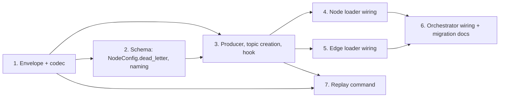

# Phase 5 / Slice 2: Dead-Letter Routing for Malformed Node and Relationship Records

## Slice Summary

This slice replaces `RejectionSink`'s fsync'd JSONL file with a Kafka DLQ
topic as the durable home for malformed node and relationship records —
records that fail decode/JSON/schema validation in `node_loader.py` and
`edge_loader.py` **before** relationship endpoint resolution is even
attempted. It does not touch missing-endpoint routing (Slice 3), the retry
consumer (Slice 4), or planned mode. Per `plan/v5-v6-orchestration.md`
(P5-Q2), a malformed record is **terminal**: it is published once to the DLQ
with its reason and is never auto-retried. A human fixes the cause (bad
producer, schema drift) and re-injects the record with the replay command
this slice ships (Story 7). Per P5-Q4, every DLQ topic is created with
`retention.ms=-1`/`retention.bytes=-1` — nothing here is ever auto-deleted.

**Planned mode is out of scope and unchanged.** `planned_writer.py` and
`edge_planner.py` keep failing the whole run on any invalid record
(`docs/USAGE.md` §12: "there is no rejection log for relationships in this
mode"). Per P5-Q3, DLQ opt-ins land only for classic and lease bulk modes,
starting with Slice 3's row-level mechanism — not this slice, and not
planned mode ever in Phase 5. No line of `planned_writer.py` or
`edge_planner.py` changes in this slice.

**Migration is opt-in, not forced.** `EdgeConfig.dead_letter` already exists
in `src/models/schema.py` but no loader reads it today — it is dead code.
This slice makes it live, and adds the mirror field to `NodeConfig`. A
schema that does not declare `dead_letter` on an entity (every schema today,
by construction) keeps writing that entity's malformed records to
`rejection_log_path` exactly as it does now — zero behavior change. A schema
that declares `dead_letter: {enabled: true}` on an entity — which, before
this slice, silently did nothing — now actually routes that entity's
malformed records to a DLQ topic instead of the file. Declaring the field is
itself the opt-in; no separate global flag is introduced.

## Story 1: Define the Dead-Letter Envelope and Its Wire Codec

**As a** Data Engineer,
**I want** a versioned, self-describing DLQ envelope format that carries
everything needed to reconstruct and replay a malformed record,
**So that** the DLQ topic is a durable, replayable record of failures
instead of a log line, and Slice 3/4 can reuse the same shape for
missing-endpoint rows without inventing a second format.

### Technical Context

- New module `src/loader/dead_letter.py`. Define a frozen `DeadLetterEnvelope`
  dataclass:

  ```python
  @dataclass(frozen=True)
  class DeadLetterEnvelope:
      schema_version: int          # 1
      failure_class: str           # "malformed" today; "missing_endpoint" /
                                    # "ambiguous_endpoint" reserved for Slice 3 —
                                    # define the literal set now so Slice 3 does
                                    # not invent new spellings
      entity_kind: str             # "node" | "edge"
      entity_name: str             # NodeConfig.label or EdgeConfig.type
      original_topic: str
      original_partition: int
      original_offset: int
      key_bytes: bytes | None      # raw Kafka message key, unmodified
      value_bytes: bytes | None    # raw Kafka message value, unmodified
      reason_code: str             # short, stable, e.g. "invalid_json",
                                    # "undeclared_property", "missing_required",
                                    # "type_mismatch", "decode_error"
      error_text: str              # the existing human-readable exception text
      loader_identity: LoaderIdentity   # run_id, replica_id, container/host name
      first_failure_at_ms: int     # wall-clock ms when first observed failed
      attempt_count: int           # initialized to 0; malformed records are
                                    # terminal (P5-Q2) so this never increments
                                    # here, but Slice 4's bookkeeping shape must
                                    # already match if it is ever extended
      dlq_routed_at_ms: int        # wall-clock ms of this publish attempt
  ```

  `LoaderIdentity` is a small frozen dataclass (`run_id: str, replica_id: str,
  kind: Literal["node", "edge"]`) reused by both loaders — no free-text
  container name, to keep this bounded the same way Phase 6's metric labels
  must be bounded.
- `encode_envelope(envelope) -> bytes` and `decode_envelope(payload: bytes) ->
  DeadLetterEnvelope`. Canonical JSON (`sort_keys=True`, no whitespace),
  matching the determinism precedent in `src/orchestrator/coordination.py`'s
  `encode_clock_lease`/`decode_clock_lease`. `key_bytes`/`value_bytes` are
  `None`-safe and base64-encoded in the wire form (they are not valid UTF-8
  in general — the existing `RejectionSink` never had this problem because it
  never carried a payload at all).
- `decode_envelope` raises a dedicated `DeadLetterEnvelopeError` (mirrors
  `ClockProtocolError`'s precedent) on: unknown `schema_version`, an
  unrecognized `failure_class`, a negative offset/partition, or a truncated
  base64 field. This is the format Story 7's replay command depends on to
  read the DLQ back deterministically.
- No Kafka code in this story — pure data model and codec, unit-testable in
  isolation exactly like `test_coordination.py` tests the lease codec before
  any producer exists.
- Tests in a new `tests/test_dead_letter.py`: round-trip encode/decode
  (including `None` key, non-UTF-8 value bytes, empty value); every
  validation branch of `decode_envelope`; canonical encoding is
  deterministic (same envelope encodes to the same bytes twice); the
  envelope is JSON (so any Kafka consumer, not just this library, can read
  it without a schema registry).

### Acceptance Criteria

- [ ] An envelope built from a raw non-UTF-8 Kafka value round-trips through
      `encode_envelope`/`decode_envelope` byte-for-byte.
- [ ] `decode_envelope` rejects every malformed field with
      `DeadLetterEnvelopeError`, never a raw `KeyError`/`TypeError`.
- [ ] `failure_class` is restricted to the three named literals; nothing else
      encodes or decodes.

### Definition of Done

- [ ] `tests/test_dead_letter.py` passes.
- [ ] Public types and errors are documented in `dead_letter.py`.
- [ ] Reviewed and merged.

### Dependencies

Depends on: none. Blocks: Stories 3, 4, 5, 7. **Estimate: 5 points.**

## Story 2: Extend the Schema — Node Dead-Letter Config and Topic Naming

**As a** Data Engineer,
**I want** an optional `dead_letter` block on node labels, mirroring
`EdgeConfig.dead_letter`, with a documented default DLQ topic name,
**So that** any node or relationship type can opt into DLQ routing the same
way, without a schema author having to name every topic by hand.

### Technical Context

- `src/models/schema.py`: add `dead_letter: Optional[DeadLetterConfig] =
  None` to `NodeConfig`, identical in shape and defaulting to
  `EdgeConfig.dead_letter`.
- Change `DeadLetterConfig.topic` from a required `str` to `topic:
  Optional[str] = None` (currently required — today's dead code never
  exercises the default-naming case, but this slice's default-naming
  requirement needs it optional). Keep the existing blank-string rejection
  as a `field_validator` when `topic` is not `None`.
- Add a pure helper (`src/models/schema.py` or a small
  `dead_letter_topic_name(entity_topic: str, dead_letter: DeadLetterConfig |
  None) -> str | None` in `dead_letter.py`): returns `None` when
  `dead_letter` is `None` or `enabled=False` (DLQ routing is off — file
  fallback); otherwise returns `dead_letter.topic or f"{entity_topic}.dlq"`.
- Extend the existing schema-wide topic-collision validation (today rejects
  "a topic shared by two labels or types, or with the coordination topic")
  to also compute every entity's *effective* DLQ topic name (via the helper
  above) and reject:
  - two entities resolving to the same DLQ topic (explicit or defaulted),
  - a DLQ topic colliding with any node/edge source topic or the
    coordination topic,
  - an explicit `dead_letter.topic` equal to its own entity's source topic.
  This runs at schema-load time (`load_schema`), so a naming collision fails
  before any container launches — consistent with every other schema
  validation error in `docs/USAGE.md` §3.
- Update `config/graph_schema.yaml` with a commented node-level `dead_letter`
  example and a comment on the default-naming rule next to the existing edge
  `dead_letter` blocks (which currently do nothing at runtime and are about
  to start doing something — call this out in the comment).
- Update `docs/USAGE.md` §3 (`nodes[]` fields table, validation bullet list)
  and §10 with the new field and the collision rule.
- Extend `tests/test_schema_validation.py`: node `dead_letter` accepts and
  validates like the edge one; `topic: None` defers naming; default-name
  collision between two entities is rejected; explicit-topic collision with
  a source topic is rejected; existing schemas without `dead_letter` on
  nodes remain valid (regression).

### Acceptance Criteria

- [ ] A node schema with no `dead_letter` block validates identically to
      today (regression).
- [ ] A node and an edge type whose default DLQ names would collide
      (identical source topic minus the `.dlq` suffix is impossible by
      construction today, but an explicit override colliding with another
      entity's default is caught) fail schema loading with a clear message.
- [ ] `dead_letter.enabled=False` and `dead_letter=None` are validated
      identically by every downstream consumer of the helper (same `None`
      return from `dead_letter_topic_name`).

### Definition of Done

- [ ] `tests/test_schema_validation.py` passes, including new cases.
- [ ] `config/graph_schema.yaml` and `docs/USAGE.md` reflect the new field
      and rule.
- [ ] Reviewed and merged.

### Dependencies

Depends on: Story 1 (`dead_letter_topic_name` lives beside the envelope
model). Blocks: Stories 3, 4, 5, 6. **Estimate: 5 points.**

## Story 3: Dead-Letter Producer, Topic Auto-Creation, and the Observability Hook

**As a** Pipeline Operator,
**I want** a fail-closed DLQ producer and idempotent topic auto-creation
with unlimited retention, plus a stable hook Phase 6 can later wire to a
counter,
**So that** a DLQ publish is exactly as durable as a Neo4j write commit
before an offset is allowed to advance, and Phase 6 doesn't have to touch
this code again.

### Technical Context

- New `DeadLetterProducer` in `dead_letter.py`, wrapping a caller-owned
  `confluent_kafka.Producer` (same ownership model as `NodeLoader`/
  `EdgeLoader`'s existing producers — constructed once in `main()`, closed in
  the `finally` block).
  ```python
  DEAD_LETTER_PRODUCER_CONFIG: dict[str, object] = {
      "acks": "all",
      "enable.idempotence": True,
      "max.in.flight.requests.per.connection": 5,
      "delivery.timeout.ms": 120_000,
  }

  class DeadLetterPublishError(RuntimeError): ...

  class DeadLetterProducer:
      def __init__(self, producer: Producer) -> None: ...
      def publish(self, topic: str, envelope: DeadLetterEnvelope) -> None:
          """Synchronously publish and block until Kafka acknowledges.

          Raises DeadLetterPublishError on any delivery failure or unflushed
          message, exactly mirroring node_loader.py's _publish_control:
          produce() with an on_delivery callback, then flush(), then check
          both the undelivered count and the callback's captured error.
          """
  ```
  The Kafka message key is `envelope.key_bytes` (preserves the *original*
  producer's key, e.g. the node key or the relationship's source key) so a
  DLQ topic with multiple partitions still groups a given entity's failures
  together for later inspection; the value is `encode_envelope(envelope)`.
- `ensure_dead_letter_topic(bootstrap_servers, topic, *, source_topic,
  admin_factory=None, timeout=30.0) -> None`: mirrors
  `_ensure_control_topic` (`src/cli.py`) and `create_chunk_topic`
  (`src/loader/edge_planner.py`) exactly — `list_topics` first, no-op if
  present, else `create_topics` with:
  ```python
  {"retention.ms": "-1", "retention.bytes": "-1", "cleanup.policy": "delete"}
  ```
  and `num_partitions` read from `source_topic`'s own partition count (via
  the same `list_topics` metadata lookup `EdgeLoader._static_topic_partitions`
  already does), `replication_factor=-1` (broker default, same as
  `_ensure_control_topic`). Tolerate a concurrent `TOPIC_ALREADY_EXISTS` from
  a racing sibling replica exactly like `_ensure_control_topic` does — this
  function runs once per CLI launch (Story 6), not once per replica, but the
  same race is possible if two runs against the same schema start together.
- Observability hook (Slice 5's "emit now, expose later" contract, folded per
  `plan/v5-v6-orchestration.md`): a tiny module-level, dependency-free
  callable seam —
  ```python
  DlqRoutedListener = Callable[[str, str, str, str], None]  # kind, name, topic, failure_class

  def on_dlq_routed(kind: str, name: str, topic: str, failure_class: str) -> None:
      """No-op by default; Phase 6 (P6-S2) replaces or wraps this to
      increment graph_loader_dlq_routed_total{kind,name}. Not a metrics
      exporter — no dependency, no port, no /metrics endpoint here."""
  ```
  `DeadLetterProducer.publish` calls this exactly once per successfully
  acknowledged publish, after the ack, never before (a hook fired before ack
  would claim a routing that might still fail). This is deliberately a
  module-level function pointer (like Python's `logging` handlers), not a
  class, so Story 4/5's call sites need no constructor change to pick it up,
  and P6-S2 can monkeypatch/replace it without touching loader code at all.
- Tests: producer publish success/failure (mocked `Producer`, matching the
  existing `_publish_control` test patterns in `test_node_loader.py`);
  `ensure_dead_letter_topic` no-ops when present, creates with the exact
  retention config when absent, tolerates a race; `on_dlq_routed` fires
  exactly once per successful publish and zero times on failure.

### Acceptance Criteria

- [ ] A DLQ publish that Kafka does not acknowledge (simulated delivery
      error, or a nonzero `flush()` undelivered count) raises
      `DeadLetterPublishError` and calls `on_dlq_routed` zero times.
- [ ] `ensure_dead_letter_topic` creates the topic with
      `retention.ms=-1`/`retention.bytes=-1` exactly, and is a no-op if the
      topic already exists — never overwrites an existing topic's config.
- [ ] Two concurrent callers racing to create the same DLQ topic both return
      successfully (no unhandled `TOPIC_ALREADY_EXISTS`).

### Definition of Done

- [ ] New tests pass; existing `_ensure_control_topic`/`create_chunk_topic`
      tests remain green (no shared-code regression).
- [ ] Reviewed and merged.

### Dependencies

Depends on: Story 1. Blocks: Stories 4, 5, 6. **Estimate: 8 points.**

## Story 4: Node Loader — Route Malformed Records to the DLQ

**As a** Data Engineer,
**I want** `NodeLoader` to publish a malformed record's full envelope to its
DLQ topic, with the record's Kafka offset committing only after that publish
is acknowledged,
**So that** a malformed node record is centrally visible and replayable
instead of stranded in a per-container file, with no change to the existing
offset-safety contract.

### Technical Context

- `node_loader.py`, `_buffer_message`: today, on
  `(UnicodeDecodeError, json.JSONDecodeError, NodeRecordValidationError,
  ValueError)`, it calls `self._rejection_sink.append(topic=..., partition=...,
  offset=..., node_label=..., reason=...)`, catches any sink exception as a
  fail-closed signal (offset stays uncommitted, message replays on restart),
  then on success does `ledger.resolved_offsets.add(offset)` and returns
  `self._commit_contiguous_resolutions()`. This exact shape is preserved —
  only what "the sink" is changes.
- Introduce a small `MalformedRecordSink` protocol both `RejectionSink` and a
  new `DeadLetterRecordSink` satisfy:
  ```python
  class MalformedRecordSink(Protocol):
      def route(self, *, topic: str, partition: int, offset: int,
                key: bytes | None, value: bytes | None, reason: str,
                reason_code: str, node_label: str | None = None,
                edge_type: str | None = None) -> None: ...
  ```
  `RejectionSink.route` keeps writing today's metadata-only JSONL line
  (ignoring `key`/`value`/`reason_code` — the on-disk format does not
  change, preserving compatibility for anyone still parsing it) —
  `RejectionSink.append` becomes a thin deprecated alias calling `route`
  with the metadata fields only, so any external caller of `.append` (tests,
  scripts) keeps working. `DeadLetterRecordSink.route` builds a
  `DeadLetterEnvelope` (Story 1) with `loader_identity` from the loader's
  `run_id`/`replica_id`, `first_failure_at_ms`/`dlq_routed_at_ms` from an
  injected wall clock, and calls `DeadLetterProducer.publish` (Story 3)
  against the entity's resolved DLQ topic (Story 2's
  `dead_letter_topic_name`).
- `NodeLoader.__init__` picks the sink once, at construction, from
  `node_config.dead_letter`: `DeadLetterRecordSink` when enabled, else the
  existing `RejectionSink`. No per-message branching — the loader's hot path
  doesn't re-check config on every record.
- `_buffer_message`'s call site changes to pass `key=message.key(),
  value=message.value(), reason_code=<derived from the exception type>` in
  addition to the existing fields. Add a small
  `_reason_code(exc: Exception) -> str` classifier (e.g.
  `UnicodeDecodeError`/`json.JSONDecodeError` → `"decode_error"`/
  `"invalid_json"`, `NodeRecordValidationError` text sniffed for "is not
  declared"/"is required" → `"undeclared_property"`/`"missing_required"`,
  else `"invalid_value"`) — stable, bounded strings, never the raw record.
- On successful DLQ route, call `on_dlq_routed("node", node_config.label,
  resolved_topic, "malformed")` — already done inside
  `DeadLetterProducer.publish` (Story 3), so no extra call here; this story
  only has to *use* the producer, not re-implement the hook.
- `main()`: replace the unconditional `RejectionSink(...)` construction with
  a small `build_malformed_record_sink(node_config, loading_config,
  bootstrap_servers) -> MalformedRecordSink` factory (new in
  `node_loader.py`, reused verbatim by `edge_loader.py` in Story 5) that
  constructs and owns a dedicated `Producer` for the `DeadLetterRecordSink`
  case, added to `main()`'s existing `finally`-block resource cleanup
  (flush, matching the existing control-topic producer's cleanup).
- Tests in `tests/test_node_loader.py` (extending the existing
  `test_malformed_only_record_commits_immediately_after_durable_rejection`,
  `test_rejection_sink_failure_leaves_offset_uncommitted` patterns):
  - a malformed record with `dead_letter` enabled publishes the exact raw
    key/value bytes in the envelope and commits its offset only after the
    mocked producer's delivery callback fires without error;
  - a DLQ publish failure (mocked delivery error or nonzero `flush()`
    undelivered count) leaves the offset uncommitted, exactly like today's
    rejection-sink-failure test;
  - a mixed batch — one malformed record DLQ'd immediately, two valid
    records buffered and later written to Neo4j in one transaction — commits
    the malformed record's offset independent of the batch's flush timing,
    and the final committed offset covers both once the batch flushes
    (regression of `_commit_contiguous_resolutions`'s existing gap-filling);
  - `dead_letter=None` (or `enabled=False`) uses `RejectionSink` unchanged —
    byte-identical JSONL output to today, proving zero silent behavior
    change;
  - a rebalance mid-DLQ-publish (revoke fires while `_settle_before_revoke`
    is draining a buffered malformed record) behaves exactly as today's
    revoke tests expect: the publish either completes and commits before
    the partition is released, or the loader fails closed
    (`_rebalance_failure=True`) — never commits without a proven ack;
  - a restart that redelivers an already-DLQ'd-but-uncommitted message
    produces a second envelope for the same `(topic, partition, offset)`
    with a new `dlq_routed_at_ms` — documented as at-least-once (matches
    P5-Q5's precedent for counters), not de-duplicated in this slice.

### Acceptance Criteria

- [ ] A malformed node record's Kafka offset never commits before its DLQ
      publish is acknowledged; a simulated broker/producer failure leaves it
      uncommitted and the record replays on restart.
- [ ] The DLQ envelope for a captured failure contains the exact original
      raw bytes (not a re-serialization) and a `reason_code` distinct from
      free-text `error_text`.
- [ ] `dead_letter` absent or `enabled=False` produces byte-identical JSONL
      rejection-file output to the pre-slice behavior.
- [ ] A rebalance while a malformed-record DLQ publish is in flight never
      commits an offset without a proven ack, and never leaves the loader
      claiming success while the publish is still outstanding.

### Definition of Done

- [ ] `tests/test_node_loader.py` passes, including new and regression
      cases.
- [ ] Reviewed and merged.

### Dependencies

Depends on: Stories 1, 2, 3. Blocks: Story 6. **Estimate: 8 points.**

## Story 5: Edge Loader — Route Malformed Relationship Records to the DLQ

**As a** Data Engineer,
**I want** `EdgeLoader` to apply the identical DLQ routing to malformed
relationship records, before any endpoint resolution is attempted,
**So that** node and relationship malformed-record handling are consistent,
and Slice 3's row-level (missing-endpoint) DLQ has a proven pattern and
producer to reuse.

### Technical Context

- `edge_loader.py`, `_buffer_message`: identical shape to Story 4's node
  change. The malformed branch today catches `(UnicodeDecodeError,
  json.JSONDecodeError, EdgeRecordValidationError, ValueError)` from decode or
  `normalize_edge_record` — this is strictly *before* any endpoint lookup, so
  it is unambiguously this slice's failure class, not Slice 3's. Swap
  `self._rejection_sink.append(...)` for the same `MalformedRecordSink.route`
  call with `edge_type=self._edge_config.type` in place of `node_label`, and
  `reason_code` derived the same way (reuse Story 4's `_reason_code`
  classifier — it is generic over the exception, add it to a shared location
  such as `dead_letter.py` rather than duplicating it in both loader
  modules).
- `EdgeLoader.__init__` mirrors `NodeLoader.__init__`: picks
  `DeadLetterRecordSink` or `RejectionSink` once, from
  `edge_config.dead_letter`, using the same `build_malformed_record_sink`
  factory from Story 4 (now shared between `node_loader.py` and
  `edge_loader.py` — move the factory to `dead_letter.py` so neither module
  imports from the other for it).
- This slice's malformed-record DLQ applies to `EdgeLoader` in **both** bulk
  and stream mode (classic/lane and bucket-lease execution alike) — it fires
  at message-buffer time, before `_execute_coordinated`/lease admission ever
  sees the record, so it is orthogonal to which relationship-execution mode
  is active. Slot-gated (lease) mode's `_buffer_message` branch is unchanged
  by this except for the same sink swap.
- Explicitly out of scope, and explicitly documented as unchanged: planned
  mode (`planned_writer.py`, `edge_planner.py`). Add a short note to
  `docs/USAGE.md` §12 (Limitations) directly under the existing "Planned mode
  fails closed on invalid records; there is no rejection log for
  relationships in this mode" bullet: *"Malformed-record DLQ routing
  (`dead_letter`) applies to the classic and bucket-lease relationship
  loaders in both bulk and stream mode; planned mode is unaffected and keeps
  failing the run on any invalid record."* No code in `planned_writer.py` or
  `edge_planner.py` changes.
- `main()` in `edge_loader.py`: same producer-construction and cleanup change
  as Story 4's `node_loader.py main()`, sharing `build_malformed_record_sink`.
- Tests in `tests/test_edge_loader.py`, mirroring Story 4's list exactly but
  for relationship records: envelope byte-fidelity, publish-failure leaves
  offset uncommitted, mixed batch (malformed DLQ'd immediately + valid rows
  later written), `dead_letter` absent/disabled is byte-identical to today,
  rebalance-mid-publish safety (reuse the existing
  `_settle_before_revoke`/`_on_revoke` test fixtures for edges), and the same
  at-least-once redelivery note. Add one test specific to edges: a malformed
  relationship record under **slot-gated** (lease) mode is DLQ'd at buffer
  time, never entering `SlotAwareAdmissionBuffer`, so it never consumes lease
  buffer capacity or blocks on a lease grant it will never need.

### Acceptance Criteria

- [ ] A malformed relationship record's Kafka offset never commits before
      its DLQ publish is acknowledged, in both classic and lease execution
      modes.
- [ ] A malformed relationship record never enters lease/slot admission —
      confirmed by a test asserting `SlotAwareAdmissionBuffer` size is
      unchanged after a malformed record is processed under slot gating.
- [ ] Planned mode's behavior (fail the run, no DLQ) is unchanged; no
      `planned_writer.py`/`edge_planner.py` diff is required by this story.
- [ ] `dead_letter` absent or `enabled=False` produces byte-identical JSONL
      output to the pre-slice behavior for relationship records.

### Definition of Done

- [ ] `tests/test_edge_loader.py` passes, including new and regression
      cases.
- [ ] `docs/USAGE.md` §12 carries the planned-mode disposition note.
- [ ] Reviewed and merged.

### Dependencies

Depends on: Stories 1, 2, 3, and reuses Story 4's shared factory/classifier.
Blocks: Story 6. **Estimate: 8 points.**

## Story 6: Orchestrator Wiring — Topic Provisioning and the Migration Path

**As a** Pipeline Operator,
**I want** every configured DLQ topic created, with the right retention,
before any loader container starts, and a documented, safe migration path
from the JSONL file,
**So that** a DLQ misconfiguration or an unreachable broker fails the run
before it half-starts, and I can move an existing deployment onto DLQ
routing deliberately and safely.

### Technical Context

- `src/cli.py`: add `_ensure_dead_letter_topics(schema, bootstrap_servers)`,
  called from `_handle_start` right beside the existing
  `_ensure_control_topic(bootstrap_servers)` call, before any container
  launches. It iterates every `NodeConfig`/`EdgeConfig` with `dead_letter`
  enabled, resolves the effective topic (Story 2's
  `dead_letter_topic_name`), and calls Story 3's `ensure_dead_letter_topic`
  for each, deduplicating by resolved topic name (two entities cannot share
  one per Story 2's validation, so this is a defensive assertion, not a
  real branch). Unlike `_ensure_control_topic`'s "log a warning and
  continue" pattern (the control topic is best-effort because loaders can
  tolerate its absence briefly), a DLQ topic-creation failure here is
  **fail-closed**: raise and abort `_handle_start` before launching any
  container. A run that cannot durably DLQ a malformed record must not
  start, matching bulk mode's existing "fail closed on setup" philosophy
  (`docs/USAGE.md` §6, DDL application).
- `src/orchestrator/docker_service.py`: no new volume or network plumbing is
  needed — the DLQ producer inside each container reuses the same
  `LOADER_KAFKA_BOOTSTRAP_SERVERS` env var the container's own consumer
  already uses, and the container already has the full schema YAML mounted
  at `/app/runtime_schema.yaml`, so it recomputes its own entity's DLQ topic
  name locally (Story 2's helper) rather than receiving it via env. The
  existing `REJECTION_LOG_PATH` env var and `host_rejection_dir` volume mount
  remain exactly as they are today — still required for the file-fallback
  path, and harmless (unused) when an entity's DLQ is enabled.
- Confirm (with a test against `docker_service.py`'s existing environment
  builder tests, if any, or a new one) that DLQ-enabled entities do **not**
  require the rejection-file volume to exist at all for their own operation —
  only for entities that are still file-mode, and for the process-wide mount
  itself which stays unconditional for simplicity (avoid a conditional mount
  path per replica).
- Migration documentation in `docs/USAGE.md` §10 (Operations): a new
  subsection, e.g. "Migrating a rejection-file entity to a DLQ topic":
  1. Add `dead_letter: {enabled: true}` (optionally with an explicit
     `topic:`) to the entity's schema block.
  2. Rerun `start`; the CLI creates the topic automatically with unlimited
     retention if it does not exist.
  3. **Explicitly document the limitation**: existing on-disk JSONL entries
     from before the migration are metadata-only (topic, partition, offset,
     reason — no raw payload, by the original `RejectionSink` design) and
     cannot be replayed through Story 7's replay command, which requires an
     envelope's `value_bytes`. An operator who needs to recover pre-migration
     rejections must re-source the original record from its source topic at
     the recorded offset while that offset is still retained there, or accept
     the old entries as informational-only. New failures after migration are
     fully replayable.
  4. Note that flipping `enabled: false` (or removing the block) later
     reverts that entity to the file sink with no other change — the switch
     is reversible in either direction.
- Tests: `_ensure_dead_letter_topics` creates every configured topic exactly
  once across a schema with mixed node/edge `dead_letter` entities; a
  simulated topic-creation failure aborts `_handle_start` before any
  container-launch call is made (mock the launcher and assert it is never
  invoked); a schema with no `dead_letter` anywhere makes zero admin calls.

### Acceptance Criteria

- [ ] `python -m src.cli start` with an unreachable Kafka admin connection
      and at least one `dead_letter`-enabled entity fails the run before any
      loader container is launched.
- [ ] Every configured DLQ topic exists, with `retention.ms=-1` and
      `retention.bytes=-1`, immediately after a successful `_handle_start`
      call, and before any container's first message.
- [ ] A schema with no `dead_letter` blocks launches identically to today —
      zero new admin-client calls.

### Definition of Done

- [ ] New CLI/orchestrator tests pass.
- [ ] `docs/USAGE.md` §10 documents the migration procedure and its
      JSONL-payload limitation.
- [ ] Reviewed and merged.

### Dependencies

Depends on: Stories 2, 3, 4, 5. Blocks: nothing further in this slice.
**Estimate: 5 points.**

## Story 7: Dead-Letter Replay Command

**As a** Data Engineer,
**I want** a CLI command that reads DLQ envelopes and republishes their
original bytes back onto the original topic, with filters and a safe
dry-run,
**So that** fixing the producer or the schema and replaying the backlog is a
single documented command, not a bespoke script per incident — the
"separate replay command" `plan/v5-v6-orchestration.md` (P5-Q2) requires
since malformed records are never auto-retried.

### Technical Context

- New subcommand, e.g. `python -m src.cli replay-dlq --config graph.yaml
  (--node-label LABEL | --edge-type TYPE) [--reason-code CODE]
  [--since ISO8601] [--until ISO8601] [--limit N] [--target-topic TOPIC]
  [--dry-run]`, implemented in a new `src/loader/dead_letter_replay.py`
  (mirrors the size/shape of existing single-purpose CLI-adjacent modules
  like `edge_planner.py`'s dispatcher client, not bolted directly into
  `cli.py`'s already-large `handle_start`).
- Resolution: `--node-label`/`--edge-type` selects the entity, whose
  `dead_letter` config (Story 2) gives the DLQ topic to read and whose own
  `topic` is the default republish destination (`--target-topic` overrides
  it — e.g. to replay into a staging topic first).
- Reader: a dedicated, non-group consumer — `assign()` to every partition of
  the DLQ topic at the low watermark (or a `--since` timestamp via
  `offsets_for_times`), reads up to each partition's high watermark captured
  once at start (the same "bulk boundary" pattern `docs/USAGE.md` §6 already
  uses, so a DLQ topic still receiving new failures during a replay run
  doesn't turn into an unbounded tail). **Never commits an offset on the DLQ
  topic** — replaying does not consume or mark the DLQ; the envelope stays in
  the (infinite-retention) DLQ topic afterward for audit, exactly as
  `plan/v5-v6-orchestration.md` requires ("Records are never dropped, and
  they can be replayed" — repeatably, not once).
- Filtering: decode every envelope (Story 1's `decode_envelope`) in the
  captured range and keep only those matching `--reason-code` (exact match
  on `reason_code`) and `--since`/`--until` (against `first_failure_at_ms`).
  `--limit` caps the number of *matching* records replayed (not messages
  scanned), for a bounded first attempt on a large backlog.
- Dry-run: matching envelopes are counted, logged (topic/partition/offset,
  `reason_code`, truncated `error_text` — never the raw payload in a dry-run
  log line, since it may be sensitive), and a summary is printed; **zero**
  producer `produce()` calls are made. This is the only way to safely
  preview a replay before committing to it.
- Live replay: for each matching envelope, produce
  `envelope.value_bytes` with key `envelope.key_bytes` onto the resolved
  target topic, using the same synchronous produce-then-flush-then-check
  pattern as `DeadLetterProducer.publish` (Story 3) — a replay that isn't
  acknowledged is not "done." **Fail closed on the batch**: if any record's
  republish is not acknowledged, stop immediately, report how many
  succeeded before the failure, and exit non-zero — never silently skip a
  record and claim overall success.
- Idempotency note (document in the module docstring and `docs/USAGE.md`):
  every write downstream is `MERGE`-based and idempotent, so replaying a
  record that was already fixed and independently re-published by the
  original producer is safe — no de-duplication bookkeeping is implemented
  or required in this version. Running the same replay command twice is
  also safe for the same reason (at-least-once, matching P5-Q5's existing
  precedent).
- Tests in a new `tests/test_dead_letter_replay.py`: filter combinations
  (reason code, time range, limit) select the exact expected subset from a
  fixture set of encoded envelopes; dry-run makes no producer calls under
  any filter; a live replay reproduces the original key/value bytes exactly
  on the target topic (mocked producer, assert `produce()` args); a
  simulated mid-batch publish failure stops replay, reports partial
  progress, and returns a non-zero exit code without attempting the
  remaining records.

### Acceptance Criteria

- [ ] `--dry-run` never calls `produce()`, under every filter combination
      exercised by the test suite.
- [ ] A live replay republishes the exact original `key_bytes`/`value_bytes`
      to the resolved target topic and only reports success once every
      replayed record is Kafka-acknowledged.
- [ ] A publish failure partway through a multi-record replay halts further
      replays, reports the exact count already replayed, and exits non-zero.
- [ ] The DLQ topic's own contents and any consumer-group offsets on it are
      unchanged by a replay run, dry-run or live.

### Definition of Done

- [ ] `tests/test_dead_letter_replay.py` passes.
- [ ] The command is documented in `docs/USAGE.md` (a new subsection near
      §10, cross-referenced from the migration procedure in Story 6).
- [ ] Reviewed and merged.

### Dependencies

Depends on: Story 1 (envelope codec) and Story 3 (the synchronous
publish-and-verify pattern it reuses). Independently mergeable after those
two; does not depend on Stories 4-6. **Estimate: 8 points.**

## Story Map



## Total Estimate

**47 points.** Stories 1-3 form the shared foundation (envelope, schema,
producer/topic/hook) and should land first and in that order. Stories 4 and
5 can run in parallel once Story 3 merges (they touch different loader
modules, sharing only the factory/classifier Story 4 places in
`dead_letter.py`). Story 7 can run in parallel with 4/5/6 — it only depends
on Stories 1 and 3. Story 6 is last, since it wires the orchestrator around
whatever Stories 4 and 5 actually construct. First Mate should begin with
Story 1.
