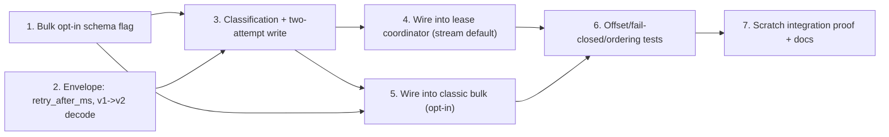

# Phase 5 / Slice 3: Row-Level DLQ for Missing-Endpoint Relationship Rows — Stories

Source: `plan/v5/slices.md` Slice 3, bound by `plan/v5-v6-orchestration.md` (P5-Q2:
this slice's envelopes must carry everything P5-S4's retry consumer needs —
`failure_class=missing_endpoint`/`ambiguous_endpoint`, `attempt_count`,
`first_failure_at`, `_retry_after`-compatible fields; P5-Q3: bulk DLQ opt-in
only for classic and lease bulk modes, planned mode stays fail-closed
unconditionally; P5-Q4: DLQ topics carry `retention.ms=-1`/`retention.bytes=-1`,
already provisioned by P5-S2; P5-Q5: at-least-once counters). Wave 4 of the
execution order (`plan/v5-v6-orchestration.md`): lands after P5-S1 (bucket
leases become streaming's default relationship-write mechanism) and reuses
P5-S2's `DeadLetterEnvelope`/`DeadLetterProducer`/topic-provisioning verbatim.
Blocks P5-S4 (nothing to retry without this DLQ).

## Decisions this Cartographer is making now (grounded in the merged code)

`plan/v5/slices.md`'s own Open Question 3 leaves the bulk opt-in mechanics,
and the epic only states the *goal* ("resolve each row's endpoints
independently... report precisely which rows did not") without a concrete
query shape. Both are resolved here, plus four implementation subtleties the
epic does not surface at all.

1. **The write query keeps today's single-statement fast path unconditionally,
   and only pays for row-level classification on the batches that actually
   need it.** `ApocLockedEdgeWriter._write_rows` (`edge_execution.py:218-234`)
   already does everything this slice needs for the *common* case: one
   `MATCH`+`MATCH`+lock+`MERGE` statement, `checked_rows`/`invalid_rows`/
   `merged_rows` all equal to `len(rows)` iff every row resolved. That query's
   `MATCH` (not `OPTIONAL MATCH`) is what keeps endpoint lookups **non-locking**
   index seeks — the existing module docstring for
   `build_apoc_locked_upsert_query` (line 84) already documents that
   `OPTIONAL MATCH`/`COLLECT` subqueries *inside an updating statement* plan as
   **locking** unique seeks in Neo4j 5. Building a single new query that
   both classifies every row (needs `OPTIONAL MATCH` to see "0 matches" for a
   missing endpoint, since plain `MATCH` on a batch of independent rows would
   drop the row from the result set entirely rather than reporting it as
   missing) *and* writes in the same statement risks silently promoting every
   endpoint lookup to a locking seek for every batch, including
   all-resolved batches — a real, measured regression on the ~18-25 µs/row
   cost `docs/USAGE.md` §9 already reports for the existing query. Story 3
   resolves this with **two queries, tried optimistically**, not one merged
   query:
   - **Attempt 1 — today's exact query, unmodified, zero new cost.** Run
     `self._query` (unchanged) exactly as `_write_rows` does today. If
     `checked_rows == len(rows) and invalid_rows == 0 and merged_rows ==
     len(rows)`, commit and return — this is the *only* code path exercised
     for an all-resolved batch, so a stream with no active edge-before-node
     race pays exactly what it pays today, to the microsecond.
   - **Attempt 2 — only on Attempt 1's failure.** Because
     `build_apoc_locked_upsert_query`'s `CALL (...) { WITH ... WHERE
     invalid_rows = 0 ... }` guard (line 118) means the merge sub-block never
     runs at all when any row is invalid (`merged_rows` is 0 in that case, not
     partially written), Attempt 1 failing means **nothing was written** —
     leaving the block without `transaction.commit()` rolls back, and nothing
     Attempt 1 touched needs undoing. In a **fresh transaction**, run a new,
     **read-only** classification query (no `MERGE`, no `SET`, no updating
     clause of any kind — see Story 3's exact Cypher) that returns
     `row_index, source_matches, target_matches` for every row. Because this
     statement has no updating clause, Neo4j does not promote its `OPTIONAL
     MATCH`es to locking seeks — the locking-seek risk in point 1 above is
     specific to *updating* statements, and this one is not. Classify each
     row in Python (matched / missing / ambiguous — see Story 3), apply the
     same-pair ordering guard (decision 4 below), then run **today's exact
     query again, unmodified**, parameterized with only the matched-and-not-
     blocked subset of rows, in the *same* transaction, and commit. Publish a
     DLQ envelope (Story 2) for every unresolved or blocked row only *after*
     that commit succeeds.
   - Net effect: an all-resolved batch costs exactly what it costs today. A
     batch with `k` unresolved rows out of `n` costs one wasted (rolled-back)
     Attempt 1, one read-only classification round trip over all `n` rows,
     and one write round trip over `n - k` rows — bounded, and paid only by
     the batches that actually contain the (by construction, transient and
     minority) edge-before-node race.
2. **Row-level DLQ is a *writer-construction-time* capability
   (`missing_endpoint_sink is not None`), not a per-call branch, and it is
   gated entirely by the caller (`edge_loader.py:main()`), not by
   `edge_execution.py` re-deriving "am I streaming, bulk, or the deprecated
   clock path" from environment state.** Direct inspection of
   `build_edge_execution` (`edge_execution.py:620-674`) shows the **same**
   lease branch (`leases is not None`, keyed only on the
   `GRAPH_LOADER_LEASE_ADDR`-family env var) serves **three** different
   callers today with no way to distinguish them from inside
   `edge_execution.py`: streaming's new lease-default (P5-S1), bulk's
   `--edge-leases` opt-in, and (after the rename in P5-S1 Story 1) nothing
   else — the deprecated `--stream-clock-rotation` streaming path never sets
   that env var at all, so it always falls to the *classic*
   (`ApocLockedEdgeWriter`, `explicit_locks` from
   `GRAPH_LOADER_EDGE_EXPLICIT_LOCKS`) branch, indistinguishable from
   ordinary bulk **inside `edge_execution.py`** by any signal available
   there today. Rather than teach `edge_execution.py` to sniff CLI flags it
   has never needed to know about, `build_edge_execution` gains one new
   **required, keyword-only** parameter, `mode: str` (`"bulk"` or
   `"stream"` — the caller's own `args.mode`, always already known at the
   one production call site, `edge_loader.py:1559`), and the gating logic
   lives entirely in `build_edge_execution` using `mode` plus the existing
   `leases is not None` signal plus the new schema flag (Story 1):
   | Branch reached | `mode` | Row-level DLQ active when |
   | --- | --- | --- |
   | Lease (`leases is not None`) | `"stream"` | `dead_letter` resolves a DLQ topic (unconditional default — the epic's own "streaming by default when `dead_letter` is configured") |
   | Lease (`leases is not None`) | `"bulk"` | `dead_letter` resolves a topic **and** `dead_letter.route_missing_endpoints_in_bulk` is `True` (the lease-bulk opt-in) |
   | Classic (`leases is None`, `execution.mode != "native_disjoint"`) | `"bulk"` | same opt-in flag (the classic-bulk opt-in) |
   | Classic | `"stream"` | **never** — this is exactly the deprecated `--stream-clock-rotation` path (the only way streaming reaches the classic branch after P5-S1 Story 6), which that slice promises reproduces "today's exact behavior byte-for-byte"; row-level DLQ is new behavior this slice must not silently graft onto a path scheduled for removal. Documented as an explicit non-goal, not an oversight. |
   | `native_disjoint` (any `mode`) | — | **never** — `NativeDisjointEdgeWriter` already has its own `ON ERROR CONTINUE REPORT STATUS`-based per-transaction status reporting (a structurally different mechanism); extending row-level DLQ to it is out of scope for this slice, flagged as a follow-up. |
   Planned mode never calls `build_edge_execution` at all (`planned_writer.py`
   constructs its own `ApocLockedEdgeWriter(..., explicit_locks=False,
   sort_rows=False)` directly) — this slice adds no parameter, no import, no
   line to `planned_writer.py`/`edge_planner.py`, so P5-Q3's "planned mode
   stays fail-closed" holds by the same "zero lines touched" proof P5-S2's
   completion doc already used for the identical claim.
3. **The DLQ envelope's `value_bytes`/`key_bytes` for a missing/ambiguous
   row is the *normalized* record, not the original raw Kafka bytes — a
   deliberate, documented deviation from P5-S2's malformed-record envelope,
   not an inconsistency.** P5-S2's malformed envelopes carry the original
   raw bytes because that is the *only* thing available at the point of
   failure (`edge_loader.py:_buffer_message`, line 1104-1108: decode/JSON
   errors happen *before* `normalize_edge_record` ever produces an
   `EdgeRecord`). This slice's failures happen strictly *after* normalization
   succeeds — the record already passed every structural/type check; only
   its endpoints didn't resolve *yet*. Threading the original raw bytes this
   far would require adding a `raw_value: bytes`/`raw_key: bytes | None`
   field to `PendingEdgeRecord` (`edge_loader.py:56-64`) **and**
   `RoutedEdgeRecord` (`mix_and_batch.py:33-55`) and populating it at every
   construction site, permanently growing the in-flight memory footprint of
   *every* batched record (buffered for up to `flush_interval_ms`) for a
   byte string only the rare DLQ path would ever read. Instead, Story 2's new
   `DeadLetterRecordSink.route_unresolved_endpoint` serializes the
   already-validated `EdgeRecord` itself
   (`{"source_key":..., "target_key":..., "properties": {...}}`, canonical
   JSON) as `value_bytes`, and `[source_key, target_key]` as `key_bytes` —
   strictly *more* directly useful to P5-S4's retry consumer (which needs
   exactly this shape to retry the write, not the original wire format) and
   zero new fields on the hot-path batching dataclasses. `PendingEdgeRecord`
   and `RoutedEdgeRecord` are **not modified** by this slice.
4. **Same-pair ordering: a later, resolved row for a pair whose earlier row
   (same batch) is unresolved is parked too, not written — scoped to one
   flush, with the cross-flush residual gap documented, not silently
   accepted.** Today, a batch either commits every row or none — so two
   rows of the same `(source_key, target_key)` pair in one committing batch
   already apply in list order via `UNWIND`'s guaranteed order (`MERGE ...
   SET r += row.properties` — the later list entry's properties win,
   matching arrival order). Partial-batch commit is what introduces the new
   risk this slice must not create: if row `R1` (earlier Kafka offset, same
   pair) is unresolved and row `R2` (later offset) resolves in the *same*
   batch, writing `R2` now and later replaying `R1` (once its endpoint
   arrives, via P5-S4) would overwrite `R2`'s newer properties with `R1`'s
   older ones — a genuine last-write-wins violation this slice would
   introduce if it only classified rows by their own endpoints. Story 3's
   Python-side classification therefore adds one more pass after endpoint
   classification: group row indices by `(source_key, target_key)` in
   original (offset) order; for any pair with at least one non-matched
   (missing/ambiguous) row, every row *after* that row's position in the
   pair's own sequence is also parked — even if that later row's own
   endpoints resolve — with a distinct `reason_code`
   (`"blocked_by_earlier_unresolved_row"`) so it is visibly different from a
   genuine endpoint failure in logs/DLQ inspection. **This guarantee is
   scoped to rows landing in the same flush.** A pair whose rows straddle two
   different flushes (an earlier flush already committed/parked its rows
   before the later flush's row for the same pair is even read) is not
   covered — closing that gap would need a persistent, run-lifetime,
   per-pair "held back" registry surviving across flushes and process
   restarts, which is materially more state than this slice's DLQ envelope
   mechanism already carries and duplicates work P5-S4's retry consumer is
   better positioned to do (it already re-reads and re-attempts rows in
   whatever order the DLQ topic delivers them). Documented in
   `docs/USAGE.md` as an accepted, bounded limitation (recommend keeping
   `flush_interval_ms`/outer batch sizes reasonable relative to expected
   node/edge arrival skew), and flagged as an explicit open item for P5-S4 to
   pick up if the owner ever wants the stronger, cross-flush guarantee.
5. **No new offset-ledger mechanism is needed — "commit only after every row
   is durably written or durably DLQ'd" already falls out of the existing
   `WorkerResult`/`PartitionLedger` contract for free, because the whole
   row-level split happens *inside* one writer call.** `_resolve_worker_result`
   (`edge_loader.py:540-572`) already does exactly one thing on a `"SUCCESS"`
   `WorkerResult`: mark **every** record in that `WorkerBatch` resolved
   (`self._partition_ledgers[...].resolved_offsets.add(pending.offset)` for
   every `pending in batch.records`, unconditionally). It has no concept of,
   and needs no concept of, *why* a record is resolved. This slice's new
   `ApocLockedEdgeWriter.write_provenanced_batch` (Story 3) either (a)
   returns normally — meaning every row in the batch is now durably
   accounted for, some via a committed Neo4j write, some via an acknowledged
   DLQ publish — and the existing `_worker_loop`
   (`edge_loader.py:464-506`)/`_resolve_worker_result` path reports
   `"SUCCESS"` and resolves every offset exactly as it does today, or (b)
   raises — meaning *nothing* in the batch is durably accounted for (a
   Neo4j write failure, or a DLQ publish failure per point 6 below, or the
   rare Attempt-2 TOCTOU race per Story 3) — and the existing path reports
   `"WRITE_FAILURE"`, resolving **no** offsets, so the *entire original
   batch* (including rows that already durably committed to Neo4j earlier in
   the same `write_provenanced_batch` call) replays from Kafka on retry —
   safe because every Neo4j write in this path is idempotent `MERGE`.
   **Zero changes to `WorkerResult`, `PartitionLedger`, `_resolve_worker_result`,
   `_on_revoke`, or any offset-commit code in `edge_loader.py`.** This is the
   single biggest scope-reduction in this slice's design: the 1655-line
   `edge_loader.py` gains only a `mode=` argument at its one
   `build_edge_execution` call site and a new missing-endpoint sink
   construction beside its existing malformed-sink construction (Story 5) —
   its worker-loop/ledger/rebalance machinery is read, not edited.
6. **A DLQ publish failure for an unresolved row fails the *whole* batch
   closed — it is not a partial, best-effort routing.**
   `write_provenanced_batch` (Story 3) publishes every unresolved/blocked
   row's envelope only *after* the matched-subset transaction has already
   committed (mirroring `DeadLetterProducer.publish`'s own "ack the write,
   then fire the hook" ordering); if **any** of those publishes raises
   `DeadLetterPublishError`, `write_provenanced_batch` re-raises it uncaught.
   Per decision 5, this resolves **zero** offsets for the batch — including
   the rows already committed to Neo4j moments earlier in the same call —
   and the entire batch (matched rows and all) replays on the next attempt.
   This is deliberately conservative (P5-Q2's "commit only once every record
   is durably written or durably in the DLQ" reading taken literally: *every*
   record, not *most*) and safe only because the Neo4j side is idempotent
   `MERGE` — re-writing an already-written row on replay changes nothing.
7. **A lease-loss/lease-server-restart abort (P5-S1 Story 4's
   `lease_liveness_check`) during Attempt 1 or Attempt 2 is not a DLQ
   condition and must not be misclassified as one.** P5-S1's
   `lease_liveness_check` raises before `transaction.commit()`, inside
   `ApocLockedEdgeWriter._write_rows` — a code path this slice calls
   unchanged from `write_provenanced_batch`'s Attempt 1 and reuses unchanged
   for Attempt 2's matched-subset write. That exception type
   (`LeaseCoordinatorError`, not `self._error_factory`'s
   `MissingRelationshipEndpointError`) must propagate straight out of
   `write_provenanced_batch` exactly as it does out of today's
   `write_rows` — Story 3's Attempt-1-then-Attempt-2 dispatch only catches
   the specific "aggregate check failed" signal (a `strict=False` return
   value, not an exception — see Story 3), so a `TransientError` or a lease
   abort already propagate through both attempts unmodified, with no new
   `except` clause anywhere in this slice that could accidentally widen to
   catch them.

## Story 1: Schema — Per-Entity Bulk Opt-In for Row-Level Missing-Endpoint DLQ

**As a** Data Engineer,
**I want** an explicit, per-relationship-type schema flag that turns on
row-level missing-endpoint DLQ routing for classic and lease **bulk** runs,
off by default,
**so that** P5-Q3's "bulk keeps its fail-closed default unless an explicit
opt-in enables DLQ routing there too" has one unambiguous, schema-driven
control, consistent with how `dead_letter.enabled` itself is already the
opt-in for DLQ routing at all (not a CLI flag, which would apply uniformly
to every relationship type in the run regardless of that type's own
tolerance for a missing endpoint).

### Technical Context

- `src/models/schema.py`'s `DeadLetterConfig` (line 92-115) gains one new
  field:
  ```python
  class DeadLetterConfig(BaseModel):
      model_config = ConfigDict(extra="forbid")
      topic: Optional[str] = None
      enabled: bool = True
      route_missing_endpoints_in_bulk: bool = False
      """Bulk-only opt-in (P5-Q3). Streaming always routes a missing/ambiguous
      endpoint to this entity's DLQ when `enabled=True`; classic and lease
      *bulk* keep today's fail-closed MissingRelationshipEndpointError unless
      this is explicitly set. Planned mode (`--edge-plan`) never reads this
      field -- it stays fail-closed unconditionally, per P5-Q3."""

      @field_validator("route_missing_endpoints_in_bulk", mode="before")
      @classmethod
      def _reject_bool_typo(cls, value: object) -> object:
          # Mirrors every other boolean-toggle validator in this module
          # (e.g. CoordinationConfig's integer_fields_are_not_bool): defends
          # against a YAML string "true"/"false" landing here as a str,
          # which pydantic would otherwise silently coerce.
          if isinstance(value, str):
              raise ValueError("route_missing_endpoints_in_bulk must be a boolean")
          return value

      @model_validator(mode="after")
      def _bulk_opt_in_requires_enabled(self) -> "DeadLetterConfig":
          if self.route_missing_endpoints_in_bulk and not self.enabled:
              raise ValueError(
                  "route_missing_endpoints_in_bulk=True requires enabled=True "
                  "(there is no DLQ topic to route to otherwise)"
              )
          return self
  ```
  This field applies only to `EdgeConfig.dead_letter` (relationship types);
  `NodeConfig.dead_letter` has no equivalent, since missing-endpoint
  resolution is a relationship-only concept — no schema change to
  `NodeConfig` or its validation.
- **No CLI flag.** A run-wide `--edge-plan`-style flag would apply the same
  opt-in to every relationship type regardless of that type's own tolerance
  for a stray missing endpoint (e.g. a type whose source label is populated
  by a slow, separate bulk phase might *want* fail-closed even with the
  opt-in on for a different, always-co-populated type) — schema-level,
  per-type control is strictly more expressive and consistent with
  `dead_letter.enabled` already being per-type. `config/graph_schema.yaml`'s
  existing `dead_letter` blocks (currently `enabled: false`, per P5-S2's
  Deviation 3) get one commented-out example line showing the new field,
  matching that file's existing "present but not turned on" documentation
  style.
- `docs/USAGE.md` §3 "Dead-lettering malformed records" (line 216-239) gets
  one new paragraph and YAML example line for
  `route_missing_endpoints_in_bulk` (Story 7 owns the actual edit, to keep
  this story's diff schema-only).

### Acceptance Criteria

- [ ] A schema with no `dead_letter` block, or `dead_letter.enabled: false`,
      loads with `route_missing_endpoints_in_bulk` absent/irrelevant — no
      behavior change, matching every other DLQ field's "absent means
      today's behavior" contract.
- [ ] `dead_letter: {enabled: true, route_missing_endpoints_in_bulk: true}`
      loads cleanly; `dead_letter: {enabled: false,
      route_missing_endpoints_in_bulk: true}` fails schema loading with the
      exact validator message above, at load time, before any container
      launches.
- [ ] `route_missing_endpoints_in_bulk: "true"` (a YAML string, a plausible
      operator typo) fails schema loading rather than silently coercing.
- [ ] `extra="forbid"` on `DeadLetterConfig` still rejects an unrelated typo
      (e.g. `route_missing_endpoint_in_bulk`, singular) — this story adds
      one field, it does not relax the existing typo guard.

### Definition of Done

- [ ] `tests/test_schema_validation.py` extended: default `False`, explicit
      `True`, the `enabled=False` + opt-in `True` rejection, the string-typo
      rejection, and the existing collision/`extra="forbid"` tests
      unaffected.
- [ ] `config/graph_schema.yaml` documents the new field.
- [ ] Reviewed and merged.

### Dependencies

Depends on: none new from this phase (P5-S2's `DeadLetterConfig` is already
merged). Blocks: Stories 3-5 (all read this field). **File-overlap risk:**
`src/models/schema.py` — touched only by this story in this slice, exactly
mirroring P5-S1 Story 1's and P5-S2 Story 2's precedent of landing the
schema change first with zero rebase risk for later stories. **Estimate: 3
points.**

## Story 2: Extend the DLQ Envelope for Missing/Ambiguous-Endpoint Rows

**As a** Pipeline Operator,
**I want** a DLQ'd missing-endpoint or ambiguous-endpoint relationship row's
envelope to carry a computed `retry_after_ms` alongside the fields P5-S2
already ships (`failure_class`, `attempt_count`, `first_failure_at_ms`),
**so that** P5-S4's retry consumer (this phase's very next slice) can honor
each record's earliest retry time immediately, from the first envelope this
slice ever publishes, without a schema migration of its own — exactly
P5-Q2's requirement, satisfied one slice ahead of the code that reads it.

### Technical Context

- **`src/loader/dead_letter.py`'s envelope gains one field, and
  `SCHEMA_VERSION` bumps 1 → 2 with an explicit backward-compatible decode
  path** — this is the one piece of real migration risk in this slice,
  spelled out because P5-S2 already shipped and its envelopes (schema
  version 1, no `retry_after_ms`) may already sit in production DLQ topics:
  ```python
  SCHEMA_VERSION = 2  # was 1 (P5-S2); see _decode_v1 below for the migration path.

  _ENVELOPE_FIELDS_V2 = _ENVELOPE_FIELDS + ("retry_after_ms",)
  # _ENVELOPE_FIELDS (v1's shape) is unchanged and kept exactly as-is, since
  # it is also the set _validated_envelope's *encoder* path continues to
  # validate against for every OTHER field -- only the wire-level field-set
  # check and the schema_version literal branch on decode.
  ```
  `encode_envelope` always writes `schema_version=2` and
  `retry_after_ms` (required, an `int`, for every new envelope this module
  ever produces from this slice forward — including a **re-encode** of
  `failure_class="malformed"` envelopes, which set `retry_after_ms=None` and
  document why: P5-Q2's "not auto-retried" decision for malformed records
  means there is nothing to compute a retry time *for*, but the field must
  still be present in a v2 envelope's wire form for `decode_envelope`'s
  strict field-set check to accept it uniformly).
  `decode_envelope` dispatches on the wire payload's own `schema_version`
  **before** calling `_validated_envelope`:
  ```python
  def decode_envelope(payload: bytes) -> DeadLetterEnvelope:
      ...  # unchanged: bytes/JSON/duplicate-key checks
      version = data.get("schema_version")
      if version == 1:
          if set(data) != set(_ENVELOPE_FIELDS):  # v1's field set, unchanged
              raise DeadLetterEnvelopeError("envelope payload has a missing or unexpected field")
          return _validated_envelope(..., retry_after_ms=None, schema_version=1)
      if set(data) != set(_ENVELOPE_FIELDS_V2):
          raise DeadLetterEnvelopeError("envelope payload has a missing or unexpected field")
      return _validated_envelope(..., retry_after_ms=data["retry_after_ms"], schema_version=version)
  ```
  `_validated_envelope`/`DeadLetterEnvelope` gain `retry_after_ms: int | None`
  with validation: `None` is only valid when `failure_class == "malformed"`;
  for `"missing_endpoint"`/`"ambiguous_endpoint"` it must be a nonnegative
  int `>= first_failure_at_ms`. `SCHEMA_VERSION` itself becomes a *range*
  concept (`1` and `2` both decodable, only `2` encodable) rather than a
  single equality check — document this explicitly in the module docstring
  as the first schema-version migration this module has ever needed, so a
  *third* future version follows the same "old versions still decode, only
  the newest encodes" pattern rather than inventing a new one.
  `tests/test_dead_letter.py` gets a byte-for-byte fixture: a schema-version-1
  envelope encoded by *pinning* `SCHEMA_VERSION=1` temporarily in a test
  double (or a captured literal JSON blob from P5-S2's own test fixtures,
  whichever the implementer confirms is more stable against future
  refactors) must still `decode_envelope` successfully after this story
  lands.
- **New sink method**, additive on the existing `DeadLetterRecordSink`
  (`dead_letter.py:653-724`) — not a new class, since it reuses the exact
  same constructor-bound `_producer`/`_topic`/`_run_id`/`_replica_id`
  identity P5-S2 already built per loader:
  ```python
  def route_unresolved_endpoint(
      self, *, topic: str, partition: int, offset: int,
      record: "EdgeRecord", edge_type: str, failure_class: str,
      reason_code: str, error_text: str, retry_after_seconds: float,
  ) -> None:
      """Publish a DeadLetterEnvelope for one relationship row whose
      endpoint(s) did not resolve within one write attempt.

      failure_class is "missing_endpoint" or "ambiguous_endpoint" (never
      "malformed" -- routed through DeadLetterRecordSink.route instead).
      attempt_count starts at 0: P5-S4's retry consumer re-publishes with
      an incremented attempt_count and a recomputed retry_after_ms on each
      further failure, this method only ever produces the *first* attempt's
      envelope. value_bytes/key_bytes carry the normalized record (Decisions
      point 3), not the original wire bytes.
      """
      _require(self._kind == "edge", "route_unresolved_endpoint is edge-only")
      _require(
          failure_class in ("missing_endpoint", "ambiguous_endpoint"),
          f"failure_class must be missing_endpoint or ambiguous_endpoint, got {failure_class!r}",
      )
      now = self._clock()
      value = json.dumps(
          {"source_key": record.source_key, "target_key": record.target_key,
           "properties": record.properties},
          sort_keys=True, separators=(",", ":"), default=str,
      ).encode("utf-8")
      key = json.dumps(
          [record.source_key, record.target_key], separators=(",", ":"), default=str,
      ).encode("utf-8")
      envelope = DeadLetterEnvelope(
          schema_version=SCHEMA_VERSION, failure_class=failure_class,
          entity_kind="edge", entity_name=edge_type,
          original_topic=topic, original_partition=partition, original_offset=offset,
          key_bytes=key, value_bytes=value,
          reason_code=reason_code, error_text=error_text,
          loader_identity=LoaderIdentity(run_id=self._run_id, replica_id=self._replica_id, kind="edge"),
          first_failure_at_ms=now, attempt_count=0,
          dlq_routed_at_ms=now, retry_after_ms=now + int(retry_after_seconds * 1000),
      )
      self._producer.publish(self._topic, envelope)
  ```
  `retry_after_seconds` is supplied by the caller (Story 3) as
  `edge_config.retry.base_delay_seconds` (`RetryConfig`, `schema.py:242-264`
  — already exists, already validated `> 0`), reusing the *same* retry
  backoff configuration surface an edge type already declares for Neo4j
  `TransientError` retries, rather than inventing a second, DLQ-specific
  backoff config block this early — P5-S4 owns deciding whether it needs its
  own multiplier/max-delay config distinct from `RetryConfig` once it
  actually implements the backoff loop; this slice only needs *one* initial
  delay to populate the very first `retry_after_ms`.
- `_reason_code`-equivalent classification for this failure family (distinct
  from the existing `_reason_code(exc)` used for malformed records, since
  these are never `ValueError`s, always a Python-side classification of
  `source_matches`/`target_matches` counts — see Story 3): stable literal
  strings `"missing_source"`, `"missing_target"`, `"missing_both"`,
  `"ambiguous_source"`, `"ambiguous_target"`, `"ambiguous_both"`, computed by
  Story 3, passed straight through as `reason_code` — no new function needed
  in `dead_letter.py` for this; Story 3's classification step already knows
  the answer.

### Acceptance Criteria

- [ ] `encode_envelope`/`decode_envelope` round-trip a
      `failure_class="missing_endpoint"` envelope with a populated
      `retry_after_ms`.
- [ ] A hand-built schema-version-1 JSON payload (no `retry_after_ms` key)
      still decodes successfully; a schema-version-1 payload that *does*
      include a stray `retry_after_ms` key is rejected (proves the v1 field
      set stayed exactly what P5-S2 shipped, not silently widened).
- [ ] `retry_after_ms=None` with `failure_class` other than `"malformed"`
      fails validation; `retry_after_ms` set with `failure_class="malformed"`
      fails validation (the two are mutually exclusive by construction).
- [ ] `route_unresolved_endpoint` called with `failure_class="malformed"`
      raises before any Kafka call.
- [ ] `route_unresolved_endpoint`'s published envelope's `value_bytes`,
      decoded, round-trips the exact `source_key`/`target_key`/`properties`
      of the `EdgeRecord` passed in — proven with a property containing a
      float, a `None`, and a nested dict (the existing `default=str`
      fallback's edge cases).

### Definition of Done

- [ ] `tests/test_dead_letter.py` extended with the v1/v2 migration,
      `retry_after_ms` validation, and `route_unresolved_endpoint` tests
      above.
- [ ] Module docstring's "versioned, self-describing" claim (line 8-9)
      updated to describe the two-version decode contract.
- [ ] Reviewed and merged.

### Dependencies

Depends on: none new (P5-S2's envelope/producer are already merged). Blocks:
Story 3 (calls `route_unresolved_endpoint`). **File-overlap risk:**
`src/loader/dead_letter.py` only, additive (`SCHEMA_VERSION` bump plus one
new method) — no existing method signature changes, so every P5-S2 test and
call site is unaffected except where this story's own new tests exercise the
new path. **Estimate: 5 points.**

## Story 3: Row-Level Endpoint Classification and the Two-Attempt Write Path

**As a** Data Engineer,
**I want** the relationship writer to resolve every row's endpoints
independently, write every row that resolved exactly one source and target
in the same transaction as before, and hand back precisely which rows did
not (and why), while costing nothing extra when every row resolves,
**so that** one out-of-order record never blocks or fails an entire batch of
otherwise-good relationships, without regressing the measured ~18-25 µs/row
cost of the existing fast path for the common case.

### Technical Context

- **New classification query** (`edge_execution.py`, sibling to the existing
  `_preflight_query` used by `NativeDisjointEdgeWriter` — same `WITH`-chain
  shape, but returning per-row detail instead of an aggregate):
  ```python
  def _endpoint_classification_query(edge_config: EdgeConfig) -> str:
      """Read-only (no updating clause -> OPTIONAL MATCH stays non-locking):
      one row per input row with its source/target match counts."""
      return (
          "UNWIND range(0, size($rows) - 1) AS row_index\n"
          "WITH row_index, $rows[row_index] AS row\n"
          f"OPTIONAL MATCH (s:`{edge_config.nodes.source}` "
          f"{{`{edge_config.source_key_property}`: row.source_key}})\n"
          "WITH row_index, row, count(s) AS source_matches\n"
          f"OPTIONAL MATCH (t:`{edge_config.nodes.target}` "
          f"{{`{edge_config.target_key_property}`: row.target_key}})\n"
          "RETURN row_index, source_matches, count(t) AS target_matches"
      )
  ```
  This is deliberately *not* a new writer/lock query: it is read-only, and
  the actual write of the matched subset reuses `self._query`
  (`build_apoc_locked_upsert_query`, unmodified) called a second time with a
  filtered `$rows` list. No new Cypher write path exists in this slice.
- **`ApocLockedEdgeWriter.__init__` gains one new optional parameter**,
  defaulting to `None` (today's behavior, byte-for-byte, for every existing
  caller and test):
  ```python
  def __init__(self, driver, edge_config, *, missing_endpoint_error_factory,
               sleep=time.sleep, explicit_locks=None, sort_rows=True,
               missing_endpoint_sink: "MissingEndpointSink | None" = None) -> None:
      ...
      self._missing_endpoint_sink = missing_endpoint_sink
      self._classification_query = (
          _endpoint_classification_query(edge_config) if missing_endpoint_sink is not None else None
      )
      self._retry_after_seconds = edge_config.retry.base_delay_seconds
  ```
  `MissingEndpointSink` is a local `Protocol` in `edge_execution.py` (not an
  import of `dead_letter.py` — preserves the existing one-directional
  `dead_letter.py -> schema.py` layering; `edge_loader.py` is the module that
  already imports both and satisfies this duck-typed protocol with a real
  `DeadLetterRecordSink`):
  ```python
  class MissingEndpointSink(Protocol):
      def route_unresolved_endpoint(
          self, *, topic: str, partition: int, offset: int, record: "EdgeRecord",
          edge_type: str, failure_class: str, reason_code: str, error_text: str,
          retry_after_seconds: float,
      ) -> None: ...
  ```
- **`_write_rows` gains a `strict: bool = True` parameter** — the *only*
  change to the existing method, preserving every current call site
  (`write_rows`'s retry loop) unmodified:
  ```python
  def _write_rows(self, rows, metadata=None, *, strict: bool = True) -> bool:
      """Returns True iff the aggregate check passed and the transaction
      committed. strict=True (unchanged default) raises via
      self._error_factory on a failed aggregate check, exactly as today.
      strict=False returns False instead of raising, letting the caller
      (write_provenanced_batch) fall through to row-level classification --
      used only by that new method, never by write_rows."""
      with open_session(self._driver) as session:
          begin = session.begin_transaction(metadata=metadata) if metadata else session.begin_transaction()
          with begin as transaction:
              result = transaction.run(self._query, rows=rows)
              counts = list(result); result.consume()
              ok = (
                  len(counts) == 1 and counts[0]["checked_rows"] == len(rows)
                  and counts[0]["invalid_rows"] == 0 and counts[0]["merged_rows"] == len(rows)
              )
              if not ok:
                  if strict:
                      raise self._error_factory(f"Edge '{self._edge_type}' did not resolve exactly one source and target endpoint")
                  return False  # leaving the block without commit rolls back; nothing written
              transaction.commit()
              return True
  ```
- **New public method**, called by both coordinators (Stories 4-5) *instead
  of* `write_batch` whenever `missing_endpoint_sink is not None` (checked via
  a new `row_level_dlq_enabled` property both coordinators read):
  ```python
  @property
  def row_level_dlq_enabled(self) -> bool:
      return self._missing_endpoint_sink is not None

  def write_provenanced_batch(self, items: Sequence) -> None:
      """items: PendingEdgeRecord or RoutedEdgeRecord -- anything exposing
      .record/.topic/.partition/.offset. Every item is durably written to
      Neo4j or durably DLQ'd before this returns normally; raises (nothing
      durable) on any other failure, including a DLQ publish failure for
      even one row (Decisions point 6)."""
      if not items:
          return
      assert self._missing_endpoint_sink is not None
      rows = [self._as_row(item.record) for item in items]
      for attempt in range(1, self._max_attempts + 1):
          try:
              if self._write_rows(rows, strict=False):
                  return  # fast path: every row resolved, identical cost to today
              break  # aggregate check failed -- fall through to classification below
          except TransientError as exc:
              if not exc.is_retryable() or attempt >= self._max_attempts:
                  raise
              delay = min(self._base_delay * 2 ** (attempt - 1), self._max_delay)
              self._sleep(delay)
      self._write_with_row_level_dlq(items, rows)

  @staticmethod
  def _as_row(record: "EdgeRecord") -> dict:
      return {"source_key": record.source_key, "target_key": record.target_key, "properties": record.properties}
  ```
  Note the `TransientError` retry loop wraps *only* Attempt 1 (today's fast
  path) -- a transient Neo4j error is retried with the existing backoff
  exactly as `write_rows` already does; an aggregate-check failure (`strict=
  False` returning `False`, no exception) breaks out of the loop
  immediately into row-level classification, since retrying the identical
  all-or-nothing statement cannot resolve a genuinely missing endpoint any
  faster than the row-level path already will.
- **`_write_with_row_level_dlq`** — the classification, ordering guard, and
  Attempt 2 write, all in one fresh transaction:
  ```python
  def _write_with_row_level_dlq(self, items: Sequence, rows: list[dict]) -> None:
      with open_session(self._driver) as session:
          with session.begin_transaction() as transaction:
              result = transaction.run(self._classification_query, rows=rows)
              by_index = {r["row_index"]: (r["source_matches"], r["target_matches"]) for r in result}
              result.consume()
              statuses = self._classify_rows(rows, by_index)  # -> {index: (status, reason_code)}
              matched_indices = [i for i, (status, _) in statuses.items() if status == "matched"]
              matched_rows = [rows[i] for i in sorted(matched_indices)]
              if matched_rows:
                  write_result = transaction.run(self._query, rows=matched_rows)
                  counts = list(write_result); write_result.consume()
                  ok = (
                      len(counts) == 1 and counts[0]["checked_rows"] == len(matched_rows)
                      and counts[0]["invalid_rows"] == 0 and counts[0]["merged_rows"] == len(matched_rows)
                  )
                  if not ok:
                      # Rare TOCTOU: an endpoint classified as matched moments
                      # ago no longer resolves. Fail the WHOLE original batch
                      # closed -- no partial commit, no DLQ routing for
                      # anyone, safe retry of everything on the next attempt
                      # (Decisions point 5/7).
                      raise self._error_factory(
                          f"Edge '{self._edge_type}' matched-subset write mismatch "
                          "(endpoint changed between classification and write)"
                      )
              transaction.commit()
      # Only after the commit above succeeds -- publish DLQ envelopes for
      # every unresolved/blocked row. A publish failure here re-raises
      # uncaught (Decisions point 6): the caller sees an exception, resolves
      # NO offsets for this batch, and Neo4j's already-committed matched
      # rows are safely re-written (idempotent MERGE) on the next attempt.
      for index, (status, reason_code) in sorted(statuses.items()):
          if status == "matched":
              continue
          item = items[index]
          self._missing_endpoint_sink.route_unresolved_endpoint(
              topic=item.topic, partition=item.partition, offset=item.offset,
              record=item.record, edge_type=self._edge_type,
              failure_class="ambiguous_endpoint" if "ambiguous" in reason_code else "missing_endpoint",
              reason_code=reason_code, error_text=self._describe(item.record, reason_code),
              retry_after_seconds=self._retry_after_seconds,
          )
  ```
- **`_classify_rows`** — endpoint classification plus the same-pair ordering
  guard (Decisions point 4):
  ```python
  def _classify_rows(self, rows: list[dict], by_index: dict[int, tuple[int, int]]) -> dict[int, tuple[str, str]]:
      statuses: dict[int, tuple[str, str]] = {}
      for i, row in enumerate(rows):
          source_matches, target_matches = by_index[i]
          if source_matches == 1 and target_matches == 1:
              statuses[i] = ("matched", "")
          elif source_matches > 1 or target_matches > 1:
              which = ("source" if source_matches > 1 else "") + ("_and_target" if source_matches > 1 and target_matches > 1 else "target" if target_matches > 1 else "")
              statuses[i] = ("ambiguous", f"ambiguous_{which or 'endpoint'}")
          else:
              which = ("source" if source_matches == 0 else "") + ("_and_target" if source_matches == 0 and target_matches == 0 else "target" if target_matches == 0 else "")
              statuses[i] = ("missing", f"missing_{which or 'endpoint'}")
      pairs: dict[tuple, list[int]] = {}
      for i, row in enumerate(rows):
          pairs.setdefault((row["source_key"], row["target_key"]), []).append(i)
      for indices in pairs.values():
          blocked = False
          for i in indices:  # already offset-ordered: rows[] preserves batch/input order
              if blocked and statuses[i][0] == "matched":
                  statuses[i] = ("blocked", "blocked_by_earlier_unresolved_row")
              if statuses[i][0] != "matched":
                  blocked = True
      return statuses
  ```
  (Illustrative Cypher-adjacent string-building above trades a little
  readability for staying inside the existing status vocabulary; the
  implementer may prefer a small `_Endpoint` enum + explicit `if/elif`
  ladder over the string concatenation shown — functionally identical,
  reviewer's call.)
- **PROFILE-level cost note, to attach as a code comment beside
  `_endpoint_classification_query`**: the existing `_preflight_query` this
  is modeled on is already exercised in production by
  `NativeDisjointEdgeWriter.write_batch` today, so its plan shape (`OPTIONAL
  MATCH` in a read-only statement, non-locking) is not new or unproven in
  this codebase — only *reusing it as a classification step inside a
  fallback write path* is new. A scratch `PROFILE` run (Story 7) must
  confirm the classification query's plan contains no `Lock`-flagged
  operator, and that Attempt 1's plan (today's query, unchanged) is
  byte-identical to its pre-this-slice `PROFILE` output — i.e., this slice
  changes zero characters of the query object all-resolved batches
  actually execute.

### Acceptance Criteria

- [ ] A batch where every row resolves takes exactly one Cypher round trip
      (Attempt 1 only) and produces the identical query text/parameters
      `_write_rows` produced before this story, byte for byte (a test
      captures the exact statement string and asserts no drift).
- [ ] A batch with rows `[R1(missing), R2(matched), R3(ambiguous)]` (no
      shared pairs) commits `R2` alone in one transaction, and reports `R1`
      as `missing_endpoint`/`ambiguous_endpoint`-appropriate and `R3` as
      `ambiguous_endpoint`, with the correct `source`/`target`/`both`
      distinction in `reason_code`.
- [ ] A batch with two rows for the same `(source_key, target_key)`, the
      earlier missing and the later individually resolvable, parks **both**
      rows (the later one with `reason_code="blocked_by_earlier_unresolved_row"`)
      and writes neither -- proven against a real or fake Neo4j session
      asserting no relationship exists afterward for that pair.
- [ ] The rare TOCTOU path (an endpoint that resolved during classification
      but not during the matched-subset write, injected via a fake
      session/transaction double) raises `MissingRelationshipEndpointError`
      for the **whole** original batch, publishes **zero** DLQ envelopes,
      and leaves the transaction rolled back.
- [ ] `write_provenanced_batch` on a writer constructed with
      `missing_endpoint_sink=None` is never called by any coordinator (a
      coordinator-level test, Stories 4-5) -- `row_level_dlq_enabled` reads
      `False` and the coordinator uses `write_batch` exactly as before.
- [ ] A `TransientError` during Attempt 1 retries with the existing
      backoff and, on eventual success, never touches classification at
      all (proven by asserting the classification query is never issued in
      that scenario).

### Definition of Done

- [ ] `tests/test_edge_execution_writer.py` extended with every scenario
      above, using a fake driver/session/transaction double consistent with
      this file's existing style (per P6-S2's own note that this file
      already carries an `E731`/lambda ruff-ignore for exactly this reason).
- [ ] A scratch (non-CI, Docker-requiring) `PROFILE`/`EXPLAIN` comparison
      script or notebook cell, referenced from Story 7's integration test,
      confirming the cost claims above against a real Neo4j instance.
- [ ] Reviewed and merged.

### Dependencies

Depends on: Story 1 (schema flag, read by Story 5's gating, not by this
story directly), Story 2 (`route_unresolved_endpoint`). Blocks: Stories 4-5
(both call `write_provenanced_batch`/`row_level_dlq_enabled`). **File-overlap
risk:** `src/loader/edge_execution.py`'s `ApocLockedEdgeWriter` class only —
additive methods/parameters, no change to `write`/`write_batch`/`write_rows`'s
existing signatures or behavior when `missing_endpoint_sink` is `None`
(the default for every P5-S1-era test and every non-opted-in production
config). P5-S1 Story 4 already added `lease_liveness_check` to this same
class's write path (`_write_rows`) — land this story after P5-S1 merges
(already required by the wave order) and keep the `strict=False` addition
textually disjoint from the `lease_liveness_check` call site to avoid a
manual re-merge of the same method body. **Estimate: 13 points.**

## Story 4: Wire Row-Level DLQ Into the Streaming Lease Coordinator (Default Path)

**As a** Pipeline Operator,
**I want** every streaming relationship write that goes through the
bucket-lease coordinator (the default after P5-S1) to route unresolved rows
to the DLQ automatically whenever `dead_letter` is configured, with the rest
of the cell's rows still committing,
**so that** the edge-before-node race — expected, not exceptional, in a
continuous stream — never stalls or fails a lease cell's otherwise-good
rows, and every DLQ publish is visible as a `graph_loader_dlq_routed_total`
metric from the moment it happens.

### Technical Context

- **`BucketLeaseExecutionCoordinator._write_leased`
  (`edge_execution.py:558-597`) currently discards provenance before calling
  the writer**: `self._writer.write_batch([item.record for rows in
  taken.values() for item in rows])` — `taken: dict[tuple, list]` holds the
  original `PendingEdgeRecord` items (popped from `state.cells[key]`, itself
  built from `execute_pending`'s `pending` argument, which *is*
  `batch.records: tuple[PendingEdgeRecord, ...]` per `edge_loader.py`'s
  `_execute_coordinated`), so the provenance this slice needs is *already
  present* at this call site — only the `.record`-only flattening drops it.
  Change the call:
  ```python
  flattened = [item for rows in taken.values() for item in rows]
  if getattr(self._writer, "row_level_dlq_enabled", False):
      self._writer.write_provenanced_batch(flattened)
  else:
      self._writer.write_batch([item.record for item in flattened])
  ```
  This is the **only** line-level change to `_write_leased`'s write call;
  every surrounding lease-acquire/merge-plan/release/failure-recording logic
  (line 558-597) is unmodified, since `write_provenanced_batch` raises under
  the identical circumstances `write_batch` used to (Decisions point 5/6/7)
  and the existing `except Exception as exc: state.record_failure(exc);
  raise` (line 590-593) already handles any of those uniformly.
- **A cell that partially DLQs still counts as fully written for
  `state.written[key]` bookkeeping.** `_write_leased`'s existing
  `state.written[key] += len(rows)` (line 586-587) counts *rows taken*, not
  rows durably Neo4j-written — this is already correct for this slice's
  purposes unmodified: a row that was DLQ'd instead of written to Neo4j is
  still durably *resolved* (Decisions point 5), so counting it toward
  `state.written[key]` (which `execute_pending` uses only to decide
  `LaneExecutionResult.success` — "was every row in this cell accounted
  for") is exactly right, with zero code change needed here.
- **`build_edge_execution`'s lease branch** (`edge_execution.py:626-662`)
  constructs the `missing_endpoint_sink` and passes it to
  `ApocLockedEdgeWriter`:
  ```python
  def build_edge_execution(edge_config, driver, *, mode: str, missing_endpoint_sink=None,
                            executor_factory=ThreadPoolExecutor, environ=os.environ,
                            lease_client_factory=None):
      ...
      leases = lease_mode_settings(environ)
      dlq_topic = dead_letter_topic_name(edge_config.topic, edge_config.dead_letter)
      if leases is not None:
          ...
          row_level_active = dlq_topic is not None and (
              mode == "stream"
              or (edge_config.dead_letter is not None and edge_config.dead_letter.route_missing_endpoints_in_bulk)
          )
          writer = ApocLockedEdgeWriter(
              driver, edge_config, explicit_locks=False,
              missing_endpoint_error_factory=MissingRelationshipEndpointError,
              missing_endpoint_sink=missing_endpoint_sink if row_level_active else None,
          )
          ...
  ```
  `missing_endpoint_sink` itself is constructed by the caller
  (`edge_loader.py:main()`, Story 5) and passed in as a parameter — `mode`
  is the only new *required* piece of information `build_edge_execution`
  needs to make the activation decision (Decisions point 2's table).
- **Metrics**: `dead_letter.on_dlq_routed(kind, name, topic, failure_class)`
  is already called by `DeadLetterProducer.publish` (`dead_letter.py:469`)
  for *every* successful publish, unconditionally — `route_unresolved_endpoint`
  (Story 2) calls `self._producer.publish(...)`, so
  `graph_loader_dlq_routed_total{kind="edge", name=<edge_type>,
  failure_class="missing_endpoint"|"ambiguous_endpoint"}` increments for
  free the moment P6-S2's `install_dlq_routed_listener` (already wired in
  `edge_loader.py:main()` since P6-S2 merged, per that slice's Story 4/5)
  is in place — **no new metrics code in this slice**, confirmed by a test
  rather than new instrumentation, exactly like P5-S1 Story 8's precedent
  for `graph_loader_lease_wait_seconds`.
- **`graph_loader_lease_wait_seconds`/`graph_loader_records_consumed_total`
  are unaffected**: `_write_leased`'s existing timing/counting (`state.
  transactions += 1`, the outer flush's `lease_wait_seconds`) already
  measures around the whole `_write_leased` call, which now may internally
  do the two-attempt classification dance for a cell with a bad row — this
  is correctly reflected as *more* time for that cell's transaction, not a
  separate metric; no new histogram/label is needed or added.

### Acceptance Criteria

- [ ] With `dead_letter.enabled: true` and no `route_missing_endpoints_in_bulk`
      set, a **streaming** run's lease coordinator activates row-level DLQ
      automatically (no CLI flag, no additional schema field) — proven by a
      coordinator-level test asserting `writer.row_level_dlq_enabled is True`
      when `mode="stream"` is passed to `build_edge_execution`.
- [ ] The identical schema run under `mode="bulk"` (simulating `--edge-leases`
      bulk mode) with `route_missing_endpoints_in_bulk` unset does **not**
      activate row-level DLQ — `writer.row_level_dlq_enabled is False`, and a
      missing-endpoint row still raises `MissingRelationshipEndpointError`
      for the whole batch, matching bulk's documented fail-closed default
      unchanged.
- [ ] A lease cell containing rows for two different, unrelated pairs — one
      resolvable, one not — commits the resolvable row and DLQs the other in
      one transaction, and `state.written[key]` for that cell equals the
      cell's total row count (both counted as resolved).
- [ ] `graph_loader_dlq_routed_total{kind="edge", name=<type>,
      failure_class="missing_endpoint"}` increases by exactly 1 per DLQ'd
      row, confirmed via an isolated `GraphLoaderMetrics` instance in a
      unit test (per P6-S2 Story 1's isolation contract), with zero new
      instrumentation code added anywhere in this slice.
- [ ] The full existing `tests/test_bucket_lease_execution.py` suite passes
      unmodified with `missing_endpoint_sink=None` (the default) — this
      story changes zero observable behavior for any run without the new
      schema field turned on.

### Definition of Done

- [ ] `tests/test_bucket_lease_execution.py` extended with the row-level
      activation, mixed-cell, and metrics-confirmation tests above.
- [ ] Reviewed and merged.

### Dependencies

Depends on: Story 3 (`write_provenanced_batch`/`row_level_dlq_enabled`).
Blocks: Story 6 (offset/ledger and fail-closed tests exercise this wiring),
Story 7 (integration proof). **File-overlap risk:**
`BucketLeaseExecutionCoordinator._write_leased`'s one write call, plus
`build_edge_execution`'s lease branch — both in `edge_execution.py`,
disjoint from Story 5's classic-branch/`LaneExecutionCoordinator` edit in
the same file; sequence these two stories back-to-back rather than in
parallel to avoid two reviewers touching `build_edge_execution`'s shared
`mode`/`dlq_topic` computation at once. **Estimate: 8 points.**

## Story 5: Wire Row-Level DLQ Into Classic Bulk (Opt-In) and `edge_loader.py` Construction

**As a** Data Engineer,
**I want** the classic (non-lease) bulk relationship writer to also route
unresolved rows to the DLQ, strictly when `dead_letter.route_missing_endpoints_in_bulk`
is set for that type, with the run's ordinary fail-closed behavior
completely unchanged otherwise,
**so that** P5-Q3's "classic and lease bulk modes both get the opt-in" is
fully delivered, not just the lease half.

### Technical Context

- **`LaneExecutionCoordinator.execute`'s classic (non-`native_disjoint`)
  path** (`edge_execution.py:313-320`) currently flattens to `EdgeRecord`
  the same way the lease coordinator did before Story 4:
  ```python
  def run_lane(lane_id, batches):
      items = tuple(item for batch in batches for item in batch)
      try:
          for batch in batches:
              if getattr(self._writer, "row_level_dlq_enabled", False):
                  self._writer.write_provenanced_batch(list(batch))
              else:
                  self._writer.write_batch([item.record for item in batch])
          return LaneExecutionResult(lane_id, items, True)
      except Exception as exc:
          return LaneExecutionResult(lane_id, items, False, exc)
  ```
  `batch` here is a `tuple["RoutedEdgeRecord", ...]` (from
  `grouped[batch[0].lane_id]`, `edge_execution.py:301-305`) — `RoutedEdgeRecord`
  already exposes `.record`/`.topic`/`.partition`/`.offset` (`mix_and_batch.py:34-44`),
  matching `MissingEndpointSink`'s duck-typed expectation exactly, so
  `write_provenanced_batch(list(batch))` needs no adapter. The
  `native_disjoint` branch (line 306-312) is untouched — Decisions point 2
  explicitly scopes row-level DLQ out of that writer.
- **`build_edge_execution`'s classic branch** (`edge_execution.py:668-674`)
  gets the same `row_level_active` computation as Story 4's lease branch,
  but gated on `mode == "bulk"` only (never `"stream"` — Decisions point 2's
  table; the classic branch reached with `mode="stream"` is always the
  deprecated `--stream-clock-rotation` path):
  ```python
  else:
      writer = ApocLockedEdgeWriter(
          driver, edge_config,
          missing_endpoint_error_factory=MissingRelationshipEndpointError,
          missing_endpoint_sink=(
              missing_endpoint_sink
              if mode == "bulk" and dlq_topic is not None
              and edge_config.dead_letter is not None
              and edge_config.dead_letter.route_missing_endpoints_in_bulk
              else None
          ),
      )
  ```
- **`edge_loader.py:main()`** (around line 1559-1571): reorder so the
  malformed-record sink is built *before* `build_edge_execution`, and reuse
  its producer/topic/identity for the missing-endpoint sink when it is a
  real `DeadLetterRecordSink` (not the `RejectionSink` file fallback):
  ```python
  malformed_sink, dlq_producer = build_malformed_record_sink(
      dead_letter=edge_config.dead_letter, entity_topic=edge_config.topic,
      entity_kind="edge", rejection_log_path=..., bootstrap_servers=bootstrap_servers,
      run_id=run_id, replica_id=args.replica_id,
      max_poll_interval_ms=schema.loading.max_poll_interval_ms,
  )
  missing_endpoint_sink = malformed_sink if isinstance(malformed_sink, DeadLetterRecordSink) else None
  loading_config = apply_edge_outer_batch_override(schema.loading)
  driver = get_neo4j_driver(*get_neo4j_credentials())
  writer, partitioner, lane_batcher, coordinator = build_edge_execution(
      edge_config, driver, mode=args.mode, missing_endpoint_sink=missing_endpoint_sink,
  )
  ```
  Reusing the **same** `DeadLetterRecordSink`/`DeadLetterProducer`/Kafka
  `Producer` instance for both malformed records and missing-endpoint rows
  means both failure classes publish to the *same* per-edge-type DLQ topic
  (already provisioned once by P5-S2's `_ensure_dead_letter_topics`, with
  `failure_class` as the discriminating field — matching P6-S2's own
  Decision 1: "topic is not kept as a label ... one DLQ topic per entity").
  **No new topic provisioning, no new producer, no new flush/close call** —
  the existing `finally` block that flushes/closes `dlq_producer`
  (confirm the exact line; it is the same producer either way) already
  covers both failure classes.
- **`route_missing_endpoints_in_bulk` with `args.mode == "stream"` under
  `--stream-clock-rotation`**: since `missing_endpoint_sink` is computed in
  `main()` unconditionally (whenever `dead_letter` is a real DLQ sink) and
  only `build_edge_execution`'s internal `mode`/branch gating decides
  whether it is actually *used*, no extra guard is needed in `main()` itself
  — the classic branch's `mode == "bulk"` check already excludes the
  deprecated streaming path by construction (Decisions point 2).

### Acceptance Criteria

- [ ] A classic bulk run (`mode="bulk"`, no lease env var) with
      `dead_letter.enabled: true, route_missing_endpoints_in_bulk: true`
      commits resolvable rows and DLQs unresolved ones per lane, exactly as
      Story 4 proves for the lease path.
- [ ] The identical schema with `route_missing_endpoints_in_bulk` unset (or
      `dead_letter` absent/disabled) reproduces today's exact fail-closed
      `MissingRelationshipEndpointError`-for-the-whole-lane behavior — a
      regression test pins this against the pre-this-slice
      `tests/test_edge_execution_writer.py` fixtures.
- [ ] `--mode stream --stream-clock-rotation` with
      `route_missing_endpoints_in_bulk: true` set still reproduces today's
      exact fail-closed behavior (the opt-in flag is silently inert on that
      deprecated path, not an error — matching P5-S1 Story 6's own "the
      deprecated path is byte-for-byte unchanged" contract; a config surface
      simply not read there is not the same as a config surface rejected).
- [ ] Malformed and missing-endpoint DLQ envelopes for the same edge type
      publish to the identical resolved topic name, confirmed via
      `kafka-topics`/topic-metadata inspection in the scratch integration
      test (Story 7).
- [ ] `main()`'s producer/consumer construction order change does not alter
      the existing `finally`-block flush/close sequence's behavior when
      `dead_letter` is absent (the `RejectionSink`/`None`-producer path) —
      the full pre-existing `tests/test_edge_loader.py` suite passes
      unmodified.

### Definition of Done

- [ ] `tests/test_edge_execution_writer.py` extended for the classic-bulk
      opt-in/default-unchanged tests.
- [ ] `tests/test_edge_loader.py` extended for the `main()` construction
      reordering and sink-reuse tests.
- [ ] Reviewed and merged.

### Dependencies

Depends on: Story 3 (`write_provenanced_batch`), Story 4 (lands first per
its own file-overlap note; this story's `build_edge_execution` edit is in
the classic branch, textually disjoint from Story 4's lease branch, but
both stories touch the same function body, so sequencing avoids a manual
merge). Blocks: Story 6, Story 7. **File-overlap risk:**
`edge_execution.py`'s classic branch of `build_edge_execution` and
`LaneExecutionCoordinator.execute`; `edge_loader.py`'s `main()` construction
block only (the same region P5-S1 Story 7 already touches for the lease
coordinator's construction — land after that story merges). **Estimate: 8
points.**

## Story 6: Offset-Ledger, Fail-Closed, and Ordering Correctness Tests

**As a** Maintainer,
**I want** dedicated tests proving the offset-commit-only-after-durable-
resolution contract holds under every partial-batch shape this slice
introduces, without any change to `edge_loader.py`'s ledger code,
**so that** Decisions points 5-7's "this falls out of the existing
`WorkerResult` contract for free" claim is proven, not merely argued.

### Technical Context

- This story is **test-only** — no production code changes are expected
  beyond fixing anything the tests below catch. It exists as its own story
  (rather than folded into Stories 4-5) because it is the one place this
  slice's central safety claim (decision 5) gets end-to-end proof through
  the *real* `EdgeLoader`/`PartitionLedger` path, not just the writer-level
  unit tests Stories 3-5 already specify.
- **Mixed-batch commit, through the real ledger**: construct an `EdgeLoader`
  with a `BucketLeaseExecutionCoordinator` wrapping a
  `missing_endpoint_sink`-configured `ApocLockedEdgeWriter` against a fake
  Neo4j driver and a fake `DeadLetterProducer`; feed it a `WorkerBatch` with
  `PendingEdgeRecord`s at offsets `10, 11, 12` where offset `11`'s endpoint
  never resolves. Assert: `_resolve_worker_result` marks all three offsets
  resolved (`ledger.resolved_offsets == {10, 11, 12}`), the committed offset
  advances past `12` (`_commit_contiguous_resolutions`, unmodified code),
  and exactly one `DeadLetterEnvelope` was published for offset `11`.
- **DLQ produce failure fails the whole batch closed**: same setup, but the
  fake `DeadLetterProducer.publish` raises `DeadLetterPublishError` for
  offset `11`'s envelope. Assert the worker reports `"WRITE_FAILURE"`,
  `ledger.resolved_offsets` gains **none** of `{10, 11, 12}` (including the
  offsets whose rows Neo4j already durably committed inside the same
  `write_provenanced_batch` call moments earlier), and a second identical
  attempt (simulating Kafka replay) with a non-failing producer double
  succeeds and resolves all three — proving idempotent `MERGE` makes the
  replay of the already-written rows safe, and that "commit only once every
  record is durably written or durably in the DLQ" is enforced for *every*
  record, not most.
- **Rebalance mid-batch**: reuse the existing `_on_revoke` test fixtures
  (`tests/test_edge_loader.py`'s existing revoke-with-outstanding-batch
  tests, per P5-S1 Story 7's confirmation that `_on_revoke`'s settlement
  logic is coordinator-agnostic) with a `missing_endpoint_sink`-configured
  writer substituted in, proving the existing "revoked-but-unresolved
  partitions fail closed" contract is unaffected by a batch that happens to
  contain a row-level DLQ split internally.
- **Lease loss mid-transaction is not miscounted as a DLQ event**: with
  P5-S1's `lease_liveness_check` injected to fail immediately before
  Attempt 1's or Attempt 2's `transaction.commit()`, assert
  `write_provenanced_batch` raises `LeaseCoordinatorError` (not
  `MissingRelationshipEndpointError`), **zero** DLQ envelopes are published,
  and `graph_loader_dlq_routed_total` does not increment — proving Decisions
  point 7's classification-boundary claim.
- **Same-pair ordering, end to end**: publish two Kafka records for the same
  `(source_key, target_key)` in one poll batch, the earlier missing its
  target node, the later individually resolvable; assert the final Neo4j
  state has **no** relationship for that pair immediately after this batch
  (both rows parked), and that both DLQ envelopes exist with the expected
  `reason_code`s (Story 3's acceptance criteria, re-proven here through the
  full `EdgeLoader` stack rather than only the writer unit).

### Acceptance Criteria

- [ ] Every scenario above passes as a dedicated test, each asserting on
      `ledger.resolved_offsets`/committed-offset state directly, not just on
      the writer's return value.
- [ ] No test in this story requires any change to `WorkerResult`,
      `PartitionLedger`, `_resolve_worker_result`, or `_on_revoke` — if one
      does, that is a signal Decisions point 5's claim was wrong and must be
      revisited before this story is considered done, not patched around.
- [ ] The DLQ-produce-failure scenario's replay proves no duplicate
      relationship exists after the second, successful attempt (idempotent
      `MERGE`, not merely "no error").

### Definition of Done

- [ ] `tests/test_edge_loader.py` extended with the mixed-batch,
      produce-failure, rebalance, lease-loss, and ordering scenarios above.
- [ ] Reviewed and merged.

### Dependencies

Depends on: Stories 3-5 (exercises their combined wiring). Blocks: Story 7
(the scratch integration test assumes these unit-level guarantees already
hold). **File-overlap risk:** test files only
(`tests/test_edge_loader.py`), no production-code overlap with any other
story. **Estimate: 8 points.**

## Story 7: Scratch Integration Proof and Documentation

**As a** Maintainer,
**I want** a real Docker/Kafka/Neo4j scratch run publishing a relationship
before its node, proving it lands in the DLQ with the correct envelope while
the rest of the batch commits with zero lock waits, plus the `docs/USAGE.md`
updates operators need to turn this on,
**so that** this slice's Definition of Done items that unit tests alone
cannot prove (a real edge-before-node race, real DLQ envelope bytes, real
zero-lock-wait measurement) have a durable, re-runnable proof, matching
P5-S1 Story 10's and P5-S2's own scratch-Docker precedent.

### Technical Context

- **Follow P5-S2's exact scratch-Docker convention** (`plan/v5/completion_slice-2.md`'s
  "Scratch Docker end-to-end validation" section): isolated
  `scratch-p5s3-kafka`/`scratch-p5s3-neo4j` containers on their own network,
  never touching the shared `graph-loader-kafka`/`graph-loader-neo4j`/
  `graph-loader-net` stack, a scratch schema with `dead_letter.enabled: true`
  and (for one edge type) `route_missing_endpoints_in_bulk: true`, run
  directly via `python -m src.loader.edge_loader` against the scratch
  broker/database — not through Docker-orchestrated container launch,
  exactly as P5-S2 did to avoid rebuilding the shared `:latest` image tags.
- **The edge-before-node race**: publish a relationship record for a
  `(source_key, target_key)` pair to the scratch edge topic *before*
  publishing either endpoint node record to the scratch node topics; run the
  edge loader first (or concurrently with a deliberately delayed node
  loader) so the race is real, not simulated. Confirm via
  `kafka-console-consumer` on the resolved DLQ topic that exactly one
  envelope exists with `failure_class="missing_endpoint"`, `entity_kind=
  "edge"`, and a `retry_after_ms` a few hundred milliseconds after
  `first_failure_at_ms`; decode `value_bytes` and confirm it reconstructs
  the original `source_key`/`target_key`/`properties` (Decisions point 3).
  Then publish the missing node record, confirm the loader's normal path
  writes *other*, unrelated valid rows in the same run without waiting on
  the parked row, and — absent P5-S4, which does not exist yet — manually
  replay the parked envelope's normalized record through
  `dead_letter_replay.py` (or a direct write) to confirm it resolves cleanly
  once the node exists, with no duplicate relationship.
- **Zero lock waits for the resolved rows**: reuse `docs/USAGE.md` §8's
  documented methodology (Neo4j 5's query log / `SHOW TRANSACTIONS`) across
  a batch mixing several already-resolvable rows with the one
  edge-before-node row, confirming the resolvable rows' `MATCH`/`MERGE`
  Attempt-1 query shows `waiting: 0 ms` — i.e., this slice's fallback path
  for the *one* bad row does not introduce lock contention for its
  batch-mates.
- **`docs/USAGE.md` updates** (this story owns the doc edit, keeping Stories
  1-6's diffs code/schema-only):
  - §3 "Dead-lettering malformed records" (line 216-239): rename or extend
    the section heading to cover missing/ambiguous-endpoint rows too, with
    the `route_missing_endpoints_in_bulk` YAML example (Story 1) and an
    explicit statement of the default-on-for-streaming / opt-in-for-bulk
    split (Decisions point 2's table, in prose).
  - §5 "Streaming mode" (line 354-359, already due for a P5-S1 Story 9
    rewrite): add one sentence — "a missing or ambiguous relationship
    endpoint no longer fails the batch; the affected row is routed to the
    edge type's DLQ topic and the rest of the batch commits" — cross-
    referencing this section.
  - §10 "Operations" (after line 651's migration section): document the
    same-pair ordering guard's scope and residual cross-flush limitation
    (Decisions point 4) in the same frank-limitation style as the existing
    "Replay is idempotent, not order-safe" note from P5-S2's own completion
    doc.
  - §12 "Limitations" (line 771-804): add the `native_disjoint`-excluded
    and deprecated-`--stream-clock-rotation`-excluded scope boundaries
    (Decisions point 2).

### Acceptance Criteria

- [ ] The scratch run shows exactly one DLQ envelope for the edge-before-node
      race, with byte-verified `value_bytes`/`key_bytes` and the documented
      `retry_after_ms` relationship to `first_failure_at_ms`.
- [ ] Every other, unrelated valid row published in the same run's batches
      commits to Neo4j with zero measured lock-wait time.
- [ ] A manual replay of the parked row (post-node-arrival) succeeds with no
      duplicate relationship, confirmed via `cypher-shell` count.
- [ ] `docs/USAGE.md`'s four sections above are updated; no existing
      measured number in §9 is altered (this story runs no new benchmark).
- [ ] All scratch containers, network, and bind-mounted data are removed
      after validation; no shared container/network/`:latest` tag is
      touched.

### Definition of Done

- [ ] Scratch validation results attached to `plan/v5/completion_slice-3.md`
      when written (mirroring P5-S2's own completion doc's "Scratch Docker
      end-to-end validation" section).
- [ ] `docs/USAGE.md` sections above updated.
- [ ] Reviewed and merged.

### Dependencies

Depends on: every prior story in this slice (end-to-end proof of all of
them together). Blocks: nothing in this phase; P5-S4 (the retry consumer)
can begin its own cartography once this slice's envelope shape (Story 2) is
merged, without waiting for this story's scratch run specifically.
**File-overlap risk:** `docs/USAGE.md` only, plus a new scratch validation
script/notebook not part of the automated test suite (same non-CI status as
P5-S1 Story 10 and P5-S2's own scratch validation). **Estimate: 8 points.**

## Story Map



## Total Estimate

**53 points** — roughly three sprints for one developer, consistent with
this slice's **L** rough-effort rating in `plan/v5/slices.md`. First Mate
should begin with Stories 1 and 2 in parallel (disjoint files: `schema.py`
vs. `dead_letter.py`), then Story 3 (the one genuinely new query/writer
logic every later story depends on), then Stories 4 and 5 back-to-back
(same function in `edge_execution.py`, sequenced to avoid a merge conflict
rather than run in parallel), then Story 6, then Story 7.
