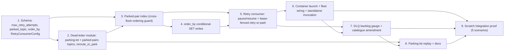

# Phase 5 / Slice 4: Retry Consumer with Backoff and a Parking Lot — Stories

Source: `plan/v5/slices.md` Slice 4, bound by `plan/v5-v6-orchestration.md`
(P5-Q2: retry only `missing_endpoint`/`ambiguous_endpoint` relationship rows —
malformed records, P5-S2's `failure_class="malformed"`, are terminal and stay
on the manual `replay-dlq` path; owner decision 2: after max attempts, park to
`<topic>.dlq.parked` (default, overridable), never dropped, replayable; P5-Q4
follow-up: this slice owns a true `graph_loader_dlq_backlog{kind,name}` gauge
added to the P6-S2 catalogue, so P6-S3's growth-rate proxy alert can switch to
it; the binding P5-S3 → P5-S4 ordering handoff: default pair-parking with a
bounded durable parked-pair index plus ordered per-pair retry, plus an optional
schema `order_by` conditional-SET mode; P5-Q1 fencing amendment: retry writes
go through the same lease-fenced, tx-timeout write path, zero lock waits;
P5-Q5: at-least-once counters). Wave 5 of the execution order
(`plan/v5-v6-orchestration.md`): lands after P5-S3 (the DLQ this slice reads)
and P5-S1 (the lease-fenced writer this slice's retries reuse), both already
merged into `feat/streaming-observability` by the time this document is acted
on. Blocks Slice 5/P6-S2's `retries`/`parked` counters going from "registered,
held at zero" to live (P6-S2 already pre-registered `graph_loader_parked_total`
and `graph_loader_retry_total{reason="missing-endpoint"}` for exactly this
slice — see Decisions §7).

## Decisions this Cartographer is making now (grounded in the merged code and the P5-S3 design this slice reads)

`plan/v5/slices.md`'s Slice 4 text and Open Question 2 leave several
mechanisms as goals, not designs: "honors `_retry_after`... without blocking
`poll()`" states the requirement, not the pause/resume state machine;
"exponential backoff... base delay, multiplier, max delay" implies a new
config surface without specifying whether it reuses `RetryConfig`; and the
slice text is silent on the one problem P5-S3's own cartographer flagged as
*this* slice's to solve — the cross-flush pair-ordering gap. All of the
following are resolved here.

1. **Scope: this is a streaming-fleet companion process, not a general DLQ
   drain tool.** The retry consumer is launched automatically, once per
   streaming run, alongside the run's bucket-lease server, and torn down with
   it. It is **not** launched automatically for bulk mode's opt-in
   missing-endpoint DLQ routing (`route_missing_endpoints_in_bulk`, P5-S3
   Story 1): a bulk run is bounded and finishes; its DLQ backlog (if any) is
   a human-in-the-loop fix-then-`replay-dlq` workflow exactly as P5-S2
   already ships, because by the time anyone looks at a bulk run's DLQ the
   run's own bucket-lease server (if it used one) has already been torn down
   — there is no live lease coordinator left to fence a bulk retry against.
   Streaming genuinely needs the unattended, forever-running self-heal loop
   the epic describes ("no human watching it," `plan/v5/slices.md`'s Phase
   Summary); bulk does not. The retry consumer's own entry point
   (`src/loader/retry_consumer.py`) is still independently invokable by hand
   against any DLQ topic (Story 6), so an operator who *does* want to run it
   against a finished bulk run's DLQ backlog may, but nothing in this slice
   wires that up automatically, and doing so without a live lease server
   would have to fall back to the classic (non-leased) writer path, which
   this slice does not build. Documented as an explicit non-goal in
   `docs/USAGE.md` (Story 9), not a silent omission.
2. **Fleet-wide, not per-edge-type.** One retry-consumer container kind,
   launched once per streaming run (like the lease server and unlike edge
   loaders, which are per-type), subscribed as a single Kafka consumer group
   to *every* DLQ-and-retry-enabled edge type's DLQ topic simultaneously.
   Rationale: the edge-before-node race this slice heals is, by construction,
   a transient minority of traffic (P5-S3's own framing) — one process per
   edge type would mean N idle containers for N schema-declared relationship
   types on a schema where the race rarely fires for most of them. Kafka's
   own consumer-group partition assignment already scales this fleet-wide
   process horizontally: a `--retry-consumer-replicas` CLI flag (Story 6,
   mirroring `run_edge_loader`'s `replicas`) adds group members if a backlog
   genuinely grows large, with partitions (and therefore pairs, since P5-S3's
   `key_bytes=[source_key, target_key]` makes the DLQ producer's default
   partitioner keep one pair's records in one partition — see Decisions §5)
   redistributed automatically.
3. **Same image, new entrypoint, no fourth Docker image.** The retry
   consumer needs exactly the same dependencies as an edge loader — the
   Kafka client, the Neo4j driver, `edge_execution.py`'s
   `ApocLockedEdgeWriter`/`BucketLeaseExecutionCoordinator`, `lease_client.py`,
   and `dead_letter.py` — so it ships as a new entrypoint
   (`python -m src.loader.retry_consumer`) inside the existing `edge_image()`
   (`Dockerfile.edge_loader`, unchanged), exactly how P5-S1 Story 6 already
   put the bucket-lease server and P4 already put the planned dispatcher/
   writers into that same image with their own entrypoints. P6-Q6's "build
   all three images: node, edge, clock" needs no amendment — this is the
   edge image's fourth *entrypoint*, not a fourth *image*.
4. **Retry writes are lease-fenced, sharing the run's live lease server.**
   P5-Q1's fencing amendment is explicit: "retry writes go through the same
   lease-fenced, tx-timeout write path." The retry consumer is constructed
   with a `BucketLeaseExecutionCoordinator` pointed at the **same**
   `GRAPH_LOADER_BUCKET_LEASE_ADDR` the run's edge loaders use (Story 6 wires
   this through the same streaming-fleet launcher P5-S1 Story 6 built,
   `_run_lease_relationship_fleet`), not a private lease connection. This is
   load-bearing, not cosmetic: without it, a retry consumer writing node `X`
   at the same moment a live edge loader writes a different, node-disjoint
   cell that happens to share `X` via a different relationship type would
   reintroduce exactly the lock contention leases exist to remove. Launch
   order: lease server, then retry consumer (it needs a live lease address
   at construction, mirroring how edge loaders already wait for it), then
   edge loaders — a one-line addition to P5-S1 Story 6's
   `_run_lease_relationship_fleet`, not a new launch phase.
5. **The DLQ producer's key-based partitioning already gives per-pair FIFO
   ordering inside one DLQ partition; this slice's index closes the
   *cross-flush* gap only, not intra-DLQ-partition ordering.**
   `DeadLetterProducer.publish` (`dead_letter.py:456-458`) calls
   `self._producer.produce(topic, key=envelope.key_bytes, ...)`, and P5-S3
   Story 2's `route_unresolved_endpoint` sets `key_bytes=json.dumps([source_key,
   target_key], ...)`. Confluent's default partitioner hashes the key, so
   **every** envelope for one `(source_key, target_key)` pair — the root
   missing-endpoint row and every same-flush row P5-S3 also parked behind it
   (`reason_code="blocked_by_earlier_unresolved_row"`) — lands in the same
   DLQ partition, in original offset order, for free. The retry consumer's
   own sequential, pause/resume-per-partition processing (Story 5) therefore
   already retries one pair's queued DLQ records in their original order
   with zero extra bookkeeping. What P5-S3 could not solve — a *new*, later
   flush's row for the same pair that individually resolves and never enters
   the DLQ at all, because nothing in that later flush's own batch signals
   "this pair already has an unresolved record sitting in a DLQ from an
   earlier flush" — is the actual gap Story 3's parked-pair index closes.
6. **The parked-pair index is a small, bounded, compacted Kafka topic per
   edge type, materialized in-memory by every writer that needs to consult
   it.** Rejected alternatives: (a) a single fleet-wide topic keyed by
   `(edge_type, source_key, target_key)` — unnecessary; DLQ topics are
   already one-per-entity (P6-S2 Decision 1), so the index inherits the same
   boundary, one compacted topic per edge type,
   named `f"{resolved_dlq_topic}.parked-pairs"` (Story 2); (b) reconstructing
   the index by re-scanning the DLQ topic on every restart instead of a
   dedicated compacted topic — rejected because a DLQ topic is not compacted
   (it is a `retention.ms=-1` append log covering *every* failure, including
   terminal `malformed` ones the index must never count), so deriving
   "which pairs are currently blocked" from it would mean scanning an
   ever-growing, un-bounded-by-design log on every restart, exactly the cost
   a dedicated compacted topic avoids by construction (compaction keeps only
   the latest record per key, so the topic's size is bounded by the number
   of *distinct pairs ever blocked*, not the number of DLQ events ever
   published). Value shape: `{"outstanding": <int>, "updated_at_ms": <int>}`,
   canonical JSON, no envelope versioning needed (this is an internal
   accounting structure, never read by an operator or `replay-dlq`, unlike
   the DLQ/parked topics). `"outstanding"` counts records for that pair
   currently sitting unresolved anywhere across every DLQ partition; it
   reaches `0` when the retry consumer durably resolves (writes or parks)
   the last outstanding record for that pair, at which point it publishes a
   **tombstone** (`value=None`) for that key, which compaction eventually
   removes, bounding the topic's live size to "pairs blocked right now," not
   "pairs ever blocked."
7. **Metrics: reuse the pre-registered counters, add exactly the gauge the
   orchestration doc names, and amend the `kind` enum by exactly one value
   for the retry consumer's own process identity.**
   `feat/p6-s2-metrics`'s `src/utils/metrics.py` already carries
   `graph_loader_parked_total{kind,name}` (`AT_LEAST_ONCE_NOTE`, "held at 0
   until Phase 5 Slice 4's retry consumer/parking-lot lands") and
   `graph_loader_retry_total{kind,name,reason}` with
   `RETRY_REASONS=("neo4j-transient","missing-endpoint")` — `reason=
   "missing-endpoint"` is pre-registered for exactly this slice's retry
   attempts. Both are **entity-scoped** (`kind="edge"`, `name=<edge type>`),
   matching `dlq_routed_total`'s existing pattern for the same reason: a
   retry attempt or a park event is about *the edge type whose row is being
   retried*, not about *which process happened to run the retry*. This
   slice adds **zero** new labels to either series — it only makes them
   read nonzero. It does add one wholly new series,
   `graph_loader_dlq_backlog` (Gauge, `kind`, `name`), per the orchestration
   doc's exact suggested name, entity-scoped the same way (Story 7). The one
   genuine gap: the retry consumer's *own* process-identity triad
   (`process_up`/`process_start_time`/`process_info`, and its own DLQ-topic
   `consumer_lag`) needs a `kind` value, and `PROCESS_KINDS`'s module
   docstring says "fixed at 7 forever." This slice amends that to 8,
   adding `"retry-consumer"` — the same category of change P5-S1 made to
   `BucketLeaseStreamConfig`'s settings surface for a genuinely new,
   bounded, source-controlled process type (not a per-record or per-key
   value, which is what the "forever" language was actually defending
   against). `consumer_lag{kind="retry-consumer", name=<edge type>,
   topic=<dlq topic>}` reuses the existing generic series unchanged — no new
   metric needed there, only a new label *value* for an already-generic
   `kind` dimension. `records_consumed_total`/`write_duration`/
   `deadlocks_recovered`/`retry_total`/`dlq_routed_total` for the retry
   consumer's own Neo4j writes stay under `kind="edge"` (Decision above):
   these describe *edge writes*, and `edge_execution.py`'s instrumentation
   is already caller-agnostic (it does not know or care whether
   `write_provenanced_batch`/the new `retry_provenanced_batch` was invoked
   by a live edge loader or the retry consumer), which is exactly the
   dashboard behavior an operator wants ("total write cost for this edge
   type," live and retried, in one series).
8. **Backoff reuses `RetryConfig`'s existing two numeric fields and this
   codebase's one existing backoff formula; the bound on attempts is a new,
   separate field, not `RetryConfig.max_attempts`.** P5-S3 Story 2 explicitly
   left this decision to this slice ("P5-S4 owns deciding whether it needs
   its own multiplier/max-delay config"). `RetryConfig.max_attempts` already
   means something different and narrower: how many times
   `ApocLockedEdgeWriter._write_rows`'s retry loop retries a Neo4j
   `TransientError` **within one write call**, on the order of milliseconds
   to a few seconds total. This slice's "how many times has this DLQ'd row
   been retried across possibly hours of backoff" is a different bound at a
   different timescale, and conflating the two would mean tuning one
   silently changes the other's, unrelated, behavior. New field:
   `DeadLetterConfig.max_retry_attempts: int = Field(default=5, ge=1,
   le=1000)` (Story 1). The backoff *timing* itself reuses
   `RetryConfig.base_delay_seconds`/`max_delay_seconds` (already used by
   P5-S3 Story 2 for the very first `retry_after_ms`) with the **same fixed
   multiplier of 2** `ApocLockedEdgeWriter.write_rows`'s own retry loop
   already hardcodes (`edge_execution.py:210`,
   `min(base_delay * 2 ** (attempt - 1), max_delay)`) — no new
   `multiplier` field, so this codebase keeps exactly one backoff formula,
   not two, extending P5-S1 Story 3's own explicit precedent for the same
   choice.
9. **The parking-lot topic name derives from the resolved DLQ topic, not the
   raw entity topic, resolving a real ambiguity in the owner decision's
   shorthand.** `plan/v5-v6-orchestration.md` writes the default as
   `<topic>.dlq.parked`; `plan/v5/slices.md`'s Slice 4 text writes
   `<original topic>.dlq.parked`. Read literally both give the identical
   string *only* when `dead_letter.topic` is unset (the DLQ topic is already
   `f"{entity_topic}.dlq"` by default, per P5-S2). When an operator has
   overridden `dead_letter.topic` to something custom, deriving the parked
   topic from the *entity* topic would silently ignore that override and
   produce a parked-topic name unrelated to where the operator actually put
   their DLQ; deriving it from the *resolved* DLQ topic instead
   (`f"{resolved_dlq_topic}.parked"`) keeps the parked topic a visible
   sibling of wherever the DLQ topic actually lives. New helper
   `parked_topic_name(entity_topic, dead_letter)` (Story 1, `schema.py`,
   mirroring `dead_letter_topic_name`'s placement and one-directional
   dependency exactly) implements this; `DeadLetterConfig.parked_topic:
   Optional[str] = None` is the explicit override, mirroring `topic`'s own
   shape.
10. **`order_by` is an alternative to pair-parking for one edge type, not an
    addition to it.** When an edge type declares `order_by`, every retried
    write for that type uses a conditional `SET` (Story 4) that makes a
    stale replay a safe no-op by construction — pair-parking exists
    *because* an unconditional `SET` would let a stale retry clobber a newer
    commit, so a type that has already removed that risk via `order_by`
    gains nothing from also paying the pair-parking index's bookkeeping cost,
    and paying both would be redundant, not additively safer. Both P5-S3's
    same-flush blocking pass (`_classify_rows`) and this slice's cross-flush
    index (Story 3) are skipped for an `order_by`-configured edge type; only
    genuine endpoint-resolution failures route that type's rows to the DLQ.
    This is a per-edge-type schema choice, not a global mode switch — a
    schema with five relationship types can run three under the default
    pair-parking behavior and two under `order_by`, simultaneously.

## Story 1: Schema — Retry-Consumer Tuning, Max Retry Attempts, Parked-Topic Override, and `order_by`

**As a** Data Engineer,
**I want** the parking-lot threshold, the parked-topic name, and an optional
per-relationship-type ordering property declared in the schema, with safe,
validated defaults,
**so that** every later story in this slice has a stable, tested
configuration surface to read, matching every prior Phase 5 slice's
"schema first, one story, zero rebase risk" precedent (P5-S1 Story 1, P5-S3
Story 1).

### Technical Context

- `src/models/schema.py`'s `DeadLetterConfig` (already carrying
  `route_missing_endpoints_in_bulk` from P5-S3) gains two fields:
  ```python
  class DeadLetterConfig(BaseModel):
      model_config = ConfigDict(extra="forbid")
      topic: Optional[str] = None
      enabled: bool = True
      route_missing_endpoints_in_bulk: bool = False          # P5-S3
      max_retry_attempts: int = Field(default=5, ge=1, le=1000)
      parked_topic: Optional[str] = None

      @field_validator("max_retry_attempts", mode="before")
      @classmethod
      def _reject_bool_max_retry_attempts(cls, value: object) -> object:
          if isinstance(value, bool):
              raise ValueError("max_retry_attempts must be an integer")
          return value

      @field_validator("parked_topic")
      @classmethod
      def parked_topic_is_not_blank_when_set(cls, value: Optional[str]) -> Optional[str]:
          if value is not None and not value.strip():
              raise ValueError("dead_letter parked_topic must not be blank when set")
          return value
  ```
  `max_retry_attempts`/`parked_topic` apply to **relationship** types only
  (mirroring `route_missing_endpoints_in_bulk`'s own scoping) — `NodeConfig.
  dead_letter` gets neither field, since malformed node records are terminal
  (P5-Q2) and this slice never retries them. `extra="forbid"` continues to
  reject a typo (e.g. `max_retry_attempt`, singular) exactly as today.
- New helper beside `dead_letter_topic_name` (`schema.py`, same
  one-directional `schema.py` → nothing dependency the existing helper
  already has — no Kafka import here):
  ```python
  def parked_topic_name(entity_topic: str, dead_letter: Optional["DeadLetterConfig"]) -> Optional[str]:
      """Return the parking-lot topic, or None when DLQ routing itself is off.

      Derived from the *resolved* DLQ topic (Decisions §9), not the raw
      entity topic, so an overridden dead_letter.topic is respected.
      """
      resolved_dlq = dead_letter_topic_name(entity_topic, dead_letter)
      if resolved_dlq is None:
          return None
      if dead_letter.parked_topic is not None:
          return dead_letter.parked_topic
      return f"{resolved_dlq}.parked"
  ```
  Extend schema-wide topic-collision validation (already checking every
  node/edge/coordination/control/DLQ topic against every other, P5-S2 Story
  2) to also include every resolved `parked_topic_name` and a new, internal
  `f"{resolved_dlq}.parked-pairs"` name (Story 2's compacted index topic,
  computed inline here since it has no override field — Decisions §6) in
  the same collision set, and to reject `max_retry_attempts`/`parked_topic`
  set while `enabled=False` (mirrors P5-S3 Story 1's identical
  `route_missing_endpoints_in_bulk`+`enabled=False` rejection, same
  validator family).
- `EdgeConfig` (schema.py) gains:
  ```python
  order_by: Optional[str] = None
  """When set, must name one of this edge type's own declared `properties`
  keys. Retried and live writes for this type use a conditional SET
  (Story 4) instead of pair-parking (Decisions §10)."""

  @model_validator(mode="after")
  def _order_by_is_a_declared_property(self) -> "EdgeConfig":
      if self.order_by is not None and self.order_by not in self.properties:
          raise ValueError(
              f"edge '{self.type}': order_by={self.order_by!r} is not one of "
              f"this type's declared properties {sorted(self.properties)}"
          )
      return self
  ```
  (Exact `properties` accessor name confirmed against the current
  `EdgeConfig` shape by the implementer — this mirrors whichever existing
  field/validator already enumerates declared property keys for a
  similar purpose, e.g. the undeclared-property rejection `_reason_code`
  classifies at write time.)
- New nested config, mirroring `BucketLeaseStreamConfig`'s placement and
  `ConfigDict(frozen=True)` convention exactly (P5-S1 Story 1):
  ```python
  class RetryConsumerConfig(BaseModel):
      """Streaming-only tuning for the DLQ retry consumer (P5-S4)."""
      model_config = ConfigDict(frozen=True)
      poll_timeout_ms: int = Field(default=500, ge=10, le=60_000)
      backlog_check_interval_ms: int = Field(default=10_000, ge=1_000, le=300_000)
      due_batch_coalesce_ms: int = Field(default=200, ge=0, le=10_000)

      @field_validator("poll_timeout_ms", "backlog_check_interval_ms", "due_batch_coalesce_ms", mode="before")
      @classmethod
      def _reject_bool(cls, value: object) -> object:
          if isinstance(value, bool):
              raise ValueError("RetryConsumerConfig fields must be integers")
          return value
  ```
  `due_batch_coalesce_ms` is the small window Story 5's scheduler waits
  after the *first* record in a tick becomes due, to let near-simultaneous
  due records from other partitions join the same write batch, rather than
  writing single-row batches back-to-back — bounded low (10 s max) so it
  never meaningfully delays a resolution. Nested as `LoadingConfig.
  retry_consumer: RetryConsumerConfig = Field(default_factory=
  RetryConsumerConfig)`.

### Acceptance Criteria

- [ ] A schema with no `dead_letter` block, or `enabled: false`, loads with
      `max_retry_attempts`/`parked_topic` absent/irrelevant — no behavior
      change.
- [ ] `dead_letter: {enabled: true, max_retry_attempts: 8, parked_topic:
      "orders.parked"}` loads cleanly; `{enabled: false, max_retry_attempts:
      8}` and `{enabled: false, parked_topic: "x"}` both fail schema loading
      with a clear message, exactly like P5-S3's `route_missing_endpoints_in_bulk`
      + `enabled=False` rejection.
- [ ] `max_retry_attempts: true` (a YAML bool masquerading as an int) and
      `max_retry_attempts: 0` both fail schema loading.
- [ ] `order_by: "updated_at"` on an edge type that declares `updated_at` in
      `properties` loads cleanly; the same on a type that does not declare
      it fails schema loading with a message naming the missing property.
- [ ] A schema whose two edge types both resolve to the same `parked_topic`
      (explicit override collision) fails schema loading, matching the
      existing DLQ-topic collision test's shape.
- [ ] `RetryConsumerConfig`'s defaults load when `retry_consumer:` is absent;
      each field's out-of-bounds value fails schema loading with a clear
      message.

### Definition of Done

- [ ] `tests/test_schema_validation.py` extended: `max_retry_attempts`/
      `parked_topic` defaults, bounds, `enabled=False` rejection, the new
      collision set (parked + parked-pairs topics), `order_by` declared-vs-
      undeclared, `RetryConsumerConfig` bounds.
- [ ] `config/graph_schema.yaml` documents every new field, following
      P5-S3 Story 1's "present but commented, off by default" style.
- [ ] Reviewed and merged.

### Dependencies

Depends on: none new from this phase (P5-S3's `DeadLetterConfig`/`EdgeConfig`
are already merged). Blocks: every later story in this slice (all read one or
more of these fields). **File-overlap risk:** `src/models/schema.py` only —
touched only by this story in this slice, exactly mirroring every prior
slice's precedent of landing the schema change first. **Estimate: 8 points.**

## Story 2: Dead-Letter Module — Parking-Lot Topic, Retry/Park Sink Methods, and the Parked-Pair Index Topic

**As a** Pipeline Operator,
**I want** the parking-lot topic and the compacted parked-pair index topic
provisioned with the right policy, and a sink that republishes a DLQ'd row
with an incremented attempt count or moves it to the parking lot,
**so that** the retry consumer (Story 5) has durable, correctly-provisioned
Kafka topics and a tested sink to call, without reinventing P5-S2/P5-S3's
already-proven publish/provisioning machinery.

### Technical Context

- **Parking-lot topic provisioning** reuses `ensure_dead_letter_topic`
  verbatim (`retention.ms=-1`/`retention.bytes=-1`, same size cap, same
  fail-closed policy-verification-on-pre-existing-topic behavior) — it is
  not a new function, only a new call site (`_ensure_dead_letter_topics` in
  `cli.py`, Story 6) passing `parked_topic_name(...)` instead of
  `dead_letter_topic_name(...)`. No change to `ensure_dead_letter_topic`
  itself.
- **The parked-pair index topic is provisioned differently: compacted, not
  append-only**, since Decisions §6 requires bounded size by pair count, not
  by event count:
  ```python
  PARKED_PAIR_INDEX_TOPIC_CONFIG: dict[str, str] = {
      "cleanup.policy": "compact",
      "min.cleanable.dirty.ratio": "0.1",
      "delete.retention.ms": "300000",   # 5 min tombstone-visibility window,
                                          # long enough for every consumer of
                                          # this topic (Story 3) to observe a
                                          # tombstone before compaction
                                          # physically removes it.
      "max.message.bytes": "65536",      # a canonical-JSON [source_key,
                                          # target_key] key plus a two-field
                                          # value never approaches the DLQ
                                          # envelope's 8 MiB cap.
  }

  def ensure_parked_pair_index_topic(
      bootstrap_servers: str, topic: str, *, source_topic: str, admin_factory=None, timeout: float = 30.0,
  ) -> None:
      """Create the compacted parked-pair index topic, unless it already exists.

      Mirrors ensure_dead_letter_topic's list-then-create-tolerating-races
      shape, but never calls _verify_existing_dead_letter_topic_config (that
      function's retention.ms=-1 check does not apply to a compacted topic —
      a separate, smaller check confirms cleanup.policy=compact on an
      existing topic instead, failing closed the same way).
      """
  ```
- **New sink method on `DeadLetterRecordSink`**, additive (mirrors P5-S3
  Story 2's `route_unresolved_endpoint` addition exactly — same class, same
  constructor, no new class):
  ```python
  def reroute_or_park(
      self, *, envelope: "DeadLetterEnvelope", reason_code: str, error_text: str,
      retry_after_seconds_for_reattempt: float, parked_topic: str,
  ) -> Literal["re_dlq", "parked"]:
      """Republish envelope with attempt_count+1 to this sink's own DLQ topic,
      or -- once attempt_count+1 reaches the caller's resolved
      max_retry_attempts -- publish it to parked_topic instead.

      Preserves envelope.original_topic/partition/offset, entity_kind,
      entity_name, loader_identity, and first_failure_at_ms verbatim: only
      attempt_count, retry_after_ms (recomputed on re-DLQ; None on park,
      matching route_unresolved_endpoint's own None-for-malformed
      convention -- nothing left to retry once parked), reason_code, and
      error_text change. dlq_routed_at_ms is refreshed to the current
      publish time on a re-DLQ (a fresh DLQ event); parked envelopes get
      their own, distinct on_parked observability call (see below), not a
      second on_dlq_routed for the same conceptual event.

      The caller (Story 5) decides re_dlq vs parked by comparing
      envelope.attempt_count + 1 against the edge type's own
      max_retry_attempts -- this method takes the *decision*, already made,
      as which topic to publish to, not the threshold itself, keeping this
      module free of any per-edge-type config lookup.
      """
      next_attempt = envelope.attempt_count + 1
      now = self._clock()
      if parked_topic is not None and _is_parking(envelope, next_attempt):  # caller-decided; see Story 5
          parked = DeadLetterEnvelope(
              **{**vars(envelope), "attempt_count": next_attempt, "retry_after_ms": None,
                 "reason_code": reason_code, "error_text": error_text, "dlq_routed_at_ms": now},
          )
          self._producer.publish(parked_topic, parked)
          on_parked(self._kind, envelope.entity_name, parked_topic)  # new hook, see below
          return "parked"
      re_dlq = DeadLetterEnvelope(
          **{**vars(envelope), "attempt_count": next_attempt,
             "retry_after_ms": now + int(retry_after_seconds_for_reattempt * 1000),
             "reason_code": reason_code, "error_text": error_text, "dlq_routed_at_ms": now},
      )
      self._producer.publish(self._topic, re_dlq)
      return "re_dlq"
  ```
  (Illustrative — the exact caller/callee split of the parked-vs-re_dlq
  decision is Story 5's to finalize; the constraint this story fixes is
  that `reroute_or_park` never invents a new `attempt_count`/
  `first_failure_at_ms` the way `route_unresolved_endpoint` correctly does
  for a *first* failure, and that a park publish and a re-DLQ publish are
  distinguishable observability events, not both counted as `dlq_routed`.)
- **New observability hook**, dependency-free, same shape as
  `on_dlq_routed` (`dead_letter.py`):
  ```python
  # kind, name, parked_topic
  OnParkedListener = Callable[[str, str, str], None]

  def on_parked(kind: str, name: str, parked_topic: str) -> None:
      """No-op seam fired exactly once per acknowledged parking-lot publish.
      P6-S2's install_dlq_routed_listener-equivalent for this slice
      (Story 7) replaces this to increment graph_loader_parked_total."""
      return None
  ```
  `reroute_or_park`'s `retry_after_ms` recomputation on a re-DLQ (not a
  park) is the only place this module computes the exponential backoff
  formula; the caller (Story 5) passes `retry_after_seconds_for_reattempt`
  already computed per Decisions §8's formula (`min(base_delay * 2 **
  (next_attempt - 1), max_delay)`), so `dead_letter.py` itself performs no
  schema lookups and stays a pure Kafka/envelope module, matching its
  existing layering discipline.
- **Malformed envelopes are never passed to `reroute_or_park`.** This
  method's docstring states, and a defensive `_require(envelope.
  failure_class != "malformed", ...)` at its top enforces, that a caller
  attempting to retry a terminal failure is a caller bug, not a runtime
  condition to route around — Story 5's consumer loop filters these out
  before ever calling this method (P5-Q2).

### Acceptance Criteria

- [ ] `ensure_parked_pair_index_topic` creates a topic with
      `cleanup.policy=compact`; a pre-existing topic with
      `cleanup.policy=delete` fails closed with a clear message; a
      concurrent `TOPIC_ALREADY_EXISTS` race is tolerated exactly like
      `ensure_dead_letter_topic`.
- [ ] `reroute_or_park` on an envelope with `attempt_count=2`,
      `max_retry_attempts=5` (caller signals "not yet parking") publishes to
      the original DLQ topic with `attempt_count=3` and a fresh
      `retry_after_ms` strictly greater than the publish time; the same call
      with the caller signaling "parking" (`attempt_count+1 >=
      max_retry_attempts`) publishes to `parked_topic` instead, with
      `retry_after_ms=None`.
- [ ] `reroute_or_park` on `failure_class="malformed"` raises before any
      Kafka call.
- [ ] A parked envelope preserves `original_topic`/`original_partition`/
      `original_offset`/`first_failure_at_ms`/`loader_identity` byte-for-byte
      from the envelope passed in.
- [ ] `on_parked` fires exactly once per successful park publish, and never
      for a re-DLQ publish (which fires the pre-existing `on_dlq_routed`
      instead, via the normal `DeadLetterProducer.publish` path both
      re-DLQ and park share).

### Definition of Done

- [ ] `tests/test_dead_letter.py` extended with every scenario above, plus
      `ensure_parked_pair_index_topic`'s own creation/policy-violation/race
      tests mirroring `test_ensure_dead_letter_topic`'s existing shape.
- [ ] Reviewed and merged.

### Dependencies

Depends on: Story 1 (`max_retry_attempts`/`parked_topic`/`parked_topic_name`,
read by Story 5's caller, not by this module directly). Blocks: Story 3
(publishes/reads the parked-pair index topic this story provisions), Story 5
(calls `reroute_or_park`), Story 7 (`on_parked` listener). **File-overlap
risk:** `src/loader/dead_letter.py` only, additive — no existing method
signature changes, so P5-S2/P5-S3's full existing test suite is unaffected.
**Estimate: 8 points.**

## Story 3: The Parked-Pair Index — Durable Cross-Flush Ordering Guard

**As a** Pipeline Operator,
**I want** a pair with any record still waiting in the DLQ to have every
*later* resolvable record for that same pair diverted to the DLQ too, even
across flushes and process restarts,
**so that** P5-S3's own flagged gap — a stale, since-superseded retry
overwriting a newer commit — never happens for a schema that has not opted
into `order_by` (Decisions §10).

### Technical Context

- **In-memory materialized view, one per edge type, shared by every process
  that writes that type.** A small class, `ParkedPairIndex`, constructed
  from the resolved `parked_pairs_topic` (Decisions §6's
  `f"{resolved_dlq}.parked-pairs"`) and a Kafka bootstrap string:
  ```python
  class ParkedPairIndex:
      """In-memory view of one edge type's parked-pair compacted topic.

      Rebuilt from the beginning of the (compacted, therefore bounded)
      topic at construction; kept current afterward by a background thread
      that never stops polling for new records/tombstones. Read-only from
      the caller's perspective except through increment/decrement, which
      both publish to the topic (the write of record) before updating the
      local view (read-your-own-write is only guaranteed locally; a
      concurrent replica's view catches up on its own next poll -- see the
      Acceptance Criteria's explicit "eventually consistent, not
      linearizable" scope note).
      """
      def is_blocked(self, source_key: str, target_key: str) -> bool: ...
      def increment(self, source_key: str, target_key: str) -> None: ...
      def decrement(self, source_key: str, target_key: str) -> None: ...
      def start(self) -> None: ...   # rebuild-then-poll background thread
      def stop(self) -> None: ...
  ```
  `increment`/`decrement` are called **only** by the retry consumer (Story
  5), which is the sole writer of this topic (every increment corresponds
  to a DLQ envelope this consumer just read; every decrement corresponds to
  a record it just durably wrote or parked). Every edge-loader replica
  (live writer) and every retry-consumer replica constructs a **read-only**
  `ParkedPairIndex` for `is_blocked` lookups; only the retry consumer's own
  instance ever calls `increment`/`decrement` — this asymmetry is enforced
  by construction (a `writable: bool` constructor flag gates
  `increment`/`decrement`, raising if called on a `writable=False`
  instance), not by convention alone, since a live edge loader accidentally
  incrementing this index would corrupt the count with no corresponding
  decrement ever coming from that process.
  On `increment`, the record's current `"outstanding"` value is read from
  the local view, incremented, and republished (`key=[source_key,
  target_key]`, `value={"outstanding": n+1, "updated_at_ms": now}`); on
  reaching `0` via `decrement`, a **tombstone** (`value=None`) is published
  instead of `{"outstanding": 0, ...}` — Decisions §6's bounded-size
  property depends on this: a `0`-valued record is still a live key in a
  compacted topic (compaction removes tombstones, not zero values) and
  would defeat the whole point.
  **Race note, documented in the class docstring, not hidden**: two
  concurrent retry-consumer replicas (Decisions §2's horizontal scaling) can
  both read the same pair's current count in the same window and both
  publish an incremented value, one clobbering the other (last-write-wins
  on the same compacted key) — this can under-count `outstanding` (never
  over-count in a way that fails to unblock; the failure mode is
  "unblocks one attempt cycle too early," not "never unblocks"). This is
  bounded and self-correcting: the next DLQ envelope for that pair (if the
  race genuinely dropped an increment) republishes and increments again,
  and Decisions §5's same-partition FIFO delivery for one pair means the
  two racing replicas are, in the overwhelmingly common case, two different
  *retry attempts for two different pairs*, not two racing updates to the
  *same* pair's count from the *same* partition (Kafka delivers one
  partition to exactly one group member at a time) — a same-pair race is
  only possible immediately after a rebalance moves a partition to a new
  member while the old member's last update to this topic is still
  in-flight, a narrow, self-healing window, not a steady-state condition.
- **Live-writer integration point: `ApocLockedEdgeWriter.write_provenanced_batch`
  (P5-S3 Story 3) gains one cheap, in-process check before Attempt 1**, so
  the common "nothing is blocked" case costs one Python dict/set membership
  test per batch, not a Neo4j or Kafka round trip:
  ```python
  def write_provenanced_batch(self, items: Sequence) -> None:
      if not items:
          return
      assert self._missing_endpoint_sink is not None
      rows = [self._as_row(item.record) for item in items]
      if self._parked_pair_index is not None:
          forced_blocked = {
              i for i, row in enumerate(rows)
              if self._parked_pair_index.is_blocked(row["source_key"], row["target_key"])
          }
      else:
          forced_blocked = set()
      if not forced_blocked:
          for attempt in range(1, self._max_attempts + 1):
              try:
                  if self._write_rows(rows, strict=False):
                      return  # unchanged fast path
                  break
              except TransientError as exc:
                  ...  # unchanged
      self._write_with_row_level_dlq(items, rows, forced_blocked=forced_blocked)
  ```
  `_classify_rows` (P5-S3 Story 3) gains one more override pass, run after
  its existing endpoint-classification and same-flush-pair-blocking passes:
  any row whose index is in `forced_blocked`, and whose status is currently
  `"matched"`, becomes `("blocked", "blocked_by_parked_pair")` — a fourth,
  distinct `reason_code` alongside P5-S3's `missing_*`/`ambiguous_*`/
  `blocked_by_earlier_unresolved_row`, so log/DLQ inspection can tell "this
  row's own endpoints were fine; it was blocked purely because an earlier,
  still-outstanding DLQ'd record shares its pair" apart from every other
  cause. `write_provenanced_batch`'s `_missing_endpoint_sink.
  route_unresolved_endpoint` call for a `blocked_by_parked_pair` row still
  publishes with `attempt_count=0` (this row has never itself failed to
  resolve; it is a first-time diversion) — no index `increment` happens
  here, because the pair is *already* counted as outstanding (that is
  precisely why `is_blocked` returned true); double-incrementing here would
  overcount. `ApocLockedEdgeWriter.__init__` gains one new optional
  parameter, `parked_pair_index: ParkedPairIndex | None = None`, defaulting
  to `None` (today's behavior, byte for byte, for every writer not
  constructed with one — every existing P5-S1/P5-S3 test is unaffected).
- **`order_by`-configured edge types never get a `ParkedPairIndex` at
  all**: `build_edge_execution` (Story 4) passes `parked_pair_index=None`
  whenever `edge_config.order_by is not None`, regardless of whether
  row-level DLQ itself is active — Decisions §10's "skip both mechanisms"
  is enforced at construction, not by a runtime branch inside the
  classification pass, so an `order_by` type's write path never even
  connects to that type's `parked-pairs` topic (no wasted background
  consumer thread for a mechanism that type structurally never uses).
- **Rebuild on restart**: `ParkedPairIndex.start()` seeks each of the
  topic's partitions to their beginning and reads to the (captured-once)
  high watermark before returning, exactly mirroring
  `dead_letter_replay.py`'s own `_iter_matching_envelopes` bounded-scan
  pattern (reused conceptually, not by import, since that module is
  replay-specific) — bounded by compaction (Decisions §6), so a restart
  after a long run rebuilds in time proportional to "pairs blocked
  recently," not "DLQ events ever." After the initial catch-up read, the
  same consumer keeps polling indefinitely on a background thread (never
  closes, never commits — no consumer group, exactly like
  `dead_letter_replay.py`'s dedicated non-committing reader) to stay
  current for the life of the process.

### Acceptance Criteria

- [ ] A `ParkedPairIndex` constructed against a topic with one existing
      `{"outstanding": 2, ...}` record for pair P and no tombstone reports
      `is_blocked(P) is True` immediately after `start()` returns, with no
      DLQ or Neo4j interaction.
- [ ] `increment` then `decrement` twice on the same pair (reaching 0)
      publishes a tombstone as the final record, and a **fresh**
      `ParkedPairIndex` instance built afterward from the same topic reports
      `is_blocked(P) is False` — proving the rebuild-from-topic path
      correctly treats a tombstone as "not blocked," not merely "count 0."
- [ ] `write_provenanced_batch` on a batch with no blocked pairs issues the
      identical Attempt-1 query/parameters as P5-S3's own byte-for-byte
      regression test, with `parked_pair_index.is_blocked` called exactly
      `len(items)` times and zero Kafka/Neo4j calls beyond what P5-S3
      already made — proving Decisions §6's "zero cost when nothing is
      blocked" claim, not merely arguing it.
- [ ] A batch containing one row whose pair is currently blocked (via a
      fake `ParkedPairIndex` returning `True`) and whose own endpoints
      *do* resolve is DLQ'd with `reason_code="blocked_by_parked_pair"`,
      not written, and the DLQ envelope's `attempt_count=0`.
- [ ] A writer constructed with `parked_pair_index=None` (every existing
      P5-S1/P5-S3 test, and every `order_by`-configured type) behaves
      byte-for-byte as before this story — proven by the full existing
      `tests/test_edge_execution_writer.py` suite passing unmodified.
- [ ] Two `ParkedPairIndex` instances built from independently faked
      partition-assignment orderings that race an increment and a
      decrement on the same pair converge to a consistent (not necessarily
      identical mid-race) final state after both republish their last
      write — a documented, tested instance of the race note above, not
      left as an unverified claim.

### Definition of Done

- [ ] `tests/test_parked_pair_index.py` (new) covering the `ParkedPairIndex`
      class in isolation against a fake Kafka client double, following this
      codebase's existing fake-client test style
      (`tests/test_dead_letter_replay.py`'s fakes are the closest
      precedent).
- [ ] `tests/test_edge_execution_writer.py` extended for the
      `write_provenanced_batch`/`_classify_rows` integration above.
- [ ] Reviewed and merged.

### Dependencies

Depends on: Story 1 (schema surface), Story 2 (the compacted topic this
class reads/writes). Blocks: Story 4 (`order_by` types skip this
mechanism), Story 5 (the retry consumer is this index's sole writer), Story
6 (provisions the topic, wires the index into `build_edge_execution`).
**File-overlap risk:** a new module (`src/loader/parked_pair_index.py`, the
implementer's call whether to fold it into `dead_letter.py` instead — either
placement keeps the one-directional `dead_letter.py`-adjacent dependency
shape) plus `edge_execution.py`'s `ApocLockedEdgeWriter.__init__`/
`write_provenanced_batch`/`_classify_rows` (additive parameters/passes only,
same low-collision shape as every prior additive change to this class in
P5-S1/P5-S3). **Estimate: 13 points.**

## Story 4: `order_by` Conditional-SET Writes

**As a** Data Engineer,
**I want** a relationship type with a declared `order_by` property to use a
conditional `SET` that only applies a write when its own ordering value is
newer than whatever is already stored,
**so that** a stale retried record can never overwrite a newer commit for
that type, without needing pair-parking's index or its cross-process
bookkeeping at all.

### Technical Context

- **Cypher shape.** `build_apoc_locked_upsert_query` (and its
  `native_disjoint`/planned-mode siblings, out of scope per P5-S3
  Decisions §2's existing `native_disjoint`/planned exclusions, unchanged
  here for the identical reason) gains an `order_by: str | None` parameter.
  When set, the merge sub-block's unconditional
  `SET r += row.properties` becomes:
  ```cypher
  WITH r, row
  WHERE row.properties[$order_by] IS NULL
     OR r[$order_by] IS NULL
     OR row.properties[$order_by] > r[$order_by]
  SET r += row.properties
  ```
  Three clauses, in order of precedence, per the prompt's own required
  coverage (types, ties, missing values):
  - **Missing incoming value** (`row.properties[$order_by] IS NULL`): the
    incoming record does not carry the ordering property at all. Applied
    unconditionally (same as today's non-`order_by` behavior for that one
    row) rather than silently dropped — Cypher's own `NULL > x` evaluates
    to `NULL` (falsy), so *without* this explicit branch a row missing the
    property would silently never update the relationship again, a much
    worse failure mode than "applies unconditionally, once, with a logged
    warning" (the warning is emitted by the writer in Python, not by
    Cypher, at the point it observes this branch was taken — see the
    per-row result below).
  - **Missing existing value** (`r[$order_by] IS NULL`): the relationship
    exists (a prior `MERGE` created it) but has never recorded an
    `order_by` value — either it was created before this feature was
    enabled for this type, or an earlier write itself hit the "missing
    incoming value" branch above. Applied unconditionally: there is nothing
    to compare against, and refusing to ever update a relationship again
    just because its first recorded value happened to be absent would be
    strictly worse than the ordinary risk this mode exists to reduce.
  - **Tie** (`row.properties[$order_by] == r[$order_by]`, i.e., neither
    `>` nor the two `IS NULL` branches fire): **not** applied. A tie means
    "this is the same version already stored, or a duplicate delivery of
    the same original write" — at-least-once delivery (P5-Q5) makes an
    exact duplicate retry a real, expected case, and silently re-applying
    identical properties is harmless but skipping it (rather than treating
    a tie as "newer") avoids ever nondeterministically picking a winner
    between two same-timestamp writes that actually differ in some other
    property, which `>` alone cannot detect and this design does not claim
    to solve (documented as a known limitation in `docs/USAGE.md`, Story
    9 — `order_by` orders by *one* declared field; if two genuinely
    different payloads share that field's value, whichever was tried
    first under this conditional wins and the second is silently a no-op,
    not an error).
  - **Types**: `order_by` must resolve to a Cypher-comparable scalar for
    every row of that type — Neo4j's `>` on two values of *different*
    incomparable types (e.g. a string compared to an integer) returns
    `NULL`, which this `WHERE` clause treats as "do not apply" (safe,
    silent no-op, not a Cypher runtime error) — safe, but silently
    "stuck" for that row if the property's type is inconsistent across a
    type's records. `docs/USAGE.md` (Story 9) recommends declaring
    `order_by` only for a property whose YAML `type:` is uniformly
    `integer`, `float`, or an ISO-8601 string normalized upstream to a
    lexicographically-ordered form (e.g. epoch milliseconds as an
    integer, not a mixed-format timestamp string) — this story does not
    add schema-level type enforcement beyond Story 1's "must be a declared
    property," since the normalization layer (`normalize_edge_record`)
    already enforces each property's own declared YAML type consistently
    across every record of that type, which is sufficient: a `type:
    integer` property is already guaranteed integer-valued by the time it
    reaches this query.
  - **Result reporting**: the merge sub-block's existing `CALL {...}
    RETURN checked_rows, invalid_rows, merged_rows` aggregate (P5-S3's
    query shape) is joined by one more count,
    `skipped_as_not_newer_rows`, for exactly the tie/type-mismatch case
    above (never for the two "missing value, applied anyway" branches,
    which count as ordinary `merged_rows`) — surfaced in
    `ApocLockedEdgeWriter`'s return value so Story 5's retry-consumer path
    can log (not DLQ, not retry — this is a successful, intentional no-op)
    when a retried write was silently superseded.
- **Disabling pair-parking for `order_by` types** is Story 3's
  responsibility (construction-time `parked_pair_index=None`); this story
  only needs to confirm, with a test, that an `order_by`-configured type's
  same-flush blocking pass in `_classify_rows` (P5-S3's own mechanism) is
  *also* skipped — P5-S3's blocking pass has no awareness of `order_by`
  today, so this story adds the one-line guard:
  ```python
  if self._edge_config.order_by is None:
      # existing same-pair blocking pass (P5-S3)
      ...
  ```
  inside `_classify_rows`, gated on the same `order_by` field Story 1
  declared. Two same-flush rows for one pair, one missing its endpoint and
  one individually resolvable, therefore behave differently depending on
  `order_by`: without it, both park (P5-S3's existing guarantee); with it,
  the resolvable one writes immediately (protected by the conditional
  `SET` against ever being clobbered later by the other row's eventual
  retry, whichever order the two settle in).

### Acceptance Criteria

- [ ] A retried write whose incoming `order_by` value is strictly greater
      than the relationship's currently stored value applies every property
      in the row, including updating the stored `order_by` value itself.
- [ ] A retried write whose incoming value is strictly less applies
      nothing — a `cypher-shell`/fake-session assertion confirms the
      relationship's properties are unchanged, and the row counts toward
      `skipped_as_not_newer_rows`, not `merged_rows` and not any DLQ path.
- [ ] A tie (equal values) also applies nothing, distinguishing it in a test
      from the "strictly greater" case even though both currently resolve
      the same `>`/`IS NULL` boolean shape difference in the query.
- [ ] A row missing the `order_by` property entirely applies unconditionally
      and logs a `WARNING`-level line naming the edge type and pair.
- [ ] A relationship with no previously recorded `order_by` value (created
      before this feature, or by the missing-value branch) accepts the next
      write unconditionally and begins recording the value from then on.
- [ ] `order_by`-configured types never construct a `ParkedPairIndex`
      (`writer._parked_pair_index is None`, confirmed via
      `build_edge_execution`), and their same-flush pair-blocking pass never
      fires (a same-pair two-row batch with one unresolved and one resolved
      row writes the resolved one, unlike the non-`order_by` case).
- [ ] The query text for a **non**-`order_by` edge type is byte-for-byte
      unchanged from P5-S3 (a regression test pins the exact string) —
      this story's Cypher change is additive and gated, never applied to a
      type that did not opt in.

### Definition of Done

- [ ] `tests/test_edge_execution_writer.py` extended with every scenario
      above, using the same fake driver/session/transaction doubles this
      file already uses.
- [ ] `tests/test_schema_validation.py` (Story 1's tests) cross-checked
      against this story's actual `EdgeConfig.order_by` reads — no drift.
- [ ] Reviewed and merged.

### Dependencies

Depends on: Story 1 (`EdgeConfig.order_by`), Story 3 (the
`ParkedPairIndex`/same-flush-blocking guards this story tells to skip).
Blocks: Story 5 (the retry consumer's write path must know to log, not
retry-or-park, a `skipped_as_not_newer_rows` outcome), Story 8 (tests/docs
prove both semantics). **File-overlap risk:**
`edge_execution.py`'s `build_apoc_locked_upsert_query` and
`_classify_rows` — same file, same class Story 3 also touches; land after
Story 3 merges to avoid a manual re-merge of `_classify_rows`. **Estimate:
13 points.**

## Story 5: The Retry Consumer — Pause/Resume Scheduling and the Lease-Fenced Retry-or-Park Write Path

**As a** Pipeline Operator,
**I want** a consumer that reads every DLQ-and-retry-enabled edge type's DLQ
topic, holds each record until its `retry_after_ms` elapses without ever
blocking `poll()`, and re-attempts the write through the same lease-fenced
path the live stream uses,
**so that** an edge-before-node race self-heals automatically and a
permanently unresolvable row is parked, never dropped, exactly as owner
decision 4 requires.

### Technical Context

- **Per-partition state machine**, the load-bearing mechanism for "honor
  `_retry_after` without blocking `poll()`":
  ```python
  @dataclass
  class _PendingRecord:
      envelope: DeadLetterEnvelope
      partition: int
      offset: int          # this envelope's own offset in the DLQ topic
      topic: str            # the DLQ topic it came from (multiple, fleet-wide)

  class RetryConsumer:
      def __init__(self, consumer, writer_by_edge_type, parked_pair_index_by_edge_type,
                   dlq_topic_to_edge_type, clock=time.monotonic, wall_clock=lambda: int(time.time() * 1000)):
          self._consumer = consumer
          self._paused: dict[tuple[str, int], _PendingRecord] = {}   # (topic, partition) -> held record
          self._wake_heap: list[tuple[int, str, int]] = []            # (retry_after_ms, topic, partition), heapq
          ...

      def run_forever(self, shutdown_requested: threading.Event) -> None:
          while not shutdown_requested.is_set():
              self._resume_due_partitions()
              message = self._consumer.poll(self._poll_timeout_seconds)
              if message is not None and message.error() is None:
                  self._on_message(message)
              self._maybe_flush_due_batch()
          self._drain_on_shutdown()  # best-effort: commit anything already durably resolved

      def _on_message(self, message) -> None:
          topic, partition, offset = message.topic(), message.partition(), message.offset()
          try:
              envelope = decode_envelope(message.value())
          except DeadLetterEnvelopeError as exc:
              logger.error("stage=retry-consumer unreadable envelope topic=%s partition=%s "
                           "offset=%s error=%s -- committing past it, it can never be retried", topic, partition, offset, exc)
              self._consumer.commit(message, asynchronous=False)  # a poison-pill envelope must not stall the partition forever
              return
          if envelope.failure_class == "malformed":
              # P5-Q2: never retried. Commit past it; it stays in the DLQ
              # topic (retention.ms=-1) for replay-dlq, untouched otherwise.
              self._consumer.commit(message, asynchronous=False)
              return
          pending = _PendingRecord(envelope=envelope, partition=partition, offset=offset, topic=topic)
          self._consumer.pause([TopicPartition(topic, partition)])
          if envelope.retry_after_ms <= self._wall_clock():
              self._due_this_tick.setdefault((topic, partition), pending)
          else:
              heapq.heappush(self._wake_heap, (envelope.retry_after_ms, topic, partition))
              self._paused[(topic, partition)] = pending

      def _resume_due_partitions(self) -> None:
          now = self._wall_clock()
          while self._wake_heap and self._wake_heap[0][0] <= now:
              _, topic, partition = heapq.heappop(self._wake_heap)
              pending = self._paused.pop((topic, partition), None)
              if pending is not None:
                  self._due_this_tick[(topic, partition)] = pending
  ```
  Pausing on **every** newly fetched record (not only ones found not-yet-due)
  is deliberate: it bounds this consumer's own in-flight state to at most
  one record per assigned partition at any time (Decisions §2's "no
  unbounded buffering" property from the Decisions section above), and it
  is what makes per-pair ordering fall out of Kafka's own partitioning
  (Decisions §5) for free — a partition is never asked for its next record
  until the current one's outcome (write, re-DLQ, or park) is durable and
  its offset has committed.
- **Batched retry-or-park write, flushed on `due_batch_coalesce_ms` or
  immediately if the tick's due set is already large enough** (mirrors the
  live edge loader's own outer-batch/flush-interval shape, reusing the same
  "coalesce, don't trickle" rationale):
  ```python
  def _maybe_flush_due_batch(self) -> None:
      if not self._due_this_tick:
          return
      if self._clock() - self._first_due_at < self._coalesce_seconds and len(self._due_this_tick) < self._max_batch_size:
          return
      by_edge_type: dict[str, list[_PendingRecord]] = defaultdict(list)
      for pending in self._due_this_tick.values():
          by_edge_type[pending.envelope.entity_name].append(pending)
      for edge_type, pendings in by_edge_type.items():
          self._retry_or_park_one_edge_type(edge_type, pendings)
      self._due_this_tick.clear()
  ```
  Grouping by `entity_name` (edge type) before writing is required: each
  edge type has its own `ApocLockedEdgeWriter`/schema/lease coordinator
  (Decisions §4), so a due batch spanning several types issues one
  `retry_provenanced_batch` call per type, not one call mixing rows from
  different Cypher queries.
- **`ApocLockedEdgeWriter.retry_provenanced_batch`** — the retry-path
  sibling of P5-S3's `write_provenanced_batch`, sharing its classification
  and matched-subset-write internals via one refactored private helper
  (`_classify_and_write(items, rows, on_unresolved)`), differing only in
  what happens to a still-unresolved row:
  ```python
  def retry_provenanced_batch(self, pendings: Sequence["_PendingRecord"]) -> dict[int, str]:
      """Returns {index: 'written'|'re_dlq'|'parked'|'skipped_as_not_newer'}
      for every pending record, once every one of them is durably
      accounted for. Raises (nothing durable) exactly like
      write_provenanced_batch on any failure -- the whole batch is safe to
      retry from scratch (idempotent MERGE; a re-DLQ/park publish failure
      re-raises uncaught, Decisions-parity with P5-S3's own point 6)."""
      records = [self._record_from_envelope(p.envelope) for p in pendings]
      rows = [self._as_row(r) for r in records]
      outcomes: dict[int, str] = {}
      def on_unresolved(index: int, status: str, reason_code: str) -> None:
          pending = pendings[index]
          next_attempt = pending.envelope.attempt_count + 1
          if status == "blocked":  # blocked_by_parked_pair / blocked_by_earlier_unresolved_row
              # Not a resolution failure -- re-DLQ at the SAME attempt_count
              # with a short, fixed (non-exponential) delay, so waiting on
              # another record's own resolution never compounds this row's
              # own backoff. See Acceptance Criteria.
              outcome = self._missing_endpoint_sink.reroute_or_park(
                  envelope=pending.envelope, reason_code=reason_code,
                  error_text=self._describe(records[index], reason_code),
                  retry_after_seconds_for_reattempt=self._retry_after_seconds,  # base delay, not compounded
                  parked_topic=None,  # blocked rows are never parked purely for being blocked
              )
              outcomes[index] = outcome
              return
          max_attempts = self._max_retry_attempts_by_type[pending.envelope.entity_name]
          delay = min(self._base_delay_seconds * 2 ** (next_attempt - 1), self._max_delay_seconds)
          outcome = self._missing_endpoint_sink.reroute_or_park(
              envelope=pending.envelope, reason_code=reason_code,
              error_text=self._describe(records[index], reason_code),
              retry_after_seconds_for_reattempt=delay,
              parked_topic=self._parked_topic if next_attempt >= max_attempts else None,
          )
          outcomes[index] = outcome
          if pending.envelope.attempt_count > 0 or outcome != "written":  # every row here already went through >=1 DLQ cycle
              self._parked_pair_index.decrement(records[index].source_key, records[index].target_key) \
                  if outcome in ("written", "parked") else None
      self._classify_and_write(records, rows, on_unresolved=on_unresolved, matched_outcome="written")
      return outcomes
  ```
  (Illustrative; the exact split of "which module owns the
  attempt/threshold bookkeeping" between `retry_provenanced_batch` and
  `RetryConsumer` is the implementer's call, as long as the observable
  contract above holds.) A **matched** row (endpoints now resolve, pair not
  blocked) is written and its `ParkedPairIndex` entry (if this pair had any
  outstanding count — it does, since this row came from the DLQ)
  decremented. A **written** outcome after any retry increments
  `graph_loader_retry_total{reason="missing-endpoint"}` with an implicit
  "succeeded" semantics carried only by the fact that no further DLQ/park
  event follows for that row — Decisions §7 deliberately keeps `reason` as
  the only label (the pre-registered enum), so "succeeded vs.
  failed-will-retry vs. failed-parked" (the epic's own suggested labels,
  never actually added to the P6-S2 catalogue) is read from the *presence
  or absence* of a corresponding `dlq_routed`/`parked` event for the same
  `(kind, name)` in the same time window, not from a new label — documented
  explicitly in `docs/USAGE.md` (Story 9) so a dashboard author does not
  go looking for an `outcome` label that does not exist.
- **Offset commit discipline**, mirroring P5-S3 Decisions §5's "falls out
  of the existing contract for free" claim, re-derived here for a
  structurally different ledger (this consumer is not group-partitioned the
  same way the `EdgeLoader`'s `PartitionLedger` is, but the *rule* is
  identical): a DLQ record's offset commits **only after** its outcome
  (written / re-DLQ'd / parked / skipped-as-not-newer) is itself durable —
  i.e., after `retry_provenanced_batch` returns normally for that record's
  index. `_maybe_flush_due_batch`'s per-edge-type write happens **before**
  any commit; only once `retry_or_park_one_edge_type` returns without
  raising does the consumer commit every one of that call's pendings'
  offsets and `resume()` their partitions — a raise (Neo4j failure, lease
  loss, or a `reroute_or_park`/park-publish failure) commits **nothing**
  for that batch and leaves every affected partition paused (not resumed),
  so the identical due set is naturally retried on this consumer's very
  next tick once the underlying failure clears, with no explicit retry
  loop needed inside this method.
- **Rebalance**: a partition revoked while this consumer holds a paused,
  not-yet-resolved pending record for it must not commit that record's
  offset — the revoke callback simply drops that partition's entry from
  `self._paused`/`self._wake_heap` (the reassigned owner, this same
  consumer group's other member, re-fetches the un-committed record from
  its last committed offset and re-decides pause/resume independently; no
  cross-replica coordination is needed because the record itself, and its
  envelope's `retry_after_ms`, are both self-describing on the wire).

### Acceptance Criteria

- [ ] A record whose `retry_after_ms` is in the future is paused
      immediately on read and never re-delivered by `poll()` before its
      wake time — proven with a fake consumer whose `poll()` call count and
      arguments are asserted directly, using a fake clock, no real time
      elapsed.
- [ ] The poll loop's own `poll()` call cadence is unaffected by how many
      records are currently paused/waiting — a test asserts `poll()` is
      called on schedule (bounded by `poll_timeout_ms`) throughout a
      simulated multi-minute wait for one partition's wake time, with
      other, unrelated partitions' due records processed promptly in the
      meantime.
- [ ] A `failure_class="malformed"` envelope is committed past immediately,
      never passed to `retry_provenanced_batch`, and the partition is never
      paused for it.
- [ ] A record whose endpoint has since resolved is written, its offset
      commits, and `graph_loader_retry_total{kind="edge",name=<type>,
      reason="missing-endpoint"}` increments by exactly one, with no
      corresponding `dlq_routed`/`parked` event.
- [ ] A record retried past `max_retry_attempts - 1` times, still
      unresolved, is published to the parking-lot topic on the attempt that
      reaches the threshold, `graph_loader_parked_total` increments by
      exactly one, and the record's DLQ offset commits only after that
      park publish is acknowledged.
- [ ] A record classified `blocked_by_parked_pair`/
      `blocked_by_earlier_unresolved_row` is re-DLQ'd at its **unchanged**
      `attempt_count` with the fixed base delay (not the exponential
      formula), distinguishing this from an actual endpoint-resolution
      retry in a test asserting the republished envelope's `attempt_count`.
- [ ] A Neo4j write failure (or a lease-loss abort) during a due batch's
      write commits zero offsets for that batch and leaves every affected
      partition paused, not resumed; the identical batch succeeds on a
      subsequent tick with a non-failing double, with no duplicate
      relationship (idempotent `MERGE`).
- [ ] A revoke mid-hold drops the held record's local state without
      committing its offset; a fresh `RetryConsumer` instance (simulating
      the reassigned group member) re-reads and correctly re-schedules it.

### Definition of Done

- [ ] `tests/test_retry_consumer.py` (new) covering every scenario above
      against fake consumer/producer/writer doubles, following this
      codebase's established fake-client test style.
- [ ] `tests/test_edge_execution_writer.py` extended for
      `retry_provenanced_batch`/`_classify_and_write`'s refactored sharing
      with `write_provenanced_batch`.
- [ ] Reviewed and merged.

### Dependencies

Depends on: Story 2 (`reroute_or_park`), Story 3 (`ParkedPairIndex`,
`_classify_and_write` refactor), Story 4 (`skipped_as_not_newer_rows`
outcome handling). Blocks: Story 6 (the container this story's class runs
inside), Story 7 (the metrics this story's outcomes drive). **File-overlap
risk:** a new module (`src/loader/retry_consumer.py`) plus the
`_classify_and_write` refactor inside `edge_execution.py`'s
`ApocLockedEdgeWriter` (touches the same region Stories 3-4 already
touched; land after both merge). **Estimate: 21 points** (the largest single
story in this slice — the pause/resume scheduler, the batched retry-or-park
write, and the offset-commit discipline are each independently nontrivial
and each individually load-bearing for a Definition of Done item).

## Story 6: Container Launch, Fleet Wiring, and Standalone Invocation

**As a** Pipeline Operator,
**I want** the retry consumer launched automatically as part of a streaming
run, sharing the run's lease server and torn down with it, with a replica
count I can scale, and independently runnable by hand against any DLQ
backlog,
**so that** "start a stream" and "get self-healing retries" are the same
operation, with no extra step, matching every other zero-extra-step
guarantee this phase has built.

### Technical Context

- **`DockerService.run_retry_consumer`**, modeled directly on
  `run_bucket_lease_server`'s "launch from the edge image with a dedicated
  entrypoint" shape and `run_edge_loader`'s "N replicas, one consumer
  group" shape:
  ```python
  def run_retry_consumer(
      self, *, run_id: str, config_path: str, lease_address: str,
      dlq_topics: Sequence[str], replicas: int = 1,
      network: str = "graph-loader-net", environment: Optional[Dict[str, str]] = None,
  ) -> List[docker.models.containers.Container]:
      """Launch `replicas` retry-consumer replicas from the edge image, one
      Kafka consumer group across every DLQ topic in dlq_topics.

      lease_address is required (Decisions §4): a retry consumer with no
      live lease server to fence against must not be launched by this
      path -- construct it directly (module-level, no Docker) for the
      standalone/manual-bulk-backlog use case documented in docs/USAGE.md
      instead.
      """
      if not dlq_topics:
          raise ValueError("retry consumer requires at least one DLQ topic")
      parse_lease_address(lease_address)  # fail fast on a malformed address, same guard run_edge_loader already uses
      env = dict(environment) if environment is not None else {
          "NEO4J_URI": ..., "NEO4J_USERNAME": ..., "NEO4J_PASSWORD": ...,
          "KAFKA_BOOTSTRAP_SERVERS": ...,
      }
      env[LEASE_ADDRESS_ENV] = lease_address
      env["GRAPH_LOADER_RUN_ID"] = run_id
      env["KAFKA_GROUP_ID"] = f"graph-loader-retry-consumer-{run_id}"
      host_config_path = os.path.abspath(config_path)
      launchers = []
      for index in range(replicas):
          launch_kwargs = dict(
              image=edge_image(),
              name=f"graph-loader-retry-{index}-{run_id.encode('utf-8').hex()}",
              entrypoint=["python", "-m", "src.loader.retry_consumer"],
              command=["--config", "/app/runtime_schema.yaml", "--run-id", run_id,
                       "--dlq-topics", ",".join(dlq_topics)],
              environment=dict(env), network=network,
              labels={"app": "graph-loader", "component": "retry-consumer",
                      "run_id": run_id, "replica_id": str(index)},
              volumes={host_config_path: {"bind": "/app/runtime_schema.yaml", "mode": "ro"}},
              detach=True, remove=False,
              **_loader_resource_options(),
          )
          launchers.append(lambda kwargs=launch_kwargs: self.client.containers.run(**kwargs))
      return _launch_all(launchers, _stop_and_remove_quietly)
  ```
- **CLI wiring into P5-S1 Story 6's `_run_lease_relationship_fleet`**: one
  new launch call, sequenced strictly after the lease server (Decisions
  §4) and before (or concurrently with — no ordering requirement between
  the two once the lease server is up) the edge-loader replicas:
  ```python
  lease_container = docker_service.run_bucket_lease_server(...)
  lease_address = docker_service.bucket_lease_address(lease_container, network=network, prefer_name=True)
  retry_dlq_topics = sorted({
      dead_letter_topic_name(edge.topic, edge.dead_letter)
      for edge in schema.edges if dead_letter_topic_name(edge.topic, edge.dead_letter) is not None
  })
  retry_containers = (
      docker_service.run_retry_consumer(
          run_id=run_id, config_path=config_path, lease_address=lease_address,
          dlq_topics=retry_dlq_topics, replicas=args.retry_consumer_replicas, network=network,
      )
      if retry_dlq_topics else []
  )
  cleanups.append(lambda: [_stop_and_remove_quietly(c) for c in retry_containers])
  ```
  When no edge type in the run's schema has DLQ routing enabled at all
  (`retry_dlq_topics` is empty), no retry-consumer container is launched —
  matching this codebase's existing "don't run a process with structurally
  nothing to do" convention (e.g. `_ensure_dead_letter_topics` already skips
  edge DLQ topics for planned mode). A new `--retry-consumer-replicas`
  CLI argument (default `1`, bounds `1-64` matching `run_edge_loader`'s own
  `replicas` bound) is added to `parser_start`.
- **Standalone invocation** (Decisions §1's escape hatch for a bulk run's
  DLQ backlog, or for an operator who wants to run the retry consumer
  against a subset of topics manually): `src/loader/retry_consumer.py`'s
  `main()` accepts `--config`, `--dlq-topics` (comma-separated, overriding
  schema-derived resolution), and an **optional** `--lease-address` — when
  absent, `main()` constructs the classic (non-leased)
  `ApocLockedEdgeWriter` path instead of the lease-coordinated one, exactly
  mirroring `build_edge_execution`'s existing `leases is None` branch
  (P5-S3's classic-bulk-opt-in wiring, Story 5 of that slice) — this
  reintroduces ordinary Neo4j locking for the retry writes only in this
  explicitly-manual, no-live-lease-server invocation, documented as the
  expected, narrow trade-off for using this tool against a run that has
  already finished (there is no live fleet left to contend with, so the
  zero-lock-wait guarantee's absence here has no other writer to collide
  with in practice).
- **Teardown ordering**: the retry consumer is stopped and removed in the
  same `finally`/cleanup sequence as the lease server and edge loaders,
  before the network is torn down — no new ordering constraint relative to
  the lease server's own shutdown, since (per Decisions §4) the retry
  consumer's writes already abort-not-commit on a lease disconnect exactly
  like a live edge loader's would (P5-S1 Story 4's `lease_liveness_check`,
  reused verbatim by `retry_provenanced_batch` since it shares
  `_classify_and_write`'s underlying `_write_rows`/commit path).

### Acceptance Criteria

- [ ] A schema with at least one DLQ-and-retry-enabled edge type, run with
      `--mode stream`, launches exactly one retry-consumer replica (or
      `--retry-consumer-replicas N`, N replicas in one consumer group) after
      the lease server and before/alongside the edge loaders, subscribed to
      every one of that schema's resolved DLQ topics.
  - [ ] A schema with **no** DLQ-enabled edge type launches zero
      retry-consumer containers — confirmed via the attached parent mock's
      full call-site assertion, mirroring P5-S2 Story 6's own review-fixed
      test shape.
- [ ] Stopping the streaming run stops and removes the retry-consumer
      container(s) in the same cleanup pass as the lease server and edge
      loaders, leaving no orphaned container behind.
- [ ] Standalone `python -m src.loader.retry_consumer --config ... --dlq-topics
      ... ` with no `--lease-address` runs against a classic
      (non-leased) Neo4j session, successfully retrying a resolvable row —
      proven in the scratch integration test (Story 8), not only mocked.
- [ ] `run_retry_consumer` with an empty `dlq_topics` sequence raises
      `ValueError` before any container launches.

### Definition of Done

- [ ] `tests/test_docker_service.py` extended for `run_retry_consumer`.
- [ ] `tests/test_cli.py` extended for the fleet-wiring call-order and
      zero-DLQ-types-means-zero-containers assertions.
- [ ] Reviewed and merged.

### Dependencies

Depends on: Story 5 (the process this container launches), P5-S1 Story 6
(the `_run_lease_relationship_fleet` this story's CLI wiring extends — must
already be merged, per the wave order). Blocks: Story 8 (scratch
integration exercises the full launch). **File-overlap risk:**
`docker_service.py` (new method, additive) and `cli.py`'s
`_run_lease_relationship_fleet` region (one new launch call plus one new
`--retry-consumer-replicas` argument — land after any other story touching
that same function in this wave). **Estimate: 8 points.**

## Story 7: The DLQ Backlog Gauge and Catalogue Amendment

**As an** Operator,
**I want** `graph_loader_dlq_backlog{kind,name}` populated for every
DLQ-and-retry-enabled edge type, computed cheaply and periodically, so P6-S3's
DLQ-growth-rate proxy alert can switch to a real depth-based one,
**so that** P5-Q4's follow-up ("P5-S4 owns a true DLQ backlog gauge") is
delivered, not left as Phase 6's own unmet dependency.

### Technical Context

- **New metric**, added to `src/utils/metrics.py`'s
  `GraphLoaderMetrics.__init__` and `EXPECTED_METRIC_FAMILIES`:
  ```python
  self.dlq_backlog = Gauge(
      "graph_loader_dlq_backlog",
      "DLQ topic high watermark minus the retry consumer's own committed "
      "offset, plus the parking-lot topic's current size (high minus low "
      "watermark). Entity-scoped (kind=node|edge, name=<label|type>), like "
      "dlq_routed_total/parked_total -- NOT process-scoped, even though the "
      "retry consumer computes it (P5-S4 Decisions §7). Computed "
      "periodically (retry_consumer.backlog_check_interval_ms), never on "
      "the hot path; a brief staleness window between computations is "
      "expected and documented, not a bug.",
      ["kind", "name"],
      registry=r,
  )
  ```
  `EXPECTED_METRIC_FAMILIES` gains `"graph_loader_dlq_backlog"` (the
  completeness test's exact-set assertion is updated in the same change,
  matching how P6-S2 Story 2 itself documents "this catalogue's own count
  was wrong once; corrected here" as the expected update ritual for this
  frozenset).
- **`kind` enum amendment**: `PROCESS_KINDS` gains `"retry-consumer"`,
  updating the module docstring's "fixed at 7 forever" to "fixed at 8
  forever" with a one-line changelog note (Decisions §7) — used **only**
  for the retry consumer's own `process_up`/`process_start_time`/
  `process_info` triad and its own DLQ-topic `consumer_lag` series
  (`consumer_lag{kind="retry-consumer", name=<edge type>, topic=<dlq
  topic>}`, the existing generic `Gauge`, no code change to that series
  itself — only a new label *value*). The cardinality-guard source-scan
  test (P6-S2 Story 1) that enumerates every `.labels(kind=...)` call site
  against `PROCESS_KINDS` is updated to recognize this new call site and
  value.
- **Computation, run on a dedicated background thread inside the retry
  consumer, every `retry_consumer.backlog_check_interval_ms`** (Story 1's
  config), never inside `run_forever`'s poll loop:
  ```python
  def _compute_backlog_once(self, edge_type: str, dlq_topic: str, parked_topic: str) -> int:
      dlq_high = self._admin_watermarks(dlq_topic)          # sum of per-partition highs
      committed = self._consumer_committed_offsets(dlq_topic)  # this group's own committed offsets, summed
      parked_high, parked_low = self._admin_watermarks_low_high(parked_topic)
      return max(0, dlq_high - committed) + max(0, parked_high - parked_low)
  ```
  Both watermark reads and the committed-offset read are metadata/admin
  RPCs (`get_watermark_offsets`, `committed`), not full topic scans —
  "cheap" per the prompt's explicit requirement, matching the existing
  `consumer_lag` gauge's own already-established computation shape
  elsewhere in this codebase (reused conceptually, not by import, since
  that computation lives inside the live loaders' own poll-thread bookkeeping
  and this is a distinct background thread). A transient admin-call failure
  (broker metadata blip) is caught and logged at `WARNING`, leaving the
  gauge at its last-known value rather than momentarily reporting `0` or
  raising out of the background thread and killing it — mirroring
  `safe_emit`'s "a metrics failure must never become a process failure"
  contract from `metrics.py`.
- **`on_parked`/`retry_total` emission wiring** (Story 5's outcomes,
  Story 2's `on_parked` hook): a new `install_parked_listener(metrics=None)`
  function in `metrics.py`, structurally identical to
  `install_dlq_routed_listener` (same dynamic-lookup-at-call-time,
  same test-isolation reset helper), replacing `dead_letter.on_parked` with
  a listener incrementing `graph_loader_parked_total`. `retry_total`'s
  increment is **not** a `dead_letter.py` hook (there is no
  "retry attempted" event in that module — a retry attempt is a write, not
  a DLQ publish); instead, `RetryConsumer`/`retry_provenanced_batch`
  (Story 5) call `metrics.retry.labels(kind="edge", name=edge_type,
  reason="missing-endpoint").inc()` directly, through `safe_emit`, exactly
  once per row per attempt cycle — mirroring how the *existing*
  `neo4j-transient` reason is incremented directly inside
  `ApocLockedEdgeWriter.write_rows`'s own retry loop today (confirmed by
  inspection before this story lands, not assumed).
- **Retry-consumer `main()`** follows the exact `process_metrics()` /
  `install_dlq_routed_listener()` / `install_parked_listener()` /
  `start_metrics_server(kind="retry-consumer", name="-")` /
  `write_metrics_snapshot` sequence every other `main()` in this codebase
  already follows (P6-S2 Story 8's pattern, reused verbatim) — `name="-"`
  for the retry consumer's own process-identity triad, since (like the
  lease server and unlike an edge loader) it is not scoped to one entity.

### Acceptance Criteria

- [ ] A DLQ topic with 3 unread envelopes (high watermark 3 ahead of this
      consumer's committed offset) and an empty parking-lot topic reports
      `graph_loader_dlq_backlog{kind="edge",name=<type>} == 3`.
- [ ] Parking one record (moving it out of the DLQ topic's *unread* count
      via a durable commit, into the parking-lot topic) decreases the DLQ
      component by 1 and increases the parking-lot component by 1 on the
      next computation tick — net backlog unchanged, composition shifted,
      confirmed by a test asserting both intermediate values, not only the
      final sum.
- [ ] The backlog computation runs on its own thread and never blocks or
      delays the poll/pause-resume loop — a test with a slow fake admin
      client confirms `poll()`'s own cadence is unaffected.
- [ ] `EXPECTED_METRIC_FAMILIES`'s completeness test fails if
      `graph_loader_dlq_backlog` is removed or misspelled, and passes with
      it present — proving the catalogue test itself was updated, not
      merely the metric added.
- [ ] The cardinality-guard source-scan test accepts `kind="retry-consumer"`
      at its two legitimate call sites (the process-identity triad,
      `consumer_lag`) and continues to reject an invented ninth value
      anywhere else.
- [ ] `graph_loader_retry_total{reason="missing-endpoint"}` and
      `graph_loader_parked_total` both read a real nonzero value after this
      story lands (previously "registered now, held at zero" per P6-S2's
      own documented convention) — confirmed in the scratch integration
      test (Story 8), not only a unit test with a fake registry.

### Definition of Done

- [ ] `tests/test_metrics.py` extended with the new gauge, the enum
      amendment, and the listener-installation tests above.
- [ ] `tests/test_retry_consumer.py` extended for the backlog-thread
      isolation test.
- [ ] `docs/USAGE.md`'s metric-catalogue cross-reference gets one new row
      for `graph_loader_dlq_backlog`, and a note that `PROCESS_KINDS` is now
      8 values, not 7 (Story 9 owns the actual prose edit).
- [ ] Reviewed and merged.

### Dependencies

Depends on: Story 5 (the outcomes this story counts), Story 6 (the process
whose thread computes the gauge). Blocks: nothing else in this slice;
unblocks P6-S3's alert switch (out of this phase, tracked there). **File-overlap
risk:** `src/utils/metrics.py` (additive: one Gauge, one enum value, two new
listener-install functions, mirroring existing ones exactly) — low collision
risk with any concurrent Phase 6 work on the same file, since this slice
lands after P6-S2 per the wave order and only adds, never edits, an
existing series. **Estimate: 8 points.**

## Story 8: Parking-Lot Replay and Documentation

**As a** Pipeline Operator,
**I want** `replay-dlq` to work against a parking-lot topic exactly as it
already works against a DLQ topic, plus the `docs/USAGE.md` updates
covering everything this slice adds,
**so that** a permanently parked row is genuinely replayable (owner decision
2's explicit requirement), not merely "not dropped."

### Technical Context

- **`dead_letter_replay.py` already supports this with zero code changes**,
  confirmed by inspection rather than assumed: `run_replay`/
  `_iter_matching_envelopes` operate on whatever topic name `--dlq-topic`
  names, with no assumption baked in about which topic produced the
  envelopes it decodes — the completion doc for P5-S2 already documents the
  `--dlq-topic` override existing precisely so "an entity switched back to
  the file sink stays replayable"; the identical mechanism makes a parked
  topic replayable by passing `--dlq-topic <parked topic name>` unchanged.
  This story's only required code change, if any, is a small CLI ergonomics
  addition: `replay-dlq --parked` (a boolean flag, `cli.py`) that resolves
  `parked_topic_name(...)` instead of `dead_letter_topic_name(...)` for the
  named node label/edge type, so an operator does not have to compute or
  paste the parked topic's name by hand.
- **A replayed parked record re-enters the normal pipeline from the top**:
  `run_replay`'s existing behavior (republish `value_bytes`/`key_bytes`
  onto `--target-topic`, defaulting to the original entity topic) means a
  replayed parked row is read by the live edge loader exactly like any
  fresh record — if its endpoint still doesn't resolve, P5-S3's row-level
  DLQ sends it right back to the DLQ topic with a **fresh**
  `attempt_count=0` (`route_unresolved_endpoint`'s existing "first attempt"
  contract, unchanged) — this is correct and intentional: a replay is a
  deliberate, human-approved new attempt, not a continuation of the
  attempt count that led to parking, and documented as such (mirroring
  P5-S2's own "a record that is still malformed after a replay is DLQ'd
  again... with a fresh `first_failure_at_ms` and `attempt_count=0`" note
  for the identical reason).
- **`docs/USAGE.md` updates** (this story owns the doc edit, keeping
  Stories 1-7's diffs code/schema-only, per every prior slice's precedent):
  - §3 "Dead-lettering malformed records" (already extended by P5-S3 to
    cover missing/ambiguous-endpoint rows): add the parking-lot topic,
    `max_retry_attempts`, `parked_topic`, and `order_by` fields with their
    YAML examples and the Decisions §10 "alternative, not additive" framing
    in prose.
  - §5 "Streaming mode": one paragraph on the retry consumer as an
    automatic companion process to the lease-fleet default, cross-
    referencing this section's existing lease-fleet description (P5-S1
    Story 9).
  - New §5 subsection or a §10 addition: the pair-parking index's semantics
    (Decisions §5-6), its bounded-size property, and the documented
    eventually-consistent race (Decisions §6's race note) in the same
    frank-limitation style as every prior slice's completion doc.
  - §10 "Operations": the parking-lot replay procedure (`--parked` flag),
    and the explicit non-goal from Decisions §1 (no automatic retry
    consumer for bulk's opt-in DLQ backlog; manual standalone invocation or
    `replay-dlq` instead).
  - §12 "Limitations": `order_by`'s tie/type-mismatch silent-no-op
    behavior (Story 4's own documented limitation), and the parked-pair
    index's race note.
  - Metric-catalogue cross-reference: `graph_loader_dlq_backlog`,
    `graph_loader_retry_total{reason="missing-endpoint"}`,
    `graph_loader_parked_total` moving from "registered, held at zero" to
    "live," and the `PROCESS_KINDS` count correction (Story 7).

### Acceptance Criteria

- [ ] `replay-dlq --edge-type <type> --parked --dry-run` reports the correct
      `matched` count against a scratch parking-lot topic with known
      contents.
- [ ] A live (non-dry-run) parked-record replay republishes onto the
      original entity topic; the edge loader picks it up and, if the
      endpoint now resolves, writes it with no duplicate relationship.
- [ ] Every schema/config field this slice adds
      (`max_retry_attempts`, `parked_topic`, `order_by`,
      `retry_consumer.*`) appears in `docs/USAGE.md` with a YAML example.
- [ ] No existing measured number in `docs/USAGE.md` §9 is altered by this
      story.

### Definition of Done

- [ ] `tests/test_cli_dead_letter.py` extended for `--parked`.
- [ ] `docs/USAGE.md` sections above updated.
- [ ] Reviewed and merged.

### Dependencies

Depends on: Story 2 (`parked_topic_name`), Story 7 (the metric names this
story documents). Blocks: nothing in this phase. **File-overlap risk:**
`src/cli.py`'s `replay-dlq` argument/handler region (one new flag, additive)
and `docs/USAGE.md` only. **Estimate: 5 points.**

## Story 9: Tests and Scratch Integration Proof — Edge-Before-Node Self-Heal, Permanent Park, Cross-Flush Ordering, Zero Lock Waits

**As a** Maintainer,
**I want** a real Docker/Kafka/Neo4j scratch run proving every one of this
slice's binary Definition of Done items that a unit test alone cannot prove,
**so that** owner decision 4's guarantees — self-heal, never dropped, never
out of order — have a durable, re-runnable proof, matching every prior
slice's scratch-Docker precedent (P5-S2, P5-S3 Story 7, P5-S1 Story 10).

### Technical Context

- **Follow the exact scratch-Docker convention**: isolated
  `scratch-p5s4-kafka`/`scratch-p5s4-neo4j` containers, never touching the
  shared stack, a scratch schema with `dead_letter.enabled: true`,
  `max_retry_attempts: 3`, `base_delay_seconds: 1` (short, so the scratch
  run doesn't need to wait minutes), for one edge type, plus a second edge
  type with `order_by: updated_at` declared, run directly via
  `python -m src.loader.edge_loader`/`python -m src.loader.retry_consumer`
  against the scratch broker/database (not through Docker-orchestrated
  container launch, exactly as P5-S2/P5-S3 did).
- **Scenario 1 — edge-before-node, retried and written**: publish a
  relationship record before its target node; confirm it lands in the DLQ
  with `retry_after_ms` a few hundred ms out; publish the node; confirm the
  retry consumer writes the relationship within its backoff window with no
  duplicate, and `graph_loader_retry_total{reason="missing-endpoint"}`
  increments by exactly the number of attempts actually taken (1, if the
  node arrives before the first backoff elapses).
- **Scenario 2 — node never arrives, parked after max attempts**: publish a
  relationship whose target node is never published; confirm exactly
  `max_retry_attempts` DLQ cycles occur (increasing `attempt_count` each
  time, `retry_after_ms` growing per the exponential formula), then a park
  publish to the parking-lot topic; confirm `graph_loader_parked_total`
  increments by exactly one and the DLQ topic's own high watermark stops
  advancing for that row (it is gone from the retry loop, present only in
  the parking-lot topic).
- **Scenario 3 — ordering preserved across flushes**: publish relationship
  record R1 for pair `(a,b)` with an endpoint missing (parks); in a
  **separate, later** publish/flush, publish relationship record R2 for the
  identical pair `(a,b)` whose endpoints **do** resolve; confirm R2 is
  diverted to the DLQ (`reason_code="blocked_by_parked_pair"`), not written,
  while R1 is still outstanding; then publish the missing node, confirm R1
  resolves and R2 (still in the DLQ, at the same or a later offset in the
  same partition per Decisions §5) resolves next, in that order, and the
  final relationship's properties match R2 (the later record), never R1's —
  proving the exact overwrite bug P5-S3's cartographer flagged cannot
  happen.
- **Scenario 4 — `order_by` type never diverts**: repeat Scenario 3's shape
  (R1 parks, R2 for the same pair resolves in a later flush) on the
  `order_by`-configured edge type instead; confirm R2 writes **immediately**
  (no diversion), and once R1 eventually resolves (its own endpoint
  arrives), confirm the conditional `SET` correctly refuses to overwrite
  R2's newer `updated_at` value with R1's older one — the final
  relationship's properties still match R2.
- **Scenario 5 — zero lock waits**: with the retry consumer and at least
  one live edge-loader replica writing concurrently (overlapping node sets,
  both connected to the same scratch lease server), reuse `docs/USAGE.md`
  §8's query-log/`SHOW TRANSACTIONS` methodology to confirm every write from
  both processes shows `waiting: 0 ms` — proving Decisions §4's shared-lease
  claim, not merely stating it.
- **`docs/USAGE.md` numbers**: this story runs no new throughput benchmark;
  any timing numbers it captures (e.g. backoff-to-resolution latency in the
  scratch run) are reported in `plan/v5/completion_slice-4.md` when written,
  not folded into §9's existing measured-results table.

### Acceptance Criteria

- [ ] All five scenarios above pass against real Docker/Kafka/Neo4j
      containers, each independently confirmed via `kafka-console-consumer`
      on the relevant topic and `cypher-shell` on the final graph state.
- [ ] Every scratch container, network, and bind-mounted data directory is
      removed after validation; no shared container/network/`:latest` tag
      is touched.
- [ ] The full existing unit suite (`tests`, excluding `integration`/`smoke`
      markers) passes unmodified alongside this slice's new tests.

### Definition of Done

- [ ] Scratch validation results attached to `plan/v5/completion_slice-4.md`
      when written, mirroring every prior slice's completion-doc shape.
- [ ] Reviewed and merged.

### Dependencies

Depends on: every prior story in this slice. Blocks: nothing in this phase.
**File-overlap risk:** a new scratch validation script/notebook (non-CI,
same status as every prior slice's scratch proof); no production-code
overlap with any other story. **Estimate: 13 points.**

## Story Map



## Total Estimate

**97 points** — the largest single-slice estimate in Phase 5 so far
(exceeding P5-S1's 77 and P5-S3's 53), consistent with this slice's **L**
rough-effort rating in `plan/v5/slices.md` understating what the binding
P5-S3 → P5-S4 ordering handoff actually requires once designed in full: the
parked-pair index (Story 3) and the pause/resume retry-or-park engine
(Story 5) are each, on their own, comparable in complexity to a full P5-S1
story. First Mate should begin with Story 1 (schema, zero rebase risk for
everything after it), then Story 2 (disjoint from Story 1, additive to
`dead_letter.py`), then Story 3 (the one mechanism every later story
depends on), then Stories 4 and 5 in sequence (both touch
`ApocLockedEdgeWriter`, sequenced rather than parallelized to avoid a manual
re-merge), then Story 6, then Stories 7 and 8 (largely disjoint — metrics
vs. CLI/docs — but sequenced here since Story 8's docs reference Story 7's
metric names), then Story 9.
