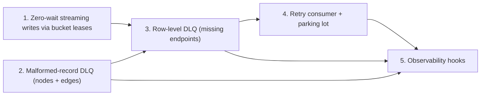

# Phase 5: Real-Time Streaming & Resilience — Feature Slices

## Phase Summary

Phase 5 turns graph-loader from a bulk/lease-batch library into one that can
run `--mode stream` forever without a human watching it: relationship writes
never wait on a Neo4j lock, a relationship that arrives before its node is
never lost, malformed records never silently vanish into a local file, and a
transient failure gets bounded, visible retries instead of an indefinite hang
or a silent drop. Every mechanism is schema/YAML-driven so it works for any
graph model, any number of edge types, and hub-heavy degree distributions —
nothing here is IMDb-specific.

### Current state vs. the epic

The epic's `technical.md` (written before Phase 4 existed) assumed the classic
per-type loaders and proposed a single `apoc.lock.nodes` query with row-level
`OPTIONAL MATCH` feedback for the DLQ. That is no longer the right design:

* **Streaming concurrency already has two competing mechanisms, and neither
  gives zero lock waits everywhere.** Phase 4 built a run-scoped global batch
  clock (`src/orchestrator/coordination.py`, `rotation.py`, `clock_runner.py`)
  that rotates *whole-bucket* ownership of shared endpoint labels between
  conflicting relationship types, one type per slot, and isolates
  self-referencing types into a separate serialized phase. This removes
  starvation but still uses Neo4j's own locking (or explicit APOC locks)
  *inside* a slot, and self-reference isolation is deliberately serial.
  Separately, Phase "bulk resilience" work built a real zero-wait mechanism —
  the bucket-lease coordinator (`src/orchestrator/lease_server.py`,
  `src/loader/lease_client.py`, `BucketLeaseExecutionCoordinator` in
  `src/loader/edge_execution.py`) that grants exact, per-transaction,
  node-disjoint resource sets across *every* edge type and container at once,
  including self-references (a self-reference cell just collapses to one
  resource). **It is wired up for bulk only**: `--edge-leases` is rejected
  outside `--mode bulk` (`_validate_edge_lease_settings` in `src/cli.py`).
  Owner decision 1 (below) picks the lease coordinator as the streaming
  mechanism and requires this phase to decide what, if anything, the clock
  still does in streaming.
* **Relationship writes are all-or-nothing per transaction today.** Both
  `ApocLockedEdgeWriter` and `NativeDisjointEdgeWriter` in
  `src/loader/edge_execution.py` validate every row's endpoints in one
  aggregate check and roll the whole transaction back if any row fails to
  resolve exactly one source and target (`MissingRelationshipEndpointError`).
  There is no row-level signal today about *which* rows failed — the
  aggregate query only returns counts. Row-level DLQ (owner decision 2) needs
  a new query shape that commits the matched rows and reports the unmatched
  ones, not a bigger hammer on the existing aggregate check.
* **DLQ and dead-letter scaffolding exists but is inert.** `DeadLetterConfig`
  and `EdgeConfig.dead_letter` (`src/models/schema.py`) are defined and
  documented but never read by any loader. `RetryConfig`
  (`edge_config.retry`) *is* used, but only for retrying Neo4j
  `TransientError`s (e.g. deadlocks) within one write attempt
  (`ApocLockedEdgeWriter.write_rows`); it has nothing to do with a DLQ retry
  loop or `_retry_after`. The only failure sink that exists today is
  `RejectionSink`, an fsync'd JSONL file used by both `node_loader.py` and
  `edge_loader.py` for malformed records, with the log line
  `phase5_action=route_to_dlq` already marking exactly where Phase 5 replaces
  it.
* **Offset discipline to build on.** Both loaders already commit Kafka
  offsets only for contiguously resolved records (`PartitionLedger`), already
  commit-on-revoke inside `_on_revoke` (blocking the poll thread briefly to
  let an in-flight worker batch finish and commit before handing partitions
  to a new owner), and bulk relationship loaders already use static partition
  assignment. This offset machinery is reused, not rebuilt, by every slice
  below: a DLQ or parking-lot publish is just one more way a record becomes
  "durably resolved" before its offset can commit.

### Owner decisions (binding)

1. **Zero lock waits in streaming, via the bucket-lease coordinator.** Not
   the APOC-locked query from `technical.md`. Slice 1 must also state,
   explicitly, what becomes of the Phase 4 global clock and rotation plan in
   streaming (replaced, or kept for something orthogonal to write
   concurrency) — see the open question below; this plan does not silently
   delete Phase 4 code.
2. **Row-level DLQ for missing endpoints.** In a relationship batch, only the
   rows whose source/target isn't resolvable yet go to that type's DLQ
   topic; the rest of the batch commits. Kafka offsets commit only once every
   record in the batch is either durably written or durably in the DLQ.
3. **Node DLQ.** Malformed node records *and* malformed relationship records
   go to a DLQ topic, replacing the fsync'd rejection file, with a documented
   migration/compat path.
4. **Retry consumer with a parking lot.** Re-attempts DLQ'd relationships
   with exponential `_retry_after` backoff, honored without blocking
   `poll()` (pause/resume), up to a configured maximum attempts; after that,
   records go to a parking-lot topic (`<topic>.dlq.parked` or configurable),
   never silently dropped, and stay replayable.
5. **Bulk keeps its default fail-closed behavior.** A missing endpoint in
   bulk stays "bad data, fail the run" unless an explicit opt-in enables DLQ
   routing there too.
6. **Generic, schema/YAML-driven, and built for scale**: many edge types,
   high-throughput streams, hub nodes, backpressure, DLQ growth,
   restart/recovery, and idempotent-MERGE-plus-offset-discipline
   exactly-once-ish semantics.
7. **Observability hooks now, metrics exposure later.** This phase defines
   and emits the counters/events (`dlq_routed`, `retries`, `parked`, …) that
   Phase 6's Prometheus exporter will read; it does not build the exporter.

## Slice 1: Zero-Wait Streaming Relationship Writes via Bucket Leases

**As a** Pipeline Operator,
**I want** streaming relationship writes to acquire node-disjoint bucket
leases before every transaction, fleet-wide, instead of relying on Neo4j's
own locking or a rotating slot,
**So that** `--mode stream` relationship throughput never blocks on a lock
wait or a rotation-wait, for any relationship type including
self-references.

### Business Problem

Today only bulk mode can reach zero lock waits (`--edge-leases`, bulk-only).
Streaming relies on the Phase 4 clock, which prevents starvation between
conflicting types but still serializes work inside a slot with Neo4j's own
locking, and isolates self-referencing types into their own serial phase.
Neither eliminates lock waits the way leases already do for bulk. Owner
decision 1 requires streaming to get the same zero-wait guarantee.

### Expected Behaviour

* A run-scoped bucket-lease coordinator (the existing `BucketLeaseServer`)
  is launched for the whole streaming session, not just for a bounded bulk
  run, and every relationship-loader container (conflicting, non-conflicting,
  and self-referencing types alike) is wired through
  `BucketLeaseExecutionCoordinator` instead of the classic
  `apoc.lock.nodes`/native-disjoint path.
* Self-referencing types no longer need a dedicated isolated phase: a
  self-reference's cell already collapses source and target to shared
  resources in `BucketCellRouter`, so it is naturally node-disjoint from
  every other concurrently running transaction without a separate schedule.
* The existing dual-thread consumer model (poll/rebalance thread +
  bounded worker queue, from Phase 4 Slice 2) is retained for
  `max.poll.interval.ms` safety: the worker thread now blocks on lease
  acquisition and the write, while the poll thread keeps heartbeating and
  handling rebalances, exactly as today.
* The role of the Phase 4 global batch clock and rotation plan in streaming
  is explicitly decided and documented (see the open question below) rather
  than left ambiguous: either the clock is retired for streaming runs (its
  concurrency-control job is now redundant with leases) or it is kept for a
  distinct, named purpose that leases do not cover.
* A missing endpoint in this slice still fails the batch exactly as bulk
  lease mode does today (`MissingRelationshipEndpointError`); tolerating a
  missing endpoint gracefully is explicitly Slice 3's job, not this one's.

### Scope

**IN scope:**

- Launch and supervise a long-lived bucket-lease coordinator for the
  duration of a streaming run (not bounded to a bulk phase), with the same
  fail-closed connection/HELLO handshake behavior as bulk mode.
- Route every streaming relationship loader's writes through
  `BucketLeaseExecutionCoordinator`/`BucketCellRouter`, for conflicting,
  non-conflicting, and self-referencing types, replacing the clock-gated
  admission-buffer path and the isolated self-reference phase for streaming
  runs.
- Decide and document the fate of `coordination.py`/`rotation.py`/
  `clock_runner.py` for `--mode stream`: retire the ownership-rotation
  responsibility, keep any orthogonal responsibility (if one is identified)
  under a new name to avoid confusion with the unrelated "lease" terminology
  already used by `CoordinationConfig.lease_timeout_ms`.
- Preserve existing offset-commit safety: commit-on-revoke, static
  assignment where used, and Kafka heartbeat liveness during a blocked write.
- Unit and integration tests: lease-fleet coverage across mixed
  conflicting/non-conflicting/self-referencing types with zero measured
  Neo4j lock-wait time; a rebalance mid-lease-hold still commits or safely
  abandons per the existing revoke contract; coordinator restart/crash is
  fail-closed (no writer proceeds without a proven lease).

**OUT of scope:** Row-level DLQ for missing endpoints (Slice 2); malformed
record DLQ (Slice 3); retry consumer and parking lot (Slice 4); bulk mode
(unchanged, still opt-in `--edge-leases` or planned mode); observability
counters (Slice 5).

### Definition of Done

- [ ] Every streaming relationship write, for every edge type, is preceded
      by a proven bucket-lease grant; no write path still issues
      `apoc.lock.nodes` or relies on Neo4j's own MERGE locking in stream mode.
- [ ] Self-referencing types run concurrently with every other type under
      one lease coordinator, with no separate isolated phase, and with no
      duplicate or lost relationships versus the isolated behavior.
- [ ] A streaming E2E run shows 0 ms of Neo4j lock-wait time across a
      mixed fleet (conflicting-label types + a self-referencing type) run
      concurrently, matching the bulk lease-mode measurement methodology in
      `docs/USAGE.md`.
- [ ] The disposition of the Phase 4 clock/rotation code for streaming is
      documented in code comments/docs, not left implicit.
- [ ] Kafka heartbeats continue and rebalances resolve safely while a worker
      thread blocks on a lease grant or a write.

### Dependencies

Depends on: Phase 4 Slices 1–4 (reuses the dual-thread consumer/admission
model and conflict-family/self-reference classification as inputs to the
decision above); the existing bulk bucket-lease coordinator
(`lease_server.py`, `lease_client.py`, `BucketLeaseExecutionCoordinator`).
Blocks: Slices 2–5 (every later slice assumes streaming relationship writes
already go through the lease-based writer).

### Rough Effort

**XL**

## Slice 2: Dead-Letter Routing for Malformed Node and Relationship Records

**As a** Data Engineer,
**I want** malformed node and relationship records published to a DLQ topic
instead of an fsync'd local file,
**So that** bad records are centrally visible, replayable, and recoverable
across container restarts and host failures, not stranded on one
container's disk.

### Business Problem

`RejectionSink` writes malformed records to a local JSONL file per
container. That file isn't visible to any consumer, doesn't survive the
container's disk being lost, and can't be replayed once the schema or a
downstream fix is available. The epic and owner decision 3 call for a DLQ
topic instead, with a migration path since some operators may depend on the
existing file today.

### Expected Behaviour

* Every malformed node record (decode/JSON/validation failure in
  `node_loader.py`) and every malformed relationship record (same in
  `edge_loader.py`, before endpoint resolution is even attempted) is
  published to a DLQ topic instead of, or in addition to, the rejection
  file.
* The DLQ topic name defaults to `<source topic>.dlq`, or the schema's
  `dead_letter.topic` when set (`EdgeConfig.dead_letter`); an equivalent
  optional field is added for nodes so the same override applies there.
  `DeadLetterConfig.enabled=False` preserves today's log-and-continue
  behavior without a DLQ publish.
* The DLQ envelope carries the original raw payload, the source topic/
  partition/offset, the failure reason, a first-seen timestamp, and an
  attempt count initialized for the retry consumer's bookkeeping (Slice 4),
  even though this class of failure is not auto-retried (see the open
  question below).
* A record's Kafka offset commits only after its DLQ publish is
  acknowledged — the same contiguous-resolution ledger the loaders already
  use for successful writes, extended to cover "durably DLQ'd" as another
  terminal resolution.
* Migration/compat path: `rejection_log_path` and the JSONL sink remain
  available and documented as a fallback (e.g. for local/offline runs
  without a DLQ topic, or a transition period), selected by explicit
  configuration; the DLQ path is not forced on existing deployments without
  an opt-in flag or a schema field.

### Scope

**IN scope:**

- A shared DLQ-envelope model and a DLQ producer used by both
  `node_loader.py` and `edge_loader.py`.
- Wire `RejectionSink`'s call sites to the DLQ producer when configured;
  keep the file-sink implementation as the documented compatibility
  fallback.
- Extend `NodeConfig` with an optional dead-letter field mirroring
  `EdgeConfig.dead_letter`.
- Offset-commit integration: a DLQ publish is a durable resolution exactly
  like a successful write, under the existing `PartitionLedger` contiguity
  rule.
- Tests: envelope shape, default vs. configured topic naming, `enabled:
  false` fallback behavior, offset-commit-only-after-ack, and a documented
  migration test/procedure from the JSONL file.

**OUT of scope:** Row-level (partial-batch) DLQ routing for missing
endpoints — this slice's malformed-record DLQ fires before endpoint
resolution is attempted at all (Slice 3); the retry consumer and parking lot
(Slice 4); bulk mode's fail-closed default (unchanged, opt-in only per owner
decision 5); metrics exposure (Slice 5, though this slice must emit the
counter events).

### Definition of Done

- [ ] Every malformed node record and every malformed relationship record
      is durably published to a DLQ topic (or the compat file, if
      explicitly configured) before its offset commits.
- [ ] `DeadLetterConfig.enabled=False` preserves today's log-and-continue
      behavior with no DLQ publish attempted.
- [ ] The DLQ envelope is sufficient, on its own, to reconstruct the
      original record and know why and where it failed.
- [ ] A documented migration path exists from the JSONL rejection file to
      DLQ-topic routing, with no silent behavior change for a deployment
      that does not opt in.
- [ ] Unit tests cover both node and relationship malformed-record paths and
      the offset-commit-after-ack ordering.

### Dependencies

Depends on: none from this phase (independently deployable ahead of or
alongside Slice 1). Blocks: Slice 3 (reuses the DLQ envelope/producer for
missing-endpoint rows) and Slice 5 (counters for `dlq_routed`).

### Rough Effort

**M**

## Slice 3: Row-Level DLQ for Missing-Endpoint Relationship Rows

**As a** Data Engineer,
**I want** a relationship batch to commit every row whose endpoints already
exist and route only the rows that lost the edge-before-node race to that
type's DLQ,
**So that** one out-of-order record never blocks or fails an entire batch
of otherwise-good relationships.

### Business Problem

Today's single-statement write (`ApocLockedEdgeWriter`/
`NativeDisjointEdgeWriter`) validates all rows in aggregate and rolls the
whole transaction back if even one row's endpoint is missing. In a
continuous stream, the edge-before-node race is expected, not exceptional,
and it must not stall or fail unrelated rows in the same batch.

### Expected Behaviour

* The relationship write query changes shape from "all rows or nothing" to
  one that resolves each row's endpoints independently, writes every row
  that resolved exactly one source and target in the same transaction, and
  reports precisely which rows did not (missing, or ambiguous because more
  than one node matched the key).
* Rows that didn't resolve are published to that edge type's DLQ topic
  (Slice 2's producer/envelope) instead of failing the batch; the batch's
  resolved rows still commit as one Neo4j transaction.
* A batch's Kafka offsets commit only once every row in it is either
  durably written or durably DLQ'd — never before both conditions hold for
  every row, and never for a row that is neither.
* This behavior applies to streaming relationship writes through the
  lease-based writer from Slice 1. Bulk mode's default fail-closed behavior
  (owner decision 5) is unchanged; DLQ routing in bulk is available only
  behind an explicit opt-in flag reusing the same mechanism.
* Hub nodes and high-throughput types are handled at the same granularity
  as any other type — row-level DLQ does not special-case degree or volume,
  so it scales the same way planned/lease mode already does.

### Scope

**IN scope:**

- A new relationship write query (or a per-row variant of the existing
  single-statement query) that separates "written" rows from "endpoint not
  resolved" rows within one transaction, for the lease-based writer path.
- Route unresolved rows to the DLQ producer from Slice 2, tagged with which
  endpoint (source, target, or both) failed to resolve and why (missing vs.
  ambiguous).
- Extend the offset-ledger contract so a batch's offset advances only once
  every row is accounted for as written or DLQ'd.
- The explicit bulk opt-in flag/schema setting that reuses this same
  row-level mechanism for bulk relationship writes (owner decision 5),
  off by default.
- Tests: mixed-batch commits (some rows written, some DLQ'd, same
  transaction); ambiguous-endpoint rows are distinguished from missing-
  endpoint rows in the DLQ envelope; offset-commit ordering under partial
  batches; bulk's default fail-closed behavior is unchanged when the opt-in
  is off.

**OUT of scope:** The retry consumer that re-reads this DLQ (Slice 4); the
malformed-record DLQ, which is a different failure class entirely (Slice 2,
already shipped); metrics exposure (Slice 5).

### Definition of Done

- [ ] A batch with some rows whose endpoints exist and some whose endpoints
      don't commits the resolvable rows and DLQs only the rest, in one
      transaction.
- [ ] The batch's Kafka offset commits only after every row in it is either
      written or durably DLQ'd; a crash between the two never double-commits
      or drops a row.
- [ ] Missing vs. ambiguous endpoint failures are distinguishable in the DLQ
      envelope.
- [ ] Bulk mode's default (fail-closed) behavior is provably unchanged
      unless the new opt-in is set.
- [ ] A streaming E2E scenario publishes a relationship before its node,
      confirms the row lands in the DLQ, then publishes the node and confirms
      Slice 4's retry consumer (or, absent Slice 4, a manual replay) resolves
      it without data loss or duplication.

### Dependencies

Depends on: Slice 1 (lease-based writer to modify) and Slice 2 (DLQ
producer/envelope). Blocks: Slice 4 (nothing to retry without this DLQ) and
Slice 5 (`dlq_routed` counter for missing-endpoint rows specifically).

### Rough Effort

**L**

## Slice 4: Retry Consumer with Backoff and a Parking Lot

**As a** Pipeline Operator,
**I want** a background consumer that re-attempts DLQ'd relationship rows on
an exponential `_retry_after` backoff without blocking Kafka `poll()`, and
parks rows that exhaust their retries instead of dropping them,
**So that** a transient edge-before-node race self-heals automatically, and
a row that never resolves is still visible and replayable, never lost.

### Business Problem

Once Slice 3 exists, DLQ'd rows need somewhere to go besides a topic nobody
reads. Without a retry loop, every out-of-order relationship needs a manual
replay. Without a bound, a permanently unresolvable row (e.g. the node truly
never arrives) either retries forever or gets silently dropped — both are
unacceptable per the epic and owner decision 4.

### Expected Behaviour

* A retry consumer reads the relationship missing-endpoint DLQ topic(s) from
  Slice 3, honors each record's `_retry_after` timestamp using `pause()`/
  `resume()` on the relevant partitions (never a blocking sleep in the poll
  loop), and re-attempts the write through the same lease-based writer used
  by the live stream.
* On a further failure, the record's attempt count increments and
  `_retry_after` backs off exponentially (`RetryConfig`-shaped: base delay,
  multiplier, max delay), up to a configured maximum attempts.
* After the maximum attempts, the record is published to a parking-lot
  topic (default `<original topic>.dlq.parked`, overridable) — never
  dropped — and remains consumable there for manual inspection or replay.
* Malformed-record DLQ messages from Slice 2 are **not** put through this
  same automatic retry loop by default: a schema/type violation fails
  identically on every retry until the record or the schema changes, so
  automatic retry only wastes cycles and delays the parking-lot signal. This
  is called out explicitly as a design decision needing owner confirmation
  in the open questions below, since the epic's literal wording ("a retry
  consumer... re-attempts edges parked in the DLQ") does not by itself rule
  either reading out.
* Offset discipline mirrors the live path: a DLQ record's position in the
  DLQ topic commits only once it is durably re-written to Neo4j or durably
  parked.

### Scope

**IN scope:**

- A retry-consumer process/container reading the Slice 3 DLQ topic(s),
  honoring `_retry_after` via pause/resume, bounded by a configurable
  maximum attempts.
- Exponential backoff calculation and persistence of attempt count/
  `_retry_after` on each re-queued record.
- A parking-lot producer and topic-naming convention, with replayability
  (a parked record carries everything needed to be replayed onto the
  original topic or written directly).
- Tests: backoff timing/ordering, `poll()` never blocks on a future
  `_retry_after`, exhausted attempts land in the parking lot, and a parked
  record can be replayed successfully once its underlying cause is fixed.

**OUT of scope:** Whether malformed-record DLQ messages (Slice 2) are
included in this retry loop — flagged as an open question, not decided
here; metrics exposure (Slice 5, though this slice must emit the counter
events).

### Definition of Done

- [ ] A DLQ'd relationship row with a since-arrived endpoint is
      automatically rewritten to Neo4j within its backoff window, with no
      duplicate relationship created.
- [ ] `poll()` on the retry consumer never blocks waiting for a
      `_retry_after` to elapse; pause/resume is used instead.
- [ ] A row that never resolves is parked, not dropped, after the
      configured maximum attempts, and is replayable from the parking-lot
      topic.
- [ ] Backoff is exponential and bounded (base/multiplier/max delay), and
      is unit tested independent of Kafka/Neo4j.
- [ ] Offsets in the DLQ topic commit only after a row is durably rewritten
      or durably parked.

### Dependencies

Depends on: Slice 3 (the DLQ it reads) and Slice 1 (the writer it retries
through). Blocks: Slice 5 (`retries`/`parked` counters).

### Rough Effort

**L**

## Slice 5: Observability Hooks for DLQ, Retry, and Parking Events

**As a** Site Reliability stakeholder (Phase 6's consumer),
**I want** every DLQ, retry, and parking event to emit a well-defined
counter/event,
**So that** Phase 6 can build alerting and dashboards on top without
touching this phase's write path again.

### Business Problem

Phase 6 (observability) needs stable counters to expose via Prometheus, but
building the exporter is explicitly out of this phase's scope. Without
agreed event names and cardinality now, Phase 6 either blocks on this phase
or invents its own incompatible instrumentation later.

### Expected Behaviour

* Every DLQ publish (malformed, Slice 2; missing-endpoint, Slice 3) emits a
  `dlq_routed` counter event, labeled at minimum by node label or edge type,
  DLQ topic, and failure class (malformed vs. missing-endpoint vs.
  ambiguous-endpoint).
* Every retry attempt (Slice 4) emits a `retries` counter event, labeled by
  edge type and outcome (succeeded, failed-will-retry, failed-parked).
* Every parking-lot publish emits a `parked` counter event, labeled by edge
  type and parking topic.
* Events are structured (not just free-text log lines) so Phase 6 can wire
  them to Prometheus without re-deriving them from logs; they are emitted
  in-process (e.g. a small counters/events module imported by the loaders
  and the retry consumer) rather than requiring a new transport.
* No metrics server, `/metrics` endpoint, or Prometheus client library is
  introduced here — that remains entirely Phase 6.

### Scope

**IN scope:**

- Define the counter/event names, labels, and emission points listed above.
- Instrument Slices 2, 3, and 4's code paths to emit them at the point of
  DLQ publish, retry attempt, and parking-lot publish.
- Document the event contract (names, labels, cardinality bounds) so Phase
  6 can build against it without re-reading this phase's source.
- Tests: each instrumented path emits exactly one event per occurrence, with
  the documented labels, including under partial-batch (row-level DLQ)
  conditions.

**OUT of scope:** Prometheus exporter, `/metrics` endpoint, dashboards,
alerting rules — all Phase 6.

### Definition of Done

- [ ] `dlq_routed`, `retries`, and `parked` events are emitted at every
      point defined above, with documented labels.
- [ ] The event contract is written down (names, labels, cardinality) in a
      place Phase 6 can read without touching this phase's internals.
- [ ] No new external dependency (metrics client, server, port) is
      introduced by this slice.
- [ ] Tests confirm one event per occurrence across malformed, missing-
      endpoint, retry, and parking paths, including partial-batch cases.

### Dependencies

Depends on: Slices 2, 3, and 4 (instruments their code paths). Blocks:
nothing in this phase; unblocks Phase 6.

### Rough Effort

**S**

## Slice Map

## Open Questions / Architecture Risks (not decided here)

1. **Fate of the Phase 4 global clock/rotation machinery in streaming
   (Slice 1).** Owner decision 1 asks this phase to decide whether leases
   *replace* or *complement* the clock. This document recommends replacing
   the clock's write-concurrency role (leases already give a strictly
   better guarantee, fleet-wide, including self-references), but whether
   `coordination.py`/`rotation.py`/`clock_runner.py` and the coordination
   Kafka topic are removed, retired-but-kept-for-bulk-only, or repurposed
   for something the lease coordinator doesn't cover (e.g. run-scoped
   liveness/health reporting distinct from TCP-lease-ownership) is a
   technical design call for the Slice Cartographer, not settled here. Note
   also the terminology collision: `CoordinationConfig.lease_timeout_ms`
   (the clock's slot lease) and the unrelated TCP bucket-lease coordinator
   both use the word "lease" for different things — recommend renaming one
   during implementation.
2. **Does the retry consumer (Slice 4) also retry malformed-record DLQ
   messages (Slice 2), or only missing-endpoint rows (Slice 3)?** This
   document assumes only the latter (a malformed record fails identically
   on every retry, so auto-retrying it is wasted work), but the epic's text
   doesn't explicitly rule out the former, and the owner decisions don't
   disambiguate it either. Needs an explicit owner call before Slice 4 is
   built.
3. **Bulk opt-in mechanics for row-level DLQ (Slice 3, owner decision 5).**
   The decision states DLQ routing in bulk "may be an explicit opt-in only"
   without specifying the flag/schema shape (a CLI flag like
   `--edge-plan`/`--edge-leases`, a schema-level toggle, or both). Left to
   the Slice Cartographer, but flagging that bulk's planned mode (the
   default, fastest path) fails closed on any invalid record *by design*
   per `docs/USAGE.md` section 12 ("there is no rejection log for
   relationships in this mode") — extending row-level DLQ to planned mode
   specifically, versus only to lease/classic bulk modes, is a bigger change
   than extending it to lease-mode bulk alone, and should be scoped
   explicitly before estimation.
4. **DLQ topic growth and retention are not addressed in this plan.** Owner
   decision 6 asks the design to "think about... DLQ growth," but no slice
   above owns retention policy, alerting on DLQ backlog size, or a bound on
   how large the parking lot can grow before it needs operator attention.
   This may be intentionally deferred to Phase 6 (alerting) plus ops
   documentation, but it isn't claimed by any slice here — confirm that's
   acceptable rather than an oversight.
5. **Exactly-once-ish semantics under retry-consumer crash.** Slice 4's
   offset-commit-after-durable-outcome rule prevents the retry consumer from
   losing a row, but a crash between "Neo4j write committed" and "DLQ
   offset committed" will cause the retry consumer to reprocess that row on
   restart. Since relationship writes are idempotent `MERGE`, this is safe
   for the graph, but it means the `retries`/`dlq_routed` counters (Slice 5)
   can double-count on restart. Flagging so Phase 6's alerting doesn't treat
   raw counter deltas as an exact retry count.
