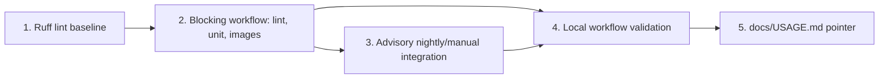

# Phase 6 / Slice 1: CI Pipeline — Lint, Unit Tests, Image Builds

## Slice Summary

This slice adds the repository's first CI pipeline. Two workflows, not one:
a **blocking** workflow (`ci.yml`) that runs on every push/PR — lint, the
~900-test unit suite, and a build of all three container images — and a
separate **advisory** workflow (`ci-integration.yml`) that runs the
`testcontainers`-backed integration suite nightly and on manual dispatch
only, per the orchestrator's binding resolution of P6-Q2
(`plan/v5-v6-orchestration.md`). Nothing here changes runtime behavior:
this slice is `.github/`, `pyproject.toml`'s `[tool.ruff]` table,
`requirements-dev.txt`, a handful of `Makefile` targets, twenty single-line
dead-code removals ruff finds today, and a documentation pointer.

All measurements below were taken by installing `ruff==0.16.9` into a
throwaway `/tmp` venv and running it against this tree exactly as the First
Mate will encounter it (branch `feat/streaming-observability`, no other
changes). The repo's own venvs were never modified. Two independent,
concrete findings came out of that verification and out of running the
documented unit command in a clean interpreter, both folded into the
acceptance criteria below:

1. **`ruff` with no `[tool.ruff]` section selects effectively every rule
   category it ships** (confirmed empirically: `ruff check --show-settings`
   with no config lists ~416 enabled rules, not the commonly assumed
   `E4,E7,E9,F` default) — so *not* adding a `[tool.ruff.lint].select` table
   would make the lint job noisy with hundreds of stylistic findings
   (`BLE001` blind-except: 100, `I001` unsorted imports: 87, `EXE002`
   shebang: 58, `UP035/UP037/UP006/UP045` pyupgrade: 65 combined, etc.),
   most of which would require touching dozens of files — exactly the
   "repository-wide reformat" `plan/v5-v6-orchestration.md` forbids. Story 1
   picks an explicit, narrow `select`.
2. **The documented unit command silently depends on a second requirements
   file.** Running
   `pytest tests examples/imdb/tests -m "not integration and not smoke"`
   in a venv built from *only* `requirements.txt` aborts collection
   entirely (`ModuleNotFoundError: No module named 'pandas'` from
   `examples/imdb/tests/test_build_subset.py`, which imports
   `examples/imdb/build_subset.py`, which imports `pandas`).
   `examples/imdb/requirements.txt` (`pandas>=2.2`) is a separate,
   deliberately-excluded-from-the-loader-image file
   (`# Optional local tooling for examples/imdb/build_subset.py. Kept
   outside the production loader image dependencies.`). A CI unit job that
   installs only `requirements.txt` would be red on `main` on day one,
   violating this slice's own Definition of Done. Story 2 installs both
   files. With both installed, `pytest tests examples/imdb/tests -m "not
   integration and not smoke"` passes clean: **903 passed, 13 deselected**
   in ~15s on this tree (the 900th test not present is
   `tests/test_dev_environment.py::test_process_environment_overrides_dotenv`,
   which *does* collect and pass once `.env` is absent — see Story 2).

## Story 1: Pin a Zero-Reformat Ruff Lint Baseline

**As a** Maintainer,
**I want** a `ruff` configuration that passes today's tree with only a
short, explicit list of genuine fixes,
**So that** the lint gate is trustworthy the day it ships instead of
starting red, or silently laundering real defects behind a blanket
`ignore = ["ALL"]`.

### Technical Context

- **Tool and pin.** Add `requirements-dev.txt` (new file, sibling to
  `requirements.txt`, not merged into it — mirrors the existing
  `examples/imdb/requirements.txt` pattern of keeping dev/example-only
  tooling out of the production dependency list the loader images
  install):

  ```
  # Development and CI tooling. Not installed into any loader image
  # (Dockerfile.node_loader / Dockerfile.edge_loader / Dockerfile.clock
  # install only requirements.txt).
  ruff==0.16.9
  actionlint-py==1.7.12.25
  ```

  (`actionlint-py` is consumed by Story 4; pinning it here now avoids a
  second dev-dependency file later.)

- **`pyproject.toml`: add `[tool.ruff]`.** The existing
  `[tool.pytest.ini_options]` table is untouched. Append:

  ```toml
  [tool.ruff]
  target-version = "py312"

  [tool.ruff.lint]
  # Pyflakes (F) plus only the pycodestyle "E" codes that are actually
  # clean on this tree. Deliberately narrower than ruff's commonly-assumed
  # "E4,E7,E9,F" default because several E7xx codes fire on this
  # codebase's existing, intentional style (see ignore list below) — this
  # repo's lint baseline must pass without a reformat
  # (plan/v5-v6-orchestration.md, "Lint baseline").
  select = [
      "E4",   # import syntax (E401 multiple-imports-on-line: 0 hits; E402 excluded below)
      "E7",   # statement/comparison style (most sub-codes excluded below; E711/E712/E713/E714/E721/E722/E703: 0 hits)
      "E9",   # runtime syntax errors (0 hits — nothing to except)
      "F",    # pyflakes: unused imports/names, undefined names, f-strings
  ]
  ignore = [
      # 30 hits (10 src/cli.py, 7 examples/imdb/publish_and_load_nodes.py,
      # 2 src/orchestrator/schema_initializer.py, 1
      # src/orchestrator/docker_service.py, 2 tests/test_cypher_generator.py
      # + tests/test_schema_initializer.py). All are imports placed after
      # helper-function definitions further up the same module, not
      # sys.path-shim patterns. Moving them is a real code-shape change
      # (risk of exposing a latent circular import) — out of scope for a
      # lint-only slice. Revisit in a dedicated cleanup story.
      "E402",
      # E701 (colon) / E702 (semicolon): 22 + 96 hits, heaviest in
      # src/loader/edge_execution.py (e.g. line 243:
      # "self._driver = driver; self._error_factory = ...") — an
      # intentional compact-assignment style used throughout the hot
      # write path, not a defect.
      "E701",
      "E702",
      # E731 (lambda assignment): 5 hits, all test-only fixture helpers
      # (tests/test_edge_execution_writer.py x4, tests/test_relationship_bulk_e2e.py x1).
      "E731",
      # E741 (ambiguous variable name `l`): 2 hits, both test-only lambda
      # parameters (tests/test_auto_settings.py:227, tests/test_planned_edges_cli.py:489).
      "E741",
  ]
  ```

  Deliberately **not** added: `[tool.ruff.format]` / a `ruff format --check`
  CI step. Measured: `ruff format --check` reports **83 files would be
  reformatted, 11 already formatted** on this tree today — enabling it is
  the exact repository-wide reformat the orchestrator ruled out. Not
  revisited in this slice.

- **Genuine fixes (all of them — this is the complete list, measured with
  the `select`/`ignore` above, zero rules beyond it enabled):**

  | # | File:line | Finding | Fix |
  |---|---|---|---|
  | 1–3 | `examples/imdb/publish_and_load_nodes.py:37` | `F401` — `DEFAULT_CHUNK_ROWS`, `DEFAULT_HUB_DEGREE`, `DEFAULT_PLAN_BUCKETS` imported from `src.loader.edge_plan`, unused | Delete the three names from the `import` line |
  | 4 | `src/cli.py:94` | `F401` — `DEFAULT_PLAN_WRITERS` imported from `src.orchestrator.planned_edges`, unused | Delete the name from the `import` line |
  | 5 | `src/cli.py:1511` | `F541` — `logger.info(f"Stopping loader(s)...")`, f-string with no placeholder | Drop the `f` prefix |
  | 6 | `src/loader/edge_execution.py:623` | `F401` — `EdgeWriter` imported from `src.loader.edge_loader` inside a function, unused | Delete `EdgeWriter` from that local import (keep `MissingRelationshipEndpointError`) |
  | 7 | `src/loader/edge_loader.py:30` | `F401` — `PropertyConfig` imported from `src.models.schema`, unused | Delete the name from the `import` line |
  | 8 | `src/loader/edge_loader.py:728` | `F841` — `suffix = "" if lease is None else f" epoch={lease.epoch} slot={lease.slot_id}"` computed every `_poll_coordination` loop iteration, never read (no logger call in the function uses it) | Delete the line — verified no other statement in `_poll_coordination` references `suffix` |
  | 9 | `src/orchestrator/lease_server.py:47` | `F401` — `field` imported from `dataclasses`, unused | Delete the name from the `import` line |
  | 10 | `src/orchestrator/planned_dispatcher.py:51` | `F401` — `field` imported from `dataclasses`, unused | Delete the name from the `import` line |
  | 11 | `src/orchestrator/relationship_bulk_monitor.py:16` | `F401` — `ClockProtocolError` imported from `src.orchestrator.coordination`, unused | Delete the name from the `import` line |
  | 12 | `tests/test_auto_settings.py:6` | `F401` — `timedelta` imported from `datetime`, unused | Delete the name from the `import` line |
  | 13 | `tests/test_bucket_lease_execution.py:11` | `F401` — `SimpleNamespace` imported from `types`, unused | Delete the name from the `import` line |
  | 14 | `tests/test_dev_environment.py:17` | `F401` — `Consumer` imported from `confluent_kafka`, unused | Delete the name from the `import` line (keep `KafkaException`) |
  | 15 | `tests/test_edge_loader.py:33` | `F401` — `ControlDeliveryError` imported from `src.loader.node_loader`, unused | Delete the name from the `import` line (keep `RejectionSink`) |
  | 16 | `tests/test_planned_dispatcher.py:316` | `F841` — `first = running.client("w1")`, never read after | **Not** a delete: `first` holds the only reference to the connected client for the duration of the `with pytest.raises(...)` block below it, keeping "w1" connected in the dispatcher's eyes. Rename to `_first` (ruff's dummy-variable pattern ignores leading-underscore names by default — verified: `ruff check --select F841` on a `_first = 1` sample reports zero findings) so the reference — and therefore the behavior under test — is unchanged |
  | 17–18 | `tests/test_planned_edges_cli.py:6-7` | `F401` — `os`, `Path` imported, unused | Delete both `import` lines |
  | 19–20 | `tests/test_schema_validation.py:25,27` | `F401` — `IndexConfig`, `MixAndBatchConfig` imported from `src.models.schema`, unused | Delete both names from the `import` block |

  Finding 16 is the one item in this list that is not a pure deletion —
  call it out explicitly in the PR description so the reviewer checks the
  reasoning, not just the diff.

- Add a `Makefile` target so the exact command CI will run is the one
  developers run locally:

  ```makefile
  .PHONY: lint
  lint:
  	ruff check src tests examples
  ```

### Acceptance Criteria

- [ ] `pip install -r requirements-dev.txt && ruff check src tests examples`
      exits `0` on the tree as of this story's own commit (after the 20
      fixes above) with the `select`/`ignore` table in `pyproject.toml`.
- [ ] Reverting any one of the 20 fixes individually causes `ruff check` to
      report exactly that finding and nothing new — proves the fixes are
      independent, not accidentally masked by another change.
- [ ] `ruff format --check src tests examples` is **not** invoked by
      anything in this story (no formatter config, no CI step) — confirms
      the "no reformat" constraint isn't silently reintroduced.
- [ ] `tests/test_planned_dispatcher.py::test_duplicate_writer_ids_are_rejected`
      still passes after the `first` → `_first` rename (behavior-preserving
      is a build-time claim to verify, not just a lint-time one).

### Definition of Done

- [ ] `make lint` exists and passes.
- [ ] `requirements-dev.txt` is not referenced by any `Dockerfile.*` or the
      root `Dockerfile`.
- [ ] Reviewed and merged.

### Dependencies

None. Blocks: Story 2 (the blocking workflow's lint job runs this
configuration). **Estimate: 5 points.**

## Story 2: Wire the Blocking CI Workflow — Lint, Unit Tests, Image Builds

**As a** Maintainer,
**I want** every push and pull request to run lint, the unit suite, and a
build of all three loader images, gated so a lint failure stops the tests
from even starting,
**So that** a regression is caught before merge, not after a production
load, and CI minutes aren't spent running a suite whose lint gate has
already failed.

### Technical Context

- Create `.github/workflows/ci.yml`. Three jobs; `lint` gates the other
  two via `needs:`, satisfying the DoD's "fails CI before tests run"
  literally (GitHub Actions skips dependents of a failed `needs` job
  rather than starting them):

  ```yaml
  name: CI

  on:
    push:
    pull_request:

  concurrency:
    group: ci-${{ github.workflow }}-${{ github.ref }}
    cancel-in-progress: true

  jobs:
    lint:
      runs-on: ubuntu-latest
      steps:
        - uses: actions/checkout@v4
        - uses: actions/setup-python@v5
          with:
            python-version-file: .python-version
            cache: pip
            cache-dependency-path: |
              requirements.txt
              requirements-dev.txt
        - run: pip install -r requirements-dev.txt
        - run: make lint

    unit-tests:
      needs: lint
      runs-on: ubuntu-latest
      steps:
        - uses: actions/checkout@v4
        - uses: actions/setup-python@v5
          with:
            python-version-file: .python-version
            cache: pip
            cache-dependency-path: |
              requirements.txt
              examples/imdb/requirements.txt
        - run: pip install -r requirements.txt -r examples/imdb/requirements.txt
        - run: make test-unit

    build-images:
      needs: lint
      runs-on: ubuntu-latest
      strategy:
        fail-fast: false
        matrix:
          include:
            - name: node
              dockerfile: Dockerfile.node_loader
              entrypoint: '["python","-m","src.loader.node_loader"]'
            - name: edge
              dockerfile: Dockerfile.edge_loader
              entrypoint: '["python","-m","src.loader.edge_loader"]'
            - name: clock
              dockerfile: Dockerfile.clock
              entrypoint: '["python","-m","src.orchestrator.clock_runner"]'
      steps:
        - uses: actions/checkout@v4
        - uses: docker/setup-buildx-action@v3
        - uses: docker/build-push-action@v6
          with:
            context: .
            file: ${{ matrix.dockerfile }}
            push: false
            load: true
            tags: graph-loader-${{ matrix.name }}:ci
            cache-from: type=gha,scope=${{ matrix.name }}
            cache-to: type=gha,mode=max,scope=${{ matrix.name }}
        - name: Verify entrypoint
          run: |
            actual="$(docker inspect graph-loader-${{ matrix.name }}:ci --format '{{json .Config.Entrypoint}}')"
            expected='${{ matrix.entrypoint }}'
            if [ "$actual" != "$expected" ]; then
              echo "Entrypoint mismatch for ${{ matrix.dockerfile }}: got $actual, want $expected" >&2
              exit 1
            fi
  ```

  This mirrors, on the CLI, the exact assertion
  `tests/test_docker_build.py::test_docker_build_node_loader` already makes
  in Python (`attrs["Config"]["Entrypoint"] == ["python", "-m",
  "src.loader.node_loader"]`) — deliberately **not** as new pytest
  functions, since Slice 1's scope explicitly excludes new tests ("Any new
  tests beyond what already exists"), and deliberately **not** by relying
  on that existing pytest test, since it is `@pytest.mark.integration`-
  marked and therefore excluded from `unit-tests`' `-m "not integration and
  not smoke"` filter — it only runs in Story 3's advisory job. Without this
  job's own `docker inspect` step, a broken edge/clock entrypoint would not
  fail any PR, contradicting this slice's own DoD line ("A pull request
  that breaks the node, edge or clock image build fails CI").

- Add the `test-unit` Makefile target (the *exact* command from
  `plan/v6/slices.md`'s scope, so local runs and CI runs are provably the
  same invocation):

  ```makefile
  .PHONY: test-unit build-images
  test-unit:
  	pytest tests examples/imdb/tests -m "not integration and not smoke"

  build-images:
  	docker build -f Dockerfile.node_loader -t graph-loader-node:local .
  	docker build -f Dockerfile.edge_loader -t graph-loader-edge:local .
  	docker build -f Dockerfile.clock -t graph-loader-clock:local .
  ```

- **No `.env` file is created, copied, or referenced anywhere in this
  workflow.** `.env` is gitignored (`.gitignore:1`), so a clean
  `actions/checkout` has none; `tests/test_dev_environment.py`'s
  module-level `DOTENV_VALUES = _parse_dotenv(DOTENV_PATH)` (line 79) hits
  `if not path.is_file(): return {}` (line 29-30) and every `_setting(...)`
  call falls through to its hardcoded default. This is why the unit job
  needs no special-casing for that file at all — verified by running the
  full unit command in a fresh venv with `.env` absent from view: it
  collects and passes, including
  `test_process_environment_overrides_dotenv`. (The failure the task
  brief refers to — a developer's own `.env` having a line ruff/pytest
  can't parse — is a local-machine-only condition; it cannot occur on a
  clean CI checkout, so nothing needs to "tolerate" it in CI. Do not add
  a try/except or a skip for this in `tests/test_dev_environment.py`
  itself — that would be a source change with no CI benefit and would
  mask a genuinely malformed local `.env` from the developer who owns it.)

### Acceptance Criteria

- [ ] A branch with one `ruff` violation (e.g. an unused import) opens a PR
      where `lint` fails, and `unit-tests`/`build-images` show as skipped,
      not failed or passed — proving the gate, not just eventual failure.
- [ ] A branch that breaks one existing unit test (e.g. flips an assertion)
      fails only `unit-tests`; `build-images` still passes independently
      (jobs are not serialized with each other, only with `lint`).
- [ ] A branch with a syntax error in `Dockerfile.clock` fails only the
      `clock` leg of the `build-images` matrix; `node` and `edge` legs
      still pass (matrix legs are independent, `fail-fast: false`).
- [ ] A branch that changes `Dockerfile.edge_loader`'s `ENTRYPOINT` fails
      the `edge` leg's "Verify entrypoint" step even though `docker build`
      itself succeeds — proves the entrypoint check is load-bearing, not
      decorative.
- [ ] Two consecutive pushes to the same PR: the first run's in-progress
      jobs are cancelled by `concurrency.cancel-in-progress`, not left
      running — no wasted runner minutes on superseded commits.
- [ ] `main`'s current tree (after Story 1's 20 fixes) passes `lint` and
      `unit-tests`; `build-images` passes for all three matrix legs.

### Definition of Done

- [ ] `.github/workflows/ci.yml` exists with the three jobs above.
- [ ] `make test-unit` and `make build-images` exist and match the CI
      steps exactly (no drift between local and CI commands).
- [ ] Repo admin follow-up recorded (not part of this PR, cannot be set
      from a workflow file): branch protection on `main` must list `lint`,
      `unit-tests`, and each `build-images (node|edge|clock)` matrix leg as
      required status checks, or the gate is advisory in practice despite
      this story's YAML. Flag this explicitly in the PR description.
- [ ] Reviewed and merged.

### Dependencies

Depends on: Story 1 (lint must already be clean, or this workflow starts
red on merge day). **Estimate: 8 points.**

## Story 3: Wire the Advisory Nightly/Manual Integration Workflow

**As a** Maintainer,
**I want** the `testcontainers`-backed integration suite to run against a
real Neo4j Enterprise + Kafka stack on a schedule and on demand, without
ever gating a pull request,
**So that** the parts of the suite too slow or too network-dependent for
every PR (per `plan/v5-v6-orchestration.md`'s P6-Q2) still run regularly
and their results are visible, without adding Neo4j-Enterprise-license or
first-pull flakiness risk to every contributor's PR.

### Technical Context

- `plan/v6/slices.md`'s own wording ("Add a **second** CI job") suggests
  one workflow file with a second job; `plan/v5-v6-orchestration.md`
  overrides that (its header: "Where a slice document and this file
  disagree, this file wins") with "The integration job is nightly or
  manual (`workflow_dispatch`) and non-blocking." A job triggered only by
  `schedule`/`workflow_dispatch` inside `ci.yml` would still technically
  satisfy that, but splitting it into its own workflow file makes
  "non-blocking" true by construction — it is never invoked by
  `push`/`pull_request` at all, so there is no `needs:`/status-check
  entanglement with Story 2's jobs to reason about, and no risk that a
  later edit to `ci.yml`'s `on:` block accidentally makes it PR-triggered.

- Create `.github/workflows/ci-integration.yml`:

  ```yaml
  name: Integration (advisory)

  on:
    schedule:
      - cron: "0 3 * * *"  # 03:00 UTC nightly
    workflow_dispatch: {}

  jobs:
    integration:
      runs-on: ubuntu-latest
      timeout-minutes: 45
      steps:
        - uses: actions/checkout@v4
        - uses: actions/setup-python@v5
          with:
            python-version-file: .python-version
            cache: pip
            cache-dependency-path: requirements.txt
        - run: pip install -r requirements.txt
        - run: pytest tests -m integration --junitxml=integration-results.xml
        - if: always()
          uses: actions/upload-artifact@v4
          with:
            name: integration-results
            path: integration-results.xml
            retention-days: 14
  ```

- **No GitHub Actions `services:` block for Kafka or Neo4j.** The task
  framing anticipated service containers, but this repo's own pattern
  (`tests/conftest.py`) is `testcontainers`: `neo4j_connection` starts
  `Neo4jContainer("neo4j:5.21-enterprise", ...).with_env(
  "NEO4J_ACCEPT_LICENSE_AGREEMENT", "yes")` and `kafka_bootstrap` starts a
  bare `KafkaContainer()`, both from inside the test process against the
  runner's own Docker daemon (present by default on `ubuntu-latest`).
  Declaring `services:` would run *a second, redundant* Neo4j/Kafka that
  nothing in the suite talks to — every `@pytest.mark.integration` test in
  this repo brings its own isolated container(s) and skips cleanly
  (`pytest.skip(...)`) if Docker is unavailable, which is exactly the
  "no external environment variables set" condition in the slice's DoD.
  The license acceptance is already inside the fixture, not a job-level
  env var — nothing to set here.

- `tests/test_social_planned_integration.py` is module-scoped
  `pytestmark = [pytest.mark.integration, pytest.mark.skipif(not
  os.environ.get("GRAPH_LOADER_IT_KAFKA"), ...)]`. No
  `GRAPH_LOADER_IT_*` variable is set anywhere in this workflow, by
  design (Slice 1 scope explicitly excludes standing up that scratch
  stack) — this file's tests must show as **skipped** in the job's own
  output/`--junitxml`, never **error**, confirming the `skipif` guard
  fires before any fixture that would need the scratch stack runs.

- `tests/test_docker_build.py::test_docker_build_node_loader` is
  `@pytest.mark.integration` and therefore *also* runs here, redundantly
  with Story 2's dedicated `build-images` job step. This is intentional
  overlap, not a bug to dedupe: Story 2's job is the blocking, deliberate
  entrypoint check for all three images; this pytest test is pre-existing,
  node-loader-only, and simply comes along for free with `-m integration`.
  Leave both in place.

### Acceptance Criteria

- [ ] Triggering the workflow via `workflow_dispatch` on this branch (once
      pushed) runs to completion within the 45-minute timeout and uploads
      `integration-results.xml` regardless of pass/fail (`if: always()`).
- [ ] `tests/test_social_planned_integration.py`'s two tests report
      `skipped` (not `error`, not silently absent from the count) in
      `integration-results.xml`.
- [ ] Every `testcontainers`-backed integration test that needs Docker
      finds it (hosted runners ship Docker) and does not hit the
      `pytest.skip(f"Docker is required for ... integration tests: {exc}")`
      branch in `tests/conftest.py`.
- [ ] A failing run of this workflow does **not** appear as a required
      check, does not block any open PR's merge button, and does not
      appear at all in a PR's checks list unless someone manually dispatches
      it against that PR's branch.
- [ ] The workflow is absent from `ci.yml`'s job graph entirely — no
      `needs:` edge, no shared `on:` trigger.

### Definition of Done

- [ ] `.github/workflows/ci-integration.yml` exists, triggered only by
      `schedule` and `workflow_dispatch`.
- [ ] One recorded manual dispatch run (screenshot or linked run URL in the
      PR description) showing the job completed and the artifact was
      produced, since this cannot be exercised via a local `act`-style
      dry run the same way Story 4 exercises `ci.yml`'s syntax.
- [ ] Reviewed and merged.

### Dependencies

None additional — independent of Stories 1 and 2 (it does not run `ruff`,
does not depend on the unit-test fixes, and lives in its own workflow
file). Sequenced after Story 2 here only for review convenience (both
touch `.github/workflows/`). **Estimate: 5 points.**

## Story 4: Validate Both Workflows Locally Without Pushing to GitHub

**As a** First Mate,
**I want** to prove `ci.yml` and `ci-integration.yml` are syntactically and
semantically valid, and that every job's commands actually succeed, before
ever relying on GitHub Actions itself to tell me that,
**So that** the first real signal from GitHub is a true result, not a YAML
typo or an expression-syntax mistake burning a push-and-wait cycle — this
Cartographer's own environment has nothing pushed and cannot exercise
Actions at all.

### Technical Context

- `requirements-dev.txt` (Story 1) already pins `actionlint-py==1.7.12.25`
  — a PyPI-packaged wrapper around the `actionlint` Go binary
  (github.com/rhysd/actionlint), installable with plain `pip install`, no
  Go toolchain and no Docker required. Verified directly: installed into a
  throwaway venv, ran against a workflow file with a deliberately broken
  `${{ }}` expression, and it correctly reported the exact line and
  column of the syntax error. It must be run from within a git
  repository (it walks up from the working directory looking for
  `.github/workflows/`) — trivially true for this repo.

- Add a `Makefile` target:

  ```makefile
  .PHONY: validate-workflows
  validate-workflows:
  	python3 -c "import yaml, glob; [yaml.safe_load(open(f, encoding='utf-8')) for f in glob.glob('.github/workflows/*.yml')]"
  	actionlint
  ```

  The `yaml.safe_load` pass is a cheap first filter for plain YAML
  mistakes (bad indentation, tabs, duplicate keys); `actionlint` is the
  real check — it understands the GitHub Actions expression language
  (`${{ }}`), validates `uses:` action references and input names against
  known schemas, catches `runs-on`/`shell` typos, and flags a `needs:`
  reference to a job name that doesn't exist. Both must pass with no
  output (`yaml.safe_load` silent on success; `actionlint` prints nothing
  and exits `0` on a clean workflow).

- **What running `make lint`, `make test-unit`, and `make build-images`
  locally does and does not prove.** These are literally the commands
  `ci.yml` invokes (Story 2), so a green local run proves the *commands*
  work in a clean `pip install -r requirements.txt [-r ...]` environment —
  it does not prove the *YAML wiring* around them (the `needs:` graph,
  the matrix, the cache keys, the `actions/checkout`/`setup-python`
  version pins) is correct. `actionlint` is what covers that second half.
  Together they cover the workflow without ever pushing a branch or
  opening a PR.

- Record the validation, since there is no CI run URL to link to for this
  slice's own PR (nothing is pushed from this environment): capture
  `actionlint`'s exit code and `make lint && make test-unit && make
  build-images`'s combined pass/fail in the PR description text, not just
  asserted — e.g. paste the terminal output showing `903 passed, 13
  deselected` and `All checks passed!`/no `actionlint` output.

### Acceptance Criteria

- [ ] `actionlint` run against a workflow file with a deliberately
      introduced typo (e.g. `needs: lintt` referencing a non-existent job,
      or `runs-on: ubuntu-latest-typo`) reports the specific error and
      exits non-zero — proves the check has teeth, not just that it runs.
- [ ] `actionlint` run against `ci.yml` and `ci-integration.yml` as
      authored in Stories 2–3 exits `0` with no findings.
- [ ] `make lint && make test-unit && make build-images` all pass in a
      freshly created venv (`python3.12 -m venv` + `pip install -r
      requirements.txt -r requirements-dev.txt -r
      examples/imdb/requirements.txt`, nothing else) on a machine with
      Docker available, with no `.env` file present.
- [ ] Deleting `requirements-dev.txt`'s `actionlint-py` pin and re-running
      `make validate-workflows` fails with a clear "no module named
      actionlint_py" / command-not-found error, not a silent skip — proves
      the target doesn't degrade into a no-op if the dependency is
      missing.

### Definition of Done

- [ ] `make validate-workflows` exists and passes against both workflow
      files.
- [ ] The PR that lands Stories 2–4 includes the captured local output
      described above in its description.
- [ ] Reviewed and merged.

### Dependencies

Depends on: Story 2 and Story 3 (there is nothing to validate before their
YAML exists); Story 1 (needs `requirements-dev.txt` to already carry the
`actionlint-py` pin). **Estimate: 3 points.**

## Story 5: Document the Pipeline in `docs/USAGE.md`

**As a** Maintainer,
**I want** a short pointer to how CI works and how to reproduce each job
locally,
**So that** a contributor who sees a red check knows which single command
to run before pushing again, without reading the workflow YAML.

### Technical Context

- `docs/USAGE.md` currently ends at `## 12. Limitations` (line 631). Add a
  new `## 13. Continuous integration` section — a pointer, not a rewrite,
  per this slice's own scope note. Content:

  - One paragraph: `ci.yml` runs on every push/PR (`lint` → `unit-tests` +
    `build-images`, blocking); `ci-integration.yml` runs nightly and on
    manual dispatch only (advisory, never blocks a PR) and needs nothing
    beyond what the runner already provides — no scratch Kafka/Neo4j
    stack, no secrets.
  - A small table mapping each CI job to its exact local-reproduction
    command, all of which are now `make` targets:

    | CI job | Local command |
    | --- | --- |
    | `lint` | `make lint` |
    | `unit-tests` | `make test-unit` |
    | `build-images` | `make build-images` |
    | `integration` (advisory) | `pytest tests -m integration` (needs Docker; same `testcontainers` skip behavior as any other integration run documented in §2) |
    | workflow YAML validity | `make validate-workflows` |

  - One line noting `tests/test_social_planned_integration.py` keeps
    skipping in the advisory job exactly as it does locally without a
    named `GRAPH_LOADER_IT_*` scratch stack (cross-reference §4/§10 rather
    than re-documenting the variable table already there).

### Acceptance Criteria

- [ ] The new section is reachable from the existing table of contents
      style (numbered heading, consistent with §1–§12).
- [ ] No existing section's content is altered — `git diff` for this story
      touches only new lines appended after §12.
- [ ] Every command in the new table has actually been run in Stories 1–4
      and is copy-pasted, not retyped from memory.

### Definition of Done

- [ ] `docs/USAGE.md` §13 exists.
- [ ] Reviewed and merged.

### Dependencies

Depends on: Stories 2, 3, 4 (documents their final command names).
**Estimate: 2 points.**

## Story Map



## Total Estimate

**23 points** — roughly one sprint. First Mate should begin with Story 1;
Stories 2 and 3 touch disjoint files from any parallel Phase 5 work
(`.github/`, `pyproject.toml`, `Makefile`, `requirements-dev.txt`,
`docs/USAGE.md`) and, per `plan/v5-v6-orchestration.md`'s execution-order
table, are meant to land in the same wave as P5-S2 — nothing in this slice
touches `src/`.
