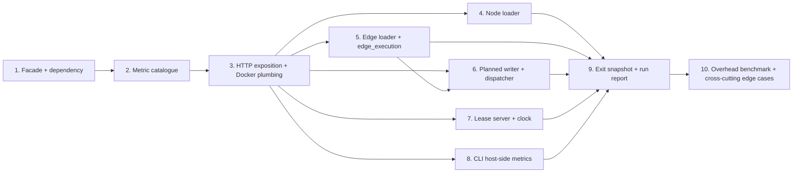

# Phase 6 / Slice 2: Core Metrics Instrumentation — Stories

Source: `plan/v6/slices.md` Slice 2, bound by `plan/v5-v6-orchestration.md`
(P6-Q1 no Pushgateway/final-snapshot-on-exit, P6-Q5 metric-name catalogue is
the single source of truth, P5-Q5 at-least-once counters, P5-S5 folded into
this slice). Wave 2 of the execution order: this slice touches every
process entry point and must land before P5-S1 (wave 3) and before Slices
3/4/5 of this phase.

## Slice recap

**As an** Operator, **I want** every loader, planned writer, dispatcher,
lease server and the CLI/orchestrator process itself to expose a Prometheus
metrics endpoint, **so that** I can see throughput, latency, lag, and
error/lock counters for a run without grepping container logs.

Out of scope for this slice (unchanged from `plan/v6/slices.md`): Docker
service-discovery config and dashboards (Slice 3); stress-test assertions
that consume these counters (Slice 4); Phase 5 actually calling the
retry/parked counters with real traffic (Phase 5's own slices — this slice
only registers them at zero and wires the one hook Phase 5 already shipped,
`on_dlq_routed`).

## Decisions this Cartographer is making now (grounded in the merged code)

These are called out up front because `plan/v6/slices.md` was written before
Phase 5 Slice 2 merged (it is merged now — `src/loader/dead_letter.py`,
commits `22c65bf`..`a8a7164`), and the epic's literal label list is a lower
bound, not a description of what the shipped hook actually gives us.

1. **`graph_loader_dlq_routed_total` gets a third label, `failure_class`,
   not just `{kind,name}`.** `dead_letter.on_dlq_routed(kind, name, topic,
   failure_class)` (`src/loader/dead_letter.py:398`) already hands us
   `failure_class` (closed enum: `malformed`, and — once P5-S3 lands —
   `missing-endpoint`/`ambiguous-endpoint`) for free. Dropping it would
   throw away exactly the dimension `plan/v5/slices.md` Slice 5 says Phase
   5's own event contract needs ("labeled... by failure class (malformed
   vs. missing-endpoint vs. ambiguous-endpoint)"). `topic` is *not* kept as
   a label — it is a deterministic function of `(kind, name)` in this
   schema-driven library (one DLQ topic per entity), so it would be a
   redundant label, not new information. This resolves
   `plan/v6/slices.md` Open Question 5 ("cross-phase naming lock-in") for
   the DLQ counter: Phase 5's later slices (S3, S4) call the same
   `on_dlq_routed(kind, name, topic, failure_class)` signature unchanged;
   they only need to pass a new `failure_class` value, never a new hook
   shape.
2. **No metric ever carries `run_id` as a label.** The task brief asks
   "run id?" and leaves it a judgement call. A Prometheus label value that
   changes every run (a fresh UUID per `graph-loader start`) is exactly the
   unbounded-over-time cardinality Prometheus's own docs warn against: a
   long-lived Prometheus server scraping many runs over weeks would
   accumulate one time series per historical `run_id` forever. Run
   correlation for a *live* scrape is Slice 3's job via a Prometheus
   `docker_sd_configs` relabel rule reading the `run_id` **Docker container
   label** (already the pattern `lease_server`/`planned_dispatcher` use,
   see Story 3) into a scrape *target* label, not a metric label baked in
   here. Durable per-run correlation is Story 9's final-values snapshot,
   named by run, under `GRAPH_LOADER_TIMING_DIR`.
3. **`clock_runner.py` gets a metrics endpoint too**, even though the
   slice's own "As an Operator" bullet list names five process kinds plus
   the CLI (not six) and omits the clock. The task's own code-grounding
   list includes it, it already has its own `Dockerfile.clock` image and
   its own `SIGTERM` handling (`src/orchestrator/clock_runner.py:42`), and
   leaving one container image dark while every sibling image reports
   `up`/`graph_loader_process_start_time_seconds` would be a silent gap an
   operator would trip over. Scope is deliberately minimal (Story 7): no
   hot-path histogram (the clock never writes to Neo4j), just the
   process-info/up/start-time triad every other process gets, so this
   doesn't grow into redesigning `GlobalBatchClock` metrics. Flagging this
   as a scope addition beyond the slice document's literal wording, for
   the reviewer to confirm rather than assume.

## Story 1: Metrics Facade Skeleton, Dependency, and Label Policy

**As a** Maintainer,
**I want** one shared `src/utils/metrics.py` module with a dependency-pinned
`prometheus_client`, a documented naming/label policy, and a registry model
that is safe to construct more than once inside a single Python process,
**so that** every later story in this slice imports one settled contract
instead of six ad hoc ones, and the ~900-test unit suite (which constructs
many `NodeLoader`/`EdgeLoader` instances per process) never hits
`ValueError: Duplicated timeseries in CollectorRegistry`.

### Technical Context

- Add `prometheus_client>=0.20` to `requirements.txt`, alongside the
  existing unpinned-upper-bound style (`pydantic>=2.7`, `neo4j>=5.20`).
  Rebuilds `Dockerfile.node_loader`, `Dockerfile.edge_loader`,
  `Dockerfile.clock` for free (`pip install -r requirements.txt`, no
  Dockerfile edit needed) — flag this to whoever picks up Slice 1's CI
  image-build job so a stale build cache doesn't hide a missing wheel.
- Create `src/utils/metrics.py` (`src/utils/` already holds
  `schema_loader.py`, `neo4j_session.py`, `cypher_generator.py` — this is
  the natural fourth module, no new package).
- **Registry-per-process, not global-default-per-import.** A naive
  `Counter("graph_loader_records_consumed_total", ..., registry=REGISTRY)`
  as a bare module-level statement is registered exactly once at first
  import (Python caches modules), so *production* processes (one Python
  process per container) are fine either way. The risk is entirely in
  tests: many test files construct multiple `NodeLoader`/`EdgeLoader`
  instances in the same pytest process, and if metric *construction* were
  tied to instance construction (e.g. inside `NodeLoader.__init__`), the
  second instance's `Counter(...)` call would collide with the first's
  already-registered name in the same registry.
  Resolve this with a factory, not bare module globals:
  ```python
  from prometheus_client import CollectorRegistry, Counter, Gauge, Histogram

  def build_registry() -> CollectorRegistry:
      """One fresh registry. Production calls this once per process
      (module-level `_PROCESS_REGISTRY`, created lazily on first use, never
      rebuilt); tests call it per test case to get full isolation without
      monkeypatching prometheus_client's global default `REGISTRY`."""
      return CollectorRegistry()

  class GraphLoaderMetrics:
      """Every metric object in the catalogue (Story 2), bound to one
      registry. One instance per process in production; one instance per
      test case in tests — never shared across test cases, so counter
      values from test A never leak into test B's assertions."""
      def __init__(self, registry: CollectorRegistry | None = None) -> None:
          self.registry = registry or build_registry()
          # Story 2 populates self.records_consumed, self.write_duration, ...

  _process_metrics: GraphLoaderMetrics | None = None

  def process_metrics() -> GraphLoaderMetrics:
      """The one instance every loader main() and docker_service label
      helper shares within this process. Lazily constructed so importing
      this module (e.g. transitively, from a test that imports
      `node_loader` but never runs `main()`) never touches
      `prometheus_client` at all."""
      global _process_metrics
      if _process_metrics is None:
          _process_metrics = GraphLoaderMetrics()
      return _process_metrics
  ```
  Every later story calls `process_metrics()` in production code paths
  (`main()` functions, hot-path write methods) and constructs its own
  `GraphLoaderMetrics(registry=CollectorRegistry())` in unit tests that
  need to assert exact values.
- **Naming convention.** Every series is prefixed `graph_loader_`, unit
  suffix per Prometheus convention (`_total` for counters, `_seconds` for
  durations, no suffix for gauges/dimensionless counts). Names are fixed by
  this story's catalogue (Story 2) and never renamed silently — anyone
  changing a name after this slice merges must update this document in the
  same change, because `plan/v6/slices.md`'s Phase Summary states
  "P6-S2's catalogue is the single source of truth for metric names."
- **Label policy (bounded cardinality, enforced by convention + a test in
  Story 2, not by a runtime check on the hot path — a runtime cardinality
  check inside `.labels(...)` would itself be the "per-record" overhead
  this slice is required to avoid):**
  | Label | Allowed values | Why bounded |
  | --- | --- | --- |
  | `kind` | closed enum: `node`, `edge`, `planned-writer`, `planned-dispatcher`, `lease-server`, `clock`, `cli` | one value per process *type*, fixed at 7 forever |
  | `name` | a node label / edge type declared in the schema, or `-` for process kinds with no single entity (lease-server, planned-dispatcher, clock, cli) | bounded by schema size (`len(schema.nodes) + len(schema.edges)`), never by record volume — this is exactly the epic's "loader/process kind and name" requirement |
  | `label_or_type` (on `records_consumed_total` only) | same domain as `name` | kept as its own label per the epic's literal series shape even though it equals `name` for every loader that only ever processes one type today; documented as forward-looking, not accidental duplication |
  | `stage` (write-duration histogram) | `node-write` \| `edge-write` | matches the existing `stage=` field in `write_timing_capture.py`'s log-line filter, so log-derived and metric-derived latencies are the same two buckets by construction |
  | `reason` (`retry_total`) | closed enum, enumerated in Story 2 (`neo4j-transient`, growing to Phase 5's retry-consumer reasons later) | small fixed enum, never the exception's free-text message |
  | `failure_class` (`dlq_routed_total`) | closed enum: `malformed`, `missing-endpoint`, `ambiguous-endpoint` (only `malformed` is reachable until P5-S3 lands) | fixed by Phase 5's own DLQ envelope's `failure_class` field, already validated in `dead_letter.py` |
  | `topic` (`consumer_lag_records` only) | a schema-declared Kafka topic | bounded by schema size |
  - **Never used as a label anywhere in this catalogue:** a Kafka message
    key, a node/relationship key property value, a raw error message, a
    `run_id`, an offset, a partition number, or a container/replica id. A
    replica id would multiply every series by replica count with no
    aggregate value Prometheus's own `sum by (...)` can't already give from
    unlabeled per-container scraping (each replica is its own scrape
    target) — so it is deliberately omitted, matching how
    `lease_server.py`/`planned_dispatcher.py` already report per-container
    stats without a replica label on the wire.
- **Env vars** (read once, at process start, never on the hot path):
  - `GRAPH_LOADER_METRICS_ENABLED` — default enabled; `"0"` disables the
    HTTP server (and, per Story 9, the exit-time snapshot write) entirely.
    Mirrors the existing `GRAPH_LOADER_EDGE_EXPLICIT_LOCKS` boolean-toggle
    convention already used in this codebase (`os.environ.get(...) !=
    "0"`).
  - `GRAPH_LOADER_METRICS_PORT` — default `9090`. (Not `7700`/`7701`,
    already taken by the lease server and dispatcher control ports per
    `src/orchestrator/lease_server.py:DEFAULT_LEASE_PORT`,
    `src/orchestrator/planned_dispatcher.py:DEFAULT_DISPATCHER_PORT`; not
    Prometheus's own default `9090`... **note the deliberate collision**:
    9090 is also Prometheus server's own default port. That is fine and
    intentional here because these are two different Docker containers on
    the same network (Prometheus itself is not deployed inside
    `graph-loader-net` by this slice — that is Slice 3's optional compose
    profile, on its own service), never the same container; the epic's own
    "Current state" note in `plan/v6/slices.md` already flags 9090 as the
    obvious per-container internal port precedent. Document this
    explicitly in code comments so a future Slice 3 author does not
    conflate "the loader's port 9090" with "Prometheus server's port
    9090" when writing the compose file.

### Acceptance Criteria

- [ ] `import src.utils.metrics` performs zero `prometheus_client` calls
      (no registry, no metric objects) until `process_metrics()` or
      `GraphLoaderMetrics(...)` is called.
- [ ] Constructing two independent `GraphLoaderMetrics(registry=CollectorRegistry())`
      instances in one Python process (simulating two tests in one pytest
      run) never raises `ValueError: Duplicated timeseries...`.
- [ ] Calling `process_metrics()` twice in the same process returns the
      identical object (registry-per-process, not per-call).
- [ ] The label-policy table above exists verbatim as a module docstring in
      `src/utils/metrics.py`, not only in this plan document.

### Definition of Done

- [ ] `tests/test_metrics.py` created with the two isolation tests above.
- [ ] `requirements.txt` updated; `pip install -r requirements.txt` succeeds
      in a clean venv.
- [ ] Reviewed and merged.

### Dependencies

Blocks: every other story in this slice. **Estimate: 5 points.**

## Story 2: The Metric Catalogue

**As an** Operator,
**I want** every series named in the epic (plus the operator-value series
the owner asked for) defined once, with exact names/types/labels, and a
test that the registry contains *exactly* that set — no more, no fewer,
**so that** Phase 5's later slices and this phase's own Slices 3–5 have one
place to read the contract from, per `plan/v6/slices.md`'s "P6-S2's
catalogue is the single source of truth."

### Technical Context

Add every series below to `GraphLoaderMetrics.__init__` (Story 1), each
built against `self.registry`. Grouped by the code path that will emit them
(wired in later stories — this story only *defines* them; every counter/
histogram starts at its zero/empty state and stays there until a later
story's `.inc()`/`.observe()`/`.set()` call is added):

| Name | Type | Labels | Unit | Meaning | Emitted by (story) |
| --- | --- | --- | --- | --- | --- |
| `graph_loader_records_consumed_total` | Counter | `kind,name,label_or_type` | records | records durably resolved (written, or DLQ'd) per flushed batch | 4, 5 |
| `graph_loader_neo4j_write_duration_seconds` | Histogram | `kind,name,stage` | seconds | one Neo4j transaction/chunk's wall time | 4, 5, 6 |
| `graph_loader_deadlocks_recovered_total` | Counter | `kind,name` | count | a `TransientError` that *was* retried successfully (classic/lease `ApocLockedEdgeWriter` only; planned mode never increments this, by construction) | 5 |
| `graph_loader_retry_total` | Counter | `kind,name,reason` | count | any bounded retry attempt (node-write retryable-Neo4j-error today; Phase 5's retry consumer, `reason="missing-endpoint"`, later) | 4, 5 |
| `graph_loader_dlq_routed_total` | Counter | `kind,name,failure_class` | count | one acknowledged DLQ publish (`on_dlq_routed`, only `malformed` reachable pre-Phase-5) | 5 (nodes wired in 4) |
| `graph_loader_parked_total` | Counter | `kind,name` | count | registered now, held at 0 — Phase 5 Slice 4 increments it once it exists | 2 (registration only) |
| `graph_loader_consumer_lag_records` | Gauge | `kind,name,topic` | records | high-watermark minus committed offset, summed across this process's assigned partitions | 8 |
| `graph_loader_lease_wait_seconds` | Histogram | `kind,name` | seconds | one outer flush's *client-side* accumulated lease-wait time (`_LeaseFlush.lease_wait_seconds` in `edge_execution.py`) — an owner-value add beyond the epic's literal list, justified because it is the only way to see *why* a write was slow without reading logs | 5 |
| `graph_loader_lease_grants_total` / `graph_loader_lease_denials_total` / `graph_loader_lease_wait_timeouts_total` | Counter | `kind="lease-server"` | count | server-side `LeaseStats.grants`/`.denials`/`.wait_timeouts` | 7 |
| `graph_loader_lease_held_resources` / `graph_loader_lease_waiters` | Gauge | `kind="lease-server"` | count | currently-held resource count / currently-parked waiter count | 7 |
| `graph_loader_plan_chunks_total` / `graph_loader_plan_chunks_committed` | Gauge | `kind="planned-dispatcher"` | chunks | `DispatchState.total` / `DispatchState.stats.completed`, exposed verbatim | 6 |
| `graph_loader_plan_active_writers` | Gauge | `kind="planned-dispatcher"` | count | `DispatchStats.active` | 6 |
| `graph_loader_plan_resource_wait_seconds` | Histogram | `kind="planned-dispatcher"` | seconds | one dispatch wait (`DispatchStats.waits`/`.total_wait_ms`) | 6 |
| `graph_loader_planner_rows_read_total` / `graph_loader_planner_chunks_published_total` | Counter | `kind="cli"` | count | the in-process `KafkaEdgePlanner`'s own progress counters | 8 |
| `graph_loader_process_start_time_seconds` | Gauge | `kind,name` | unix seconds | set once, at process start, to `time.time()` | 4, 5, 6, 7, 8 |
| `graph_loader_process_up` | Gauge | `kind,name` | 0/1 | set to `1` right after the metrics server binds, so a scrape of a container mid-crash-loop reads `0` from the *previous* scrape's staleness rather than a false `1` | 4, 5, 6, 7, 8 |
| `graph_loader_process_info` | Info (or `Gauge` with a constant `1` and a `version` label, since `prometheus_client.Info` renders as `_info{...} 1`) | `kind,name,version` | n/a | build/version identification | 4, 5, 6, 7, 8 |

- **Cardinality-guard test** (`tests/test_metrics.py`, extended in this
  story): for every registered collector, assert every *sample* emitted
  after a synthetic `.labels(**probe).inc()`/`.observe()` call with the
  documented enum values succeeds, and assert calling `.labels(...)` with
  a 64-character random string (simulating an accidental record key) is
  merely *possible* (Prometheus client itself never rejects an arbitrary
  string) but is never exercised by scanning every call site added in
  Stories 4–8 for a label argument that is not one of: a literal, a
  `NodeConfig.label`/`EdgeConfig.type` attribute, or an item from the
  closed enums above. Implement this as a source-scan test (`ast`-based or
  a regex over `\.labels\(`) rather than a runtime check, so it costs
  nothing at run time and still fails CI if a future patch adds
  `.labels(key=record["id"])` by mistake.
- **Catalogue-completeness test**: a hard-coded Python set of exactly the
  names in the table above, compared against
  `{m.name for m in registry.collect()}` on a freshly constructed
  `GraphLoaderMetrics`. Fails if a name is added, removed, or renamed
  without updating this story's table (and this plan document).
- **Histogram buckets**, shared by every `_seconds` histogram observing a
  write/lease-wait duration (module constant
  `WRITE_DURATION_BUCKETS`), chosen to resolve from 1 ms to 30 s per the
  task brief, log-spaced:
  ```python
  WRITE_DURATION_BUCKETS = (
      0.001, 0.0025, 0.005, 0.01, 0.025, 0.05, 0.1, 0.25,
      0.5, 1.0, 2.5, 5.0, 10.0, 30.0,
  )
  ```
  Justify in a code comment: `docs/USAGE.md` §9 measures real per-batch
  write times from tens of ms (small node batches) to low seconds (large
  planned chunks under contention); 1 ms floor catches an unusually fast
  small batch without every sample landing in the `+Inf` overflow bucket's
  neighbor, 30 s ceiling catches a batch stuck behind a lock/lease wait
  before the loader's own retry/backoff would have already intervened.
- **At-least-once note** (P5-Q5): add a one-paragraph docstring on every
  Counter in the catalogue: "at-least-once — a crash between a durable
  write/DLQ-publish and this counter's `.inc()` can double-count on
  restart; the graph itself stays exact via idempotent `MERGE`. Do not
  treat a raw counter delta as an exact retry/DLQ count." This is the
  same guarantee `plan/v5-v6-orchestration.md` already documents for
  Phase 5's own counters; repeating it here means Slice 3's dashboard and
  Slice 4's stress-test assertions don't have to rediscover it.

### Acceptance Criteria

- [ ] The registry contains exactly the 19 series named above — not one
      more, not one fewer — verified by the completeness test.
- [ ] Every histogram in the catalogue uses `WRITE_DURATION_BUCKETS`
      (single source, no per-series bucket drift).
- [ ] The cardinality-guard source scan fails (red) if a call site anywhere
      under `src/` passes a label value it cannot statically prove is a
      literal, a schema attribute, or a documented enum member.
- [ ] `graph_loader_parked_total` and (pre-Phase-5-S3) `graph_loader_retry_total{reason="missing-endpoint"}`
      exist and read `0`, never absent — a Prometheus query for either
      during this phase returns a real `0` sample, not "no data."

### Definition of Done

- [ ] `tests/test_metrics.py` covers catalogue completeness, bucket
      consistency, and the cardinality-guard scan.
- [ ] Reviewed and merged.

### Dependencies

Depends on: Story 1. Blocks: Stories 4–8 (all wire into this catalogue).
**Estimate: 8 points.**

## Story 3: HTTP Exposition — Six Container Entry Points and Docker Plumbing

**As an** Operator,
**I want** every container process to serve `/metrics` on a fixed internal
port that Docker publishes the same way `lease_server`/`planned_dispatcher`
already do, without ever blocking or crashing the loader if the port is
taken,
**so that** Slice 3's Docker-SD scraping has something to find, and a
metrics failure is never a load failure.

### Technical Context

- **Exposition helper** in `src/utils/metrics.py`:
  ```python
  def start_metrics_server(metrics: GraphLoaderMetrics, *, kind: str, name: str) -> object | None:
      """Bind and start the metrics HTTP server, or return None.

      Never raises. GRAPH_LOADER_METRICS_ENABLED=0 skips entirely (returns
      None with no port bound). A bind failure (port already in use inside
      this container — two loaders sharing one container is not a real
      deployment shape today, but a stale process from a crashed previous
      attempt or a misconfigured GRAPH_LOADER_METRICS_PORT is) is caught,
      logged at WARNING, and treated exactly like disabled: metrics are
      unavailable for this run, the loader keeps writing. The write path
      must never depend on whether this call succeeded.
      """
      if os.environ.get("GRAPH_LOADER_METRICS_ENABLED", "1") == "0":
          return None
      port = int(os.environ.get("GRAPH_LOADER_METRICS_PORT", "9090"))
      metrics.up.labels(kind=kind, name=name).set(0)
      metrics.start_time.labels(kind=kind, name=name).set(time.time())
      try:
          server, _thread = start_http_server(port, addr="0.0.0.0", registry=metrics.registry)
      except OSError as exc:
          logger.warning("stage=metrics kind=%s name=%s reason=bind failed: %s", kind, name, exc)
          return None
      metrics.up.labels(kind=kind, name=name).set(1)
      return server
  ```
  `prometheus_client.start_http_server` already spawns its own **daemon**
  thread internally — this matters for the asyncio-based `lease_server.py`/
  `planned_dispatcher.py`: it does not need to be awaited or scheduled on
  the event loop, and a daemon thread never blocks process exit even if
  nobody calls `server.shutdown()` (Story 9/Slice 5's shutdown audit still
  calls it explicitly for a clean stop, but a missed call is not a hang).
- **Wire into all six `main()`/`serve()` functions**, right beside the
  existing `configure_write_timing_capture(...)` call (same "optional,
  never fatal, configured by an env var" shape already established by that
  helper) — one line added per process, in the `try` block before Kafka/
  Neo4j resources are constructed, so a metrics-server failure is visible
  in logs before any real resource is opened, but never prevents opening
  them:
  - `src/loader/node_loader.py:735` (right after
    `configure_write_timing_capture(logger, "node-write")`).
  - `src/loader/edge_loader.py:1453` (same pattern, `"edge-write"`).
  - `src/loader/planned_writer.py:588` (same pattern).
  - `src/orchestrator/lease_server.py`: inside `serve()` (line ~495, right
    after `server.start(host, port)` logs `stage=lease-server-ready`), not
    in `main()`, so the metrics server's lifetime matches the lease
    server's own `try/finally` around `stop.wait()`.
  - `src/orchestrator/planned_dispatcher.py`: inside `serve()` (line ~591,
    right after `dispatcher.start(host, port)` logs
    `stage=planned-dispatcher-ready`), same reasoning.
  - `src/orchestrator/clock_runner.py:41-46` (right after constructing the
    `Producer`, before `GlobalBatchClock(...).run(shutdown)`).
  - `kind`/`name` passed to `start_metrics_server` per process: node loader
    → `("node", node_config.label)`; edge loader → `("edge",
    edge_config.type)`; planned writer → `("planned-writer", "-")`
    (a writer serves every edge type in the plan, so no single `name`
    applies — documented as the one process kind whose `name` label is
    always `-`); planned dispatcher → `("planned-dispatcher", plan.plan_id)`;
    lease server → `("lease-server", "-")`; clock → `("clock", run_id)`.
- **Docker plumbing** (`src/orchestrator/docker_service.py`) — labels only,
  per this slice's explicit scope boundary with Slice 3 (discovery config
  is Slice 3's job, not this story's):
  - Add `ports={"9090/tcp": ("127.0.0.1", None)}` (Docker-assigned ephemeral
    host port, exactly the `bucket_lease_address`/
    `planned_dispatcher_addresses` precedent at
    `docker_service.py:178-241`) to every one of the six launch call sites:
    `run_node_loader` (line 547), `run_edge_loader` (line 456),
    `run_planned_edge_writers` (line 286), `run_planned_dispatcher` (already
    has a `ports=` line at 223 for its *control* port 7701 — add a second
    entry for 9090 to the same dict), `run_bucket_lease_server` (currently
    has **no** `ports=` at all — its control port 7700 is only reachable
    from other containers on the Docker network today, not from the host;
    confirm with the reviewer whether adding a host-published metrics port
    here should also finally publish 7700, or whether 9090 alone is
    sufficient since Slice 3's Prometheus scrapes over the Docker network,
    not via the host loopback mapping — this story only needs 9090
    published), `run_global_batch_clock` (currently no `ports=` either).
  - Add three Docker labels to every launch's existing `labels={...}` dict:
    `"graph_loader.metrics_port": "9090"`, `"graph_loader.kind": <kind>`
    (same value passed to `start_metrics_server`), and reuse the label the
    launcher already sets for `run_id`/entity name where one exists (do not
    invent a fourth label name for the entity — `node_label`/`edge_type`/
    `writer_id` already exist per launcher). These three additions are
    **labels only** — no `docker_sd_configs`, no compose file, no
    Prometheus config; that remains entirely Slice 3, per the task's
    explicit scope line.
  - `GRAPH_LOADER_METRICS_PORT`/`GRAPH_LOADER_METRICS_ENABLED`, when set on
    the *host* running the CLI, are **not** currently forwarded into every
    launcher's `environment={...}` dict (most launchers build a fixed
    `env = {...}` literal, not a passthrough of the host's own env). Add
    both to every launcher's environment construction, following the exact
    existing pattern for `GRAPH_LOADER_EDGE_EXPLICIT_LOCKS`
    (`docker_service.py:391-393, 495-496`: `if environment is None and
    os.environ.get(...): env[...] = os.environ[...]`), so an operator who
    sets `GRAPH_LOADER_METRICS_PORT=9091` on the host before `graph-loader
    start` gets every container honoring it, and the port published in
    `ports={...}` for that launcher must read the same env var rather than
    hardcoding `9090` — thread the port through the docker_service function
    signature already reserved for such per-run tuning
    (e.g. mirroring `outer_batch_size`'s optional-argument pattern in
    `run_edge_loader`).

### Acceptance Criteria

- [ ] With `GRAPH_LOADER_METRICS_ENABLED` unset, every one of the six
      process kinds serves `/metrics` on port 9090 (or
      `GRAPH_LOADER_METRICS_PORT`) inside its container within one second
      of process start, in Prometheus text format (`# HELP`/`# TYPE`
      lines present).
- [ ] `GRAPH_LOADER_METRICS_ENABLED=0` fully disables the HTTP server (no
      bound socket at all — verified by attempting to connect and getting
      `ConnectionRefusedError`, not a 4xx) with **no change** to write
      behavior, exit codes, or Kafka/Neo4j resource lifecycle in any of the
      six processes.
- [ ] Pre-binding port 9090 inside the container before the loader starts
      (simulating a port conflict) causes `start_metrics_server` to log a
      warning and return `None`; the loader still starts, writes, and
      exits with its normal exit code — a metrics-server failure is never
      visible in the process's own exit status.
- [ ] Two node-loader replicas of the same label launched by
      `run_node_loader(replicas=2, ...)` on one Docker host never collide
      on a host port (Docker-assigned ephemeral ports, exactly like
      `bucket_lease_address`'s existing per-container IP resolution — this
      is a property of `ports={"9090/tcp": ("127.0.0.1", None)}`, proven by
      a docker-requiring integration test, not by inspection).
  - `graph_loader.metrics_port`, `graph_loader.kind` Docker labels are
      present on every container `docker_service.py` launches (verified by
      the existing `docker_service.py` unit tests that already assert on
      `labels=` dict contents for other keys).

### Definition of Done

- [ ] Unit tests (mocked Docker client, as the existing `docker_service.py`
      test suite already does) assert `ports=` and the three new labels on
      all six launch call sites.
- [ ] A documented (not CI-automated) local smoke test proves `curl
      localhost:<ephemeral-port>/metrics` against a running node loader
      container returns 200.
- [ ] Reviewed and merged.

### Dependencies

Depends on: Stories 1–2. Blocks: Stories 4–8 (nothing to expose without
this), Slice 3 (the port/label contract it wires up).

**File-overlap risk:** this story touches all of
`node_loader.py`/`edge_loader.py`/`planned_writer.py`/`lease_server.py`/
`planned_dispatcher.py`/`clock_runner.py`/`docker_service.py` at their
`main()`/`serve()`/launcher boundaries only (import + one function call +
`environment`/`ports`/`labels` dict entries). Stories 4–8 touch the *hot
write paths* of the same files. To avoid two developers editing the same
function in the same file at once, land this story first and merge it
before starting Stories 4–8, even though nothing here is a hard runtime
dependency of those stories' *metric-emission* logic (it is a hard
*review/merge-order* dependency to keep diffs disjoint). **Estimate: 8
points.**

## Story 4: Node Loader Instrumentation

**As an** Operator,
**I want** the node loader's batch-write path to increment counters and
observe latency once per batch, not once per record,
**so that** `graph_loader_records_consumed_total`,
`graph_loader_neo4j_write_duration_seconds`, and `graph_loader_retry_total`
are real for the one process kind (nodes) whose write path has no other
open dependency in this phase.

### Technical Context

- `src/loader/node_loader.py:_write_batch_with_retry` (line 506) already
  times the whole attempt (`started_at = time.perf_counter()`, line 510)
  and logs `stage=node-write ... records=%s attempts=%s write_ms=%.3f` on
  success (line 514) — this is the one and only place to add
  `metrics.write_duration.labels(kind="node", name=label, stage="node-write").observe(elapsed_seconds)`
  and `metrics.records_consumed.labels(kind="node", name=label,
  label_or_type=label).inc(len(records))`: **one observe/inc per batch**,
  immediately beside the existing successful-path log call, using the same
  `time.perf_counter()` delta already computed for the log line (no second
  timer).
  ```python
  self._logger.info("stage=node-write ...")
  elapsed = time.perf_counter() - started_at
  self._metrics.write_duration.labels(
      kind="node", name=self._node_config.label, stage="node-write"
  ).observe(elapsed)
  self._metrics.records_consumed.labels(
      kind="node", name=self._node_config.label, label_or_type=self._node_config.label
  ).inc(len(records))
  return True
  ```
- The retry branch (line 522-538) is the increment point for
  `graph_loader_retry_total{kind="node",name=label,reason="neo4j-transient"}`
  — increment once per *attempt that will retry* (i.e. inside the
  `retryable and attempt+1 < attempts` branch, right where the existing
  `self._pause_assignments()` call already sits at line 542), not once per
  record and not on the final, non-retried failure (that failure already
  surfaces as an offset-commit-blocking error, not a "retry" by this
  metric's definition).
- `NodeLoader.__init__` gains a `metrics: GraphLoaderMetrics | None = None`
  constructor parameter, defaulting to `process_metrics()` in production
  (`main()`, line ~779's `NodeLoader(...)` call) and to an isolated
  `GraphLoaderMetrics(registry=CollectorRegistry())` in every existing test
  that constructs a `NodeLoader` directly — this mirrors exactly how
  `writer`/`producer`/`consumer` are already injected, so no test needs a
  network call or a global-registry reset between test cases.
- `dead_letter.on_dlq_routed` for the node path: the module-level seam
  (`dead_letter.py:398-410`) already fires for both node and edge malformed
  records via `DeadLetterProducer.publish` (called from
  `build_malformed_record_sink`, shared by both loaders — Phase 5 Slice 2's
  own "Story 4" deviation note in `plan/v5/completion_slice-2.md` already
  says this factory lives in `dead_letter.py` for exactly this reuse). This
  story wires the **node** call path; Story 5 wires the same seam again for
  edges (same function, no duplicate work, just confirming both loaders
  route through one replacement).
  ```python
  # in src/loader/dead_letter.py or a small adapter this story adds there
  def _metrics_on_dlq_routed(kind: str, name: str, topic: str, failure_class: str) -> None:
      process_metrics().dlq_routed.labels(kind=kind, name=name, failure_class=failure_class).inc()

  dead_letter.on_dlq_routed = _metrics_on_dlq_routed  # replaces the no-op, once, at import time
  ```
  Set this assignment in `src/utils/metrics.py` itself (imported once by
  both loaders' `main()`), not duplicated in each loader module, so there
  is exactly one place that "replaces" the seam — re-read
  `dead_letter.py`'s own docstring at line 405-408: it explicitly documents
  that the module looks up `on_dlq_routed` **by attribute at call time**,
  precisely so this kind of post-construction replacement works.
  **Caution:** this module-level monkeypatch-by-design must happen exactly
  once per process and must be idempotent (re-assigning the same function
  object twice is harmless; two *different* replacements — e.g. Story 4 and
  a hypothetical second listener — silently drop the first). Document this
  single-writer constraint in a comment at the assignment site.
- Process-info triad (`process_start_time_seconds`, `process_up`,
  `process_info{version}`) set in `main()` by `start_metrics_server`
  (Story 3) — no additional code needed in this story beyond passing
  `kind="node", name=node_config.label` through, already specified in
  Story 3.

### Acceptance Criteria

- [ ] A batch of N node records writes and increments
      `records_consumed_total` by exactly N once, not N times.
- [ ] `neo4j_write_duration_seconds` records exactly one observation per
      successful batch write, with a value matching (within measurement
      noise) the `write_ms` already logged on the same line.
- [ ] A retried-then-successful batch increments `retry_total` by the
      number of retry attempts *before* success, and `records_consumed_total`
      by N exactly once (not once per attempt).
- [ ] A malformed node record routed to the DLQ increments
      `dlq_routed_total{kind="node",name=<label>,failure_class="malformed"}`
      by exactly 1, and does **not** increment `records_consumed_total`
      (a DLQ'd record was not "consumed" in the successful-write sense —
      confirm this distinction explicitly with the reviewer, since the
      epic's text is not perfectly unambiguous on whether DLQ'd records
      count as "consumed").
- [ ] Disabling metrics (`GRAPH_LOADER_METRICS_ENABLED=0`) via Story 3
      still runs `NodeLoader` correctly end to end — no `AttributeError`
      from a metrics call site when the HTTP server never bound (the
      metric *objects* still exist and accept `.inc()`/`.observe()` even
      with no server exposing them; only the exposition, not the
      accounting, is disabled).

### Definition of Done

- [ ] `tests/test_node_loader.py` extended with the above, using an
      injected isolated `GraphLoaderMetrics`.
- [ ] Reviewed and merged.

### Dependencies

Depends on: Stories 1–3. **File-overlap risk:** only `node_loader.py` (plus
the one shared assignment site in `dead_letter.py`/`metrics.py`) — no
overlap with Story 5's `edge_loader.py`/`edge_execution.py` work; these two
stories can run in parallel once Story 3 merges. **Estimate: 5 points.**

## Story 5: Edge Loader and Edge-Execution Instrumentation

**As an** Operator,
**I want** the relationship write paths — the streaming worker loop, and
the classic/lease writers' deadlock-retry loop — instrumented the same way,
**so that** `graph_loader_deadlocks_recovered_total` and
`graph_loader_lease_wait_seconds` give the exact "is this run structurally
lock-free" signal `plan/v6/slices.md`'s Phase Summary promises ("planned
mode's counter stays at 0 by construction, which is itself a useful health
signal").

### Technical Context

- **Streaming worker loop** (`src/loader/edge_loader.py:_worker_loop`, line
  464): the success path already logs `stage=edge-write ... write_ms=%.3f`
  at line 487-493, timed from `started_at = time.perf_counter()` at line
  476 — identical shape to Story 4's node path. Add
  `write_duration.labels(kind="edge", name=self._edge_config.type,
  stage="edge-write").observe(elapsed)` and
  `records_consumed.labels(kind="edge", name=edge_type,
  label_or_type=edge_type).inc(len(batch.records))` right beside it, once
  per worker batch (not per row, not per lane inside
  `LaneExecutionCoordinator.execute`'s per-lane loop — a lane batch is
  already the unit `_worker_loop` reports on).
- **Deadlock retry** — `src/loader/edge_execution.py:ApocLockedEdgeWriter.write_rows`
  (line 196-216): the existing `TransientError` branch (line 207-214)
  already logs `stage=edge-write-retry edge=%s records=%s attempt=%s/%s
  delay_s=%.3f code=%s` — this is the exact increment point for
  `deadlocks_recovered_total{kind="edge",name=edge_type}.inc()`, added
  once the loop's `return attempt` on line 206 is reached (i.e. count a
  *recovered* deadlock only once the batch's retry eventually succeeds —
  do not count on every attempt, since an attempt that raises and retries
  again is not yet "recovered"; count it once, when `write_rows` returns
  normally after at least one retryable exception was caught). Track this
  with a local `retried = attempt > 1` flag inside `write_rows` and
  increment only on the `return attempt` path when `retried` is true.
  `NativeDisjointEdgeWriter` (line 237) has **no** retry loop at all today
  (any status failure raises `ExecutionModeError` immediately) — this
  metric structurally cannot fire for that writer, which is correct and
  should be a one-line code comment, not a gap to "fix."
  `edge_execution.py` needs a `metrics: GraphLoaderMetrics` constructor
  parameter on `ApocLockedEdgeWriter`, defaulted the same way as Story 4's
  `NodeLoader` change.
- **Lease wait** — `src/loader/edge_execution.py`'s `_LeaseFlush` dataclass
  (line 326-352) already accumulates `lease_wait_seconds: float = 0.0` per
  outer flush inside `BucketLeaseExecutionCoordinator`. Find the point
  where one outer flush completes (after the class's worker pool finishes
  a flush — the exact call site is inside
  `BucketLeaseExecutionCoordinator`'s flush-orchestration method, past line
  396 in the excerpt read for this plan; the implementer must locate the
  precise "flush is done" return/join point) and add
  `lease_wait.labels(kind="edge", name=edge_type).observe(flush.lease_wait_seconds)`
  exactly once per outer flush — this is a flush-level observation, not a
  per-cell or per-lease-request one, keeping the increment rate bounded by
  flush count, not lease-grant count (a busy fleet issues far more lease
  grants than flushes).
- **DLQ hook**: confirm (do not re-implement) that Story 4's
  `dead_letter.on_dlq_routed` replacement already covers the edge loader's
  malformed-record path, since both loaders share
  `build_malformed_record_sink`/`DeadLetterProducer` — this story's only
  job here is a test proving the edge path also increments
  `dlq_routed_total{kind="edge",...}`, not new wiring.
- Process-info triad: same as Story 4, `kind="edge", name=edge_config.type`.

### Acceptance Criteria

- [ ] A batch written without any `TransientError` never increments
      `deadlocks_recovered_total`.
- [ ] A batch that raises one retryable `TransientError` then succeeds
      increments `deadlocks_recovered_total{kind="edge",name=<type>}` by
      exactly 1 (not by the attempt count).
- [ ] A batch that exhausts retries and raises increments neither
      `deadlocks_recovered_total` nor `records_consumed_total`.
- [ ] `graph_loader_lease_wait_seconds` observes a nonzero value under a
      contended lease scenario (two edge types leasing overlapping
      resources) and stays at all-zero observations when the coordinator
      never waits (disjoint resources) — proving the histogram actually
      distinguishes contention, not just existing.
- [ ] Planned mode's writer (`ApocLockedEdgeWriter` constructed with
      `explicit_locks=False, sort_rows=False` inside
      `src/loader/planned_writer.py:607`) is confirmed, by a test, to keep
      `deadlocks_recovered_total` at exactly 0 across an entire planned
      run — the epic's own claimed health signal, made concrete.

### Definition of Done

- [ ] `tests/test_edge_loader.py` and `tests/test_edge_execution_writer.py`
      (existing file, per the ruff-ignore list's E731 note) extended.
- [ ] Reviewed and merged.

### Dependencies

Depends on: Stories 1–3. Independent of Story 4 (disjoint files).
**Estimate: 8 points.**

## Story 6: Planned Writer and Planned Dispatcher Instrumentation

**As an** Operator,
**I want** the dispatcher's own already-tracked plan-progress numbers
exposed as gauges, with no new bookkeeping,
**so that** a planned run's progress is visible live, not only in the
`stage=planned-dispatcher-stats` log line the dispatcher already emits on
shutdown.

### Technical Context

- `src/orchestrator/planned_dispatcher.py`'s `DispatchState` (line 109)
  already tracks everything needed:
  - `self.stats.completed` / `self.total` (property, line 162) →
    `graph_loader_plan_chunks_committed` / `graph_loader_plan_chunks_total`.
  - `self.stats.active` / `self.stats.max_active` →
    `graph_loader_plan_active_writers` (current value; `max_active` is
    diagnostic only, not part of this catalogue — Prometheus's own
    `max_over_time()` on the gauge gives the same information without a
    second series).
  - `self.stats.waits` / `.wait_timeouts` / `.total_wait_ms` →
    `graph_loader_plan_resource_wait_seconds` histogram, observed once per
    wait resolution (not accumulated into one running total the way
    `total_wait_ms` currently is) — this requires observing at the same
    point `DispatchStats.total_wait_ms` is currently incremented (the
    implementer must locate `DispatchState`'s grant/wait transition methods
    past line 220 in the excerpt read for this plan and add one
    `.observe(wait_seconds)` beside each `total_wait_ms +=` site, mirroring
    the histogram-per-event, not gauge-of-running-total, shape used
    everywhere else in this catalogue).
  - Update the gauges at the same mutation points, not by polling
    `state.status()` on a timer — "no new bookkeeping, just exposing what
    already exists" (the slice document's own words) means the metric call
    sits next to the existing `self.stats.completed += 1`-shaped lines, not
    in a new background thread.
- **Planned writer** (`src/loader/planned_writer.py:PlannedEdgeWriterWorker`,
  line 498): the existing `stage=edge-write edge=%s ... planned=1 writer=%s
  chunk=%s records=%s ...` log line (line 542) is the timed section to
  attach `write_duration.labels(kind="planned-writer", name=edge_type,
  stage="edge-write").observe(...)` and `records_consumed.labels(
  kind="planned-writer", name=edge_type, label_or_type=edge_type).inc(...)`
  to, once per chunk — note `name` here is the *chunk's* edge type (a
  planned writer serves every type in the plan across its lifetime, so
  `name` varies per observation, not fixed at process start the way node/
  edge loaders' `name` is; this is the one series in the catalogue where
  `name` is chosen per-call, not baked into a `start_metrics_server(...,
  name=...)` call at process start — the process-info triad for planned
  writers still uses the fixed `name="-"` per Story 3, since the *process*
  serves no single type even though its *metric observations* are
  per-type).
- Deadlock-retry metric: `PlannedEdgeWriterWorker` constructs
  `ApocLockedEdgeWriter(..., explicit_locks=False, sort_rows=False, ...)`
  per edge type (line 607-611) — Story 5's instrumentation of
  `ApocLockedEdgeWriter` already covers this writer for free, since it's
  the same class; this story's only job is confirming (via test) that it
  is wired with `kind="planned-writer"` correctly and, per Story 5's own
  acceptance criterion, stays at 0.

### Acceptance Criteria

- [ ] `graph_loader_plan_chunks_total` is set once, at dispatcher start, to
      the plan's total chunk count, and never changes for the life of the
      run.
- [ ] `graph_loader_plan_chunks_committed` increases monotonically and
      equals `graph_loader_plan_chunks_total` exactly when the dispatcher's
      own `state.complete` becomes true.
- [ ] `graph_loader_plan_active_writers` never exceeds the number of writer
      containers actually launched for the run.
- [ ] A planned writer chunk write increments `records_consumed_total` by
      exactly the chunk's row count, labeled by that chunk's edge type —
      confirmed across a plan mixing at least two edge types in one writer
      process.
- [ ] `deadlocks_recovered_total{kind="planned-writer",...}` stays at 0
      across a full planned integration run (reusing this phase's
      `test_star_topology_stress.py` scaffold once Slice 4 exists, or a
      smaller planned integration test today).

### Definition of Done

- [ ] `tests/test_planned_dispatcher.py`/equivalent and
      `tests/test_planned_writer.py`/equivalent extended (confirm exact
      existing test file names before writing new ones — do not create a
      duplicate test module for code that already has one).
- [ ] Reviewed and merged.

### Dependencies

Depends on: Stories 1–3, 5 (reuses `ApocLockedEdgeWriter`'s instrumentation
verbatim). **File-overlap risk:** `planned_dispatcher.py` and
`planned_writer.py` only — no overlap with Stories 4/5/7/8.
**Estimate: 8 points.**

## Story 7: Lease Server and Clock Runner Instrumentation

**As an** Operator,
**I want** the bucket-lease coordinator's own `LeaseStats` counters exposed
live, and the clock container reporting `up`/`info` like every other
process kind,
**so that** "is any writer currently starved waiting on a lease" is a
Prometheus query, not a log line read after the fact from
`stage=lease-server-stats`.

### Technical Context

- `src/orchestrator/lease_server.py`'s `LeaseTable.grant` (line 122-138)
  already does `stats.grants += 1` — add
  `lease_grants_total.labels(kind="lease-server").inc()` on the same line.
  Do the same at every other `stats.<field> += 1`/`+=` site already
  present: `_any` (line ~380-414, denials/waited_grants path) and
  `_grant_to_waiters` (line 448-489, `waited_grants`/`total_wait_ms`).
  This is a direct one-for-one mapping — every metric here already has an
  existing plain-Python counter sitting right next to where it must be
  incremented; this story adds no new decision logic, only a second
  increment beside each existing one.
- **Gauges**, not counters, for currently-held state:
  `lease_held_resources.labels(kind="lease-server").set(len_of_held_set)`
  and `lease_waiters.labels(kind="lease-server").set(len(self._waiters))` —
  update at the same mutation points (`table.grant`/`table.release`,
  `self._waiters[seq] = waiter` / `_remove_waiter`), not on a timer, so the
  gauge is exact at every scrape, not sampled from a stale snapshot.
- `serve()` (line 492-506) already logs `stage=lease-server-stats
  %s" % server.stats.render()` in its `finally` block — this is also
  Story 9's natural place to write the exit-time snapshot (see Story 9);
  this story only needs the *live* gauges/counters, which must already be
  correct well before that `finally` block runs.
- **Clock runner** (`src/orchestrator/clock_runner.py`): per this
  document's opening "Decisions" section, scope is deliberately the
  process-info triad only. Add `start_metrics_server(metrics, kind="clock",
  name=args.run_id)` right after constructing `producer` (line 40) and
  before `GlobalBatchClock(...).run(shutdown)` (line 44-46) — no
  hot-path histogram, no counters, because the clock's own concurrency
  role in streaming is explicitly an open question Phase 5 Slice 1 will
  resolve (`plan/v5/slices.md` Open Question 1); instrumenting a code path
  that phase may retire would be wasted or actively misleading work.
  Confirm with the reviewer that this minimal scope is acceptable rather
  than silently under-delivering against the "every process kind" framing
  in the task brief.

### Acceptance Criteria

- [ ] `graph_loader_lease_grants_total` increases by exactly 1 per granted
      `ANY` request, whether granted immediately or after a wait.
- [ ] `graph_loader_lease_wait_timeouts_total` increases by exactly 1 per
      `_expire` callback firing (a waiter that timed out without a grant).
- [ ] `graph_loader_lease_held_resources` never reports a count exceeding
      the coordinator's configured `bucket_count`.
- [ ] `graph_loader_lease_waiters` returns to 0 once every outstanding
      `ANY` request in a test scenario has been either granted or timed
      out — no leaked waiter count.
- [ ] `graph_loader_process_up{kind="clock",...}` reads `1` while the clock
      container runs and the metrics endpoint responds even though no
      write-latency series exists for this process kind (confirmed by a
      test that the clock's `/metrics` response contains
      `graph_loader_process_up` but not `graph_loader_neo4j_write_duration_seconds`).

### Definition of Done

- [ ] `tests/test_lease_server.py` (existing) extended with the counter/
      gauge assertions above, driven the same way its existing
      `LeaseStats`-shape tests already are (in-process, no real sockets).
- [ ] Reviewed and merged.

### Dependencies

Depends on: Stories 1–3. **File-overlap risk:** `lease_server.py` and
`clock_runner.py` only — fully disjoint from Stories 4–6, 8; can run in
parallel with any of them once Story 3 merges. **Estimate: 5 points.**

## Story 8: CLI/Orchestrator Host-Side Metrics — Bulk-Run, Stream-Run, Consumer Lag, Planner Progress

**As an** Operator,
**I want** the CLI process itself — which runs on the host, not inside a
container, for the whole lifetime of a bulk or streaming run — to also
serve `/metrics`, including a cheaply computed consumer-lag gauge and the
in-process library planner's own progress,
**so that** the one process kind that is *not* a Docker container (and so
gets no Docker-SD label from Slice 3 later) is still observable exactly the
same way.

### Technical Context

- **This process is not in a container.** Every other story publishes a
  container-internal port via `docker_service.py`'s `ports={...}` dict; the
  CLI process (`src/cli.py`'s `main()`, line 1874) runs directly on the
  operator's host. `start_metrics_server` (Story 3) binds `0.0.0.0:9090`
  by default for container processes; for the CLI it should bind
  `127.0.0.1` by default instead (an operator's own workstation/CI runner
  is not a shared multi-tenant host the way the Docker network is, and
  `0.0.0.0` there would expose the endpoint on every network interface with
  no corresponding Docker network isolation) — add an `addr` parameter to
  `start_metrics_server` defaulting to `"0.0.0.0"`, with the CLI's two call
  sites passing `addr="127.0.0.1"` explicitly. Document this distinction
  in the function's docstring so a future caller doesn't copy the wrong
  default.
- **Two call sites**, both already identified while reading `src/cli.py`
  for this plan:
  - The bulk-run path (`main()`'s bulk branch, which synchronously drives
    `_run_relationship_bulk_stages`/`_run_completion_driven_bulk_edges` to
    completion before returning) — start the metrics server right after
    schema load, before any container launch, `kind="cli", name=run_id`.
  - The stream-run path — `main()`'s `mode == "stream"` branch (line
    1017-1035) blocks on `monitor.supervise_stream(...)` for the run's
    entire lifetime with its own `SIGINT`/`SIGTERM` handlers already
    installed (line 1017-1018) — start the metrics server immediately
    before that block, alongside the existing signal-handler installation,
    and stop it in the same `finally` (line 1028-1029) that restores the
    previous signal handlers. The self-reference isolation path
    (`_run_isolated_self_reference_stream`, line ~787-793) has the
    identical shape and needs the identical treatment — do not miss this
    second stream-mode entry point.
- **Consumer lag, computed cheaply**: `src/orchestrator/bulk_monitor.py`
  already computes exactly this, reused rather than reinvented —
  `_watermarks`/`_committed_offsets` (lines 415, 500) call the consumer's
  own `get_watermark_offsets`/`committed()` (cheap metadata RPCs, not a
  full poll loop) once per label/monitoring tick, and
  `RelationshipBulkMonitor` follows the same shape for streaming. Add a
  `consumer_lag_records.labels(kind="cli", name=label_or_type,
  topic=topic).set(watermark - committed)` call inside whichever of these
  existing periodic-check methods already runs on a timer during a bulk or
  streaming run (the implementer must confirm the exact call site — likely
  `_wait_until`'s predicate polling or an equivalent periodic tick in
  `RelationshipBulkMonitor.supervise_stream`), rather than adding a new
  poll loop — the whole point of "computed cheaply" is reusing an RPC this
  code already issues for its own liveness/drain logic.
- **Planner progress**: only for the in-process library planner
  (`start_kafka_edge_planner`/`KafkaEdgePlanner` in
  `src/loader/edge_planner.py`), not for an external producer-side planner
  (`docs/USAGE.md` §7's "Planning in the producer" path — there is no
  in-process object to instrument there, and this story does not attempt
  to poll that external process's `edge-plan.json.progress` file from the
  CLI, since the CLI in that mode is a passive `wait_for_plan` reader, not
  the planner itself; scoped out explicitly). Wire
  `planner_rows_read_total`/`planner_chunks_published_total` counters at
  the same call sites `KafkaEdgePlanner` already uses to write its own
  progress heartbeat (`_report_rows` and the `progress()` closure inside
  `PlannerWorkerState`/`ChunkEmitter`, `src/loader/edge_planner.py:675,722`
  — implementer must confirm exact call sites since this file was read only
  by function signature for this plan, not line-by-line), so the CLI's own
  `/metrics` shows planning progress live while `wait_for_plan` is still
  blocking the bulk scheduler thread on the plan file's existence.
- Process-info triad: `kind="cli", name=run_id`.

### Acceptance Criteria

- [ ] The CLI's metrics endpoint binds `127.0.0.1` by default, never
      `0.0.0.0`, without an explicit opt-in.
- [ ] A bulk run's CLI process serves `graph_loader_process_up{kind="cli",...}=1`
      for the run's duration and the port closes (or the process exits)
      once the run completes — no leaked background thread keeping the
      CLI process alive after its normal exit.
- [ ] A streaming run's `SIGTERM` (both the fleet-wide path and the
      isolated-self-reference path) stops the metrics server in the same
      `finally` block that restores signal handlers — verified by a test
      that the port is unbound immediately after `main()` returns.
- [ ] `graph_loader_consumer_lag_records` reflects a nonzero lag when a
      test publishes records faster than a slow consumer drains them, and
      returns to 0 once fully drained — proving it is a live gauge, not a
      one-shot snapshot.
- [ ] `graph_loader_planner_rows_read_total` increases monotonically while
      `start_kafka_edge_planner`'s background thread runs, and is entirely
      absent from the catalogue's expected-zero state when a run uses the
      producer-side plan path instead (confirm it simply never gets a
      nonzero value there, not that it errors).

### Definition of Done

- [ ] New or extended CLI-level tests (likely `tests/test_cli.py` or a new
      `tests/test_cli_metrics.py`, matching this slice's precedent of a
      dedicated `tests/test_cli_dead_letter.py` from Phase 5 Slice 2)
      cover bind address, start/stop lifecycle on both run modes, and the
      lag gauge.
- [ ] Reviewed and merged.

### Dependencies

Depends on: Stories 1–3. **File-overlap risk:** this is the story most
likely to collide with Story 6 and Story 7 inside `src/cli.py` if any of
them also touch `cli.py` (they should not — Stories 6/7 are scoped to
`planned_dispatcher.py`/`planned_writer.py`/`lease_server.py`/
`clock_runner.py` only) and with `bulk_monitor.py`, which no other story in
this slice touches. Safe to run in parallel with Stories 4–7 once Story 3
merges. **Estimate: 8 points.**

## Story 9: Final-Values Snapshot on Exit (P6-Q1) and Run-Report Totals

**As an** Operator running short bulk loads,
**I want** every process to write its final metric values to a file under
`GRAPH_LOADER_TIMING_DIR` when it exits — normally or via `SIGTERM` — and
the example driver's Markdown run report to include those totals,
**so that** a container that exits between Prometheus scrapes (the
documented IMDb 20k-seed load finishes in about 60 s end-to-end,
`docs/USAGE.md` §9) never loses its counters, per the binding decision in
`plan/v5-v6-orchestration.md` P6-Q1: "every process writes its final metric
values into the run's timing directory on exit... so nothing is lost if a
container exits between scrapes."

### Technical Context

- **Format**: Prometheus text exposition format
  (`prometheus_client.generate_latest(registry)`), not JSON — this is the
  same bytes `/metrics` itself would have served, so a human or a script
  can treat the snapshot file identically to a scrape response, and no new
  parser is needed anywhere in this codebase or in Slice 3's dashboard.
- **Path**: reuse the existing `GRAPH_LOADER_TIMING_DIR` volume-mount
  convention exactly (`docker_service.py:_mount_write_timing_directory`,
  line 33-41, already binds a host directory to `/app/write-timings` in
  every launcher that calls it) — write to
  `/app/write-timings/metrics-<kind>-<name-or-replica-id>.prom` inside the
  container, mirroring the existing `GRAPH_LOADER_TIMING_LOG_PATH` per-
  replica naming scheme already used for write-timing logs (e.g.
  `edge-{edge_type}-{replica_id}.log`, `node-{label}-{replica_id}.log` at
  `docker_service.py:453, 531`). Add a parallel
  `GRAPH_LOADER_METRICS_SNAPSHOT_PATH` env var per replica, set by
  `docker_service.py` the same way `GRAPH_LOADER_TIMING_LOG_PATH` already
  is, for every one of the six launchers — this is the same "if
  `capture_timings`" conditional already present at each of the three
  `_mount_write_timing_directory` call sites (lines 270, 407, 514), just
  one more environment key added beside `GRAPH_LOADER_TIMING_LOG_PATH` at
  each.
- **When it writes**: a helper in `src/utils/metrics.py`,
  ```python
  def write_metrics_snapshot(metrics: GraphLoaderMetrics) -> None:
      """Best-effort; never raises, matching every other GRAPH_LOADER_TIMING_DIR writer in this codebase."""
      path = os.environ.get("GRAPH_LOADER_METRICS_SNAPSHOT_PATH")
      if not path:
          return
      try:
          Path(path).write_bytes(generate_latest(metrics.registry))
      except OSError as exc:
          logger.warning("stage=metrics-snapshot reason=%s", exc)
  ```
  called from the `finally` block of every one of the six `main()`/
  `serve()` functions Story 3 touched, in the same position as the
  existing consumer/producer/driver close calls (e.g.
  `node_loader.py:795-818`'s `finally`, right before or after
  `driver.close()` — order does not matter since the snapshot only reads
  in-process counter state, it does not touch Neo4j/Kafka) — this covers
  **both** normal exit and `SIGTERM` (`SIGTERM` sets the same
  `shutdown_requested`/`stop` event every process already drains through
  before reaching its own `finally` block; no new signal handling is
  needed, only a new line inside handling that already exists).
  Async processes (`lease_server.py`, `planned_dispatcher.py`) call this
  from their own `finally` inside `serve()` (line 503-505 / 598-606),
  beside the existing `stage=lease-server-stats`/
  `stage=planned-dispatcher-stats` log line — the snapshot and that log
  line now report the same underlying numbers through two channels, which
  is intentional redundancy, not duplication to remove.
- **CLI's own snapshot**: the CLI process (Story 8) is not
  container-launched by `docker_service.py`, so it does not get
  `GRAPH_LOADER_METRICS_SNAPSHOT_PATH` from a launcher — it should instead
  write directly to `Path(os.environ["GRAPH_LOADER_TIMING_DIR"]) /
  "metrics-cli.prom"` when that host env var is set, matching how
  `_record_bulk_edge_stage_timing` (`cli.py:554-572`) already writes its
  own per-type JSON file directly under `GRAPH_LOADER_TIMING_DIR` without
  going through the container-mount helper (because the CLI process is the
  host process, not a container).
- **Run-report totals**: `examples/imdb/publish_and_load_nodes.py`'s
  `read_write_timings`/`read_edge_stage_timings`/`write_run_report` (lines
  106, 140, 968) already parse `GRAPH_LOADER_TIMING_DIR`'s contents into
  the Markdown report `docs/USAGE.md` §8 calls "the example drivers write
  a Markdown report per run" — the durable per-run record P6-Q1 says can
  substitute for live scraping on a short bulk run. Add a
  `read_metrics_snapshots(directory: Path) -> dict[str, float]` function
  there that globs `metrics-*.prom`, parses each with
  `prometheus_client.parser.text_string_to_metric_families` (a stdlib-
  adjacent, already-a-transitive-dependency parser that ships inside
  `prometheus_client` itself — no new dependency), sums each series across
  every replica's file, and appends a "Metrics totals" section to
  `write_run_report`'s output (records consumed, DLQ routed, deadlocks
  recovered, retry count) beside the existing per-type publish/write
  tables. This is example-driver code, not `src/`, so it carries no risk
  to the library's own tests — flag this distinction for the implementer
  so nobody accidentally treats an `examples/imdb/` change as touching
  "production" `src/`.

### Acceptance Criteria

- [ ] A normal-exit bulk run leaves exactly one `metrics-*.prom` file per
      launched container replica under `GRAPH_LOADER_TIMING_DIR`, each
      parseable by `prometheus_client`'s own text parser.
- [ ] Sending `SIGTERM` to a running node/edge/planned-writer/lease-server/
      planned-dispatcher/clock container mid-run still leaves a
      `metrics-*.prom` snapshot behind with the counters accumulated up to
      the moment of shutdown (not an empty or missing file) — this is the
      story's single most important edge case and must be its own test per
      process kind, not asserted only for the happy path.
  - [ ] `GRAPH_LOADER_TIMING_DIR` unset (the common case for a developer
      running a loader directly, not through the CLI) results in zero
      snapshot-writing attempts and zero errors — `write_metrics_snapshot`
      is a silent no-op, exactly like `configure_write_timing_capture`
      already is when its own env var is unset.
- [ ] The IMDb example driver's run report gains a "Metrics totals" section
      whenever at least one `metrics-*.prom` file exists in the run's
      timing directory, and omits it cleanly (no crash, no empty section)
      when none exist (e.g. `GRAPH_LOADER_METRICS_ENABLED=0` for the whole
      run).
- [ ] A snapshot write failure (e.g. a read-only mounted directory) is
      logged and does not change the process's exit code — matching every
      other best-effort `GRAPH_LOADER_TIMING_DIR` writer's existing
      contract in this codebase.

### Definition of Done

- [ ] `tests/test_metrics.py` covers snapshot format/path/no-op behavior in
      isolation; each of the six process-kind test files gets one
      SIGTERM-leaves-a-snapshot test.
- [ ] `examples/imdb/tests/test_publish_and_load_nodes.py` (existing, per
      the ruff-ignore notes) extended for the report-section addition.
- [ ] Reviewed and merged.

### Dependencies

Depends on: Stories 1–8 (every process must already have live metrics
before a snapshot of them means anything). **File-overlap risk:** touches
the `finally` block of all six `main()`/`serve()` functions a second time
(after Story 3's first touch to add the HTTP server) plus
`docker_service.py`'s three `_mount_write_timing_directory` call sites a
second time (after Story 3's port/label additions) — sequence this story
strictly after Story 3 and after whichever of Stories 4–8 owns each file's
hot-path change, to avoid a rebase conflict on the same `finally` block
twice. **Estimate: 8 points.**

## Story 10: Performance Budget, Benchmark, and Cross-Cutting Edge-Case Tests

**As a** Maintainer,
**I want** a benchmark proving this slice's instrumentation costs
negligible hot-path overhead, plus the slice-level edge-case acceptance
criteria that don't belong to any single process kind,
**so that** "metrics never slow down the load" is a tested claim, not an
assumption, and the slice's binary Definition of Done items are provably
met end to end rather than only per-story.

### Technical Context

- **Overhead budget, by construction, already established in Stories 4–8**:
  every `.inc()`/`.observe()` call site added by this slice sits beside an
  existing per-batch/per-chunk/per-flush log line, never inside a
  per-record loop. `prometheus_client`'s `Counter.inc()`/
  `Histogram.observe()` are lock-protected but O(1) (a few atomic float
  additions under a per-metric lock, no I/O, no allocation beyond the
  label tuple lookup, which itself is cached per distinct label
  combination — and this catalogue's label combinations are bounded by
  schema size, not record volume, so the label-tuple cache itself never
  grows unboundedly during a run).
- **Benchmark test** (`tests/test_metrics_overhead.py`, marked so it does
  not run in the default fast unit suite the way
  `test_star_topology_stress.py` will be per Slice 4 — reuse that same
  `integration`/advisory-job convention rather than inventing a second
  "benchmark" pytest marker): construct a `NodeWriter`/`ApocLockedEdgeWriter`
  against a fake/mocked driver that returns instantly, run N batches with
  `GraphLoaderMetrics` instrumentation live vs. with `metrics=None`-equivalent
  (a metrics object whose `.labels(...).inc()`/`.observe()` calls are
  patched to true no-ops), and assert the wall-time delta between the two
  runs is under a generous fixed threshold (e.g. under 5% of total mocked-
  write time, or an absolute microseconds-per-call ceiling) — generous
  enough to not be flaky on a shared CI runner, tight enough to catch a
  regression like an accidental per-record `.observe()` call slipping into
  a future change.
- **Source-level guard** (cheaper and more reliable than a wall-clock
  benchmark for catching the actual regression this budget cares about):
  extend Story 2's cardinality-guard source scan to also assert that no
  `.inc()`/`.observe()` call site added by this slice sits inside a `for`
  loop whose iterable is per-record (a static heuristic: flag any metrics
  call textually nested inside a loop over `records`/`rows`/`batch` at a
  deeper indentation than the loop over batches itself) — imperfect as a
  static check, but cheap to run on every CI build unlike the wall-clock
  benchmark, and it is the check most likely to actually catch the mistake
  this story exists to prevent.
- **Slice-level edge-case tests** that cross story boundaries and so belong
  here rather than duplicated per-story:
  - **Port conflict**: launch two containers of different kinds (e.g. a
    node loader and an edge loader) with `GRAPH_LOADER_METRICS_PORT` fixed
    to the same value on the same Docker network — confirm each still
    binds fine (each is a *separate* container, so there is no real
    conflict at the container level; the only conflict risk is the *host*
    port Docker assigns, which Story 3's `ports={"9090/tcp": ("127.0.0.1",
    None)}` already avoids by using an ephemeral host port per container).
    Document this as effectively already covered by Story 3's "two
    replicas never collide" AC, and instead add the one port-conflict case
    that is *not* yet covered: two processes **inside the same container**
    (not a real deployment shape today, but worth a unit test of
    `start_metrics_server`'s own bind-failure handling in isolation,
    without Docker at all — bind a raw socket to a fixed port first, then
    call `start_metrics_server` on the same port, and assert it returns
    `None` and logs, per Story 3's own AC, restated here as a pure-Python
    unit test with no container involved).
  - **Metrics server failure must not crash the loader**: a full
    `NodeLoader.run()`/`EdgeLoader` end-to-end test (existing fixtures,
    fake consumer/producer/driver) with `start_metrics_server` patched to
    raise an unexpected (non-`OSError`) exception, confirming `main()`
    still reaches its normal write path and returns its normal exit code —
    broader than Story 3's own AC, which only exercises the `OSError`
    branch; this test exercises "any exception," proving the call site in
    each `main()` catches broadly enough (or, if it does not, this is the
    test that should fail and prompt tightening `start_metrics_server`'s
    own internal `except` clause to guarantee it truly never raises,
    rather than relying on every one of six call sites to wrap it
    defensively).
  - **SIGTERM snapshot**: already per-process in Story 9; this story adds
    the one cross-process assertion — a full six-process matrix (parametrized
    test) confirming every process kind's `SIGTERM` path reaches its
    snapshot write, so a future seventh process kind added to this
    codebase has an obvious test to extend rather than six independent
    ones to rediscover.
  - **Multiple replicas**: `run_node_loader(replicas=3, ...)`/
    `run_edge_loader(replicas=3, ...)` each report their *own*
    `graph_loader_records_consumed_total` independently (no shared/leaked
    registry across replica containers — trivially true since each is its
    own OS process, but worth one explicit test given Story 1's registry
    design otherwise centers on avoiding *cross-test* leakage within one
    process, a different failure mode than cross-*replica* leakage, which
    this test targets instead).

### Acceptance Criteria

- [ ] The benchmark shows less than 5% wall-time overhead attributable to
      metrics instrumentation on a mocked-write micro-benchmark of at least
      10,000 simulated batches.
- [ ] The source-level per-record-loop guard passes on the tree as of this
      slice's own merge (proving Stories 4–8 did not introduce the mistake
      it's designed to catch) and is demonstrated, in the test's own
      history/PR description, to fail against a deliberately introduced
      per-record `.observe()` call reverted before merge.
- [ ] `start_metrics_server` raising any exception (not only `OSError`)
      never propagates out of any of the six `main()`/`serve()` functions.
- [ ] Every one of the six process kinds has a passing SIGTERM-leaves-a-
      snapshot test (cross-referencing, not duplicating, Story 9's
      per-process tests).
- [ ] Three replicas of one node label report three independent,
      non-aggregated `records_consumed_total` values when scraped
      individually (proving per-container scraping, not a shared counter,
      is really what's happening end to end).

### Definition of Done

- [ ] `tests/test_metrics_overhead.py` (new, marked to match Slice 4's
      heavy-test convention) added.
- [ ] The source-level guard is added to (not duplicated from) Story 2's
      cardinality-guard scan in `tests/test_metrics.py`.
- [ ] Full unit suite (`pytest -m "not integration"`) still passes with
      this slice's total instrumentation applied.
- [ ] Reviewed and merged; this story's merge is the slice's completion
      commit.

### Dependencies

Depends on: Stories 1–9 (this is the slice's closing, cross-cutting story).
**Estimate: 5 points.**

## Story Map



Stories 4, 5, 7, and 8 are mutually file-disjoint and can run in parallel
once Story 3 merges; Story 6 depends on Story 5 (reuses
`ApocLockedEdgeWriter`'s instrumentation) so should start after or
alongside it, not fully in parallel. Story 9 must sequence after every
process-kind story because it edits each one's `finally` block a second
time.

## Total Estimate

**66 points** across 10 stories — consistent with the slice document's own
"Rough Effort: L" for the whole feature, scaled against Phase 5 Slice 2's
comparable 7-story, "M"-effort precedent (`plan/v5/slice-2/stories.md`,
implied by `plan/v5/completion_slice-2.md`) now that this slice's six
independent process-kind stories replace that slice's two-loader shape.

## Cross-Cutting Notes for the First Mate

- **Do not start Stories 4–8 before Story 3 merges.** All six touch the
  same `main()`/`serve()` functions Story 3 adds its one new line to;
  starting early guarantees a rebase conflict on every file.
- **Stories 4, 5, 7, and 8 are safe to implement in parallel** (fully
  disjoint files: `node_loader.py`; `edge_loader.py` +
  `edge_execution.py`; `lease_server.py` + `clock_runner.py`; `cli.py` +
  `bulk_monitor.py`). Story 6 should follow Story 5 directly since it
  reuses `ApocLockedEdgeWriter`'s new constructor parameter.
- **`src/loader/dead_letter.py`'s `on_dlq_routed` seam is single-writer.**
  Only Story 4 assigns `dead_letter.on_dlq_routed = ...`, once, in
  `src/utils/metrics.py`. If a future change (this slice or later) needs a
  second listener on that seam, it must compose both callables explicitly
  — do not let a second story silently overwrite Story 4's assignment.
- **`docker_service.py` is touched by Story 3 (ports/labels/env
  passthrough) and again by Story 9 (snapshot-path env var) at the same
  three `_mount_write_timing_directory` call sites.** Land Story 3's
  `docker_service.py` changes, merge, then start Story 9's — do not let
  both be in flight against `docker_service.py` at once.
- **This slice defines names; it does not rename anything Phase 5 has
  already shipped.** `dead_letter.py`'s `on_dlq_routed(kind, name, topic,
  failure_class)` signature is untouched — this slice only replaces the
  no-op function bound to that name. Confirm with Phase 5's own
  Cartographer (Slices 3/4, waves 4–5) that `failure_class` values they
  introduce (`missing-endpoint`, `ambiguous-endpoint`) match this slice's
  Story 2 enum exactly, since that enum is now the load-bearing contract
  for `dlq_routed_total`'s label values.
