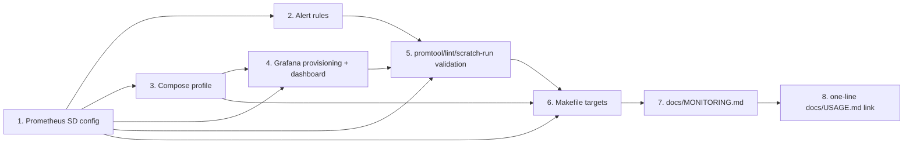

# Phase 6 / Slice 3: Metrics Delivery — Discovery, Pushgateway, Starter Dashboard — Stories

Source: `plan/v6/slices.md` Slice 3, bound by `plan/v5-v6-orchestration.md`
(P6-Q1 no Pushgateway/live pull scraping + exit-time snapshot for bulk
durability, P6-Q4 example alert rules with conservative defaults, P6-Q5
metric-name catalogue is the single source of truth) and by this
Cartographer's binding task brief, which supersedes `plan/v6/slices.md`'s
literal wording on two points called out below. Runs **in parallel** with
P6-S2 (core metrics instrumentation, still landing on
`feat/p6-s2-metrics` at the time this document is written) and with the
Phase 5 waves, per the orchestrator's "maximise parallelism" directive in
`plan/v5-v6-orchestration.md`.

## Slice recap (as corrected by the binding task brief)

**As an** Operator, **I want** Prometheus to discover and scrape every
loader/writer/dispatcher/lease-server/clock container on the shared Docker
network by label, and a Grafana starting point with example alert rules,
**so that** the metrics P6-S2 registers are graphable and alertable, not
just theoretically present — without the library ever depending on
Prometheus being up.

Two corrections to `plan/v6/slices.md`'s original Slice 3 text, both
binding:

1. **No Pushgateway.** `plan/v6/slices.md`'s title still names it; the
   orchestrator's P6-Q1 resolution removes it entirely. Bulk-run
   durability for containers shorter than one scrape interval is already
   solved by P6-S2 Story 9's exit-time snapshot into
   `GRAPH_LOADER_TIMING_DIR` (`metrics-<kind>-<name>.prom`, Prometheus text
   format) — this slice's job is live pull scraping only. A Pushgateway
   would be a second, redundant durability mechanism for a problem P6-S2
   already closed, and it reintroduces the exact "who deletes a stale
   pushed series" cardinality problem Prometheus's own docs warn against
   for ephemeral jobs.
2. **Metrics port is 9464, not 9090.** `plan/v6/slices.md`'s literal text
   (and this Cartographer's own initial reading of it) said 9090; P6-S2's
   own orchestrator correction (`src/utils/metrics.py`'s
   `DEFAULT_METRICS_PORT`, confirmed on `feat/p6-s2-metrics`) fixes this at
   **9464** in-container, because 9090 collides with Prometheus server's
   own default port on the same `graph-loader-net` network once this
   slice's compose profile exists. The host-side CLI process binds
   `127.0.0.1:9464` (P6-S2 Story 8), with the same ephemeral-fallback
   behavior as every container: if 9464 is taken, `start_metrics_server`
   logs a warning and returns `None` rather than failing the run. Every
   config file in this slice reads the port from the `graph_loader.kind`/
   `graph_loader.metrics_port` **Docker labels** P6-S2 Story 3 already
   attaches to every container (never hardcodes 9464 as a scrape target
   port), so an operator overriding `GRAPH_LOADER_METRICS_PORT` needs no
   change to any file this slice adds.

## Scope confinement (binding, to avoid merge conflicts with P6-S2/P6-S4)

Per the task brief and `plan/v5-v6-orchestration.md`'s "maximise
parallelism" directive:

> P6-S3 is confined to new files: `monitoring/`, `docker-compose.monitoring.yml`
> and `docs/MONITORING.md`. At the end it adds a one-line link to
> `docs/USAGE.md`.

Every story below only ever creates new files, with two narrow exceptions
that are each their own final story so the risk is isolated and reviewable
in one small diff: `Makefile` (Story 6, additive lines only) and
`docs/USAGE.md` (Story 8, one line at the very end). Nothing in this slice
touches `src/`, `tests/`, `docker-compose.yaml`, or `requirements.txt`.
**No source changes, no commits beyond what the First Mate makes when
implementing, no Kafka/Neo4j/Docker containers are started by planning
itself** (this document and its siblings are the only artifacts this
Cartographer produces).

## Design decisions this Cartographer is making now

These resolve tensions between P6-S2's cardinality discipline and this
slice's own "distinguish concurrent runs" requirement, and are called out
up front because they are load-bearing for several stories' acceptance
criteria.

1. **`run_id` becomes a Prometheus *target* label via Docker SD relabeling,
   never a *metric* label.** P6-S2 Story 1 deliberately excluded `run_id`
   from every metric's label set because a long-lived Prometheus server
   scraping many runs over weeks would accumulate one time series per
   historical `run_id` forever (`src/utils/metrics.py`'s own docstring:
   "unbounded cardinality over time"). This slice's compose profile is a
   **disposable, local, short-retention** monitoring stack (Story 3 pins
   retention to 48h by default), not the long-lived production backend
   P6-S2's decision was written against — relabeling the `run_id` **Docker
   container label** (already set by `docker_service.py` for every
   dispatcher/lease-server/clock/planned-writer container, and for
   node/edge loaders whenever the CLI passes `--run-id`) into the scrape
   target's own `run_id` label lets an operator filter one run's dashboard
   from another's, and the growth this adds is bounded by *concurrently
   running or recently-retained* runs within the 48h window, not by
   history. `docs/MONITORING.md` (Story 7) states this distinction
   explicitly and tells an operator who wants to run this stack long-lived
   in a shared environment to drop the `run_id` target label at relabel
   time instead (one relabel_config line to delete, documented inline in
   `prometheus.yml`) — this slice's default keeps it, because the stated
   use case is "operator watches a run live," not "twelve-month capacity
   planning."
2. **Docker SD needs the Docker socket inside the Prometheus container.**
   `docker_sd_configs` talks to the Docker Engine API directly
   (`host: unix:///var/run/docker.sock`), which means mounting
   `/var/run/docker.sock` (read-only) into the Prometheus container — this
   is root-adjacent access to the whole Docker daemon, not just this
   project's containers. Documented as an explicit, named risk in Story 3
   and `docs/MONITORING.md`, scoped to "trusted local host only," with a
   pointer to a socket-proxy (e.g. `tecnativa/docker-socket-proxy`) as a
   hardening option for anyone who needs this off a single trusted
   workstation — not built by this slice, since the task brief scopes this
   to local use.
3. **Multi-port containers need a `keep`/`drop` relabel, not a dynamic
   port match.** `run_bucket_lease_server`/`run_planned_dispatcher` publish
   *two* ports each (their own control port — 7700 / 7701 — plus the new
   9464 metrics port from P6-S2 Story 3). Prometheus's Go regex engine
   (RE2) has no backreferences, so a relabel rule cannot compare "does
   `__meta_docker_port_private` equal the value of the
   `graph_loader.metrics_port` label" dynamically. Story 1 instead **drops
   the two known, fixed control ports by literal value** (`7700`, `7701` —
   `src/orchestrator/lease_server.py:DEFAULT_LEASE_PORT`,
   `src/orchestrator/planned_dispatcher.py:DEFAULT_DISPATCHER_PORT`,
   neither of which is ever the metrics port), leaving exactly the metrics
   port target standing for every container kind, including these two.
   This is correct as long as the two control ports never collide with an
   operator's `GRAPH_LOADER_METRICS_PORT` override — flagged as a
   documented constraint, not enforced by config (an operator who sets
   `GRAPH_LOADER_METRICS_PORT=7700` breaks this and gets no scrape target;
   `docs/MONITORING.md` calls this out as a reserved-value note).

## Story 1: Prometheus Docker Service Discovery Configuration

**As an** Operator,
**I want** Prometheus configured to discover every graph-loader container
on `graph-loader-net` by its `graph_loader.*` Docker labels, scrape it on
an interval short enough to catch a bulk container before it exits, and
tag each series with the run/entity identity already carried in Docker
labels,
**so that** a running load's metrics are graphable within a few seconds of
container start with zero manually maintained target list.

### Technical Context

- New file `monitoring/prometheus/prometheus.yml`. Top-level `scrape_configs`
  job `graph-loader`:
  ```yaml
  global:
    scrape_interval: 3s        # short enough to catch a ~60s bulk run's
                                # short-lived containers at least once;
                                # see the Story's own scrape-vs-container-
                                # lifetime edge case below
    evaluation_interval: 15s

  scrape_configs:
    - job_name: graph-loader
      scrape_interval: 3s
      docker_sd_configs:
        - host: unix:///var/run/docker.sock
          port: 9464            # fallback only; every real target's port is
                                 # overridden per-container below from its
                                 # own graph_loader.metrics_port label, so an
                                 # operator's GRAPH_LOADER_METRICS_PORT
                                 # override needs no change here
          refresh_interval: 2s  # Docker API poll; must be shorter than the
                                 # shortest bulk run this stack is expected
                                 # to observe, per the task's "short-lived
                                 # containers discovered and scraped at
                                 # least once" acceptance criterion
          filters:
            - name: label
              values: ["graph_loader.kind"]   # narrows the Docker API call
                                               # itself: Neo4j, Kafka,
                                               # Kafka UI, Prometheus and
                                               # Grafana's own containers
                                               # never carry this label and
                                               # are never even fetched,
                                               # not merely filtered out
                                               # after the fact
      relabel_configs:
        # 1. Drop the two known control ports (never the metrics port).
        #    RE2 has no backreferences, so this cannot be a dynamic
        #    "port == the metrics_port label's value" comparison — see
        #    this document's Design Decision 3.
        - source_labels: [__meta_docker_port_private]
          regex: "7700|7701"
          action: drop
        # 2. Skip containers that opted out (GRAPH_LOADER_METRICS_ENABLED=0).
        - source_labels: [__meta_docker_container_label_graph_loader_metrics_enabled]
          regex: "0"
          action: drop
        # 3. Keep only targets on graph-loader-net (a container joined to
        #    a second network would otherwise be discovered twice).
        - source_labels: [__meta_docker_network_name]
          regex: "graph-loader-net"
          action: keep
        # 4. Promote Docker labels to series labels an operator queries by.
        - source_labels: [__meta_docker_container_label_graph_loader_kind]
          target_label: kind
        - source_labels: [__meta_docker_container_label_run_id]
          target_label: run_id          # see Design Decision 1
        - source_labels: [__meta_docker_container_label_node_label]
          target_label: node_label
        - source_labels: [__meta_docker_container_label_edge_type]
          target_label: edge_type
        - source_labels: [__meta_docker_container_label_writer_id]
          target_label: writer_id
        - source_labels: [__meta_docker_container_label_replica_id]
          target_label: replica_id
        - source_labels: [__meta_docker_container_name]
          regex: "/(.*)"
          target_label: container_name
  ```
  Note precisely which container-launch labels exist per kind (confirmed by
  reading `feat/p6-s2-metrics:src/orchestrator/docker_service.py`, not
  guessed): every launcher sets `app`, `component`, `graph_loader.kind`,
  `graph_loader.metrics_port`, `graph_loader.metrics_enabled`; node/edge
  loaders add `node_label`/`edge_type` + `replica_id` always, and `run_id`
  only when the CLI passed `--run-id` (bulk runs without an explicit run id
  simply never populate that meta-label — the relabel rule above then
  produces an **empty string** `run_id` series label, which is valid
  Prometheus, not an error); planned writers add `writer_id` + `run_id`
  (always, since `run_planned_edge_writers` requires a nonblank `run_id`);
  lease server, planned dispatcher and clock require nonblank `run_id`
  unconditionally and set no `node_label`/`edge_type`/`writer_id` at all
  (those relabel targets are simply absent for these three kinds — also
  valid).
- **Address construction**: `docker_sd_configs` builds one raw target per
  `(container, network, exposed port)` tuple using that network's private
  IP — Prometheus reaches every container over `graph-loader-net` directly
  (container IP:port), **never** through the host-published ephemeral port
  mapping P6-S2 Story 3 adds (`ports={"9464/tcp": ("127.0.0.1", None)}` is
  for a human on the host to `curl` one container directly; Prometheus, a
  container on the same network, ignores it entirely and uses the
  in-network address+port docker_sd already resolves). Document this
  explicitly as a common point of confusion (the two mappings look related
  but serve different consumers).
- **Scrape-vs-container-lifetime edge case**, stated precisely rather than
  promised away: a container whose total lifetime is shorter than
  `refresh_interval + scrape_interval` (here, under ~5s) can legitimately
  exit and be reaped before Prometheus ever discovers it, in which case its
  *only* durable record is P6-S2 Story 9's exit-time `.prom` snapshot file
  under `GRAPH_LOADER_TIMING_DIR` — not a Prometheus series at all. This
  slice's tuning (3s scrape / 2s refresh) is chosen so that the documented
  IMDb 20k-seed bulk run (~60s end-to-end, `docs/USAGE.md` §9) gets many
  scrapes per container, not to guarantee sub-5-second containers are ever
  seen live. State this boundary explicitly in `docs/MONITORING.md` (Story
  7) so nobody treats "discovered and scraped at least once" as an
  unconditional guarantee for every possible run shape.
- Add a second scrape job `prometheus` (self-scrape, standard practice, one
  static target `localhost:9090`) so the dashboard's own "is Prometheus
  healthy" panel (Story 4) has something to query even before any
  graph-loader container ever runs.

### Acceptance Criteria

- [ ] A node-loader or edge-loader container started with a lifetime of at
      least 10 seconds appears in Prometheus's own target list
      (`/api/v1/targets`) as `up` within one `refresh_interval +
      scrape_interval` window (≤ 5s) of the container starting — verified
      manually (Story 6's scratch-run validation), not by inspection alone.
- [ ] Two node-loader containers of the **same** `node_label` launched by
      two **different** concurrent runs (two different `run_id` Docker
      labels) produce two distinguishable Prometheus targets, each with
      its own `run_id` series label — queryable independently
      (`graph_loader_records_consumed_total{run_id="run-a"}` vs.
      `run_id="run-b"`) without a config change between runs.
  - [ ] Neither series set grows once its container exits and ages past the
      configured retention window (Story 3) — confirmed by the retention
      setting, not by an unbounded-growth test (out of scope for a
      planning document; stated as the acceptance boundary Story 3's
      retention default exists to satisfy).
- [ ] Neo4j, Kafka, Kafka UI, Prometheus's and Grafana's own containers
      never appear as `graph-loader` job targets (the `filters`/`keep`
      chain excludes them, not merely hides them after discovery).
- [ ] A lease-server or planned-dispatcher container produces **exactly
      one** scrape target (the 9464 metrics port), never two (the 7700/7701
      control port is dropped by the literal-value relabel rule, not
      accidentally scraped as a second, always-non-Prometheus-text-format
      target that would show as a scrape failure).
- [ ] `promtool check config monitoring/prometheus/prometheus.yml` (Story 6)
      exits 0.
- [ ] With the observability compose profile never started, this file is
      never read by anything — `docker compose up` (no profile flag)
      behavior is provably unaffected, since Prometheus itself never
      launches (cross-referenced with Story 3's own AC on the same point).

### Definition of Done

- [ ] `monitoring/prometheus/prometheus.yml` created.
- [ ] `promtool check config` passes (Story 6 wires this into a validation
      target; this story's own DoD is the config file being syntactically
      and semantically valid on its own, verified once manually before
      Story 6's tooling exists).
- [ ] Reviewed and merged.

### Dependencies

Depends on: P6-S2 Story 3 (the `graph_loader.*` Docker labels, the
`graph-loader-net` label set, and the 9464 port) having merged, or at least
having a stable, reviewed contract — this Cartographer read
`feat/p6-s2-metrics` directly rather than only `plan/v6/slice-2/stories.md`
because that branch is still in flight; if the label *names* change before
merge, this file's relabel `source_labels` must change with them (flag to
the reviewer as the one place a P6-S2 rename would ripple into this slice).
Blocks: Stories 2, 4, 6 (all query or validate against this config).
**File-overlap risk:** none — new file, no existing file touched.
**Estimate: 8 points.**

## Story 2: Example Alert Rules — DLQ Backlog, Stuck Progress, Consumer Lag, Errors, Lease/Lock Waits

**As an** Operator,
**I want** a starter set of Prometheus alert rules covering the specific
failure classes this library's own design already anticipates,
**so that** I have conservative, clearly-labeled starting points to tune
for my own environment, per P6-Q4 ("does not claim SLOs").

### Technical Context

- New directory `monitoring/prometheus/alerts/`, referenced from
  `prometheus.yml`'s top-level `rule_files: ["alerts/*.yml"]`.
- **Every rule group's file gets this exact header comment** (P6-Q4's own
  wording, repeated verbatim per the task brief: "clearly marked as
  starting points"):
  ```yaml
  # STARTING POINT, NOT AN SLO. Thresholds below are conservative defaults
  # chosen without production traffic data (P6-Q4, plan/v5-v6-orchestration.md).
  # Tune every threshold to your own environment before treating a firing
  # alert as an incident. `for:` durations are chosen to avoid a scrape-
  # interval blip firing an alert, not to model any real SLO.
  ```
- **`monitoring/prometheus/alerts/dlq.yml`** (P5-Q4's own AC: "Backlog is
  observable as a Phase 6 metric... P6-S3 adds an example alert rule for
  it"):
  ```yaml
  groups:
    - name: graph-loader-dlq
      rules:
        - alert: GraphLoaderDlqRoutingDetected
          expr: increase(graph_loader_dlq_routed_total[15m]) > 0
          for: 0m
          labels: {severity: info}
          annotations:
            summary: "{{ $labels.kind }}/{{ $labels.name }} routed {{ $value }} record(s) to its DLQ in the last 15m (failure_class={{ $labels.failure_class }})."
            description: >
              Informational by default: a single malformed record reaching
              the DLQ is not necessarily an incident. Raise to warning/
              critical once you know your own baseline rate. NOTE: this
              catalogue exposes routed/parked *counts*, not DLQ *topic
              depth* — there is no Kafka consumer-lag exporter for DLQ
              topics in this slice; use `kafka-ui` (already in
              docker-compose.yaml) or a Kafka lag exporter for true topic
              depth. This rule is a growth-rate proxy for backlog, not a
              backlog gauge.
        - alert: GraphLoaderDlqRoutingSpike
          expr: increase(graph_loader_dlq_routed_total[15m]) > 50
          for: 5m
          labels: {severity: warning}
          annotations:
            summary: "{{ $labels.kind }}/{{ $labels.name }} routed more than 50 records to its DLQ in 15m."
        - alert: GraphLoaderParkedLotGrowing
          expr: increase(graph_loader_parked_total[30m]) > 0
          for: 0m
          labels: {severity: critical}
          annotations:
            summary: "{{ $labels.kind }}/{{ $labels.name }} parked {{ $value }} record(s) after exhausting retries (P5-S4)."
            description: >
              Reads 0 until Phase 5 Slice 4's retry consumer/parking-lot
              lands (P6-S2 Story 2) — this rule is registered now so it is
              live the moment that slice ships, per this catalogue's
              "registered now, held at zero" convention. A parked record
              is terminal until manually replayed; treat any nonzero value
              as needing operator attention, not routine.
  ```
- **`monitoring/prometheus/alerts/progress.yml`** (stuck load / no
  progress):
  ```yaml
  groups:
    - name: graph-loader-progress
      rules:
        - alert: GraphLoaderPlannedRunStalled
          expr: >
            (graph_loader_plan_chunks_committed < graph_loader_plan_chunks_planned)
            and (increase(graph_loader_plan_chunks_committed[10m]) == 0)
          for: 10m
          labels: {severity: warning}
          annotations:
            summary: "Planned dispatcher run_id={{ $labels.run_id }} has not committed a chunk in 10m and is not yet complete."
        - alert: GraphLoaderNoRecordsConsumed
          expr: >
            (graph_loader_process_up == 1)
            and on(kind, name) (increase(graph_loader_records_consumed_total[10m]) == 0)
          for: 10m
          labels: {severity: warning}
          annotations:
            summary: "{{ $labels.kind }}/{{ $labels.name }} is up but has consumed 0 records in 10m."
            description: >
              Expected to fire during legitimate idle periods for
              long-lived streaming loaders with no traffic — tune `for:`
              or scope this rule to bulk runs only in your own environment
              (P6-Q4: not an SLO).
  ```
- **`monitoring/prometheus/alerts/lag_and_errors.yml`** (consumer lag,
  error rates):
  ```yaml
  groups:
    - name: graph-loader-lag-and-errors
      rules:
        - alert: GraphLoaderConsumerLagHigh
          expr: graph_loader_consumer_lag_records > 100000
          for: 10m
          labels: {severity: warning}
          annotations:
            summary: "{{ $labels.kind }}/{{ $labels.name }} lag on {{ $labels.topic }} is {{ $value }} records."
        - alert: GraphLoaderConsumerLagCritical
          expr: graph_loader_consumer_lag_records > 1000000
          for: 5m
          labels: {severity: critical}
        - alert: GraphLoaderConsumerLagNotDraining
          expr: deriv(graph_loader_consumer_lag_records[10m]) > 0
          for: 15m
          labels: {severity: warning}
          annotations:
            summary: "{{ $labels.kind }}/{{ $labels.name }} lag on {{ $labels.topic }} is growing, not draining."
        - alert: GraphLoaderRetryRateHigh
          expr: sum by (kind, name) (rate(graph_loader_retry_total[5m])) > 1
          for: 10m
          labels: {severity: warning}
          annotations:
            summary: "{{ $labels.kind }}/{{ $labels.name }} is retrying more than 1/s over 5m (reason breakdown in graph_loader_retry_total)."
  ```
- **`monitoring/prometheus/alerts/concurrency.yml`** (lease waits / lock
  waits > 0, including the epic's own "planned mode is structurally
  lock-free" claim made into an alertable canary):
  ```yaml
  groups:
    - name: graph-loader-concurrency
      rules:
        - alert: GraphLoaderPlannedModeDeadlockObserved
          expr: graph_loader_deadlocks_recovered_total{kind="planned-writer"} > 0
          for: 0m
          labels: {severity: critical}
          annotations:
            summary: "Planned-mode writer recovered a deadlock — this must stay 0 by construction (docs/USAGE.md §6/§9); investigate the resource-disjointness invariant immediately."
        - alert: GraphLoaderLeaseWaitersStuck
          expr: graph_loader_lease_waiters > 0
          for: 2m
          labels: {severity: warning}
          annotations:
            summary: "{{ $value }} waiter(s) parked on the bucket-lease server for over 2m — a writer may be starved."
        - alert: GraphLoaderLeaseWaitTimeoutsDetected
          expr: increase(graph_loader_lease_wait_timeouts_total[10m]) > 0
          for: 0m
          labels: {severity: warning}
          annotations:
            summary: "{{ $value }} lease wait timeout(s) in 10m — a writer aborted its transaction per P5-Q1's disconnect-safety contract; check for lease-server restart or contention."
        - alert: GraphLoaderPlanResourceWaitHigh
          expr: histogram_quantile(0.95, sum by (le) (rate(graph_loader_plan_resource_wait_seconds_bucket[5m]))) > 5
          for: 10m
          labels: {severity: warning}
          annotations:
            summary: "Planned-dispatcher p95 resource wait exceeded 5s over 5m."
  ```
- **Deliberately not alerted on**: raw Neo4j lock-wait time (not a metric
  in P6-S2's catalogue at all — it lives in Neo4j's own query log /
  `SHOW TRANSACTIONS`, per `docs/USAGE.md` §8, and is out of this slice's
  scope to export); `graph_loader_lease_held_resources` as a percentage of
  capacity (the coordinator's configured `bucket_count` is not itself a
  metric, so a percentage cannot be computed — noted as a future
  enhancement, not built here).

### Acceptance Criteria

- [ ] `promtool check rules monitoring/prometheus/alerts/*.yml` (Story 6)
      exits 0 for every file.
- [ ] Every rule group's file begins with the verbatim "STARTING POINT, NOT
      AN SLO" header comment.
- [ ] Every metric name referenced by any `expr:` exists verbatim in
      P6-S2's catalogue (`src/utils/metrics.py:EXPECTED_METRIC_FAMILIES`) —
      cross-checked by hand against the 22-series list at Cartographer
      time; the First Mate re-checks against whatever `feat/p6-s2-metrics`
      has actually merged as, since names must never silently drift
      (P6-Q5).
- [ ] `GraphLoaderPlannedModeDeadlockObserved` fires against a synthetic
      metric snapshot with `graph_loader_deadlocks_recovered_total{kind="planned-writer",name="ACTED_IN"} 1`
      and does not fire against an all-zero snapshot (verified with
      `promtool test rules`, Story 6).
- [ ] No rule's `expr:` divides by a series that can be legitimately absent
      (e.g. no rule computes `x / graph_loader_plan_chunks_planned` without
      first confirming that series exists for the run in question) —
      Prometheus silently drops (does not fire, does not error) a vector
      expression over an absent series, so this is a correctness review
      item, not a runtime-crash risk, but a rule that can never fire due to
      an absent denominator is a silent gap worth catching at review time.

### Definition of Done

- [ ] Five rule files created under `monitoring/prometheus/alerts/`.
- [ ] `promtool check rules` passes for all five (Story 6's validation
      target exercises this; this story's own DoD is passing it manually
      once before that tooling exists).
- [ ] Reviewed and merged.

### Dependencies

Depends on: P6-S2 Story 2 (the exact metric/label names). Independent of
Story 1 (different files), but both are referenced from
`prometheus.yml`'s `rule_files:`, so Story 1's file must exist before this
one is wired in (trivial ordering, not a real blocking dependency).
**File-overlap risk:** none — new files only.
**Estimate: 8 points.**

## Story 3: `docker-compose.monitoring.yml` — Prometheus + Grafana Override Profile

**As an** Operator,
**I want** an optional, separate Compose file that adds Prometheus and
Grafana to the existing stack without touching `docker-compose.yaml`,
**so that** `docker compose up` alone is byte-for-byte unaffected by this
slice, and the monitoring stack's own resource, storage and auth choices
live in one reviewable file.

### Technical Context

- **Separate override file, not a `--profile` flag on the existing file** —
  justification (the task brief asks for this to be justified explicitly):
  `docker-compose.yaml` is a file P6-S1 (CI) and P6-S2 (metrics
  instrumentation, indirectly, since it documents the port/label contract
  this file's containers rely on) are actively iterating on in parallel
  worktrees; a `profiles:` block *inside* that file would be a same-file
  edit racing against two other in-flight slices for no benefit a second
  file doesn't already give. `docker compose -f docker-compose.yaml -f
  docker-compose.monitoring.yml up -d` is the standard Compose "override
  file" pattern and needs no `profiles:` mechanism at all: an operator who
  never passes `-f docker-compose.monitoring.yml` never starts Prometheus
  or Grafana, satisfying the slice's own "off by default" AC trivially, by
  construction, rather than by a flag that could be forgotten.
- **Services**:
  ```yaml
  services:
    prometheus:
      image: prom/prometheus:v2.55.1
      container_name: graph-loader-prometheus
      cpuset: "${MONITORING_CPUSET:-28-31}"
      command:
        - --config.file=/etc/prometheus/prometheus.yml
        - --storage.tsdb.path=/prometheus
        - --storage.tsdb.retention.time=${MONITORING_RETENTION:-48h}
        - --web.enable-lifecycle
      volumes:
        - ./monitoring/prometheus:/etc/prometheus:ro
        - ${GRAPH_LOADER_DATA_DIR:-/mnt/graph-loader/data}/prometheus:/prometheus
        - /var/run/docker.sock:/var/run/docker.sock:ro   # Design Decision 2
      ports:
        - "${PROMETHEUS_HOST_BIND:-0.0.0.0}:9090:9090"
      networks:
        - graph-loader-net
      healthcheck:
        test: ["CMD", "wget", "-q", "--spider", "http://localhost:9090/-/healthy"]
        interval: 10s
        timeout: 5s
        retries: 10
        start_period: 15s

    grafana:
      image: grafana/grafana-oss:11.3.1
      container_name: graph-loader-grafana
      cpuset: "${MONITORING_CPUSET:-28-31}"
      depends_on:
        prometheus:
          condition: service_healthy
      environment:
        GF_SECURITY_ADMIN_USER: "${GRAFANA_ADMIN_USER:-admin}"
        GF_SECURITY_ADMIN_PASSWORD: "${GRAFANA_ADMIN_PASSWORD:-admin}"
        GF_AUTH_ANONYMOUS_ENABLED: "true"
        GF_AUTH_ANONYMOUS_ORG_ROLE: "Viewer"
        GF_USERS_ALLOW_SIGN_UP: "false"
      volumes:
        - ./monitoring/grafana/provisioning:/etc/grafana/provisioning:ro
        - ./monitoring/grafana/dashboards:/var/lib/grafana/dashboards:ro
        - ${GRAPH_LOADER_DATA_DIR:-/mnt/graph-loader/data}/grafana:/var/lib/grafana
      ports:
        - "${GRAFANA_HOST_BIND:-0.0.0.0}:3000:3000"
      networks:
        - graph-loader-net

  networks:
    graph-loader-net:
      external: true
      name: graph-loader-net
  ```
  `networks.graph-loader-net.external: true` is required, not optional:
  `docker-compose.yaml` already declares and names this network, and a
  second Compose file declaring the *same* named network non-externally
  would either conflict or (depending on Compose version behavior) create
  a confusing second network with the same name — `external: true` tells
  Compose "this already exists, join it, do not try to (re)create it,"
  which is the only correct relationship between two Compose files meant
  to be combined with `-f -f`.
- **Resource pinning** (task brief: "keep them off Neo4j's cores 0-7 and
  Kafka's 8-11"): `docker-compose.yaml` documents (`docs/USAGE.md` §2) that
  `LOADER_CPUSET` is meant to cover "the remaining CPUs" for loader
  containers, with a documented example of `12-31` on a 32-core host.
  Defaulting `MONITORING_CPUSET` to `28-31` (the top of that same example
  range) is a **deliberate, flagged overlap** with that documented
  example, not an oversight: on a host actually configured with
  `LOADER_CPUSET=12-31`, running a full-tilt loader fleet at the same time
  as this monitoring stack means both are competing for cores 28-31. This
  is acceptable for this slice's stated use case (a human watching a
  bounded validation run, not a maximum-throughput production benchmark)
  but must be a named tradeoff in `docs/MONITORING.md` (Story 7): an
  operator benchmarking peak throughput should either narrow
  `LOADER_CPUSET` to `12-27` first, or set `MONITORING_CPUSET` to a range
  outside their own `LOADER_CPUSET`. `MONITORING_CPUSET` is a single env
  var (matching `NEO4J_CPUSET`/`KAFKA_CPUSET`/`LOADER_CPUSET`'s existing
  convention exactly) so this is a one-line fix for anyone who needs it.
- **Data on `/mnt` only**: both volumes use the exact same
  `${GRAPH_LOADER_DATA_DIR:-/mnt/graph-loader/data}` prefix
  `docker-compose.yaml` already uses for Neo4j/Kafka, with new
  subdirectories `prometheus/` and `grafana/` — no default ever writes
  under the repo checkout or the root disk. `mkdir -p` for these two new
  subdirectories is the Makefile target's (Story 6) job, not this file's
  (Compose does not create host bind-mount parent directories reliably
  across all Docker versions without this).
- **Retention**: `--storage.tsdb.retention.time=48h` default, overridable
  via `MONITORING_RETENTION` — chosen short deliberately (Design Decision
  1: this bounds how long a `run_id` target label's cardinality growth
  persists; a multi-week retention on a frequently-rerun local stack would
  reproduce the exact problem P6-S2 excluded `run_id` from *metric* labels
  to avoid).
- **Grafana auth defaults for local use**: anonymous **Viewer** access (no
  login needed to see dashboards — the stated use case) plus an
  `admin`/`admin` editor login (both overridable via env vars, following
  the same `${VAR:-default}` convention as every other credential in
  `docker-compose.yaml`, e.g. `NEO4J_PASSWORD`). Both Prometheus's UI (zero
  built-in auth of its own) and Grafana are bound to `0.0.0.0` by default,
  matching `docker-compose.yaml`'s existing convention for Kafka UI (also
  unauthenticated, also `0.0.0.0`) — consistency with the existing file's
  security posture, not a new precedent; `docs/MONITORING.md` (Story 7)
  states plainly that this stack assumes a trusted local/private network,
  exactly as `docker-compose.yaml` already implicitly assumes for Kafka UI
  and the Neo4j Browser HTTP port.
- **`docker compose up` (no `-f docker-compose.monitoring.yml`) is
  unaffected**: this file is never referenced by `docker-compose.yaml`,
  never auto-loaded (Compose only auto-loads `docker-compose.override.yml`
  by that exact reserved name, which this file deliberately is not named),
  so its mere existence in the repo changes nothing about the default
  command.
- **Prometheus down must not affect loads**: true by construction and
  worth stating as the mechanism, not just the outcome — every loader
  process's metrics server (P6-S2 Story 3) never blocks or crashes the
  loader if binding fails or if nobody ever scrapes it; Prometheus is a
  pull-based, passive observer with no write path into any container's
  behavior, no shared volume the loader waits on, and no network call the
  loader makes *to* Prometheus (only Prometheus calls *out* to loader
  containers). Stopping `graph-loader-prometheus` mid-run has zero effect
  on the loader's own reads from Kafka or writes to Neo4j.

### Acceptance Criteria

- [ ] `docker compose up -d` (base file only, no `-f
      docker-compose.monitoring.yml`) starts exactly the same services as
      before this slice (`neo4j`, `kafka`, `kafka-ui`) — verified by
      inspecting `docker compose config` output includes no `prometheus`/
      `grafana` service.
- [ ] `docker compose -f docker-compose.yaml -f docker-compose.monitoring.yml
      up -d prometheus grafana` starts both services joined to the existing
      `graph-loader-net`, both passing their healthchecks.
- [ ] `docker compose -f docker-compose.yaml -f docker-compose.monitoring.yml
      config` fails clearly (a Compose network-resolution error, not a
      silent second network) if `graph-loader-net` does not already exist
      — proving the `external: true` wiring, not merely asserting it by
      inspection.
- [ ] Stopping the `prometheus` container mid-bulk-run does not change the
      run's exit code, record counts, or timing — a full bulk run started
      before and finishing after `docker stop graph-loader-prometheus`
      completes identically to one run with the monitoring profile never
      started (this is the slice's "Prometheus down must not affect loads"
      binary criterion; validated in Story 6's scratch run, not asserted
      here without evidence).
- [ ] Prometheus's and Grafana's data directories resolve under
      `${GRAPH_LOADER_DATA_DIR:-/mnt/graph-loader/data}` and nowhere else —
      no bind mount targets the repo checkout or an unspecified relative
      path outside that root.
- [ ] `cpuset` for both new containers excludes `0-7` and `8-11` by default
      (`28-31`), distinct from Neo4j's and Kafka's own `cpuset:` values in
      `docker-compose.yaml`.

### Definition of Done

- [ ] `docker-compose.monitoring.yml` created.
- [ ] `docker compose ... config` validates with no errors (Story 6 wires
      this as a repeatable check).
- [ ] Reviewed and merged.

### Dependencies

Depends on: Story 1 (mounts `monitoring/prometheus/` as the config volume).
**File-overlap risk:** none against `docker-compose.yaml` itself (a
sibling file, never edited) — the only shared surface with the base file
is the *existing, named* `graph-loader-net` network, referenced as
`external: true`, never redefined. **Estimate: 8 points.**

## Story 4: Grafana Provisioning and Starter Dashboard

**As an** Operator,
**I want** Grafana pre-wired with the Prometheus datasource and one starter
dashboard covering every metric family this catalogue defines, with no
manual click-through setup,
**so that** `docker compose ... up` alone gets me a working dashboard, and
it still opens cleanly before any loader container has ever run.

### Technical Context

- **Datasource provisioning** —
  `monitoring/grafana/provisioning/datasources/prometheus.yml`:
  ```yaml
  apiVersion: 1
  datasources:
    - name: Prometheus
      type: prometheus
      access: proxy
      url: http://prometheus:9090
      isDefault: true
      editable: false
  ```
- **Dashboard provisioning** —
  `monitoring/grafana/provisioning/dashboards/graph-loader.yml`:
  ```yaml
  apiVersion: 1
  providers:
    - name: graph-loader
      folder: ""
      type: file
      options:
        path: /var/lib/grafana/dashboards
  ```
  (matches the `docker-compose.monitoring.yml` volume mount for
  `monitoring/grafana/dashboards` → `/var/lib/grafana/dashboards`.)
- **Starter dashboard JSON** —
  `monitoring/grafana/dashboards/graph-loader-overview.json`, one dashboard
  with these rows/panels, each mapped to a real series in P6-S2's
  catalogue (no invented series):
  | Row | Panel | Query |
  | --- | --- | --- |
  | Throughput | Records/s by kind+name | `sum by (kind,name) (rate(graph_loader_records_consumed_total[1m]))` |
  | Write latency | p50/p95/p99 | `histogram_quantile(0.50\|0.95\|0.99, sum by (le,kind,name) (rate(graph_loader_neo4j_write_duration_seconds_bucket[5m])))` |
  | Consumer lag | Lag by topic | `graph_loader_consumer_lag_records` |
  | Plan progress | Chunks committed / planned | `graph_loader_plan_chunks_committed` and `graph_loader_plan_chunks_planned` (dual-axis or ratio panel), `graph_loader_plan_active_writers` |
  | Lease server | Grants/denials rate, current waiters | `rate(graph_loader_lease_grants_total[1m])`, `rate(graph_loader_lease_denials_total[1m])`, `graph_loader_lease_waiters`, `graph_loader_lease_held_resources` |
  | Lease wait / lock waits | p95 lease wait, plan resource wait | `histogram_quantile(0.95, sum by (le,kind,name) (rate(graph_loader_lease_wait_seconds_bucket[5m])))`, `histogram_quantile(0.95, rate(graph_loader_plan_resource_wait_seconds_bucket[5m]))` |
  | Deadlocks | Recovered deadlocks by kind (planned-writer must read 0) | `sum by (kind,name) (increase(graph_loader_deadlocks_recovered_total[5m]))` |
  | DLQ | Routed by failure_class, parked total | `sum by (failure_class) (rate(graph_loader_dlq_routed_total[5m]))`, `graph_loader_parked_total` |
  | Errors | Retry rate by reason | `sum by (reason) (rate(graph_loader_retry_total[5m]))` |
  | Process health | Up/down table, version info | `graph_loader_process_up`, `graph_loader_process_info` |
  - **Template variables**: `kind`, `name`, `run_id`, each a Prometheus
    label-values query (e.g. `label_values(graph_loader_process_up, run_id)`)
    with `includeAll: true` and `multi: true`, **default value `.*` /
    "All"** — this is the mechanism for the "dashboard works with zero
    data" AC below: a template variable whose query returns no label
    values (because nothing has ever been scraped) still renders as an
    empty-but-valid "All" selector, not a broken dropdown, and every
    panel's query still parses and executes (returning no series, i.e. a
    "No data" panel state) rather than erroring.
  - **Panel-level "no data" handling**: every panel's field option sets
    `noValue: "No data"` (or leaves Grafana's own default, which already
    renders "No data" text rather than an error for a zero-result range
    query) — explicitly do **not** wrap queries in functions that error on
    an empty vector (e.g. `histogram_quantile` on an absent series family
    returns an empty vector, not an error, which Grafana already renders
    as empty; verified in Story 6's scratch-run validation both with and
    without any loader traffic).
  - Dashboard JSON is exported in Grafana's own schema (`schemaVersion`
    ≥ 38, matching Grafana 11.x), hand-authored rather than click-exported,
    so it is diffable and reviewable as plain JSON in this PR.

### Acceptance Criteria

- [ ] Opening the dashboard against a **freshly started** monitoring
      profile with **zero** graph-loader containers ever having run shows
      every panel in a "No data" state, with **no** red panel-error
      indicator anywhere on the page (the dashboard's own load, and every
      panel's query, succeed; only the *data* is absent) — this is the
      slice's explicit "dashboard works with zero data" binary criterion.
  - [ ] The `kind`/`name`/`run_id` template variables render as empty-but-
      functional selectors in this state (no dropdown error).
- [ ] Starting a bulk run and refreshing the dashboard (no manual query
      edits) populates every one of the nine rows above with live data
      within one scrape interval of the corresponding container's first
      batch write.
- [ ] The datasource is provisioned automatically (`Prometheus`, marked
      default) with no manual "Add data source" step — verified by
      `curl -s http://localhost:3000/api/datasources` (with the default
      anonymous-viewer or admin credentials) returning it immediately
      after Grafana's first successful start.
- [ ] The dashboard is provisioned automatically and visible in Grafana's
      dashboard list with no manual "Import dashboard" step.
- [ ] Every `expr` in the dashboard JSON references only series present in
      P6-S2's `EXPECTED_METRIC_FAMILIES` catalogue — cross-checked the same
      way as Story 2's alert rules.

### Definition of Done

- [ ] `monitoring/grafana/provisioning/datasources/prometheus.yml`,
      `monitoring/grafana/provisioning/dashboards/graph-loader.yml`, and
      `monitoring/grafana/dashboards/graph-loader-overview.json` created.
- [ ] Dashboard JSON passes a lint pass (Story 6: valid JSON, has a
      non-empty `title`, every `panel.targets[].expr` is a nonblank
      string, every referenced metric name matches the catalogue).
- [ ] Reviewed and merged.

### Dependencies

Depends on: Story 1 (metric/label shapes the queries assume), Story 3 (the
Grafana service and its provisioning volume mounts). **File-overlap risk:**
none — new files only. **Estimate: 8 points.**

## Story 5: `promtool` and Dashboard-JSON Validation, Plus a Scratch-Run Proof

**As a** Maintainer,
**I want** a repeatable, documented (not necessarily CI-automated —
Prometheus/Grafana/Docker are not part of the fast unit suite, matching
P6-S1/P6-S2's own precedent for Docker-requiring checks) way to prove this
slice's config files are valid and that targets are actually discovered
and panels actually render against a real run,
**so that** "Prometheus's own target list shows every container... with no
manually maintained target list" and "the starter dashboard renders...
against a live local run" are demonstrated, not asserted.

### Technical Context

- **Static validation** (fast, no Docker required beyond the `prom/
  prometheus` image providing `promtool`, and no live containers):
  ```bash
  docker run --rm -v "$(pwd)/monitoring/prometheus:/etc/prometheus:ro" \
    prom/prometheus:v2.55.1 promtool check config /etc/prometheus/prometheus.yml
  docker run --rm -v "$(pwd)/monitoring/prometheus:/etc/prometheus:ro" \
    prom/prometheus:v2.55.1 promtool check rules /etc/prometheus/alerts/*.yml
  ```
  (`promtool check config` transitively validates every `rule_files:` glob
  target too, so the second invocation is belt-and-suspenders for a
  clearer failure message when a rule file itself is broken.)
- **Dashboard JSON lint**: a small script,
  `scripts/validate_monitoring.py` (stdlib-only — `json`, no new
  dependency), that:
  1. Parses every `*.json` under `monitoring/grafana/dashboards/` and
     fails on invalid JSON.
  2. Asserts each has a nonblank `title` and at least one `panel`.
  3. Extracts every `targets[].expr` string, extracts the leading
     `graph_loader_[a-z_]+` metric-name token via regex, and asserts it is
     a member of a hardcoded copy of P6-S2's `EXPECTED_METRIC_FAMILIES`
     set (duplicated here deliberately, same reasoning P6-S2's own
     `metrics.py` gives for duplicating `dead_letter.FAILURE_CLASSES`
     rather than importing across an unrelated boundary: this script must
     run with no `src/` import and no `prometheus_client` dependency, so a
     `monitoring/`-only tool never needs the full Python project
     environment installed).
  4. Exits nonzero with a clear message on any failure; exits 0 and prints
     a one-line summary (`"N dashboards, M panels, K unique metric names,
     all known"`) otherwise.
- **Scratch-run proof** (manual, documented step-by-step in
  `docs/MONITORING.md`, mirroring P6-S2 Story 3's own "documented, not
  CI-automated local smoke test" precedent exactly):
  1. `docker compose up -d neo4j kafka` (base stack).
  2. `docker compose -f docker-compose.yaml -f docker-compose.monitoring.yml
     up -d prometheus grafana` (this slice's profile).
  3. Run any small existing example (e.g. `examples/social/`) in bulk mode
     for at least one full minute of container lifetime (so Story 1's
     scrape-interval tuning has margin), or run it in `--mode stream` for
     long-lived containers.
  4. Confirm via `curl -s localhost:9090/api/v1/targets | jq` that every
     launched container kind (node, edge, planned-writer,
     planned-dispatcher if `--edge-plan`, lease-server if leases are in
     play, clock if using the deprecated clock/rotation path) shows
     `"health": "up"`.
  5. Confirm via `curl -s localhost:9090/api/v1/query?query=graph_loader_records_consumed_total`
     that at least one sample with a nonzero value exists.
  6. Open `localhost:3000`, confirm the starter dashboard shows live data
     in every row without editing a query.
  7. `docker stop graph-loader-prometheus`; confirm the still-running (or a
     freshly started second) load completes with its normal exit code —
     the "Prometheus down must not affect loads" proof.
  8. `docker compose -f docker-compose.yaml -f docker-compose.monitoring.yml
     down`; confirm base `docker compose ps` is unaffected.

### Acceptance Criteria

- [ ] `promtool check config` and `promtool check rules` both exit 0
      against this slice's actual files (not a hypothetical) at merge
      time.
- [ ] `scripts/validate_monitoring.py` exits 0 against the actual dashboard
      JSON at merge time, and is demonstrated (in the PR description) to
      exit nonzero when a deliberately-introduced typo'd metric name (e.g.
      `graph_loader_recrods_consumed_total`) is added, then reverted before
      merge — same "prove the guard actually guards" pattern P6-S2 Story
      10 uses for its own source-level scan.
- [ ] The 8-step scratch-run proof above is executed at least once by the
      First Mate before this story is marked done, with its concrete
      findings (which container kinds were exercised, any discovery
      latency observed) recorded in the eventual
      `plan/v6/completion_slice-3.md`.
- [ ] Step 7 (Prometheus stopped mid-run) is one of the scratch-run steps
      that must be individually confirmed, not skipped as "obviously true"
      — this is the slice's single most important edge case per the task
      brief.

### Definition of Done

- [ ] `scripts/validate_monitoring.py` created.
- [ ] Both `promtool` invocations and the script are folded into Story 6's
      `make monitoring-validate` target so they are one command, not three
      to remember.
- [ ] Scratch-run proof executed and its findings recorded.
- [ ] Reviewed and merged.

### Dependencies

Depends on: Stories 1, 2, 4 (validates all three's output). **File-overlap
risk:** none — `scripts/validate_monitoring.py` is a new file in an
existing directory (`scripts/` already holds `start_dev.sh`,
`cleanup_imdb_local_load.sh`); no existing script is edited.
**Estimate: 5 points.**

## Story 6: `make monitoring-up` / `monitoring-down` / `monitoring-validate`

**As an** Operator,
**I want** one-word Makefile targets for the whole monitoring lifecycle,
**so that** I don't need to remember the two-file `-f -f` Compose
invocation or the `promtool`/lint commands by hand.

### Technical Context

- **`Makefile` is shared with P6-S1** (which the task brief itself flags:
  "Makefile is shared: keep the change additive"). P6-S1's own stories
  document ends with a `## Total Estimate` section after adding its own
  targets (`lint`, `test-unit`, `build-images`, `validate-workflows` — all
  already present on `main`/`feat/streaming-observability` per the
  Makefile read at the top of this Cartographer's research, confirming
  P6-S1 has already landed these). This story **appends** three new
  targets at the end of the existing file, changing no existing line and
  reordering nothing, to minimize the diff surface against any other
  slice's own Makefile edit landing around the same time:
  ```makefile
  .PHONY: monitoring-up monitoring-down monitoring-validate

  monitoring-up:
  	@mkdir -p $${GRAPH_LOADER_DATA_DIR:-/mnt/graph-loader/data}/prometheus
  	@mkdir -p $${GRAPH_LOADER_DATA_DIR:-/mnt/graph-loader/data}/grafana
  	docker compose -f docker-compose.yaml -f docker-compose.monitoring.yml up -d prometheus grafana

  monitoring-down:
  	docker compose -f docker-compose.yaml -f docker-compose.monitoring.yml down

  monitoring-validate:
  	docker run --rm -v "$$(pwd)/monitoring/prometheus:/etc/prometheus:ro" prom/prometheus:v2.55.1 promtool check config /etc/prometheus/prometheus.yml
  	docker run --rm -v "$$(pwd)/monitoring/prometheus:/etc/prometheus:ro" prom/prometheus:v2.55.1 sh -c 'promtool check rules /etc/prometheus/alerts/*.yml'
  	python3 scripts/validate_monitoring.py
  ```
  Note the existing `.PHONY:` line in the current Makefile is a single
  line listing all current targets (`dev dev-down dev-logs lint test-unit
  build-images validate-workflows`) — this story adds a **second**
  `.PHONY:` line rather than editing the first, which is valid Make syntax
  (multiple `.PHONY` declarations accumulate) and means this story's diff
  touches zero characters of the existing line, eliminating any chance of
  a textual merge conflict with a concurrent P6-S1/P6-S4 Makefile edit on
  that same line.
- The `mkdir -p` calls in `monitoring-up` exist because Compose does not
  reliably create host bind-mount parent directories across all Docker
  versions (Story 3's own note); this is the one place that responsibility
  belongs, run once per invocation, idempotent.

### Acceptance Criteria

- [ ] `make monitoring-up` from a clean checkout (base stack already
      running) brings up `prometheus`+`grafana` with no manual directory
      creation step first.
- [ ] `make monitoring-down` tears down only the monitoring profile's two
      services, leaving `neo4j`/`kafka`/`kafka-ui` untouched (verified via
      `docker compose ps` before/after).
- [ ] `make monitoring-validate` runs all three checks (`promtool check
      config`, `promtool check rules`, the dashboard lint script) with one
      command and a nonzero exit if any one of the three fails.
- [ ] `git diff Makefile` for this story's commit shows only added lines
      (a pure append) — no existing line is modified or reordered.

### Definition of Done

- [ ] `Makefile` updated (append-only).
- [ ] Reviewed and merged.

### Dependencies

Depends on: Stories 1, 3, 5 (wires up their commands). **File-overlap
risk:** the one shared file in this whole slice — `Makefile`, also touched
by P6-S1 and potentially P6-S4. Mitigated by the append-only, second-
`.PHONY:`-line discipline above; the First Mate should still `git pull`/
rebase immediately before this story's commit to catch a genuine same-line
collision early, and merge this story's commit promptly rather than
leaving it open across multiple other slices' own Makefile edits.
**Estimate: 3 points.**

## Story 7: `docs/MONITORING.md`

**As an** Operator,
**I want** one document covering the whole discovery/dashboard/alerting
story, its cardinality and resource-pinning tradeoffs, and its known
limitations,
**so that** I can bring the stack up, understand what I'm looking at, and
know what this slice deliberately does not cover.

### Technical Context

New file `docs/MONITORING.md`, sectioned to mirror `docs/USAGE.md`'s own
style (short, table-heavy, precedent-citing):

1. **Overview** — what this stack is (Prometheus + Grafana, Docker SD, no
   Pushgateway) and is not (a production-grade, long-lived, multi-tenant
   observability platform — this is explicitly a local operator tool).
2. **Quick start** — `make monitoring-up`, then `localhost:9090` /
   `localhost:3000`, credentials (`admin`/`admin` by default, anonymous
   Viewer enabled), the scratch-run proof from Story 5 condensed to a
   5-line version.
3. **How discovery works** — one paragraph + the `graph_loader.*` /
   `run_id`/`node_label`/`edge_type`/`writer_id`/`replica_id` label table,
   the 9464-vs-9090 port note (Design Decision, spelled out again here
   since this is the document an operator actually reads), the
   two-control-ports-dropped-by-literal-value caveat and its
   `GRAPH_LOADER_METRICS_PORT` reserved-value warning.
4. **Cardinality budget** — restates P6-S2's own metric-label budget
   (bounded by schema size) and this slice's *target*-label addition of
   `run_id` (Design Decision 1), the 48h default retention that bounds it,
   and the explicit instruction for anyone running this long-lived in a
   shared environment to delete the `run_id` relabel line.
5. **Resource and data placement** — the `MONITORING_CPUSET`/
   `MONITORING_RETENTION`/`GRAPH_LOADER_DATA_DIR` env vars, the documented
   overlap risk with `LOADER_CPUSET`'s own `12-31` example, and the
   `/var/run/docker.sock` mount's security scope (Design Decision 2).
6. **Alert rules** — the "starting point, not an SLO" framing repeated
   once more here (P6-Q4), a table of the five rule files and what each
   covers, and the explicit DLQ-backlog-vs-DLQ-topic-depth limitation from
   Story 2.
7. **Known limitations** — no Pushgateway (bulk-run durability is P6-S2's
   `.prom` snapshot files, cross-referenced); no true Kafka topic-depth
   metric for DLQ/parked topics; `run_bucket_lease_server`'s control port
   7700 is never published to the host today (only 9464 is, per P6-S2
   Story 3's own open question to its reviewer) — if that changes, this
   slice's relabel rule's literal `7700` drop still holds regardless of
   host-port publication, since it operates on the *container-internal*
   port docker_sd reports, not the host mapping.
8. **Troubleshooting** — target shows `down`: check
   `graph_loader.metrics_enabled` label and the two known-control-port
   drop rule; dashboard panel says "No data" for a running load: check the
   `run_id`/`kind`/`name` template variable selection is not accidentally
   scoped to a different run.

### Acceptance Criteria

- [ ] Every env var this slice introduces (`MONITORING_CPUSET`,
      `MONITORING_RETENTION`, `GRAFANA_ADMIN_USER`,
      `GRAFANA_ADMIN_PASSWORD`, `PROMETHEUS_HOST_BIND`,
      `GRAFANA_HOST_BIND`) appears in this document with its default and
      meaning, matching `docs/USAGE.md` §2's existing table style.
- [ ] The document states, in one place, the exact list of what was
      explicitly dropped from `plan/v6/slices.md`'s original Slice 3 text
      (Pushgateway) and corrected (9090 → 9464), so a reader of the old
      epic text is not misled by it.
- [ ] The document never claims an SLO or a guarantee this slice cannot
      back up (e.g., does not claim "every short-lived container is always
      scraped" — states the scrape-vs-lifetime boundary from Story 1
      precisely).

### Definition of Done

- [ ] `docs/MONITORING.md` created.
- [ ] Reviewed and merged.

### Dependencies

Depends on: Stories 1–6 (documents all of them). **File-overlap risk:**
none — new file. **Estimate: 5 points.**

## Story 8: One-Line Link From `docs/USAGE.md`

**As a** Maintainer,
**I want** `docs/USAGE.md`'s own table of contents / outputs section to
point at `docs/MONITORING.md`,
**so that** a reader of the main guide can find the monitoring stack
without this slice silently becoming undiscoverable.

### Technical Context

Per the task brief's explicit constraint ("`docs/USAGE.md` gets at most a
one-line link added at the very end, in a separate final story"): add
exactly one line, at the very end of `docs/USAGE.md` (after §13
Continuous Integration, the file's current last section — confirmed by
this Cartographer's own read of the file's table of contents), e.g.:

```markdown
For live metrics, Prometheus/Grafana discovery and example alert rules, see [`docs/MONITORING.md`](MONITORING.md).
```

No other edit to `docs/USAGE.md` — not its table of contents, not §8
("Outputs, monitoring and verification"), which stays exactly as P6-S2 and
this Cartographer found it. This is deliberately the smallest possible
touch to a file two other concurrent slices (P6-S1, P6-S2) are also
editing, sequenced as this slice's own **last** story so it merges after
this slice's other seven files already exist and the link is never dead
even briefly.

### Acceptance Criteria

- [ ] `git diff docs/USAGE.md` for this story's commit shows exactly one
      added line, appended after the file's current final line, and zero
      removed or modified lines.
- [ ] The link resolves (relative path `MONITORING.md` from `docs/`) once
      Story 7 has merged.

### Definition of Done

- [ ] `docs/USAGE.md` updated (one line, at the end).
- [ ] Reviewed and merged; this story's merge is the slice's completion
      commit.

### Dependencies

Depends on: Story 7 (the target file must exist, or the link is dead
between this commit and Story 7's merge — sequence Story 7 first in the
First Mate's actual commit order even though both are "last" in this
document's story numbering). **File-overlap risk:** `docs/USAGE.md` is
also touched by P6-S1 (CI section, already landed per `f493e62`) and
P6-S2 (any doc updates it makes) — a one-line append at the very end,
landed last, minimizes the chance of a conflicting hunk; if a conflict
still occurs it is a trivial one-line resolution. **Estimate: 1 point.**

## Story Map



Stories 1 and 2 can start in parallel (disjoint files, Story 2 only needs
Story 1's `prometheus.yml` to exist as a mount target, not to be finished).
Story 3 can start as soon as Story 1's directory layout is settled, in
parallel with Story 2. Story 4 needs Story 3's Grafana service defined but
not necessarily running. Story 6 is the slice's one shared-file risk
(`Makefile`) and should land as its own small, fast-reviewed commit.

## Total Estimate

**46 points** across 8 stories — matching the task brief's "M" rough
effort (smaller than P6-S2's 66-point, 10-story "L" effort), consistent
with this slice being config/docs/dashboard authorship rather than
six-process-kind source instrumentation.

## Cross-Cutting Notes for the First Mate

- **This slice never imports or requires `src/` at runtime.**
  `scripts/validate_monitoring.py` (Story 5) is deliberately dependency-
  free of the project's own Python package for exactly this reason — it
  must be runnable even from a worktree where P6-S2's own `src/` changes
  are mid-flight or not yet merged.
- **Read `feat/p6-s2-metrics` again immediately before implementing**, not
  only `plan/v6/slice-2/stories.md`: that branch is still landing as this
  document is written, and this slice's Story 1 relabel rules, Story 2's
  alert `expr:` metric names, and Story 4's dashboard queries are all
  load-bearing against its *exact* label/name contract. If any label name
  changes before P6-S2 merges (flagged as a live risk in Story 1), this
  slice's config files must change with it in the same First Mate pass —
  do not merge this slice's Stories 1/2/4 against a stale reading of the
  catalogue.
- **Everything after Story 5 (Makefile, docs) is safe to defer** if
  `feat/p6-s2-metrics` has not yet merged when this slice's implementation
  starts — Stories 1–5 can be authored and validated against that branch
  directly (`git worktree add` or a direct checkout) without waiting for
  the merge into `feat/streaming-observability`, per the orchestrator's
  own "maximise parallelism" directive.
- **Do not add a `profiles:` block to `docker-compose.yaml`.** Story 3's
  separate-file justification is binding; if a future reviewer prefers the
  `profiles:` mechanism, that is a change to raise with the owner, not to
  make silently, since it would reopen the exact same-file-contention risk
  this slice's whole confinement strategy exists to avoid.
