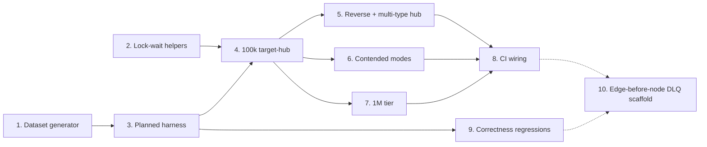

# Phase 6 / Slice 4: Regression & Stress Test Suite — Stories

Source: `plan/v6/slices.md` Slice 4, bound by `plan/v5-v6-orchestration.md`
(P6-Q3 tiered star-topology scale: 100k edges into one node in the CI
integration job, 1M in a nightly/manual stress job, the integration job
itself stays non-blocking; P6-Q2 Neo4j Enterprise in CI is
nightly/manual-only and advisory; P6-Q5 metric names come from the P6-S2
catalogue once it exists). Runs "alongside wave 2 and the Phase 5 waves"
per the owner's mid-programme parallelism directive, confined to **new
test files and fixtures only**, plus additive changes to
`.github/workflows/ci-integration.yml` and additive pytest markers in
`pyproject.toml`. No `src/` change in this slice, ever — if a test needs a
production hook that doesn't exist, this document names it as a follow-up
instead of adding it.

## Slice recap

**As a** Maintainer, **I want** an automated test that proves the
star-topology/hub-node acceptance criterion at real scale, and a scaffold
for the edge-before-node DLQ case, **so that** "no deadlocks under
contention" and "no lost edges" are continuously verified claims, not
one-time measurements in `docs/USAGE.md`.

Out of scope (unchanged from `plan/v6/slices.md`): redesigning the
deadlock-avoidance strategy (already correct); Phase 5's actual DLQ/retry
implementation; any change to a production code path.

## What already exists that this slice builds on (grounded in the current tree)

- **`tests/conftest.py`** already gives every integration test
  Docker-free-unless-Docker-is-there fixtures: `neo4j_driver`/
  `clean_neo4j` (session-scoped `Neo4jContainer("neo4j:5.21-enterprise")`,
  `pytest.skip` if Docker is unreachable) and `kafka_bootstrap`/
  `kafka_topic` (session-scoped `KafkaContainer`, UUID-suffixed
  single-partition topics, deleted after). These are exactly what the
  advisory `ci-integration.yml` job already runs self-contained, with no
  `GRAPH_LOADER_IT_*` scratch stack.
- **`tests/test_node_loader_integration.py`** is this repo's existing
  precedent for "integration test, but Docker-free of the *loader*
  containers": it drives `NodeLoader`/`NodeWriter`/`normalize_node_record`
  directly, in-process, against the `neo4j_driver`/`kafka_bootstrap`
  fixtures — no `docker_service.py`, no built loader images, no CLI
  subprocess. `test_relationship_bulk_e2e.py` and
  `test_social_planned_integration.py` are the *other* precedent — full
  `python -m src.cli start` subprocesses against a real, already-running
  Docker network (`RUN_RELATIONSHIP_BULK_E2E=1` + a live `docker compose`
  stack, or `GRAPH_LOADER_IT_*` for a named scratch stack) — neither of
  which the advisory CI job can satisfy on a stock GitHub-hosted runner
  with no pre-existing stack and no built images (image builds are `ci.yml`
  Story 2's job, a different workflow file, and are not run before
  `ci-integration.yml`'s `integration` job).
- **The production write path is usable without Docker orchestration.**
  Every class that actually decides lock/concurrency behaviour is a plain
  Python object constructible against any `Driver`/bootstrap string:
  - `src.loader.edge_execution.build_edge_execution(edge_config, driver,
    environ=...)` — the exact factory `edge_loader.py` calls; with no
    `GRAPH_LOADER_LEASE_ADDR` set it returns an `ApocLockedEdgeWriter`
    (classic/shared-overlap mode, explicit `apoc.lock.nodes` unless
    `GRAPH_LOADER_EDGE_EXPLICIT_LOCKS=0`); with a lease address set it
    returns a `BucketLeaseExecutionCoordinator` wrapping the same writer
    with `explicit_locks=False` (bulk lease mode).
  - `src.orchestrator.lease_server.BucketLeaseServer` — an asyncio
    server; `tests/test_lease_server.py`'s own `_RunningServer` fixture
    (`server.start("127.0.0.1", 0)` on a dedicated event-loop thread) is
    the exact in-process pattern this slice reuses for bulk lease mode's
    coordinator.
  - `src.loader.edge_planner.KafkaEdgePlanner` — `.start()` captures the
    bulk boundary and creates the run's chunk topic against a real Kafka
    bootstrap string, `.finish(plan_path)` runs the planner and writes
    `edge-plan.json`, `.close()` cleans up. No Docker anywhere in this
    class.
  - `src.orchestrator.planned_dispatcher.PlannedDispatcher` — an asyncio
    server (`.start(host, port)`); `tests/test_planned_dispatcher.py`'s
    `_Server` fixture is the exact in-process pattern (own event-loop
    thread, bound to `127.0.0.1:0`).
  - `src.loader.planned_writer.{DispatcherClient, ChunkFetcher,
    PlannedEdgeWriterWorker}` — the real writer-side chunk loop,
    constructible against the in-process dispatcher's loopback address and
    a real Kafka chunk topic.
  - `src.loader.dead_letter.{DeadLetterEnvelope, FAILURE_CLASSES,
    dead_letter_topic_name}` — `FAILURE_CLASSES = ("malformed",
    "missing_endpoint", "ambiguous_endpoint")` already reserves the two
    failure classes Phase 5 Slice 3 (row-level missing-endpoint DLQ) will
    use; only `"malformed"` is reachable today.
  - Today, a missing endpoint at write time raises
    `src.loader.edge_loader.MissingRelationshipEndpointError` from inside
    `ApocLockedEdgeWriter._write_rows` and rolls the whole batch/chunk back
    — this **is** today's fail-closed behaviour for planned, classic and
    lease bulk modes alike (Phase 5 Slice 3, which adds a bulk opt-in flag
    to route only the unresolved rows to a DLQ instead, is not merged; see
    Story 9).
  - `ApocLockedEdgeWriter.write_rows(rows)` returns the **attempt count**
    used (`edge_execution.py:203-215`); `1` means no retry was needed, `>1`
    means a `TransientError` (e.g. `DeadlockDetected`) was retried and
    recovered, logged as `"stage=edge-write-retry ... code=%s"`. This is a
    metrics-free, always-available signal for "a deadlock happened and was
    recovered" that predates and does not require P6-S2's
    `graph_loader_deadlocks_recovered_total` counter.
- **`examples/social/social_graph.py`** is this repo's existing pattern for
  an independently-computed expected graph compared exactly against Neo4j
  (`generate`/`expected_graph`/`read_graph`/`compare`), and it already
  covers most of this slice's "correctness regressions" list (integer
  keys, date keys, a self-referencing type with self loops, two types
  between the same labels, last-write-wins evidence) — but at a scale (a
  few hundred thousand records spread thin) that never creates a genuine
  hub, and it lives under `examples/`, not `tests/`, so this slice does not
  edit it. Story 1 builds a new, `tests/`-owned module in the same spirit,
  sized for one deliberate hub.

## Decisions this Cartographer is making now

1. **Drive the write path at the class level, not through
   `docker_service.py`/the CLI subprocess, for every test this slice adds.**
   `run_planned_edge_phase` (`src/orchestrator/planned_edges.py:364`)
   — the CLI's real planned-mode orchestration — launches the dispatcher
   and every writer as **Docker containers**
   (`docker_service.run_planned_dispatcher`/`run_planned_edge_writers`),
   which needs pre-built `graph-loader-edge`/`graph-loader-node` images.
   The advisory `ci-integration.yml` job never builds images (that is
   `ci.yml`'s `build-images` job, a different, blocking workflow that does
   not run before or alongside it). Requiring images in this slice would
   either (a) silently make every star-topology test skip on a stock
   runner exactly like `test_social_planned_integration.py` does today —
   defeating the slice's whole purpose — or (b) require adding an image
   build step to the advisory job, which is a much bigger, riskier change
   than "new test files plus additive CI." Lock-wait and deadlock behaviour
   is decided entirely by the Cypher query shape and which transactions run
   concurrently — properties of the writer classes above, not of which
   process boundary invokes them — so driving them directly, multi-threaded,
   in the test process, against the real testcontainers Neo4j/Kafka,
   proves the identical claim with none of that risk.
   **Residual, accepted gap:** this does not exercise Docker container
   startup/networking/image correctness as a source of deadlock or lost
   writes. That is out of scope for this slice (it is `test_docker_build.py`
   and `test_relationship_bulk_e2e.py`'s job) and is recorded here, not
   hidden.
2. **Tiering mechanism.** One pytest marker, `stress` (added to
   `pyproject.toml`'s `markers` list, additive), on every star-topology
   test in `tests/stress/test_star_topology_stress.py`. The 100k-edge
   variant carries only `@pytest.mark.integration @pytest.mark.stress` and
   runs as part of the advisory job's existing `pytest tests -m
   integration` step (per P6-Q3, "100k... in the CI integration job") —
   no new gating needed for it. The 1M-edge variant carries the same two
   markers **plus** a runtime `pytest.skip` unless
   `GRAPH_LOADER_STRESS_SCALE=1000000` is set in the environment, and a
   **new**, separate job in `ci-integration.yml`
   (`star-topology-stress-1m`) sets that variable and selects only that
   test by node id — so the existing `integration` job's `-m integration`
   selector never silently balloons to run the 1M case too. See Story 8.
3. **Query-log lock-wait verification needs the query log turned on.**
   `docs/USAGE.md` §8/§9's "Neo4j 5's query log... prints `waiting: N ms`"
   claim is true only once `dbms.logs.query.enabled`/threshold are
   configured — neither `tests/conftest.py`'s `Neo4jContainer` nor
   `docker-compose.yaml`'s `neo4j` service sets them today (confirmed: no
   `NEO4J_dbms_logs_query_*` env anywhere in the tree). Story 2 sets them
   explicitly on the test's own container rather than assuming a default,
   and is the one place this slice's helper differs from "just use the
   container as `conftest.py` already builds it."
4. **The edge-before-node DLQ scaffold auto-activates by behaviour
   detection, not a hardcoded date or branch check.** The slice document
   asks for "`pytest.mark.xfail`... or skip once Phase 5's DLQ topic
   exists" — a *static* `@pytest.mark.xfail` needs a human to notice and
   delete it once P5-S3 merges, which is exactly the manual step the
   epic's "activate automatically" phrase asks this slice to avoid. Story
   9 instead attempts the real write and branches on whether
   `MissingRelationshipEndpointError` is still raised (today's behaviour)
   or the batch's good rows commit and the bad row reaches a DLQ topic
   (post-P5-S3 behaviour) — a `pytest.skip()` call inside the test body,
   keyed to the actual production exception type, not to a marker anyone
   has to remember to remove.
5. **Node seeding for the stress dataset bypasses `NodeLoader`/Kafka.**
   Node-loading correctness is already covered by
   `test_node_loader_integration.py` and is not this slice's concern; the
   star-topology tests seed their (small number of distinct) node labels
   with a single bounded-batch `UNWIND ... MERGE` Cypher statement issued
   directly over the `neo4j_driver` fixture. This keeps setup time out of
   the "no lock waits" measurement window (Story 4's assertion window
   starts only once every node exists) and avoids adding a second,
   redundant Kafka-driven node-loading path to time-box.

## Story 1: Star-Topology Dataset Generator and Expected-Graph Module

**As a** Test Author,
**I want** one deterministic, scale-parameterized dataset generator that
produces a genuine hub (or several: target-fan-in, source-fan-out,
multi-type-into-one-hub) plus an independently computed expected graph,
**so that** every later story in this slice asserts against the same
ground truth instead of re-deriving it, and the generator itself is
unit-testable without Docker.

### Technical Context

New file: `tests/stress/star_topology_data.py` (new package
`tests/stress/__init__.py` too). Mirrors
`examples/social/social_graph.py`'s shape (`Dataset`, `generate`,
`expected_graph`, `wire_value`, `_canonical`) but is not a copy: it is
parameterized by `hub_edges: int` (100_000 or 1_000_000) and a
`topology: Literal["target_hub", "source_hub", "multi_type_hub"]`, and it
deliberately keeps the node-label surface tiny (this is a concurrency
stress test, not another schema-coverage example):

```python
@dataclass(frozen=True)
class StarTopologySchema:
    """One YAML schema description plus its Neo4j/Kafka topic names,
    built to match `topology` (see below). Reuses graph_loader's own
    Pydantic models (`src.models.schema.load_schema`-compatible dict) so
    the exact same `EdgeConfig`/`NodeConfig` objects the production writer
    classes expect come out of `yaml.safe_dump(schema_dict())` +
    `load_schema`, never a hand-built stand-in.
    """
    hub_edges: int
    topology: str

def schema_dict(topology: str) -> dict: ...     # -> loading/nodes/edges YAML dict
def generate(hub_edges: int, topology: str, seed: int = 13) -> Dataset: ...
def expected_graph(dataset: Dataset) -> tuple[dict, dict]: ...  # (nodes, rels) — same shape as social_graph
def last_write_evidence(dataset: Dataset) -> dict: ...           # reused idea from social_graph, adapted
```

- **`target_hub`** (the epic's literal AC): node label `Hub` (exactly one
  node, key `"H"`), node label `Leaf` (`hub_edges` distinct nodes, integer
  keys, so this doubles as the "integer key" correctness coverage), one
  edge type `POINTS_AT` with every record `(leaf_i, H, {seq: i})` — `seq`
  is monotonically increasing per source so last-write-wins is
  checkable by re-sending ~1% of pairs with a bumped `seq` (see Story 4).
- **`source_hub`** (the reverse direction called out explicitly in the
  brief): one `Hub` node, `hub_edges` distinct `Leaf` nodes, edge type
  `POINTS_FROM` with every record `(H, leaf_i, {seq: i})` — the hub is the
  **source** this time, exercising the planner's hub-detection on the
  *source* side of a unit rather than the target side.
  `src/loader/edge_planner.py`'s hub rule is "total degree across all
  relationship types," so a source-side hub must be sized the same as a
  target-side one to be picked up — this dataset's whole point is proving
  that symmetry, not assuming it.
- **`multi_type_hub`**: one `Hub` node, `hub_edges` distinct `Leaf` nodes,
  **five** edge types (`LIKES`, `FOLLOWS`, `RATED`, `VIEWED`, `SHARED`),
  each contributing `hub_edges // 5` records, all targeting the same `Hub`
  node — proving the planner treats a hub's *total* degree across types,
  not per-type, as the trigger (`docs/USAGE.md` §6 "a hub resource of its
  own if its total degree **across all relationship types**").
- `expected_graph` reuses `examples/social/social_graph.py`'s
  `_canonical`/last-write-wins-by-property-merge convention exactly (a
  later record's `SET r += props` semantics: `merged.update(...)`, never
  `merged = ...`), so Story 4's comparison is provably the same rule the
  rest of the test suite already trusts.
- **No Docker or Kafka import at module scope** — `generate`/
  `expected_graph`/`schema_dict` must be plain-Python, unit-testable in
  the fast (`-m "not integration"`) suite. Only a thin `publish(...)`
  helper (used by Story 3+) imports `confluent_kafka`, guarded the same
  way `social_graph.py` guards its Kafka imports (import inside the
  function, not at module top).

### Acceptance Criteria

- [ ] `generate(1000, "target_hub")` (a tiny scale, for the unit test)
      produces exactly 1000 `POINTS_AT` records and exactly one `Hub` node.
- [ ] `generate(1000, "source_hub")` produces exactly 1000 `POINTS_FROM`
      records, all with the same source key.
- [ ] `generate(1000, "multi_type_hub")` produces exactly 1000 records
      summed across the five types, and every type contributes at least
      one record (no type left empty by integer-division rounding at
      small scale).
- [ ] `expected_graph(generate(...))`'s relationship count for the hub's
      type(s) equals the **distinct** `(source, target)` pair count, not
      the raw record count, whenever the generator injects a repeated pair
      (last-write-wins collapse) — proven by a unit test that injects a
      known number of repeats and checks the delta.
- [ ] Every one of these three functions runs, and is unit-tested, with
      `pytest -m "not integration"` (no Docker required).
- [ ] `import tests.stress.star_topology_data` performs no Kafka or Neo4j
      driver import at module scope (checked by a test that patches
      `confluent_kafka`/`neo4j` out of `sys.modules` before importing it).

### Definition of Done

- [ ] `tests/stress/__init__.py`, `tests/stress/star_topology_data.py`
      created.
- [ ] `tests/test_star_topology_data.py` (unit, no Docker) covers every AC
      above at small scale (hundreds, never the real 100k/1M — that would
      make the *unit* suite slow for no reason; scale is Story 4/8's job).
- [ ] Reviewed and merged.

### Dependencies

Blocks: Stories 3–9 (every later story imports this module).
**File overlap:** none — every file here is new. **Estimate: 5 points.**

## Story 2: Lock-Wait and Deadlock-Recovery Assertion Helpers

**As a** Test Author,
**I want** one reusable helper module that turns on Neo4j's query log with
a zero-ms threshold, parses `waiting: N ms` out of it, and counts
retry-and-recover events from the writer classes' own log lines,
**so that** every stress and correctness test in this slice asserts "zero
lock waits" / "zero unhandled deadlocks" the same proven way, instead of
five ad hoc regexes.

### Technical Context

New file: `tests/stress/lock_wait.py`.

- **Enabling the query log.** `Neo4jContainer` (from
  `testcontainers.community.neo4j`) is a `DockerContainer` subclass, so
  `.with_env(name, value)` is available before `.start()`. Add:
  ```python
  def with_verbose_query_log(container: Neo4jContainer) -> Neo4jContainer:
      """Log every query, with its exact lock-wait time, at INFO level.

      Neo4j's docker env-var convention maps `NEO4J_dbms_logs_query_enabled`
      -> `dbms.logs.query.enabled` and `NEO4J_dbms_logs_query_threshold` ->
      `dbms.logs.query.threshold` (double-underscore-free names pass through
      verbatim; only names containing a literal underscore in the Neo4j key
      need the `_` -> `__` escaping the existing `docker-compose.yaml` uses
      for `server_memory_heap_initial__size`). Neither is set by
      `tests/conftest.py`'s `neo4j_driver` fixture today, so a stress test
      must apply this itself, before `.start()`.
      """
      return (
          container
          .with_env("NEO4J_dbms_logs_query_enabled", "VERBOSE")
          .with_env("NEO4J_dbms_logs_query_threshold", "0ms")
          .with_env("NEO4J_dbms_logs_query_parameter__logging__enabled", "false")  # never log key values
      )
  ```
  First Mate must verify the exact Neo4j 5.21 config key spelling against
  that image's own `neo4j.conf` reference (Neo4j has, in the past, renamed
  `dbms.logs.query.*` to `db.logs.query.*` between minor versions) before
  relying on it — this is exactly the kind of thing that must be checked
  against the running container's actual `logs/neo4j.log` startup banner
  (it echoes every applied/unknown setting), not assumed from memory.
- **Reading the log back out.** `Neo4jContainer` exposes the underlying
  `docker.models.containers.Container` (via `testcontainers`' own
  `get_wrapped_container()` or equivalent — confirm the exact accessor for
  this library's pinned `testcontainers` version). Use it to `exec_run`:
  ```python
  _WAIT_RE = re.compile(r"waiting:\s*(\d+)\s*ms")

  def total_lock_wait_ms(container) -> int:
      """Sum every `waiting: N ms` in the container's query log right now."""
      raw = container.get_wrapped_container().exec_run(
          ["cat", "/logs/query.log"]
      ).output.decode("utf-8", errors="replace")
      return sum(int(match.group(1)) for match in _WAIT_RE.finditer(raw))

  def assert_zero_lock_wait(container) -> None:
      total = total_lock_wait_ms(container)
      assert total == 0, f"expected 0 ms of Neo4j lock waiting, measured {total} ms"
  ```
  A helper that instead greps for any `waiting: ` value `> 0` (not just
  sums) is provided too (`any_lock_wait(container) -> int | None`,
  returning the first nonzero value or `None`) — Story 4's assertion wants
  "no lock waits happened at all," which a sum of zero already proves, but
  a nonzero sum's *first offending line* is far more useful in a CI
  failure log than a bare total, so capture it either way.
- **Live inspection during a run (debugging aid, not the pass/fail
  signal).** `poll_show_transactions(driver, stop: threading.Event, out:
  list, interval_s: float = 0.05)` runs `SHOW TRANSACTIONS YIELD status,
  activeLockCount, currentQuery` in a background thread and appends any
  row with `status` containing `"Blocked"` to `out`. This is **not** used
  for the zero-lock-wait assertion (a sampling poll can miss a wait
  entirely between polls — the query log is authoritative and complete);
  it exists only so a failing stress test's CI log shows *what was
  running* when a wait or deadlock happened, which is exactly the kind of
  detail `docs/USAGE.md`'s own "checking for lock waits yourself" section
  already tells an operator to look at by hand.
- **Deadlock-recovery counting without metrics.** `ApocLockedEdgeWriter`
  and `PlannedEdgeWriterWorker.write_rows` return an attempt count and log
  `"stage=edge-write-retry edge=%s ... code=%s"` on every retried attempt
  (Recap, bullet on `edge_execution.py:203-215`). Provide:
  ```python
  def count_retry_log_lines(caplog, edge_type: str | None = None) -> int:
      """Count `stage=edge-write-retry` records, optionally filtered by edge type."""

  def assert_no_unhandled_deadlock(write_call: Callable[[], int]) -> int:
      """Call `write_call` (e.g. `writer.write_rows(rows)`); let any exception
      propagate (an unhandled deadlock *must* fail the test, never be
      swallowed); return the attempt count used."""
  ```
  `caplog` is pytest's built-in log-capture fixture (`caplog.set_level`
  against `"src.loader.edge_execution"`'s logger name) — no new logging
  configuration needed anywhere in `src/`.
- **Soft dependency on P6-S2's metrics (per `plan/v6/slices.md`: "the test
  could fall back to query-log parsing if Slice 2 is reordered").** Add
  one optional helper, `try_scrape_metric(url: str, name: str) -> float |
  None`, a bare `urllib.request` GET against `http://127.0.0.1:<port>/metrics`
  returning `None` on any `ConnectionError`/`URLError` or if the named
  series isn't present in the text body — never an import of
  `prometheus_client` itself (this slice must not gain a hard dependency
  on Slice 2's own dependency). Every stress test in this slice treats a
  `None` return as "metrics not available yet" and falls back to the
  query-log/retry-log signals above; it never fails a test only because
  the metrics endpoint wasn't reachable.

### Acceptance Criteria

- [ ] Against a `Neo4jContainer` with `with_verbose_query_log` applied,
      running one deliberately slow, lock-contending pair of concurrent
      transactions (two threads, `MERGE` on the same node, one delayed with
      `apoc.util.sleep`) produces a nonzero `total_lock_wait_ms(container)`
      — proving the helper can detect a **real** wait, not just always
      returning zero.
- [ ] Against the same container with no contention at all, `assert_zero_
      lock_wait(container)` passes.
- [ ] `count_retry_log_lines` returns the exact count of injected
      `TransientError`s that a fake writer's `_sleep`-stubbed retry loop
      raised-then-recovered-from, in a unit test with no Neo4j/Docker at
      all (constructs `ApocLockedEdgeWriter` with a mocked `Driver`).
- [ ] `try_scrape_metric` returns `None` (never raises) when nothing is
      listening on the probed port.
- [ ] `assert_no_unhandled_deadlock` re-raises the injected exception
      unchanged when a fake `write_call` exhausts retries and still fails
      (this helper must never mask a real bug).

### Definition of Done

- [ ] `tests/stress/lock_wait.py` created.
- [ ] `tests/test_lock_wait_helpers.py` (unit, no Docker, for the
      log-line/metrics-probe helpers) plus one `@pytest.mark.integration`
      test (using `neo4j_driver`, with the container rebuilt locally with
      `with_verbose_query_log` applied — note this fixture is
      session-scoped in `conftest.py`, so this story's own test needs its
      **own** `Neo4jContainer`, not the shared `neo4j_driver` fixture, to
      apply the query-log env vars before `.start()`; document this
      clearly so nobody "fixes" it by mutating the shared fixture and
      breaking every other integration test's assumption about default
      Neo4j config) proving the real query-log wait-detection AC above.
- [ ] Reviewed and merged.

### Dependencies

Depends on: none. Blocks: Stories 4, 6, 8 (every assertion of "zero lock
waits"/"zero unhandled deadlocks" in this slice calls into this module).
**File overlap:** none — new files only. **Estimate: 5 points.**

## Story 3: In-Process Planned-Mode Harness

**As a** Test Author,
**I want** one reusable harness that runs the real planned-mode pipeline —
`KafkaEdgePlanner` -> `PlannedDispatcher` -> N `PlannedEdgeWriterWorker`
threads — against a real Neo4j/Kafka pair with no Docker container beyond
those two, and returns the same completion proof the CLI's own
`run_planned_edge_phase` checks,
**so that** Stories 4–6 do not each hand-roll planner/dispatcher/writer
wiring, and a bug in the harness itself is fixed once.

### Technical Context

New file: `tests/stress/planned_harness.py`.

```python
@dataclass
class PlannedRunResult:
    plan: EdgePlan
    ledger: dict          # from src.orchestrator.planned_edges.verify_ledger
    total_attempts_over_one: int   # sum of (attempts - 1) across every chunk write
    wall_seconds: float

def run_planned_mode(
    schema, driver, kafka_bootstrap: str, *, plan_dir: Path,
    writers: int = 4, plan_hub_degree: int | None = None,
) -> PlannedRunResult:
    """Seed nothing; caller has already written every node. Plans from the
    schema's declared edge topics (records must already be published),
    dispatches every chunk through an in-process dispatcher, and writes
    every chunk through real ApocLockedEdgeWriter/NativeDisjointEdgeWriter
    instances built the same way `planned_writer.main()` builds them.
    Raises on anything `run_planned_edge_phase` would also fail on: an
    incomplete ledger, a writer exiting nonzero, a chunk written twice.
    """
```

- **Planning.** `KafkaEdgePlanner(schema, kafka_bootstrap, settings,
  plan_id=run_id, plan_path=plan_dir / "edge-plan.json")`; call
  `.start()` then `.finish(plan_path)` synchronously (this harness plans
  and writes sequentially, not overlapped with node loading, because
  Decision 5 already seeded every node before this function is called —
  matching the docs' own "nodes and planning in parallel" only in
  spirit, not in literal overlap, which is an acceptable simplification
  for a concurrency-of-writes test, not a node-loading-overlap test).
  `settings: PlanSettings` should set `hub_degree` explicitly (from
  `plan_hub_degree`, defaulting to whatever `src/orchestrator/
  auto_settings.py` would derive for this record count) so Story 4 can
  force hub detection deterministically rather than trusting the derived
  default at every scale.
- **Dispatch.** `PlannedDispatcher(plan, digest).start("127.0.0.1", 0)` on
  a dedicated asyncio-event-loop thread (the exact `_Server` pattern in
  `tests/test_planned_dispatcher.py`); the returned `(host, port)` feeds
  every writer's `DispatcherClient(host, digest=digest)`.
- **Writing.** One `PlannedEdgeWriterWorker` per writer thread, each with
  its own `DispatcherClient`, `ChunkFetcher(kafka_bootstrap, plan.topic,
  ...)`, and a `writers: Mapping[str, object]` mapping every edge type in
  the plan to a writer object built by
  `src.loader.edge_execution.build_edge_execution(edge_config, driver)`
  called with **no** `GRAPH_LOADER_LEASE_ADDR` set (planned mode's own
  chunks are already node-disjoint, so the classic `ApocLockedEdgeWriter`
  with `explicit_locks=False, sort_rows=False` is correct here — trace
  `planned_writer.main()`'s own writer-construction call to confirm the
  exact flags it passes before wiring this, since this harness must match
  production's choice exactly, not assume it).
  Run every worker's `.run()` in its own `concurrent.futures.ThreadPoolExecutor`
  worker (matching `--plan-writers`), collect each return code, and sum
  every `PlannedEdgeWriterWorker`'s internal write-attempt counts (needs a
  one-line change to the worker's own bookkeeping *inside this test
  harness's copy of the call*, not to `src/` — capture attempts via the
  same `attempts=%s` value the worker already logs, using `caplog`, rather
  than patching `src/loader/planned_writer.py`).
- **Verification.** `src.orchestrator.planned_edges.verify_ledger(plan,
  summary)` — same function the CLI itself calls — checked against the
  written `edge-plan.json.ledger.json`.
- **Cleanup.** The harness's `finally` block always calls
  `KafkaEdgePlanner.close(delete_topic=True)` (deletes the chunk topic)
  and stops the dispatcher's event loop, even on failure — a leaked chunk
  topic or a hung event-loop thread must never survive one failed test and
  poison the next one in the same session-scoped Kafka container.

### Acceptance Criteria

- [ ] `run_planned_mode` against a small (hundreds of rows), pre-seeded,
      non-hub schema produces a graph matching
      `star_topology_data.expected_graph` exactly (reuses Story 1).
- [ ] `run_planned_mode` raises (does not silently return a partial
      result) if one writer thread's `PlannedEdgeWriterWorker.run()`
      returns nonzero.
- [ ] Calling `run_planned_mode` twice in the same test process (two
      different `run_id`s) against the same Kafka/Neo4j containers leaves
      no leftover chunk topic after either call.
- [ ] The harness never touches `src/orchestrator/docker_service.py` or
      spawns a Docker container beyond the two the `neo4j_driver`/
      `kafka_bootstrap` fixtures already own.

### Definition of Done

- [ ] `tests/stress/planned_harness.py` created.
- [ ] `tests/test_planned_harness.py` (`@pytest.mark.integration`, small
      scale) covers every AC above.
- [ ] Reviewed and merged.

### Dependencies

Depends on: Story 1 (dataset/expected-graph), Story 2 (soft — the harness
itself doesn't assert lock-wait, but Story 4 uses both together).
Blocks: Stories 4–6. **File overlap:** none — new files only.
**Estimate: 8 points.**

## Story 4: Star-Topology Stress Test — Planned Mode, 100k Tier, Target-Hub

**As a** Maintainer,
**I want** a test that publishes 100k relationship records all targeting
one hub node, runs them through planned mode via Story 3's harness, and
proves the exact count plus zero Neo4j lock waiting,
**so that** the epic's headline acceptance criterion is a standing,
automatically-re-run claim instead of a one-time measurement.

### Technical Context

New file: `tests/stress/test_star_topology_stress.py` (this story starts
it; Stories 5–7 extend the same file).

```python
GRAPH_LOADER_STRESS_SCALE = int(os.environ.get("GRAPH_LOADER_STRESS_SCALE", "100000"))

@pytest.mark.integration
@pytest.mark.stress
def test_100k_edges_into_one_hub_planned_mode_zero_lock_waits(
    neo4j_driver, clean_neo4j, kafka_bootstrap, tmp_path,
):
    dataset = star_topology_data.generate(GRAPH_LOADER_STRESS_SCALE, "target_hub")
    schema = _load_schema(star_topology_data.schema_dict("target_hub"), tmp_path)
    _seed_nodes(neo4j_driver, dataset)                      # Decision 5: direct UNWIND MERGE
    _publish_edges(dataset, kafka_bootstrap)                 # Story 1's publish() helper
    container = _query_logged_neo4j_container()               # Story 2's with_verbose_query_log,
                                                               # OWN container, see Story 2's DoD note
    ... # driver rebuilt against `container`'s own bolt address
    result = planned_harness.run_planned_mode(schema, driver2, kafka_bootstrap, plan_dir=tmp_path)
    with driver2.session() as session:
        count = session.run(
            "MATCH ()-[r:POINTS_AT]->(:Hub) RETURN count(r) AS c"
        ).single()["c"]
    assert count == len(_distinct_pairs(dataset))            # exact final count, last-write-wins collapsed
    lock_wait.assert_zero_lock_wait(container)
    assert result.total_attempts_over_one == 0               # no retries at all: planned mode never contends
```

- **Why a dedicated container instead of the shared `neo4j_driver`
  fixture:** Story 2 already flagged this — query logging must be applied
  before `.start()`, and `neo4j_driver` is session-scoped and shared by
  every other integration test in the same `pytest` run. This test (and
  every other stress test in this file) constructs its own
  function-scoped `Neo4jContainer`, which costs one extra container
  startup (~10-20 s) per test — acceptable, given each of these tests is
  already the slow, deliberately-heavy tail of the suite.
- **Exact final count, not just a nonzero count.** `_distinct_pairs`
  reduces the dataset to unique `(leaf_id, "H")` pairs (some leaves send
  more than one `POINTS_AT` record, by construction in Story 1, to give
  Story 6 something to prove last-write-wins with) — this is the "the
  final relationship count equals the input exactly" AC from
  `plan/v6/slices.md`, read precisely: exactly the number of **distinct
  pairs**, since repeats collapse under `MERGE`.
- **Runtime budget, not a performance assertion.** This test's own
  wall-clock is bounded by a generous ceiling (documented below, not
  asserted in code as a strict pass/fail unless it blows the ceiling) —
  GitHub-hosted runners are shared, variable-performance hardware, nothing
  like `docs/USAGE.md` §9's pinned 8-core benchmark host. A hard, tight
  wall-clock assertion here would be a flaky test waiting to happen; the
  *only* hard assertions are exact count and zero lock-wait. The ceiling
  exists only so a genuine hang (not a slow-but-completing run) fails the
  test instead of the whole job timing out uninformatively — implemented
  as `pytest-timeout`'s `@pytest.mark.timeout(600)` if that plugin is
  already a dependency (check `requirements-dev.txt`/`requirements.txt`
  before adding a new one; if absent, a manual `threading.Timer`-based
  hard-fail is an acceptable fallback, documented as such).
- **Hub detection must be forced, not assumed.** Pass an explicit
  `plan_hub_degree` to `run_planned_mode` (e.g. `1000`, well under
  100,000) rather than relying on `auto_settings.py`'s derived default at
  this exact record count — this test is about the hub *code path*, and
  must not silently degrade into "every leaf gets its own bucket, no hub
  resource used at all" if a future default-tuning change shifts the
  derived threshold. Assert `plan.resources.hub_count >= 1` on the
  resulting `EdgePlan` as an explicit precondition check before the
  lock-wait assertion — a passing lock-wait assertion on a plan that
  accidentally has zero hubs would prove nothing about the epic's actual
  claim.

### Acceptance Criteria

- [ ] The test publishes exactly `GRAPH_LOADER_STRESS_SCALE` (100,000 by
      default) `POINTS_AT` records to a real Kafka topic before planning
      starts.
- [ ] `plan.resources.hub_count >= 1` and the `Hub` node's key is a member
      of a hub resource (not a regular bucket) — checked directly against
      `EdgePlan.resources`, not inferred from the final count.
- [ ] The final `POINTS_AT` relationship count in Neo4j equals the number
      of distinct `(leaf, "H")` pairs in the dataset exactly (neither more
      — no duplicate relationships — nor fewer — no lost edges).
- [ ] `lock_wait.total_lock_wait_ms(container)` is exactly `0` after the
      run.
- [ ] Every chunk write in the run used exactly 1 attempt (`total_attempts
      _over_one == 0`) — planned mode shows zero recovered deadlocks by
      construction, matching `plan/v6/slices.md`'s own framing of this as
      "itself a useful health signal."
- [ ] The test fails loudly (not silently skips) if Docker is reachable
      but the run itself errors — it must never report false-green by
      accidentally catching and swallowing an exception from the harness.
- [ ] Running this test twice in a row (fresh containers each time, same
      seed) produces bit-identical pass/fail and identical final counts —
      proving the dataset and the assertion are deterministic, not
      timing-sensitive.

### Definition of Done

- [ ] `tests/stress/test_star_topology_stress.py` created with this test.
- [ ] Documented, measured (locally, by the First Mate — see Story 10)
      wall-clock at 100k scale, recorded in this story's own commit
      message or a short code comment, to size Story 8's CI job timeout
      honestly rather than guessing.
- [ ] Reviewed and merged.

### Dependencies

Depends on: Stories 1–3. Blocks: Stories 5–8 (same file, same fixtures).
**File overlap:** creates `tests/stress/test_star_topology_stress.py`,
which Stories 5–7 also edit — sequence those three after this one lands,
not in parallel, to avoid three agents editing the same new file at once.
**Estimate: 8 points.**

## Story 5: Star-Topology Stress Test — Reverse Fan-Out and Multi-Type Hub

**As a** Maintainer,
**I want** the same 100k-scale proof for one source fanning out to N
targets, and for several relationship types all landing on one hub,
**so that** the epic's "and reverse" and "many types into one hub" cases
are proven with the same rigor as the target-fan-in case, not assumed
symmetric.

### Technical Context

Extends `tests/stress/test_star_topology_stress.py` (same fixtures,
same `lock_wait`/`planned_harness` helpers as Story 4 — this story adds
two more test functions, not new infrastructure):

```python
@pytest.mark.integration
@pytest.mark.stress
def test_100k_edges_from_one_hub_planned_mode_zero_lock_waits(...):
    """topology="source_hub": one Hub node is every record's SOURCE."""

@pytest.mark.integration
@pytest.mark.stress
def test_100k_edges_five_types_into_one_hub_planned_mode_zero_lock_waits(...):
    """topology="multi_type_hub": LIKES/FOLLOWS/RATED/VIEWED/SHARED, all -> Hub."""
```

- **Source-hub specific check.** The planner's hub rule keys on total
  degree, computed once per node regardless of whether that node appears
  as a unit's source or target resource (`docs/USAGE.md` §6, "a hub
  resource of its own if its total degree **across all relationship
  types**"). Assert `plan.resources.hub_count >= 1` exactly as in Story 4,
  and additionally assert the hub's resource token is used as the
  **source** resource of every chunk in the plan for this edge type
  (`chunk.source_resource == hub_token for every chunk of type
  POINTS_FROM`) — this is the one assertion Story 4 doesn't need (its hub
  is always the target), and it is the actual proof that the reverse
  direction was exercised, not just published.
- **Multi-type-hub specific check.** Assert the final per-type counts sum
  correctly (`LIKES + FOLLOWS + RATED + VIEWED + SHARED == distinct pairs
  summed per type`) **and** that the hub's plan resource is shared across
  chunks of more than one type (`{chunk.edge_type for chunk in plan.chunks
  if hub_token in (chunk.source_resource, chunk.target_resource)}` has
  length `> 1`) — proving the planner did not accidentally give each type
  its own separate "hub," which would silently reintroduce the
  per-type-lane contention the whole planned-mode design exists to avoid.
- Both new tests reuse Story 4's exact zero-lock-wait and
  zero-extra-attempts assertions verbatim (same helper calls) — the only
  new logic in this story is dataset topology selection and the two
  structural checks on `EdgePlan.chunks` above.

### Acceptance Criteria

- [ ] Source-hub test: `Hub` is a hub resource, is exclusively the
      **source** resource in the `POINTS_FROM` chunks, and the final
      relationship count matches distinct pairs exactly.
- [ ] Multi-type-hub test: all five types are present in the final graph
      with correct per-type counts, the `Hub` node's plan resource is
      shared by at least two distinct edge types' chunks, and the total
      relationship count across all five types matches distinct pairs
      summed per type exactly.
- [ ] Both tests show `lock_wait.total_lock_wait_ms(container) == 0` and
      zero extra write attempts, identical rigor to Story 4.
- [ ] Neither new test duplicates Story 4's dataset-generation or
      container-setup code — both call the same `star_topology_data`/
      `planned_harness`/`lock_wait` helpers with a different `topology`
      argument.

### Definition of Done

- [ ] Two new test functions added to
      `tests/stress/test_star_topology_stress.py`.
- [ ] Reviewed and merged.

### Dependencies

Depends on: Story 4 (same file — land sequentially). Blocks: Story 8 (CI
wiring covers the whole file by marker, so no separate wiring per test).
**File overlap:** edits the file Story 4 created; do not run Stories 4 and
5 in parallel worktrees against the same base. **Estimate: 5 points.**

## Story 6: Deliberately Contended Modes — Zero *Unhandled* Deadlocks

**As a** Maintainer,
**I want** the same 100k-edge target-hub dataset run through the classic
shared-overlap writer and through bulk lease mode, both deliberately
contended, asserting every deadlock that occurs is recovered by retry,
**so that** the part of the epic's AC that planned mode already satisfies
"for free" is not the only part ever tested — the genuinely contended
paths get their own proof.

### Technical Context

Extends the same test file with two more functions, this time **not**
using `planned_harness` at all (planned mode has no lock waits to
contend with by construction — that's Stories 4–5's point). Instead, this
story drives `build_edge_execution` directly against the *same* one-hub
dataset, with many threads writing concurrent batches that all touch the
`Hub` node:

```python
@pytest.mark.integration
@pytest.mark.stress
def test_100k_edges_into_one_hub_shared_overlap_zero_unhandled_deadlocks(
    neo4j_driver, clean_neo4j,
):
    """Classic mode, `--bulk-edge-overlap shared` equivalent: many threads,
    each its own `ApocLockedEdgeWriter` (explicit_locks=True, the default),
    all writing batches whose rows include the same Hub node. Ordered APOC
    locks prevent deadlock; explicit MERGE on a hot node still *waits* --
    this test asserts recovered deadlocks only, and does NOT assert zero
    lock-wait (the opposite of Stories 4-5: docs/USAGE.md's own "why lock
    waits used to dominate" section says this mode's waiting is expected).
    """
    writer = ApocLockedEdgeWriter(neo4j_driver, edge_config,
                                   missing_endpoint_error_factory=MissingRelationshipEndpointError)
    batches = _chunk_into_concurrent_batches(dataset, workers=16)
    with caplog.at_level(logging.WARNING, logger="src.loader.edge_execution"):
        with ThreadPoolExecutor(max_workers=16) as pool:
            attempts = list(pool.map(lambda rows: writer.write_rows(rows), batches))
    assert all(isinstance(a, int) for a in attempts)   # every call returned, none raised
    ... # exact final count assertion, same as Story 4

@pytest.mark.integration
@pytest.mark.stress
def test_100k_edges_into_one_hub_bulk_lease_mode_zero_lock_waits(
    neo4j_driver, clean_neo4j,
):
    """Bulk lease mode: BucketLeaseServer started in-process (the exact
    `_RunningServer` pattern from tests/test_lease_server.py), then
    build_edge_execution(edge_config, driver, environ={LEASE_ADDRESS_ENV: ...})
    -- this mode already claims zero lock waits *today* (docs/USAGE.md's
    relationship-modes table: "Bucket leases ... none"), independent of
    Phase 5 Slice 1 (which only extends leases to *streaming*; bulk lease
    mode is not gated on that slice). Asserts BOTH zero lock-wait (Story
    2's helper) AND zero unhandled deadlocks, since leases claim to avoid
    contention outright, not just recover from it.
    """
```

- **The shared-overlap test's pass condition is deliberately different
  from every other test in this slice**: it *expects* nonzero lock-wait
  (that is the whole point of exercising this mode), and only fails if
  (a) an exception escapes `write_rows` (an unhandled deadlock reaching
  the caller) or (b) the final count is wrong. To make sure the test is
  actually exercising contention and not accidentally passing because the
  16 threads never overlapped in practice, assert
  `lock_wait.total_lock_wait_ms(container) > 0` as a **precondition
  sanity check**, logged clearly as "contention was real" — a test that
  can never fail on the thing it claims to test is worse than no test.
- **Retry evidence, not just "it didn't raise."** Use `count_retry_log_
  lines(caplog)` (Story 2) and assert it is `> 0` for the shared-overlap
  case at this scale/thread-count combination (tuned so contention is
  reliably reproducible — if 16 threads on 100k rows against one hot node
  never produces a single retry locally, raise the thread count or lower
  the batch size until it reliably does, and record the tuned values in
  code comments; a stress test whose "contention" branch never actually
  triggers real contention is not proving anything).
- **Lease-mode set-up detail.** `BucketLeaseClient` needs
  `GRAPH_LOADER_LEASE_ADDR` set to the in-process server's
  `"tcp://127.0.0.1:<port>"` (confirm the exact scheme string
  `parse_lease_address` expects — `lease_client.py:49` — before wiring
  this; do not guess the scheme prefix). `build_edge_execution` is called
  with `environ={LEASE_ADDRESS_ENV: address, LEASE_BUCKETS_ENV: "16"}` (or
  whatever default matches `--lease-buckets 16` per `docs/USAGE.md`'s
  `start` options table) rather than mutating `os.environ` globally,
  keeping this test isolated from every other test in the same process.

### Acceptance Criteria

- [ ] Shared-overlap test: `lock_wait.total_lock_wait_ms(container) > 0`
      (contention really happened), `count_retry_log_lines(caplog) > 0`
      (at least one deadlock was detected and retried), every
      `write_rows` call returns normally (no unhandled
      `DeadlockDetectedException`/`TransientError` reaches the test), and
      the final relationship count is exact.
- [ ] Bulk-lease test: `lock_wait.total_lock_wait_ms(container) == 0`
      (leases claim zero, not just "recovered"), no exception from any
      writer call, final count exact.
- [ ] Neither test hangs if the in-process lease server fails to start —
      both use `BucketLeaseClient`'s existing fail-closed connect-deadline
      behaviour (`tests/test_lease_server.py`'s own
      `test_unreachable_coordinator_fails_closed_after_connect_deadline`
      precedent), so a broken server surfaces as a fast, clear test
      failure, never a CI job timing out silently.
- [ ] The in-process `BucketLeaseServer`'s asyncio event loop and thread
      are torn down in a `finally` block in both success and failure
      paths, leaking neither a thread nor a bound port into the next test
      in the same session.

### Definition of Done

- [ ] Two new test functions added to
      `tests/stress/test_star_topology_stress.py`.
- [ ] The tuned thread-count/batch-size values that reliably reproduce
      real contention (per the technical context above) are recorded in a
      code comment next to the shared-overlap test, with the local
      measurement that justified them.
- [ ] Reviewed and merged.

### Dependencies

Depends on: Story 4 (dataset/container setup, same file). Independent of
Story 5 (different test functions, but same file — sequence after Story 5
lands to avoid a merge conflict on the same new file).
**File overlap:** edits `tests/stress/test_star_topology_stress.py`.
**Estimate: 8 points.**

## Story 7: 1M-Edge Nightly/Manual Tier

**As a** Maintainer,
**I want** the exact same target-hub proof at the epic's literal 1,000,000-
edge scale, gated to run only nightly or on manual dispatch, never on a
PR or every night's ordinary integration run,
**so that** the epic's headline number is genuinely, continuously proven —
not quietly downgraded to "100k, forever" — without slowing down the
day-to-day advisory job.

### Technical Context

Adds one more test function to the same file, reusing every helper from
Stories 1–4 with `topology="target_hub"` and a scale read from the
environment rather than hardcoded:

```python
@pytest.mark.integration
@pytest.mark.stress
def test_1m_edges_into_one_hub_planned_mode_zero_lock_waits(
    neo4j_driver, clean_neo4j, kafka_bootstrap, tmp_path,
):
    if os.environ.get("GRAPH_LOADER_STRESS_SCALE") != "1000000":
        pytest.skip(
            "1M-edge tier only runs when GRAPH_LOADER_STRESS_SCALE=1000000 "
            "is set (the nightly/manual star-topology-stress-1m CI job, or "
            "an explicit local override) -- never as part of an ordinary "
            "`pytest -m integration` run, per P6-Q3's tiering decision."
        )
    ... # identical body to Story 4's test, generate(1_000_000, "target_hub")
```

- **Why a runtime `pytest.skip`, not a second marker.** A dedicated
  marker (e.g. `stress_1m`) would need every CI invocation to remember to
  *exclude* it (`-m "stress and not stress_1m"`) — one missed `-m` filter
  anywhere and the 1M case silently runs inside the ordinary nightly
  `integration` job, blowing its time budget. A runtime env-var check is
  opt-in by construction: nothing runs this test unless something
  deliberately sets that exact variable, which only Story 8's new,
  dedicated job does.
- **Resource/data-location notes specific to this scale:**
  - Kafka: 1M `POINTS_AT` records at roughly 60-90 bytes of JSON each is
    ~60-90 MB of record payload — trivial for a GitHub-hosted runner's
    disk, but `KafkaContainer`'s default log-segment/retention settings
    should be left alone (this is far below the sizes
    `docs/USAGE.md` §6's "large inputs" section worries about; no spill,
    no special Kafka tuning needed at this scale).
  - Neo4j: 1M relationships plus ~1,000,001 nodes is a small graph by this
    library's own numbers (§9 measures 17.8M relationships comfortably);
    the constraint here is CI **time**, not memory or disk.
  - Any scratch file this test itself writes (the schema YAML, the plan
    file, `edge-plan.json`/`.ledger.json`) goes under pytest's `tmp_path`
    fixture, which on a GitHub-hosted runner resolves under `$RUNNER_TEMP`
    (the runner's roomy temp volume, never a size-constrained OS root
    partition) — never a hardcoded `/tmp` path and never anything checked
    into the repo.
  - Do not attempt to replicate `docker-compose.yaml`'s `cpuset` pinning
    inside this test: GitHub-hosted runners are 2-4 shared vCPUs with no
    stable core-affinity guarantee, and `testcontainers`' `Neo4jContainer`
    does not expose a `cpuset` passthrough this repo already relies on
    elsewhere. Accept whatever throughput the runner gives and size the
    timeout generously (see Story 8) rather than trying to pin cores that
    don't meaningfully exist as a stable resource on that hardware class.
- **This test is the one place in this slice most likely to reveal a
  real, previously-unmeasured cost** (1M records through the in-process
  `KafkaEdgePlanner`, which per `docs/USAGE.md` measures 590-660k
  records/s on 4 dedicated cores but has never been run on a shared
  2-core CI runner). First Mate must record an actual measured wall-clock
  from a local run before fixing Story 8's job timeout — do not guess a
  round number.

### Acceptance Criteria

- [ ] With `GRAPH_LOADER_STRESS_SCALE` unset (or any value other than
      `"1000000"`), this test is reported as **skipped**, not failed, and
      does not start any container work beyond the fixtures it shares
      with every other test in the file.
- [ ] With `GRAPH_LOADER_STRESS_SCALE=1000000` set, the test publishes
      exactly 1,000,000 records, the plan shows at least one hub resource,
      the final relationship count matches distinct pairs exactly, and
      `lock_wait.total_lock_wait_ms(container) == 0`.
- [ ] The test's own scratch files (schema YAML, plan file, ledger) are
      all under the `tmp_path` fixture's directory; no path in this test
      is a literal `/tmp/...` or repo-relative "var/..." string.
- [ ] A locally measured wall-clock time (any value) is recorded in a code
      comment beside this test, used to justify Story 8's job timeout.

### Definition of Done

- [ ] New test function added to
      `tests/stress/test_star_topology_stress.py`.
- [ ] Reviewed and merged.

### Dependencies

Depends on: Story 4 (same file, same helpers, `generate()` already
supports the `hub_edges` parameter at any scale). Blocks: Story 8 (needs
this exact test to exist and this exact env var name to wire the new CI
job to). **File overlap:** edits the same shared test file — sequence
after Stories 4-6 land. **Estimate: 5 points** (mostly measurement and
timeout-sizing work, not new logic).

## Story 8: CI Wiring — Additive Job, Pytest Marker, Local Validation Targets

**As a** Maintainer,
**I want** the 100k tier folded into the existing advisory `integration`
job and the 1M tier wired to its own new, nightly/manual-only job, with a
pytest marker and Makefile targets a First Mate can run locally without
ever pushing to GitHub,
**so that** both tiers actually execute on the schedule `plan/v5-v6-
orchestration.md` fixed (P6-Q3), and this slice's own claims about CI
behaviour are checked the same way Slice 1 checked its workflow changes —
locally, with `actionlint` and literal `make` invocations — before merge.

### Technical Context

**`pyproject.toml`** (additive only — the existing `markers` list gains one
entry, nothing already there is touched):
```toml
markers = [
    "smoke: environment smoke tests (require docker compose up)",
    "integration: integration tests against a live database",
    "stress: heavyweight star-topology/hub-node scale tests under tests/stress/ (opt-in via -m stress, or run as part of -m integration in the advisory CI job at the 100k tier; the 1M tier additionally requires GRAPH_LOADER_STRESS_SCALE=1000000)",
]
```

**`.github/workflows/ci-integration.yml`** (additive: the existing
`integration` job is untouched except its `timeout-minutes`, per Story
4/7's measured evidence; one brand-new job is added below it):

```yaml
jobs:
  integration:
    # unchanged steps; timeout-minutes bumped from 45 to a value Story 4's
    # measured 100k-tier wall-clock justifies, with headroom for every
    # other existing integration test in the same run.
    timeout-minutes: <measured 100k wall-clock, rounded up, plus existing suite's own time, plus margin>

  star-topology-stress-1m:
    runs-on: ubuntu-latest
    timeout-minutes: <Story 7's measured 1M wall-clock, rounded up generously>
    if: always()  # independent of the `integration` job; never blocks or is blocked by it
    steps:
      - uses: actions/checkout@v4
      - uses: actions/setup-python@v5
        with:
          python-version-file: .python-version
          cache: pip
          cache-dependency-path: requirements.txt
      - run: docker info
      - run: pip install -r requirements.txt
      - run: |
          GRAPH_LOADER_STRESS_SCALE=1000000 python3 -m pytest \
            "tests/stress/test_star_topology_stress.py::test_1m_edges_into_one_hub_planned_mode_zero_lock_waits" \
            -m "integration and stress" --junitxml=stress-1m-results.xml
      - if: always()
        uses: actions/upload-artifact@v4
        with:
          name: stress-1m-results
          path: stress-1m-results.xml
          retention-days: 14
```

- **Trigger inheritance.** This new job lives in the same workflow file as
  `integration`, so it inherits that file's `on: schedule`/`workflow_
  dispatch` triggers automatically — no new trigger block needed, and no
  risk of accidentally adding a `push`/`pull_request` trigger that would
  make this job (or the whole file) start gating PRs, which
  `plan/v5-v6-orchestration.md`'s P6-Q2 explicitly rules out.
  `permissions: contents: read` is already file-level in
  `ci-integration.yml`; this job needs nothing beyond that.
- **`Fail if Docker-backed tests were skipped` guard, reused.** Copy
  Slice 1's exact guard step (`! grep -q "Docker is required"
  stress-1m-results.xml`) into this job too — the same silent-green risk
  Slice 1 already solved for the `integration` job applies identically
  here: a Docker-unreachable skip must fail this job loudly, not report
  green having run nothing.
- **`Makefile`** (additive targets only; no existing target's recipe
  changes):
  ```makefile
  .PHONY: stress-100k stress-1m

  stress-100k:
      python3 -m pytest tests/stress/test_star_topology_stress.py -m "integration and stress" -k "not 1m"

  stress-1m:
      GRAPH_LOADER_STRESS_SCALE=1000000 python3 -m pytest \
          "tests/stress/test_star_topology_stress.py::test_1m_edges_into_one_hub_planned_mode_zero_lock_waits" \
          -m "integration and stress"
  ```
  Update the `.PHONY:` line at the top of `Makefile` to include both new
  target names, matching the existing single-line convention.
- **`.github/workflows/ci-integration.yml`'s existing `integration` job
  keeps running the whole `tests -m integration` selector** (Slice 1's
  original command), which — once this slice's files exist — now also
  includes every 100k-tier test in `tests/stress/test_star_topology_
  stress.py` (they carry the `integration` marker too) and skips the
  1M-tier test (its own internal `pytest.skip`, Story 7). No change to
  that job's pytest invocation is needed for the 100k tier to start
  running; only the timeout needs revisiting.
- **First Mate's local validation, without pushing (per this task's own
  binding constraint that nothing in this slice pushes to GitHub or runs
  live Kafka/Neo4j from the Cartographer's own seat):**
  1. `actionlint` + `python3 -c "import yaml; ..."` against the edited
     `ci-integration.yml` (reuse `make validate-workflows` from Slice 1
     verbatim — it already globs every file under `.github/workflows/`,
     so it needs no change to pick up this slice's edit).
  2. `make stress-100k` against scratch, throwaway local containers (the
     First Mate's own machine or sandbox, not a shared/named stack) —
     this is exactly what `neo4j_driver`/`kafka_bootstrap` already give
     for free; no `GRAPH_LOADER_IT_*` environment needed.
  3. `make stress-1m` likewise, once, to get the real measured wall-clock
     Story 7 asks for, before fixing the new job's `timeout-minutes`.
  4. Deliberately break something (an `actionlint` teeth-check, per
     Slice 1's own Story 4 precedent: introduce a bad `needs:`/`runs-on`
     value in the new job, confirm `actionlint` catches it, revert) before
     considering this story done — the same non-negotiable teeth-check
     Slice 1's report already establishes as this repo's bar for "workflow
     YAML was actually validated," not just glanced at.

### Acceptance Criteria

- [ ] `make validate-workflows` exits `0` against the edited
      `ci-integration.yml`.
- [ ] `actionlint` reports a real error when a deliberately broken
      `runs-on`/`needs` value is introduced into the new job, and reports
      clean once reverted (the teeth-check).
- [ ] `pytest --collect-only -m stress` (no Docker required for collection)
      lists every test added by Stories 4-7, and collection does not error
      even without Docker running.
- [ ] `make stress-100k` run locally against scratch containers passes.
- [ ] `make stress-1m` run locally, once, against scratch containers
      passes and produces a real measured wall-clock time.
- [ ] The existing `integration` job's YAML is unchanged except its
      `timeout-minutes` value; a diff of `ci-integration.yml` shows no
      other line in that job touched.
- [ ] Neither new Makefile target's name collides with an existing target;
      `make -n stress-100k` and `make -n stress-1m` each print exactly one
      recipe line.

### Definition of Done

- [ ] `.github/workflows/ci-integration.yml` edited (additive job +
      `integration` job's `timeout-minutes`).
- [ ] `pyproject.toml`'s `markers` list gains the `stress` entry.
- [ ] `Makefile` gains `stress-100k`/`stress-1m` and its `.PHONY` line is
      updated.
- [ ] Local validation evidence (the four `make`/`actionlint` runs above,
      with their real output) recorded in this slice's eventual
      `plan/v6/completion_slice-4.md`, matching Slice 1's own precedent for
      how "validated without pushing" is documented as evidence, not
      asserted.
- [ ] Reviewed and merged.

### Dependencies

Depends on: Stories 4-7 (the tests and env var name this story wires up
must already exist). **File overlap:** `.github/workflows/ci-
integration.yml` is also owned by Slice 1 historically (it created the
file) but Slice 1 has already merged and moved on; no other in-flight
slice at this orchestration wave edits this file (P6-S3 is confined to
`monitoring/`/`docker-compose.monitoring.yml`/`docs/USAGE.md`'s one-line
link). `pyproject.toml`'s `markers` list is also touched by nothing else
in flight (P6-S2 doesn't add markers; P5's slices don't either) — still,
confirm at merge time that no concurrent slice's own additive marker
landed first, and append rather than reorder the list either way.
**Estimate: 5 points.**

## Story 9: Relationship Correctness Regression Suite

**As a** Maintainer,
**I want** one CI-runnable (testcontainers-only, no named scratch stack)
regression test file proving last-write-wins, self-referencing types,
integer/date keys, multiple types between the same labels, and fail-closed
behaviour on a missing endpoint — across planned, classic and bulk-lease
modes,
**so that** the correctness claims `test_social_planned_integration.py`
already encodes (but which never run in CI, because it is gated behind
`GRAPH_LOADER_IT_*`) are continuously checked somewhere that actually
executes on a stock runner.

### Technical Context

New file: `tests/integration/__init__.py` (new package — a home for
CI-runnable correctness regressions, distinct from `tests/stress/`'s scale
focus) and
`tests/integration/test_relationship_correctness_regressions.py`.

- **Dataset.** Reuses `examples.social.social_graph` directly (the exact
  import `test_social_planned_integration.py` already does:
  `from examples.social import social_graph`) at a **small** `persons`
  count (e.g. `200`, not the default `20_000`) — small enough that all
  three modes run quickly in the advisory job, large enough that
  `FRIEND_OF`'s self-loops, `WORKS_AT`'s role-change repeats, and
  `LIVES_IN`/`VISITED`'s two-types-same-labels pattern all reliably occur
  (verify this by asserting `last_write_evidence(dataset)`'s
  `pairs_overwritten` is `> 0` for at least `WORKS_AT` and `FRIEND_OF`
  before trusting the rest of the test — same "prove contention is real"
  discipline as Story 6).
- **Driving each mode without `docker_service.py` (Decision 1, same
  rationale as Stories 3-6):**
  - Planned: `planned_harness.run_planned_mode` (Story 3), reused as-is —
    it is schema-agnostic, not star-topology-specific, despite living
    under `tests/stress/`. Import it from there
    (`from tests.stress.planned_harness import run_planned_mode`) rather
    than duplicating it; if that cross-directory import feels wrong to the
    First Mate once written, move `planned_harness.py` to a
    `tests/_support/` package shared by both directories instead — a
    naming/location call worth revisiting once both call sites exist, not
    before.
  - Classic label-serialized / bulk lease: build each edge type's writer
    via `build_edge_execution` exactly as Story 6 does, one type at a
    time (label-serialized mode's defining property is that types don't
    run *concurrently* with each other, which a sequential test loop
    already matches for free — no special harness needed for this mode
    specifically).
- **Fail-closed-on-missing-endpoint, precisely.** Publish (or synthesize
  directly as a row, bypassing Kafka) one `VISITED` record whose
  `source.person_id` does not exist in the dataset's generated `Person`
  set. Assert:
  1. Today (pre-P5-S3): the write call raises
     `MissingRelationshipEndpointError`, and *nothing* from that batch/
     chunk commits (re-run the same count query before and after; it must
     be unchanged) — for **all three** modes, since Phase 5 Slice 3's bulk
     opt-in is off by default and not merged yet, so today's default
     behaviour is uniformly fail-closed everywhere, matching `plan/v5/
     slices.md`'s owner decision 5 ("Planned mode stays fail-closed...
     that is documented, not changed") extended here to also pin down
     what classic/lease bulk mode do *by default*, which the epic's docs
     already state but never a CI-checked test proves.
  2. This assertion is written so it keeps passing once P5-S3 lands **with
     its opt-in left off** (the default) — it must not accidentally start
     asserting behaviour that only holds pre-P5-S3. Do this by asserting
     against the *documented default* config (no `dead_letter`/bulk-opt-in
     field set on the `VISITED` edge in this test's schema), never against
     "Phase 5 Slice 3 doesn't exist yet."
- **This story deliberately does not re-implement `test_social_planned_
  integration.py`'s classic-vs-planned graph-equality comparison** (that
  coverage already exists, just gated); it only makes sure the *same
  claims* execute somewhere CI actually runs, at a scale suited to the
  advisory job's normal (not stress) time budget.

### Acceptance Criteria

- [ ] Planned-mode load of the small social dataset matches
      `social_graph.expected_graph(dataset)` exactly (`compare(...) ==
      []`), including at least one self-loop `FRIEND_OF` relationship and
      at least one overwritten `WORKS_AT` pair (last-write-wins proven, not
      assumed).
- [ ] Classic (label-serialized-equivalent, sequential-per-type) load of
      the same dataset matches the same expected graph exactly, and
      matches the planned-mode load's own graph exactly
      (`compare(planned_graph[:2], classic_graph) == []`, mirroring
      `test_social_planned_integration.py`'s own cross-mode check).
  - [ ] Same for a bulk-lease-mode load (in-process `BucketLeaseServer`,
      per Story 6's pattern) — a third mode `test_social_planned_
      integration.py` itself never exercises today, added here as new
      coverage.
- [ ] A `Person` (integer key), `Day` (date key), and `Company`/`City`
      (string keys) all round-trip through at least one mode with exact
      property equality (proves the int/date-key coverage claim directly,
      not by inference from "the graph matched overall").
- [ ] `LIVES_IN` and `VISITED` (two distinct types between `Person` and
      `City`) both have correct, independent, non-cross-contaminated final
      counts in every mode's graph.
- [ ] The missing-endpoint `VISITED` record fails the run/batch closed, in
      **each** of the three modes, with zero relationships written from
      that batch, using the library's default (no DLQ opt-in) config.
- [ ] The whole file runs under `pytest -m integration` on the advisory
      job's stock runner (no `GRAPH_LOADER_IT_*` needed) in a small
      multiple of seconds/low minutes, not the stress tier's budget.

### Definition of Done

- [ ] `tests/integration/__init__.py` and
      `tests/integration/test_relationship_correctness_regressions.py`
      created.
- [ ] Reviewed and merged.

### Dependencies

Depends on: Story 3 (`planned_harness`, reused across directories — see
the location note above), Story 6's `build_edge_execution`/lease-server
wiring pattern (reused, not literally imported). **File overlap:** new
files only; `examples/social/social_graph.py` is imported, never edited
(matching `test_social_planned_integration.py`'s existing precedent of
importing that module from `tests/`). **Estimate: 8 points.**

## Story 10: Edge-Before-Node DLQ Scaffold (Auto-Activating)

**As a** Maintainer,
**I want** a test written against Phase 5 Slice 3's committed row-level
missing-endpoint DLQ interface, which today documents and proves the
current fail-closed behaviour and automatically starts proving the DLQ/
retry behaviour the day that slice (and, for its retry half, Slice 4)
lands, with zero manual follow-up,
**so that** the correctness claim "an out-of-order edge is never lost, it
DLQs and self-heals" has a live, self-updating test from day one of this
slice, not from whenever someone remembers to write it after Phase 5
merges.

### Technical Context

New file: `tests/integration/test_edge_before_node_dlq.py`.

```python
def _row_level_dlq_still_missing(write_call: Callable[[], object]) -> bool:
    """True iff `write_call` still raises MissingRelationshipEndpointError
    -- today's behaviour, pre-Phase-5-Slice-3. False means Slice 3's
    row-level DLQ has landed and the batch's good rows committed instead.
    """
    try:
        write_call()
    except MissingRelationshipEndpointError:
        return True
    return False


@pytest.mark.integration
def test_edge_before_node_is_dlqd_row_level_and_retried_once_the_node_arrives(
    neo4j_driver, clean_neo4j, kafka_bootstrap,
):
    """Written against Phase 5 Slice 3's committed interface
    (plan/v5/slices.md Slice 3: 'Rows that didn't resolve are published to
    that edge type's DLQ topic... instead of failing the batch; the
    batch's resolved rows still commit'), plus Slice 4's retry consumer for
    the final leg. Neither is merged as of this slice's authorship.
    """
    good_rows, bad_row = _build_batch_with_one_missing_endpoint(...)
    writer = ApocLockedEdgeWriter(neo4j_driver, edge_config, ...)

    if _row_level_dlq_still_missing(lambda: writer.write_rows(good_rows + [bad_row])):
        pytest.skip(
            "Phase 5 Slice 3 (row-level missing-endpoint DLQ) is not merged "
            "yet: a missing endpoint still fails the whole batch closed "
            "(MissingRelationshipEndpointError), per today's documented "
            "default. This test activates automatically once that slice "
            "lands -- see plan/v5/slices.md Slice 3 and "
            "plan/v5-v6-orchestration.md's execution order (wave 4)."
        )

    # -- everything below only runs once Slice 3 has actually landed --
    with neo4j_driver.session() as session:
        assert session.run(_count_query, ...).single()["c"] == len(good_rows)  # good rows committed
    envelope = _read_one_dlq_envelope(kafka_bootstrap, dead_letter_topic_name(edge_config.topic, edge_config.dead_letter))
    assert envelope.failure_class in ("missing_endpoint", "ambiguous_endpoint")
    assert envelope.entity_name == edge_config.type

    _publish_the_missing_node(kafka_bootstrap, ...)   # the node arrives, late

    if not _retry_consumer_available():
        pytest.skip(
            "Phase 5 Slice 4 (retry consumer + parking lot) is not merged "
            "yet: the DLQ'd row above is durably recorded but nothing "
            "automatically retries it. This half of the test activates "
            "once that slice lands -- see plan/v5/slices.md Slice 4."
        )
    _run_retry_consumer_once(...)
    with neo4j_driver.session() as session:
        assert session.run(_count_query, ...).single()["c"] == len(good_rows) + 1  # retried row landed, no duplicate
```

- **`_row_level_dlq_still_missing` is the whole mechanism Decision 4
  above describes** — it is the only place in this file that decides
  "has Slice 3 landed," and it decides by *behaviour*, not by checking a
  git ref, an import, or a version string. This is deliberately the same
  style as pytest's own common "capability probe, not version string"
  testing idiom.
- **`_retry_consumer_available()` is a second, independent probe** for
  Slice 4 specifically (a still-open design question per `plan/v5/
  slices.md` Slice 4's own text — "whether malformed-record DLQ messages
  are included in this retry loop... flagged as an open question" — so
  this story cannot know Slice 4's exact entry-point name yet). Implement
  it defensively: `importlib.util.find_spec("src.orchestrator.retry_
  consumer")` (or whatever module name Slice 4 actually picks) wrapped in
  a broad `except Exception: return False` — this probe **must never
  itself raise** and turn a legitimate skip into a collection error; a
  probe that raises would violate this story's own DoD line ("collected
  by pytest today without erroring the suite").
- **This test's two `pytest.skip` calls are independent** (one gates the
  DLQ-routing half, the other gates the retry half) so the exact day
  Slice 3 lands (before Slice 4, per the execution order), this test
  starts exercising and asserting the DLQ-routing behaviour for real,
  while still correctly skipping just the retry tail — partial activation
  is the expected, correct intermediate state, not a bug.
- **Envelope reading detail.** `_read_one_dlq_envelope` uses a dedicated,
  non-group Kafka consumer against the DLQ topic (mirroring
  `docs/USAGE.md` §10's own description of `replay-dlq`'s reader: "never
  commits an offset... reads each partition from its low watermark") —
  reuse that exact non-committing-consumer pattern rather than inventing a
  new one, since `src/loader/dead_letter_replay.py` likely already has a
  reusable low-level reader worth importing instead of duplicating (check
  before writing a new one).

### Acceptance Criteria

- [ ] `pytest --collect-only tests/integration/test_edge_before_node_dlq.py`
      succeeds today (collection never errors), regardless of whether
      Phase 5 Slices 3/4 are merged.
- [ ] Run today (pre-Phase-5-Slice-3), the test reports **skipped**, with
      the exact reason text quoted above, and the suite's exit code is
      unaffected by it (a skip is not a failure).
- [ ] `_row_level_dlq_still_missing` and `_retry_consumer_available` are
      each unit-tested in isolation (no Docker) against a fake write
      call/fake module path, proving the probes themselves are correct
      before trusting them to gate the real test.
- [ ] The test file imports nothing that does not exist yet in `src/`
      (only currently-real names: `MissingRelationshipEndpointError`,
      `ApocLockedEdgeWriter`, `dead_letter_topic_name`, `FAILURE_CLASSES`)
      — every Phase-5-Slice-3/4-specific name (the retry consumer module,
      any new DLQ envelope field) is referenced only inside the
      capability-probe functions' bodies, behind a broad `except`, never
      at module import time, so this file never fails to import solely
      because Phase 5 hasn't landed.

### Definition of Done

- [ ] `tests/integration/test_edge_before_node_dlq.py` created.
- [ ] `tests/test_edge_before_node_dlq_probes.py` (unit, no Docker) covers
      the probe-isolation AC above.
- [ ] Reviewed and merged.
- [ ] A short note added to this slice's `plan/v6/completion_slice-4.md`
      (once written) telling whoever implements Phase 5 Slice 3/4 that
      this scaffold exists and exactly which two probe functions they
      should expect to start returning differently once their slice
      lands — so it is discovered by reading the completion report, not
      by accident.

### Dependencies

Depends on: none from this slice technically (only needs today's `src/`
surface), but written last so its probes can be checked against the
*final* shape of Stories 1-9's helpers for consistency (e.g. reusing
`dead_letter_topic_name`, matching the non-committing-consumer pattern).
**File overlap:** new files only. **Estimate: 5 points.**

## Story Map



Solid arrows are hard dependencies (must land in that order because they
share files or build directly on each other's output). Dotted arrows into
Story 10 are soft/ordering-only (it needs nothing from Stories 8-9 to
function, but is sequenced last so its capability probes are checked
against every other story's final helper shapes).

## Residual risks and open items (recorded, not hidden)

1. **Docker-container-boundary deadlocks are out of scope** (Decision 1).
   `test_relationship_bulk_e2e.py` and `test_docker_build.py` remain the
   only coverage of the real, Dockerized dispatcher/writer containers;
   this slice proves the write-path *classes'* concurrency behaviour, not
   the orchestration layer around them. If the owner wants the literal
   Dockerized path stress-tested too, that is new scope beyond
   `plan/v6/slices.md`'s own text and needs its own decision (likely
   requiring an image-build step inside `ci-integration.yml`, which today
   deliberately has none).
2. **1M-tier CI timeout is a placeholder until Story 7 produces a real
   measurement.** Do not guess a number and ship it; a too-tight timeout
   makes the nightly job flaky (failing on infra noise, not a real
   regression), and a too-generous one hides a real regression's slowdown
   for a long time before anyone notices the job creeping toward its
   ceiling.
3. **Neo4j's exact `dbms.logs.query.*` config key names must be verified
   against the pinned `neo4j:5.21-enterprise` image**, not assumed from
   general Neo4j 5 documentation (Decision 3's own caveat) — a wrong key
   name fails open (Neo4j logs a warning about an unknown setting and
   query logging silently stays off), which would make every "zero
   lock-wait" assertion in this slice vacuously true. Story 2's own AC
   (prove the helper detects a *real*, injected wait) is the guard against
   exactly this failure mode; do not weaken or skip that AC.
4. **`plan_hub_degree`'s exact parameter name/shape on `PlanSettings`**
   (Story 3) needs confirming against `src/loader/edge_planner.py`'s real
   `PlanSettings` fields before Story 3 is implemented literally as
   sketched — this document names the *intent* (force hub detection
   deterministically); the exact keyword argument is First Mate's to
   verify against the current source, not to assume from this plan's
   code sketches, none of which are meant as copy-paste-ready `src/`-facing
   API calls.
