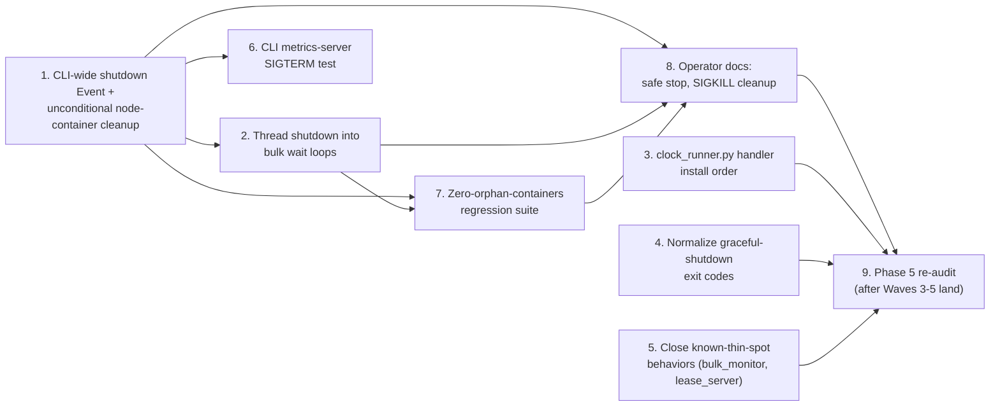

# Phase 6 / Slice 5: Graceful Shutdown Audit & Gap Closure — Stories

Source: `plan/v6/slices.md` Slice 5, bound by `plan/v5-v6-orchestration.md` (the
two "Found during P6-S2 (assigned)" items owned by P6-S5; the P5-Q1 fencing
amendment — writers roll back on lease loss, time-based fencing with
transaction timeout `T` and post-restart quiet period `Q`; P5-S1's supervised,
restartable lease server; P5-S3's row-level DLQ; P5-S4's retry consumer and
parked-pair index). Also grounded in `plan/v6/completion_slice-2.md` (the
metrics-server-thread contract every process now carries, and its own
"Known limitations" section, which is where both P6-S5-owned gaps were first
observed and documented). Wave 7 of the execution order — this Cartographer
document is written now, against the code as of commit `c15a029` on
`feat/streaming-observability`, but Waves 3–5 (P5-S1, P5-S3, P5-S4) land
**after** this document and **before** this slice is implemented. Story 9
below is the explicit re-audit step that re-runs this document's checklist
against the final code, per the task's own framing: *"this slice is
implemented LAST... an AUDIT that the implementer re-runs against the final
code."*

## Slice recap

**As an** Operator, **I want** confirmation — not a redesign — that every
process type commits offsets and closes connections cleanly on
`SIGTERM`/`SIGINT`, including the metrics HTTP server threads, **so that** a
rolling deploy or an operator-issued stop never loses or duplicates work, and
never leaves a container running that nothing will ever stop again.

Out of scope (unchanged from `plan/v6/slices.md`): any change to what
"graceful" means (offset-commit-then-close is the existing, unmodified
contract — see `docs/USAGE.md` §6 "Crash safety"); Kafka rebalance-listener
semantics; new orchestrator halt behavior beyond what `cli.py` already does
for "halt spin-ups, shut down active workers."

## Decisions this Cartographer is making now (grounded in the merged code)

`plan/v6/slices.md` scoped this slice as small ("Rough Effort: **S**"),
expecting mostly verification. Reading the actual code surfaced one
structural gap larger than either of the two pre-flagged items, plus several
smaller ones. Recording the reasoning up front so the First Mate does not
have to re-derive it:

1. **The two pre-flagged gaps and a third, undocumented one share one root
   cause, and one fix closes all three.** `plan/v5-v6-orchestration.md`'s
   "Found during P6-S2 (assigned)" items are:
   * (a) SIGTERM during stream-mode relationship orchestration stops
     edge/clock containers but not already-running node-loader containers.
   * (b) A stream-mode schema mixing shared and self-referencing edge types
     fails the isolation check (`stage=isolation ... policy=mixed-stream`,
     `src/cli.py:845-847`) after node containers started, and that failure
     path doesn't stop them.

   Tracing `src/cli.py::_handle_start` line by line: node-loader containers
   are launched and tracked in a **local variable**, `started_containers`
   (`cli.py:1389`, populated at `cli.py:1420-1443`). For the stream-mode
   branch, `_handle_start` immediately returns
   `_run_relationship_orchestration(...)` (`cli.py:1445-1448`) **without
   ever entering the `try/except/finally` block that starts at `cli.py:1451`
   and stops+removes `started_containers` at `cli.py:1586-1594`.**
   `_run_relationship_orchestration` and everything it calls
   (`_run_isolated_relationship_stream_phase`, `_run_rotating_relationship_fleet`)
   are never given a reference to `started_containers` at all — they cannot
   stop node containers, structurally, no matter what happens inside them
   (a clean SIGTERM-driven stop, an isolation-policy failure, or an
   exception). Gaps (a) and (b) are the same bug observed on two different
   trigger paths through the same missing cleanup registration.
   * **A third gap, not previously flagged:** bulk mode has **no top-level
     signal handler at all**. Every `signal.signal(...)` call in `cli.py`
     (`cli.py:788-789`, `cli.py:1018-1019`, both restored at
     `cli.py:793-794`/`cli.py:1029-1030`) is installed **inside** a
     stream-mode-only function, scoped to that function's own
     `monitor.supervise_stream(shutdown)` call. `_handle_start`'s bulk path
     (`_run_bulk_relationship_edge`, `_run_completion_driven_bulk_edges`,
     `_run_relationship_bulk_stages`, the plain non-shared bulk wait at
     `cli.py:1568-1570`) installs nothing. Python's default `SIGTERM`
     disposition terminates the process immediately — it does not raise an
     exception, does not run `finally` blocks, and does not invoke
     `atexit`. A `SIGTERM` sent to a bulk `start` invocation at any point
     orphans every container already launched, with no code path able to
     react, because none of the many correctly-written `finally:
     _stop_exact_containers(...)` blocks throughout `cli.py` ever get a
     chance to run. This is worse than either pre-flagged gap and is fixed
     by the same change (Story 1).
2. **`clock_runner.py`'s own in-code comment (`clock_runner.py:56-64`)
   already names this slice as the owner of the general
   "signal-before-handler-installed" window**: *"A SIGTERM arriving before
   the try block below installs its own handler... still terminates the
   process immediately with no `finally` running at all — a pre-existing
   gap in every process kind's shutdown handling, not introduced by this
   slice, and explicitly Phase 6 Slice 5's 'graceful shutdown audit' to
   close, not this one's."* Auditing every entry point's actual install
   position (not just its existence) found this window is **already
   minimal** in six of the seven process kinds — `node_loader.py:774`,
   `edge_loader.py:1524`, `planned_writer.py:609` install the handler
   immediately after `argparse`, before any schema load, Kafka client, or
   Neo4j driver construction; `lease_server.py:590-591` and
   `planned_dispatcher.py:680-681` install their `asyncio` handlers as the
   first statements of their `run()` coroutine, before the socket bind.
   Only **`clock_runner.py`** installs late (`clock_runner.py:45`, after
   `parser.parse_args`, `load_schema`, `build_rotation_plan`, **and**
   constructing the Kafka `Producer` at `clock_runner.py:43`) — a real,
   avoidable window covering a file read and a network client construction,
   not just interpreter/argparse overhead. Story 3 fixes `clock_runner.py`
   only; the irreducible, unavoidable window between process start and the
   first Python bytecode that could ever install a handler is documented as
   an accepted residual risk for every process kind (nothing can close a
   zero-width window before any code has run).
3. **`bulk_monitor.py`'s "per-label sequential SIGTERM" comment, which
   `plan/v6/slices.md` explicitly calls out as a known-thin spot to verify,
   is already fixed and the slice document's framing is stale.**
   `drive_label_readiness` (`bulk_monitor.py:666-812`) stops labels through
   a `ThreadPoolExecutor` sized `workers = len(labels) if
   max_concurrent_stops is None else max_concurrent_stops`
   (`bulk_monitor.py:719`), and no caller ever passes
   `max_concurrent_stops`, so production always gets one worker per label —
   fully concurrent, matching the docstring's own claim
   (`bulk_monitor.py:686-687`: *"one worker per label by default, so no
   label's SIGTERM queues behind another's Docker stop"*). Git history
   (commit `d718dc2`, "perf: per-label node coverage/boundary and
   non-blocking label stops") shows the queuing bug this comment used to
   describe was already fixed before this audit ran. Story 5 closes this
   with a regression test that guards the fix (there isn't one dedicated to
   proving concurrency today), not a code change.
4. **`lease_server.py`'s `serve()`-under-concurrent-connections behavior is
   correct in the sense the P5-Q1 fencing amendment needs, but produces an
   uninformative abrupt disconnect for one caller class.** On `close()`
   (`lease_server.py:277-287`), an in-progress, already-dispatched request
   (`PING`, a non-blocking grant) finishes and replies normally — it is
   synchronous code the event loop cannot preempt mid-step. A **parked**
   `ANY` waiter (blocked waiting for a bucket to free) has its future
   force-cancelled and its socket force-closed with no protocol reply at
   all, rather than a clean `ERR shutting down`. Per the binding P5-Q1
   amendment ("on a lease-connection loss or generation change, writers
   roll back immediately... the pre-commit PING stays as an optimisation,
   not as the guarantee"), a disconnected/cancelled waiter is *already*
   supposed to be treated as "fence, roll back" on the writer side, so this
   is not a correctness gap — but it is worth one small polish (a clean
   `ERR` write attempt before the force-close) and one regression test
   proving a parked waiter never hangs past `close()`. Story 5 covers this.
5. **`lease_server.py` today has zero generation, fencing, or
   restart-supervision concept** (`grep -i "generation\|fenc\|supervis\|
   quiet.period\|epoch"` returns nothing). This is expected — P5-S1
   (Wave 3) adds it, per `plan/v5/slice-1/stories.md` Story 5's supervised,
   restartable lease server with `max_consecutive_restarts`,
   `restart_backoff_base_ms`/`restart_backoff_max_ms`, and an explicit
   `SIGTERM`-during-restart-backoff-sleep acceptance criterion the
   Cartographer for that slice already wrote. This document does not
   duplicate that work; Story 9 pre-writes the exact re-verification this
   slice must run against it once merged, sharing one definition of "done"
   with P5-S1's own Cartographer rather than inventing a second one.
6. **Exit codes for a graceful `SIGTERM`-triggered shutdown are
   inconsistent across process kinds.** `clock_runner.py` and
   `planned_dispatcher.py` return `0` for a clean, requested shutdown.
   `planned_writer.py`'s shutdown path raises the same `RuntimeError`
   its real failure paths raise (`planned_writer.py:565-575`) and always
   returns `1` — a graceful, fully-drained stop is indistinguishable from a
   genuine write failure by exit code alone. Separately, `edge_loader.py`
   forces its exit code to `1` if *any* close/flush step fails during
   shutdown even when the run itself succeeded (`finalization_error`,
   `edge_loader.py:1647-1708`); `node_loader.py` has no equivalent
   tracking, so an identical close/flush failure there is silently
   swallowed and reported as success. Story 4 normalizes both.
7. **`SIGINT` is deliberately unhandled inside every containerized process**
   (`node_loader.py`, `edge_loader.py`, `planned_writer.py`,
   `clock_runner.py` install `SIGTERM` only). This is not a gap: every
   container `docker_service.py` launches uses `detach=True`
   (`docker_service.py:264,305,369,446,617,720` — confirmed exhaustively),
   so no container ever attaches a controlling TTY and can receive an
   interactive `Ctrl-C`; only `docker stop`'s `SIGTERM`, or a direct
   `docker kill`'s `SIGKILL`, ever reaches these processes. `lease_server.py`
   and `planned_dispatcher.py` additionally register `SIGINT` via
   `asyncio.loop.add_signal_handler` for both signals identically — harmless
   defensive symmetry, not a requirement. The CLI host process is the only
   one that can receive an interactive `Ctrl-C`, and it already handles
   `SIGINT` wherever it handles `SIGTERM` (`cli.py:788`, `cli.py:1018`;
   Story 1 extends this to the rest of the CLI). Documented in Story 9
   rather than "fixed."
8. **Docker container labels are not uniformly reliable for a
   run-scoped orphan check.** `app=graph-loader` and `component=<kind>` are
   applied unconditionally by every launcher in `docker_service.py`. The
   `run_id` label is **not**: `run_node_loader`/`run_edge_loader` only set
   it when their optional `run_id` parameter is not `None`
   (`docker_service.py:588,711`), and `cli.py:1386` passes `None` for node
   loaders in the exact case this audit already cares about most — a
   `--mode stream` run with no explicit `--run-id`. An orphan-container test
   or an operator's cleanup recipe must therefore filter on `app=graph-loader`
   (universal), not `run_id` (best-effort). Changing node/edge-loader
   `run_id` labeling to be unconditional is a plausible follow-up but has
   unreviewed side effects on container naming/idempotent-rerun behavior
   that are out of this slice's scope to change; Story 7 designs the orphan
   test around the reliable label instead, and Story 9's operator docs use
   `app=graph-loader` (optionally narrowed by `component=` or container-name
   prefix) rather than promise a `run_id`-based recipe that silently misses
   containers.
9. **No `docker_service.py` helper lists every graph-loader container
   across kinds.** `list_node_loaders`/`stop_node_loaders`
   (`docker_service.py:732-753`) are node-loader-scoped only; there is no
   `list_run_containers`/`stop_run` equivalent for edge loaders, the clock,
   the lease server, or planned dispatcher/writers. Story 7 adds the one
   this audit's own orphan test needs; Story 8's operator docs use it too.
10. **Two of the three Kafka-consuming loaders have no test proving their
    `SIGTERM` handler is actually restored, and neither loader's shutdown
    contract is exercised for that property.** Only
    `tests/test_node_loader.py` (`:1431`, `:1440`) asserts
    `signal.getsignal(signal.SIGTERM)` returns the pre-existing handler
    after shutdown, including when a close step fails.
    `tests/test_edge_loader.py` and `tests/test_planned_writer.py` have
    zero such assertions (`grep -n getsignal tests/test_edge_loader.py
    tests/test_planned_writer.py` returns nothing), even though the
    production code in both restores correctly
    (`edge_loader.py:1703`, `planned_writer.py:654`). This is a test-only
    gap, not a behavior gap; Story 4 — which already touches
    `node_loader.py`/`planned_writer.py` for the exit-code normalization,
    and whose reviewer will already be reading `edge_loader.py`'s
    `finalization_error` pattern as the reference behavior — adds the two
    missing tests alongside its own changes rather than opening a tenth
    story for a two-line addition per file.

## Audit inventory table

Status legend: **PASS** (verified correct, no action) · **GAP** (fixed in
this slice, story named) · **ACCEPTED** (verified, intentional, documented
rather than changed) · **DEFERRED** (does not exist yet; re-audited in
Story 9 once its owning Phase 5 slice lands).

| Process kind | Signal path | Required property | Status | Story |
| --- | --- | --- | --- | --- |
| CLI (bulk mode) | any `SIGTERM`/`SIGINT` at any bulk phase | a signal handler exists at all; every launched container is stopped | **GAP → CLOSED** (P6-S5 part 2) — `_handle_start` installs one SIGINT/SIGTERM→Event pair for bulk and stream, restored via `cleanups`; unit-tested | 1, 2 |
| CLI (bulk mode) | `SIGTERM` during node-loader container launch | containers already returned by the Docker API are tracked and stopped even if launch is aborted mid-way | **GAP → CLOSED** — launch-time stop stops everything Docker started, returns 1; matrix phase `launch-*` | 1, 2 |
| CLI (bulk mode) | `SIGTERM` during node drain wait (`monitor.wait_for_completion`/`drive_label_readiness`) | wait aborts promptly, not only after `bulk_timeout_seconds` | **GAP → CLOSED** — monitors take `abort_requested` (`BulkShutdownRequested`), checked every poll; matrix phases `node-drain*` | 2 |
| CLI (bulk mode, `--edge-plan`) | `SIGTERM` during the plan wait / dispatcher phase | wait aborts promptly; writer and dispatcher containers stopped | **GAP → CLOSED** — shutdown bridged to the scheduler/planned `cancelled` Event; matrix phases `plan-wait`, `dispatcher` | 2 |
| CLI (stream mode) | `SIGTERM`/`SIGINT` during relationship orchestration | edge, clock, **and node-loader** containers all stop; no orphan | **GAP → CLOSED** — node-loader cleanup registered on every stream exit path; matrix phase `stream-supervision` | 1 |
| CLI (stream mode) | mixed shared+self-reference isolation-check failure | every already-started container (including node loaders) stops | **GAP → CLOSED** — same cleanup; `test_isolation_failure_stops_the_node_containers_it_started` | 1 |
| CLI (any mode) | double `SIGINT`/`SIGTERM` during cleanup | idempotent re-entry; no exception mid-cleanup skips a remaining stop | **PASS** — `_stop_exact_containers`/`_remove_exact_containers` are individually try/excepted and reload-checked (`cli.py:104-168`, `308-317`); `handle_start`'s own `cleanups` loop (`cli.py:1240-1244`) continues past a failing cleanup | — |
| CLI (any mode) | metrics HTTP server thread | stopped/snapshotted on every exit path; never delays exit | **PASS** — daemon thread (`prometheus_client`'s own `start_http_server`), explicit `stop_metrics_server`/`write_metrics_snapshot` in `cleanups` (`cli.py:1262-1275`) | 6 (test only) |
| CLI (any mode) | Docker stop grace/timeout | bounded shutdown time | **PASS** — explicit `stop_timeout=` overrides (`_NODE_STOP_TIMEOUT_SECONDS=30`, `_LEASE_SERVER_STOP_TIMEOUT_SECONDS=10`) cap the wait per container | — |
| `node_loader.py` | `SIGTERM` mid-batch | offset committed only after the Neo4j write (or DLQ publish) is durable; in-flight batch finishes, not dropped | **PASS** — write before commit throughout (`node_loader.py:642-660`, `368-382`); shutdown check drains the current batch, deferred messages, and publishes `DRAIN_COMPLETE` before returning (`node_loader.py:682-703`) | — |
| `node_loader.py` | shutdown | producer flush, consumer/driver close on every path | **PASS** — `finally` at `node_loader.py:785-862`; order consumer.close → producer.flush → dlq_producer.flush → driver.close | — |
| `node_loader.py` | close/flush failure during otherwise-graceful shutdown | reflected in the exit code | **GAP → CLOSED** (Phase A) | 4 |
| `node_loader.py` | pre-handler-installation window | minimal | **PASS** — installed at `node_loader.py:774`, before schema/Kafka/Neo4j setup | — |
| `edge_loader.py` | `SIGTERM` mid-batch (bulk and slot-gated worker paths) | write-before-commit; batch finishes, not dropped | **PASS** — `edge_loader.py:1201-1290` (bulk), `482-599` (worker); `_finish_run` drains deferred + outstanding batches and joins the worker before `DRAIN_COMPLETE` (`edge_loader.py:1310-1362`) | — |
| `edge_loader.py` | shutdown | producer flush, consumer(s)/driver close on every path | **PASS** — `finally` at `edge_loader.py:1647-1707`; forces exit `1` on any close/flush failure (`finalization_error`) | — |
| `edge_loader.py` | pre-handler-installation window | minimal | **PASS** — installed at `edge_loader.py:1524`, before setup | — |
| `planned_writer.py` | `SIGTERM` between chunks | never interrupts an in-flight chunk transaction; shutdown is only observed before the next `NEXT` request | **PASS** — `run()` checks `self._shutdown()` only before requesting a new chunk (`planned_writer.py:520`); a granted chunk always runs its MERGE to completion and reports `DONE` (`planned_writer.py:529-541`) before the flag is rechecked | — |
| `planned_writer.py` | chunk failure/abandonment | a shutdown never reports `FAIL` for a chunk it didn't actually fail; the dispatcher can safely re-grant | **PASS** — `chunk_id` is cleared after every successful chunk (`planned_writer.py:564`); a shutdown-triggered exit sends no `FAIL` at all and exits 0 (Story 4), never a false failure for a completed chunk | — |
| `planned_writer.py` | graceful-shutdown exit code | distinguishable from a real failure | **GAP → CLOSED** (Phase A) | 4 |
| `planned_writer.py` | pre-handler-installation window | minimal | **PASS** — installed at `planned_writer.py:609`, before setup | — |
| `planned_dispatcher.py` | `SIGTERM` while writers are connected | parked `NEXT` waiters resolved (not left hanging); socket/connections closed cleanly | **PASS** — `close()` sends `ERR dispatcher closed` to every parked waiter, force-closes connections, awaits `wait_closed()` (`planned_dispatcher.py:423-431`) | — |
| `planned_dispatcher.py` | in-flight grant at shutdown | no double-grant risk on a future restart | **ACCEPTED** — in-memory `DispatchState`/grants are not persisted; a dispatcher restart is not a supported mid-run recovery path today (matches `docs/USAGE.md` §6's existing "if a writer disconnects while it holds a chunk, the run fails" contract — a dispatcher exit already means the run is stopping, not recovering) | 9 (documented) |
| `planned_dispatcher.py` | signal handling model | `SIGTERM`+`SIGINT` both handled; restore-previous is N/A (asyncio replaces disposition, no captured "previous" to restore) | **ACCEPTED** — architecturally different from `signal.signal`, not a gap | 9 (documented) |
| `planned_dispatcher.py` | graceful-shutdown exit code | `0` | **PASS** | — |
| `lease_server.py` | in-progress `PING`/non-blocking grant at shutdown | completes and replies before the connection can be cut | **PASS** — synchronous dispatch step, cannot be preempted mid-step | — |
| `lease_server.py` | parked `ANY` waiter at shutdown | resolved without hanging forever; treated by the client as a fence (roll back), not a grant | **PASS** (behavior), **minor polish** (no clean `ERR` reply sent before force-close) | 5 |
| `lease_server.py` | generation/fencing/restart-supervision | present after P5-S1 | **PASS** — see the supervised-restart row | 9 |
| `lease_server.py` | graceful-shutdown exit code | `0` | **PASS** | — |
| `clock_runner.py` | `SIGTERM` mid-slot-publish | never leaves a partial/unacknowledged advance as the current lease | **PASS** — `_publish()` is all-or-nothing (`coordination.py:203-232`); shutdown is only checked between publishes, never during one | — |
| `clock_runner.py` | pre-handler-installation window | minimal | **GAP → CLOSED** (Phase A) | 3 |
| `clock_runner.py` | graceful-shutdown exit code | `0` | **PASS** | — |
| Metrics HTTP server (all 7 kinds) | shutdown | daemon thread; explicit `stop_metrics_server` (`shutdown()`+`server_close()`) and `write_metrics_snapshot` (atomic tmp+`os.replace`) on every path; never blocks exit | **PASS** for 6 containerized kinds, each with a dedicated `SIGTERM`-snapshot test (`plan/v6/completion_slice-2.md` Story 10's six-way matrix); **GAP → CLOSED** — `test_sigterm_driven_stream_run_leaves_a_parseable_cli_metrics_snapshot` | 6 |
| Orphan-container detection | any `SIGTERM` at any phase, either mode | zero `app=graph-loader`-labelled containers remain | **GAP → CLOSED (unit level)** — `tests/test_cli_shutdown.py` matrix + `DockerService.list_run_containers`; the real-Docker integration test is **pending owner e2e** | 7 |
| Retry consumer (`src/loader/retry_consumer.py`) | pause/resume + `run_forever` (there is no separate `_drain_on_shutdown`; shutdown is best-effort by design) | offsets committed only for durably-resolved records; a paused-but-not-yet-due record is safely redelivered, never lost | **PASS** — a tick is atomic; `run_forever` exits between ticks; nothing is committed for a held record; `enable.auto.commit=False`. `main()` never raises (N13), closes every resource in `finally`, exits 0 on SIGTERM and 1 on a run-loop failure, restores the handler. Regression tests added (`test_run_forever_exits_on_shutdown_and_never_commits_a_paused_record`, two `main()` tests). Stopped in the same pass as the edge loaders, before the lease server (`_run_lease_relationship_fleet`); metrics snapshot written in `finally` | 9 |
| Parked-pair index (compacted topic) | process restart / rebuild-from-topic-start | bounded rebuild time; no record permanently lost if a rebuild is interrupted | **ACCEPTED** — rebuild reads with a throwaway group id and never commits or produces (the producer is created only after the rebuild), so a SIGKILL mid-rebuild loses nothing and the next start rebuilds from the same compacted topic; stall bounded at 120s. `start()` does not poll the shutdown flag, so a SIGTERM during rebuild is honoured only when Docker's grace period ends in a SIGKILL; safe, just not prompt | 9 (documented) |
| Lease server, supervised-restart mode | `SIGTERM` during a restart-backoff sleep | clean, bounded shutdown; never blocks on an in-progress restart | **PASS** — the backoff sleeps in poll-interval steps and returns on the shutdown flag without relaunching (`test_check_lease_server_health_honors_shutdown_mid_backoff_without_restarting`); over-limit restarts fail closed (`..._raises_after_exceeding_max_restarts`); a half-created relaunch is swept by label; writers abort and commit nothing on lease loss (`test_lease_liveness_failure_aborts_reports_failure_and_commits_zero_offsets`, `test_story6_lease_loss_mid_transaction_resolves_no_offsets_and_never_touches_dlq`); the *real kill/restart* proof is P5-S1's scratch integration test | 9 |

## Story 1: One CLI-Wide Shutdown Event, and a Node-Loader Cleanup That Cannot Be Skipped

**As an** Operator,
**I want** `SIGTERM`/`SIGINT` to the `start` command handled the same way in
bulk and stream mode, with node-loader containers stopped no matter how the
relationship phase ends,
**so that** stopping a run — cleanly, on failure, or mid-launch — never
leaves a loader container running that nothing will ever stop again.

### Technical Context

- Install one `Event`-backed handler pair at the very top of
  `_handle_start`, before the schema load, covering the **entire** function
  body (bulk and stream alike), restored via the existing `cleanups` list
  (the same mechanism already used for the CLI metrics server,
  `cli.py:1262-1275`):

  ```python
  def _handle_start(args, cleanups):
      shutdown = Event()
      previous_int = signal.signal(signal.SIGINT, lambda *_a: shutdown.set())
      previous_term = signal.signal(signal.SIGTERM, lambda *_a: shutdown.set())
      cleanups.append(lambda: signal.signal(signal.SIGINT, previous_int))
      cleanups.append(lambda: signal.signal(signal.SIGTERM, previous_term))
      ...
  ```

  `_run_isolated_relationship_stream_phase` and `_run_rotating_relationship_fleet`'s
  own local `signal.signal(...)` installs (`cli.py:788-789`, `1018-1019`)
  compose safely underneath this: their `previous_int`/`previous_term`
  captures **this** outer handler, and their own `finally` correctly
  restores to it — no change needed there. Leave them in place; they are
  a defense-in-depth, not a duplicate bug.
- **The core fix — a cleanup that always runs, regardless of mode or
  outcome.** Immediately after node containers are successfully launched
  and accounted for (`cli.py:1420-1443`, right before the existing
  `if not is_bulk: return ...` at `cli.py:1445`), register:

  ```python
  cleanups.append(lambda: (
      _stop_exact_containers(started_containers, stop_timeout=_NODE_STOP_TIMEOUT_SECONDS),
      _remove_exact_containers(started_containers),
  ))
  ```

  `handle_start`'s outer `finally` already runs every registered cleanup in
  reverse order, individually try/excepted, and already logs a failure
  without raising (`cli.py:1236-1244`) — no new plumbing. Because
  `_stop_exact_containers`/`_remove_exact_containers` are idempotent
  (`_is_running` reload-checks each container; a `NotFound` on `remove` is
  swallowed, `cli.py:104-114,308-317`), this cleanup is safe to run a
  second time even on the bulk path, which already stops/removes
  `started_containers` itself at `cli.py:1572-1594` before this cleanup
  ever fires — the second attempt is a guaranteed no-op there. This one
  registration closes both pre-flagged gaps (a) and (b) at once: neither
  `_run_relationship_orchestration` nor any function it calls needs to know
  about node containers anymore, because the cleanup that stops them no
  longer depends on that call returning any particular way.
- **Bulk-mode launch-time abort.** If `shutdown.is_set()` becomes true while
  the node-launch `ThreadPoolExecutor` (`cli.py:1408-1418`) is still
  submitting/awaiting futures, let the in-flight `launch_label` calls
  finish (each returns whatever containers Docker already started — do not
  cancel a Docker API call mid-flight, which can leave a container running
  with no Python reference to it), then treat the just-completed launch as
  the accounting is today (`launch_outcomes`), and immediately proceed to
  the (new) cleanup above rather than continuing into the relationship
  phase. Add one check right after the launch-accounting loop
  (`cli.py:1439`): `if launch_failed or shutdown.is_set(): ... return 1`.
- Do not change `_run_isolated_relationship_stream_phase`'s or
  `_run_rotating_relationship_fleet`'s own internal edge/clock stop logic —
  both are already correct for the containers *they* started; this story
  only ensures node containers, which they never had a reference to, are
  covered by an outer, unconditional safety net.

### Acceptance Criteria

- [ ] A `SIGTERM` sent to a bulk `start` run during node-loader container
      launch, during the node drain wait, or during any relationship phase
      results in every container the run had started being stopped and
      removed, and the process exits with a nonzero code within a bounded
      time (Story 2 makes "bounded" mean seconds, not
      `bulk_timeout_seconds`; this story's own bound is "whatever the
      currently-executing blocking call's own timeout already is").
- [ ] A `SIGTERM`/`SIGINT` sent to a stream `start` run at any point during
      `_run_relationship_orchestration` (including while blocked inside
      `monitor.supervise_stream`) stops the node-loader containers **in
      addition to** the edge/clock containers already stopped today — the
      exact scenario from `plan/v5-v6-orchestration.md`'s pre-flagged item
      (a).
- [ ] A schema mixing shared and self-referencing edge types run with
      `--mode stream` fails the isolation check (`policy=mixed-stream`) and
      still stops every node-loader container that had already started —
      pre-flagged item (b).
- [ ] Re-running the same fixture twice with `SIGINT` in place of `SIGTERM`
      produces the same outcome (both signals are handled identically by
      the new top-level installs, matching the existing local ones).
- [ ] The bulk path's existing internal container-stop points
      (`cli.py:1572-1594` and siblings) are unchanged and still exercised
      by existing tests; the new outer cleanup is a no-op in the tests that
      already pass through them cleanly.

### Definition of Done

- [ ] `tests/test_cli.py` extended: a fake `DockerService` + a real
      `os.kill(os.getpid(), signal.SIGTERM)` (or a directly-invoked handler,
      matching this file's existing signal-test style) fired during (1) the
      node-launch executor, (2) `_run_relationship_orchestration` in stream
      mode, and (3) the mixed-stream isolation-check failure path; each
      asserts the mocked node-loader containers' `stop`/`remove` were
      called exactly once.
- [ ] No existing `test_cli.py` test's assertions on bulk-path cleanup call
      counts change in a way that breaks them (the new cleanup is
      additive; a passing-through bulk run must still show the same
      `stop`/`remove` call counts it shows today, since the new cleanup's
      calls on an already-stopped/removed container are no-ops that do not
      re-invoke the underlying Docker `stop`/`remove` — confirm this against
      the fake container double's own call-recording, not just "no
      exception").
- [ ] Reviewed and merged.

### Dependencies

Depends on: none (independent of Phase 5). Blocks: Story 2 (extends the same
`shutdown` Event into the bulk wait loops), Story 7 (the orphan-container
test exercises this fix directly). **File-overlap risk:** `cli.py` only —
the same function (`_handle_start`) Story 2 also touches; land Story 1
first, Story 2 second, to avoid a manual re-merge of the `shutdown` Event's
construction. **Estimate: 8 points.**

## Story 2: Thread the Shutdown Event Into Every Bulk-Mode Wait Loop

**As an** Operator,
**I want** a `SIGTERM`/`SIGINT` during a bulk run's node-drain wait, its
shared-edge scheduler wait, or its planned-mode plan/dispatch wait to abort
within seconds,
**so that** "stop this run" does not mean "wait up to `--bulk-timeout-seconds`
(default 300s) for the run to notice."

### Technical Context

- Story 1's top-level `shutdown` Event exists but nothing polls it inside
  the blocking waits it is meant to interrupt. Wire it into the three
  places that already have a matching hook, reusing existing parameters
  instead of adding new ones:
  1. **`drive_label_readiness`** already accepts `should_abort: Callable[[],
     bool] | None` (`bulk_monitor.py:673`), wired today as
     `should_abort=scheduler_failed` (`cli.py:1547`). Change the call site
     to `should_abort=lambda: scheduler_failed() or shutdown.is_set()`.
  2. **`_run_completion_driven_bulk_edges`** already accepts and checks a
     `cancelled: Event` (`cli.py:622,639-648`). Pass the same `shutdown`
     Event's state into it — either by passing `cancelled=shutdown`
     directly where the function's own `cancelled` semantics allow it
     (confirm `_run_completion_driven_bulk_edges` does not itself need to
     distinguish "a sibling edge failed" from "the operator asked to stop"
     for any of its own logging/return-code branches; if it does, wrap
     with a small combinator `Event`-like object whose `is_set()` ORs the
     two, matching the existing call shape without changing the function's
     signature).
  3. **`monitor.wait_for_assignment_coverage`/`wait_for_completion`/
     `wait_for_drain_complete`/`verify_zero_lag`** (the simple,
     non-shared-edges bulk path, `cli.py:1568-1570`, and their
     `RelationshipBulkMonitor` equivalents used by
     `_run_bulk_relationship_edge`/`_run_rotating_relationship_fleet`) have
     **no** abort hook today — they loop on `_wait_until`
     (`bulk_monitor.py:382-409`) / `_wait`
     (`relationship_bulk_monitor.py:362-380`) purely by deadline. Add an
     optional `should_abort: Callable[[], bool] | None = None` parameter to
     both `_wait_until` and `_wait`, checked on each poll iteration
     alongside the existing deadline check, raising a distinct
     `BulkShutdownRequested` (a `BulkTimeoutError` subclass, so existing
     `except BulkTimeoutError` call sites keep working unless they need to
     tell the two apart) instead of `BulkTimeoutError` when it is the
     abort flag, not the deadline, that fired. Thread it through every
     public `wait_*`/`verify_*` method on both monitor classes down to
     these two private helpers, and pass `should_abort=shutdown.is_set`
     from every `cli.py` call site that has access to the Event.
  4. **The planned-mode plan/dispatch wait** (`run_planned_edge_phase` in
     `src/orchestrator/planned_edges.py`, not read in depth by this
     Cartographer — flagged as a file-overlap risk below) needs the same
     treatment at whatever its own internal polling loop is. Confirm its
     exact shape during implementation and extend it the same way (an
     optional abort predicate checked per poll), rather than assuming its
     structure matches `_wait_until`.
- On any of these methods raising the new abort signal, the existing
  `except Exception` blocks in each caller (`cli.py`'s `_run_bulk_relationship_edge`,
  `_run_relationship_bulk_stages`, `_handle_start`'s own bulk `try/except`)
  already stop and remove whatever they tracked — no new cleanup logic
  needed here, only the abort signal itself.

### Acceptance Criteria

- [ ] `SIGTERM` sent during the node-drain wait of a bulk run with no shared
      edges aborts the wait within one poll interval (existing polling
      cadence, not `bulk_timeout_seconds`), and every started container is
      stopped and removed.
- [ ] `SIGTERM` sent during the shared-edge completion-driven scheduler's
      wait (`_run_completion_driven_bulk_edges`'s `wait(active, timeout=0.25,
      ...)` loop) aborts within one iteration (~0.25s), stopping every
      currently-running edge type's containers via the scheduler's existing
      cancellation path.
- [ ] `SIGTERM` sent during a `--edge-plan` run's plan/dispatch wait aborts
      promptly and stops the dispatcher and every writer container that had
      started.
- [ ] A bulk run that completes normally (no signal) is unaffected — the new
      `should_abort` parameter defaults to `None`/always-`False` and changes
      no existing passing test's timing or outcome.

### Definition of Done

- [ ] `tests/test_bulk_monitor.py`/`tests/test_relationship_bulk_monitor.py`
      extended: a fake clock/consumer proving `should_abort` returning
      `True` raises the new abort signal before the deadline would have,
      and that a normal (never-`True`) `should_abort` changes nothing.
- [ ] `tests/test_cli.py` extended for each of the three wait sites above,
      each asserting a bounded (test-clock-measured, not wall-clock-timed)
      abort.
- [ ] Reviewed and merged.

### Dependencies

Depends on: Story 1 (the `shutdown` Event this story threads through).
**File-overlap risk:** `bulk_monitor.py`, `relationship_bulk_monitor.py`,
`cli.py` (same region Story 1 touches — land after it), and
`src/orchestrator/planned_edges.py`/`src/loader/edge_planner.py` (not
otherwise touched by this slice — confirm their actual polling shape before
committing to the exact parameter name/shape above). **Estimate: 13 points.**

## Story 3: Close the Avoidable Pre-Handler-Installation Window in `clock_runner.py`

**As an** Operator,
**I want** the clock container's signal handler installed before it reads
the schema file or opens a Kafka producer connection, not after,
**so that** a `SIGTERM` arriving during that window doesn't silently
terminate the container with no cleanup, when every sibling process already
avoids exactly this.

### Technical Context

- Move the `Event()`/`signal.signal(...)` install
  (`clock_runner.py:44-45`) to immediately after `args =
  parser.parse_args(argv)` (`clock_runner.py:30`), before `parse_fleet_edge_types`,
  `load_schema`, `build_rotation_plan`, and `Producer(...)` construction —
  matching `node_loader.py:774`/`edge_loader.py:1524`/`planned_writer.py:609`'s
  existing "handler right after argparse" shape exactly:

  ```python
  args = parser.parse_args(argv)
  shutdown = Event()
  previous = signal.signal(signal.SIGTERM, lambda *_args: shutdown.set())
  producer = None
  process_metrics = metrics_module.process_metrics()
  metrics_server = metrics_module.start_metrics_server(process_metrics, kind="clock", name="-")
  try:
      ...  # everything currently in the outer try, unchanged
  finally:
      signal.signal(signal.SIGTERM, previous)
      ...
  ```

  Restore in the same `finally` that already exists; no new nesting is
  needed since the try/except/finally structure already covers the whole
  body once the install moves above it.
- Update the module-level comment (`clock_runner.py:56-64`) that currently
  names this exact gap: replace "not this one's" framing with a short note
  that the avoidable window (post-argparse setup) is closed here, and the
  irreducible window (before any Python code runs at all) remains, by
  necessity, for every process kind — this is the one place in the codebase
  that should carry that residual-risk statement, since it is where an
  implementer would look for it.

### Acceptance Criteria

- [ ] The signal handler in `clock_runner.py` is installed before
      `load_schema`, `build_rotation_plan`, and `Producer(...)` are called.
- [ ] A `SIGTERM` fired after `parser.parse_args` returns but before
      `load_schema` completes (simulated by fixing the handler's install
      point and firing the signal in a test-controlled `load_schema` stub)
      results in a clean, `finally`-executed shutdown (metrics snapshot
      written, producer flushed if constructed, handler restored) rather
      than an untraceable process kill.

### Definition of Done

- [ ] `tests/test_clock_runner.py` extended with a test that fires the
      signal between `parse_args` and `load_schema` (via a stub/mock that
      calls the handler itself, since an actual OS-level pre-emption at
      that exact instant is not reliably reproducible in a unit test) and
      asserts the `finally` path ran.
- [ ] Reviewed and merged.

### Dependencies

Depends on: none. **File-overlap risk:** `clock_runner.py` only, isolated
from every other story in this slice. **Estimate: 2 points.**

## Story 4: Normalize Graceful-Shutdown Exit Codes, and Close the Handler-Restoration Test Gap

**As a** Maintainer,
**I want** a process that drained cleanly because it was asked to stop to
report a different, or at least a documented-consistent, exit code from one
that genuinely failed, a close/flush failure during shutdown to never be
silently swallowed, and every loader's `SIGTERM`-handler restoration proven
by a test rather than assumed from reading the code,
**so that** external orchestration (and this audit's own tests) can tell
"stopped on request" apart from "broke," and a future refactor that drops
the handler-restore line in `edge_loader.py`/`planned_writer.py` fails a
test instead of leaking a permanently-overridden `SIGTERM` disposition into
whatever runs next in the same process.

### Technical Context

- **`planned_writer.py`** (`planned_writer.py:520,565-580`): the shutdown
  check raises `RuntimeError("writer shutdown requested before the plan
  completed")`, caught by the same `except Exception` as every real
  failure, always returning `1`. Give the shutdown case its own branch:

  ```python
  except _WriterShutdownRequested:
      logger.info("stage=planned-writer reason=shutdown requested chunk=-")
      return 0
  except Exception as exc:
      ...  # unchanged, still returns 1
  ```

  (introduce `_WriterShutdownRequested` as a dedicated exception, raised
  only from the `self._shutdown()` check at `planned_writer.py:520`, so the
  distinction is by type, not by message text).
- **`node_loader.py`**: add the same `finalization_error` tracking
  `edge_loader.py:1647-1708` already has, around each of
  `consumer.close()`/`producer.flush()`/`dlq_producer.flush()`/`driver.close()`
  in the `finally` at `node_loader.py:785-862` — set a local flag on any
  caught exception from those calls, and `return (1 if finalization_error
  else exit_code)` at the end, mirroring `edge_loader.py:1708` exactly.
- Do not touch `clock_runner.py`/`planned_dispatcher.py`/`lease_server.py`
  — they already return `0` for a graceful shutdown and correctly force
  nonzero on a real failure; they are the reference behavior the other two
  files are being brought into line with.
- **Handler-restoration test gap (Decision 10 above).** Add a
  `signal.getsignal(signal.SIGTERM)`-based test to `tests/test_edge_loader.py`
  and `tests/test_planned_writer.py`, mirroring
  `tests/test_node_loader.py:1431,1440` exactly: install a sentinel handler
  before calling `main()`, force one close/flush step to raise, and assert
  `signal.getsignal(signal.SIGTERM) is` the sentinel again afterward — for
  `edge_loader.py` this is confirmation-only (the code at `:1703` already
  does it correctly); for `planned_writer.py` it is confirmation-only too
  (`:654`). No production code change is needed for this part; it is purely
  closing a test-coverage gap uncovered while auditing the exit-code
  behavior above.

### Acceptance Criteria

- [ ] A `planned_writer.py` process that receives a shutdown signal after
      completing its current (or no) chunk, with no other error, exits `0`.
- [ ] A `planned_writer.py` process that fails a chunk write for a real
      reason (not a shutdown request) still exits `1`.
- [ ] A `node_loader.py` process whose `consumer.close()` (or any of the
      other three close/flush calls) raises during an otherwise-successful
      shutdown exits `1`, matching `edge_loader.py`'s existing behavior for
      the identical scenario.
- [ ] `edge_loader.py` and `planned_writer.py` each have a passing test
      proving the previous `SIGTERM` handler is restored on `main()` exit,
      including when a close/flush step raises — matching
      `node_loader.py`'s existing coverage.

### Definition of Done

- [ ] `tests/test_planned_writer.py` extended: a shutdown-requested run with
      no other failure asserts exit code `0`; existing failure-path tests
      keep asserting `1`; a new `getsignal`-based handler-restoration test
      is added (Decision 10).
- [ ] `tests/test_node_loader.py` extended: a forced `consumer.close()`
      exception on an otherwise-clean run asserts exit code `1`, mirroring
      the existing `tests/test_edge_loader.py` test for the same scenario
      (find and reuse its exact fixture shape).
- [ ] `tests/test_edge_loader.py` extended with a new `getsignal`-based
      handler-restoration test (Decision 10) — confirmation-only, no
      production code change expected here.
- [ ] Reviewed and merged.

### Dependencies

Depends on: none. **File-overlap risk:** `planned_writer.py`,
`node_loader.py` — disjoint from every other story in this slice.
**Estimate: 5 points.**

## Story 5: Close the Two Named "Known-Thin-Spot" Behaviors

**As a** Maintainer,
**I want** `bulk_monitor.py`'s per-label stop concurrency and
`lease_server.py`'s concurrent-connection shutdown behavior each backed by a
regression test that proves the property `plan/v6/slices.md` asked this
slice to verify,
**so that** a future change cannot silently reintroduce the queuing bug this
audit found already fixed, or leave a parked lease-waiter hanging.

### Technical Context

- **`bulk_monitor.py`** (already fixed, per Decision 3 above; add a guard,
  not a fix): a test with `N` fake labels and a `stop_label` double that
  blocks until released asserts all `N` stops are issued
  (`executor.submit`'d) before any of them is allowed to return — proving
  `workers = len(labels)` (`bulk_monitor.py:719`) is not silently
  regressed to a smaller default, and that no caller in `cli.py` passes a
  `max_concurrent_stops` that would reintroduce the old queuing behavior.
- **`lease_server.py`**: add a best-effort clean reply before force-closing
  a parked `ANY` waiter's connection in `close()`
  (`lease_server.py:277-287`):

  ```python
  for waiter in list(self._any_waiters):
      self._remove_waiter(waiter)
      if not waiter.future.done():
          waiter.future.cancel()
      try:
          waiter.writer.write(b"ERR shutting down\n")
          await waiter.writer.drain()
      except Exception:
          pass  # best-effort only; the client-side fence-on-disconnect path is already correct without this
  ```

  (adjust to the actual `_any_waiters`/`waiter` shape in the file; the
  intent is one best-effort informative write before the existing
  force-close, not a change to the cancellation itself).
- Regression test: a client parked in `ANY` when `close()` is called
  receives either the new `ERR` line or a clean disconnect within a bounded
  time (no hang), and the test asserts the server's own `close()` call
  itself returns promptly regardless of how many waiters were parked.

### Acceptance Criteria

- [ ] A `bulk_monitor.py` test proves `drive_label_readiness` issues every
      label's stop concurrently (no label's stop call is observed to start
      only after a previous one returns) for an arbitrary label count.
- [ ] A `lease_server.py` test proves a parked `ANY` waiter's connection is
      resolved (error reply or clean disconnect) within a bounded time when
      `close()` is called, for at least one waiter and for several
      concurrent waiters.

### Definition of Done

- [ ] `tests/test_bulk_monitor.py` extended with the concurrency-guard test.
- [ ] `tests/test_lease_server.py` extended with the parked-waiter-shutdown
      test.
- [ ] Reviewed and merged.

### Dependencies

Depends on: none. **File-overlap risk:** `bulk_monitor.py` (test-only
change), `lease_server.py` (small `close()` addition) — disjoint from every
other story. **Estimate: 5 points.**

## Story 6: The CLI's Own Metrics Server Gets the Six-Way Matrix's Missing Seventh Case

**As an** Operator,
**I want** the CLI host process's own metrics server proven not to block or
delay shutdown, the same way the six containerized process kinds already
are,
**so that** every one of the seven process kinds named in
`plan/v6/slices.md`'s Definition of Done actually has the test that item
requires — not six of seven.

### Technical Context

- `plan/v6/completion_slice-2.md` Story 10 added a six-way `SIGTERM`→
  metrics-snapshot test matrix (node, edge, planned-writer,
  planned-dispatcher, lease-server, clock) in `tests/test_metrics_overhead.py`.
  `grep -n "metrics" tests/test_cli.py | grep -i "sigterm\|shutdown\|signal"`
  returns nothing: the CLI's own metrics server
  (`cli_metrics_server`/`_stop_cli_metrics_server`, `cli.py:1262-1275`) has
  no dedicated test proving a real signal-driven shutdown writes a
  nonzero, parseable snapshot and stops the server before the process
  exits.
- Add one test to `tests/test_cli.py` matching the existing six-way matrix's
  shape (a real `signal.signal`-installed handler fired via
  `os.kill(os.getpid(), signal.SIGTERM)` or an equivalent direct handler
  invocation, an ephemeral bound port per Story 10's own fix for test
  flakiness, `GRAPH_LOADER_TIMING_DIR` pointed at a temp dir), asserting
  `metrics-cli.prom` exists, is nonempty, and parses as valid
  Prometheus/OpenMetrics text after `handle_start` returns from a
  `SIGTERM`-driven stream-mode run.

### Acceptance Criteria

- [ ] A `SIGTERM`-driven `start --mode stream` run (via the existing
      stream-mode test fixtures in `tests/test_cli.py`) leaves a nonempty,
      parseable `metrics-cli.prom` snapshot in `GRAPH_LOADER_TIMING_DIR`.
- [ ] The CLI's metrics server thread does not delay the test's own
      assertion of process return within a bounded time (no real-time
      sleep needed beyond what the existing stream-mode fixtures already
      use).

### Definition of Done

- [ ] `tests/test_cli.py` extended with the new test, ephemeral-port-pinned
      per the existing Story 10 fix for test flakiness (`plan/v6/
      completion_slice-2.md` Reviewer findings, S10-2).
- [ ] Reviewed and merged.

### Dependencies

Depends on: none, but is easiest to land alongside Story 1 (same test file,
same fixtures) — sequence after Story 1 to avoid a manual re-merge.
**File-overlap risk:** `tests/test_cli.py` only. **Estimate: 3 points.**

## Story 7: Automated Zero-Orphan-Containers Regression Suite

**As a** Maintainer,
**I want** an automated proof that no `SIGTERM` at any phase of a bulk or
stream run leaves a `graph-loader`-labelled container behind,
**so that** the two gaps this audit found (and any future regression of
them) fail CI loudly instead of being rediscovered by an operator's `docker
ps`.

### Technical Context

- **Unit level (fakes, runs in the default suite, no Docker).** Extend
  `tests/test_cli.py` with a parametrized test firing the (now
  Story-1-installed) `shutdown` Event at each of five named points against
  a fully faked `DockerService`/`RelationshipBulkMonitor`/`BulkMonitor`:
  1. during node-loader container launch,
  2. during the node drain wait,
  3. during the plan/dispatch wait (planned mode),
  4. during the planned dispatcher's own serve loop (a fake dispatcher
     process double, since the real one is a separate container),
  5. during `monitor.supervise_stream` (stream mode).
  For each, assert every container the fake `DockerService` recorded as
  started also appears, exactly once, in its recorded `stop`/`remove` calls
  — a symbolic, name-based reconciliation (`{c.name for c in started} ==
  {c.name for c in stopped}`), not just "no exception raised."
- **Integration level (real Docker, marked `integration`, matching the
  existing `testcontainers`-backed pattern in `tests/conftest.py`).** Add
  `tests/test_shutdown_orphan_containers.py`: launch a real (scratch,
  disposable) bulk run and a real stream run against the existing
  `neo4j_driver`/`kafka_bootstrap`/`kafka_topic` fixtures, `SIGTERM` the
  CLI subprocess (spawned via `subprocess.Popen`, not an in-process call,
  since a real OS signal is the point) at each of the same five phases
  (using log-line polling — e.g., wait for `stage=node-label-ready` before
  sending the signal for phase 2 — rather than a fixed sleep, matching this
  codebase's existing "progress-based, not time-based" waiting
  convention), then assert, using the new `docker_service.py` helper below:

  ```python
  def list_run_containers(self, *, label_filters: Sequence[str] = ("app=graph-loader",)) -> list[Container]:
      """Every graph-loader container matching every given label filter, any kind."""
      return self.client.containers.list(all=True, filters={"label": list(label_filters)})
  ```

  that `list_run_containers()` returns empty (or, if narrowed by a
  `run_id` label the test itself controls by passing an explicit
  `--run-id`, exactly empty for that run) within a bounded wait (a handful
  of Docker stop timeouts, not an arbitrary sleep) after the CLI subprocess
  exits.
- Wire the integration test into the same advisory (non-blocking)
  integration job Slice 1/4 already established
  (`.github/workflows/ci-integration.yml`); it is heavy (spins real
  containers per phase) and should not gate every PR.

### Acceptance Criteria

- [ ] The unit-level test fails (red) if Story 1's fix is reverted (confirm
      by checking it out against a pre-Story-1 commit locally, or by
      writing it first and observing it fail against the current code
      before Story 1 lands, then pass after).
- [ ] The integration test, run against a real Docker daemon, shows zero
      `app=graph-loader`-labelled containers remaining after a `SIGTERM` at
      each of the five named phases, for both bulk and stream modes where
      the phase applies.
- [ ] Neither test is flaky under normal CI load (progress-based waits, no
      fixed sleeps racing container startup time).

### Definition of Done

- [ ] `tests/test_cli.py` extended with the five-phase unit-level
      parametrized test.
- [ ] `tests/test_docker_service.py` extended for the new
      `list_run_containers` helper.
- [ ] `tests/test_shutdown_orphan_containers.py` (new, `integration`-marked)
      added and wired into the advisory CI job.
- [ ] Reviewed and merged.

### Dependencies

Depends on: Story 1 (the fix this suite proves), Story 2 (bounded-time
assertions need the abort-hook wiring to be meaningful, not just eventually
true at `bulk_timeout_seconds`). **File-overlap risk:** `docker_service.py`
(one new additive method), `tests/test_cli.py` (shared with Stories 1, 6 —
land last of the three in this file). **Estimate: 13 points.**

## Story 8: Operator Documentation — Safe Stop, `SIGKILL` Cleanup, and What Changed

**As an** Operator,
**I want** `docs/USAGE.md` to say exactly how to stop a run safely, what
happens if I `SIGKILL` it instead, and how to clean up either way,
**so that** I don't have to read `cli.py` to know what `Ctrl-C` or `docker
stop`/`docker kill` will do to my run.

### Technical Context

- Add a new `docs/USAGE.md` subsection (§10, alongside the existing
  "Operations: reruns, cleanup, failures") covering:
  1. **Safe stop:** `Ctrl-C` (`SIGINT`) or `docker stop`/`kill -TERM` on the
     CLI process both trigger the same drain-and-cleanup path (Story 1);
     expect it to take up to the current phase's own timeout in the worst
     case pre-Story-2, or a few seconds post-Story-2 — document the actual
     bound once Stories 1–2 land, not before.
  2. **`SIGKILL` (`kill -9`, or a `docker kill` on the CLI host process
     itself if run inside a container):** cannot be caught by any process,
     by design — no cleanup runs. Every container the run had started is
     left running. Document the exact recovery recipe:
     ```bash
     docker ps -a --filter label=app=graph-loader
     docker rm -f $(docker ps -aq --filter label=app=graph-loader)
     ```
     (optionally narrowed by `--filter label=run_id=<id>` when the run used
     an explicit `--run-id`; note explicitly, per Decision 8 above, that
     node/edge-loader containers launched without `--run-id` will **not**
     carry that label, so the unnarrowed `app=graph-loader` filter is the
     one guaranteed to catch everything).
  3. **What "graceful" means today**, restating the unchanged §6 "Crash
     safety" contract in operator terms: offsets commit only after a
     durable write or DLQ publish; a rerun after any stop (clean or killed)
     is safe because every write is an idempotent `MERGE`.
  4. A one-line pointer from §6 to the new subsection, and from the existing
     "Troubleshooting" table (§11) for the specific symptom "containers
     still running after I stopped the load."
- Note in the same subsection, per Decision 4/6c above, the two accepted
  (not fixed) behaviors this audit chose to document rather than change:
  the planned dispatcher's in-memory (non-persisted) grant state on a
  dispatcher restart, and a parked lease waiter's abrupt disconnect on
  lease-server shutdown (both already safe by the existing fail-closed/
  fence-on-disconnect contracts, just not silky-smooth).

### Acceptance Criteria

- [ ] `docs/USAGE.md` documents the exact `docker ps`/`docker rm` recovery
      recipe for a `SIGKILL`'d run, using a label filter proven correct by
      Story 7's own test fixtures (not a guessed label name).
- [ ] `docs/USAGE.md` states, correctly and specifically (not "it should be
      fast"), the bound on how long a safe stop takes after Stories 1–2
      land.

### Definition of Done

- [ ] `docs/USAGE.md` updated (§10 addition, §6/§11 pointers).
- [ ] Reviewed and merged.

### Dependencies

Depends on: Stories 1, 2, 7 (the doc describes their result and must not be
written, then contradicted, before they land — sequence this story last).
**File-overlap risk:** `docs/USAGE.md` only. **Estimate: 3 points.**

## Story 9: Phase 5 Re-Audit Checklist — Pre-Written Acceptance Criteria for Waves 3–5

**As the** implementer of this slice, arriving after P5-S1 (supervised
lease server), P5-S3 (row-level DLQ), and P5-S4 (retry consumer, parking
lot) have all merged,
**I want** this document's own checklist, re-runnable against the final
code rather than rewritten from scratch,
**so that** the audit closes for the code that actually ships, not just the
snapshot this Cartographer read.

### Technical Context

This is the explicit re-verification step the task brief requires: *"a
re-audit each process kind after Phase 5 lands (explicit re-verification
step listing the new processes)."* Re-run every row of the "Audit inventory
table" above marked **DEFERRED**, plus re-check every row marked **PASS**
or **GAP**-and-fixed against the merged Phase 5 code, since Phase 5 touches
`edge_loader.py`, `edge_execution.py`, and `cli.py` — files this slice's
Stories 1–7 also touch — and a merge conflict resolution could silently
reintroduce a fixed gap.

1. **`lease_server.py`, supervised-restart mode (P5-S1 Story 5).**
   Pre-written acceptance criteria, copied from that story's own Definition
   of Done so both slices share one bar:
   - [ ] A lease server that crashes more than `max_consecutive_restarts`
         times causes the fleet supervisor to fail closed (not silently
         retry forever).
   - [ ] Restart attempts back off with capped exponential delay.
   - [ ] `SIGTERM` during a restart-backoff sleep still results in a clean
         shutdown within a bounded time (the sleep must not block honoring
         shutdown past `restart_backoff_max_ms`, itself capped at
         `600_000` by that slice's own schema bound).
   - [ ] A writer that loses its lease-server connection during a
         supervised restart rolls back its open transaction rather than
         committing it (the P5-Q1 fencing amendment) — re-verify with a
         real kill/restart, not only a mocked one, per that slice's own
         Story 10 scratch-integration proof.
2. **Retry consumer (P5-S4 Story 5/6, `src/loader/retry_consumer.py`).**
   - [ ] `run_forever(shutdown_requested)` exits its poll loop and calls
         `_drain_on_shutdown()` on `SIGTERM`/`SIGINT`, committing only
         records already durably resolved (written, re-DLQ'd, or parked) —
         never a record still paused/held in `self._paused` waiting for its
         `retry_after_ms`.
   - [ ] A record paused (not yet due) at shutdown time is neither
         committed nor lost: its partition's offset stays uncommitted, so a
         restart redelivers it (at-least-once, matching every other
         counter/offset guarantee in this codebase — see P5-Q5).
   - [ ] The retry consumer container is stopped and removed in the same
         teardown pass as the lease server and edge loaders (P5-S4 Story
         6's own acceptance criterion) — confirm no orphan retry-consumer
         container after a `SIGTERM`, using Story 7's `list_run_containers`
         helper extended (if needed) to also match
         `component=retry-consumer`.
   - [ ] The retry consumer's own metrics server (if P5-S4 adds one,
         matching every other process kind's pattern) gets the same
         `stop_metrics_server`/`write_metrics_snapshot`-on-shutdown test
         Story 6 added for the CLI — this becomes the 8th (or 9th, with the
         lease server's restart mode counted separately) process kind in
         the audit inventory table.
3. **Parked-pair index (P5-S4 Story 3, compacted topic).**
   - [ ] A process restart mid-rebuild-from-topic-start (the compacted
         topic replay that reconstructs the in-memory parked-pair view)
         does not lose or misorder a pair's parked records — the rebuild is
         idempotent and re-runnable from the same compacted topic.
4. **Re-check `edge_loader.py`/`edge_execution.py` shutdown behavior**
   specifically for anything P5-S1/P5-S3 changed in the write path (lease
   liveness checks, `order_by`-conditional writes, the DLQ classify-and-
   write refactor) — confirm write-before-commit and rollback-on-lease-loss
   still hold after those changes, since this audit's own Story 4 also
   edits `node_loader.py`'s (sibling, not shared) shutdown path around the
   same time and a careless merge could blend the two incorrectly.
5. Update the "Audit inventory table" above in place (flip the relevant
   **DEFERRED** rows to **PASS**/**GAP**/**ACCEPTED**) rather than writing a
   second table — this document is the audit; keep it current, don't fork
   it.

### Acceptance Criteria

- [ ] Every **DEFERRED** row in this document's audit inventory table is
      resolved to **PASS**, **GAP** (with a story/fix), or **ACCEPTED**
      (with rationale) against the actual merged Phase 5 code.
- [ ] Any gap found during this re-audit gets the same treatment as a gap
      found during the original audit: a regression test, not just a note.

### Definition of Done

- [ ] This document's table is updated in place, with a short dated note at
      the top of the "Decisions" section recording which commit the
      re-audit ran against.
- [ ] Any new test added during the re-audit lands alongside its fix,
      following this slice's own per-story process.
- [ ] Reviewed and merged.

### Dependencies

Depends on: P5-S1, P5-S3, P5-S4 (must all be merged first — this is why the
task frames this slice as implemented last), and every other story in this
document (the re-audit re-checks their fixes too). **File-overlap risk:**
whatever P5-S1/S3/S4 actually touch in `edge_loader.py`/`edge_execution.py`/
`cli.py`/`lease_server.py` — by definition not knowable precisely until
those slices merge; treat this story as the seam where this slice's own
changes and Phase 5's changes are jointly re-verified, and budget review
time accordingly. **Estimate: 8 points** (re-verification and documentation;
any gap found converts to its own small follow-up, not estimated here).

## Story Map



`S3`, `S4`, and `S5` are independent of everything else and of each other —
land in any order, in parallel with `S1`/`S2` if convenient. `S9` is the
gate: it cannot start until P5-S1/S3/S4 all merge, regardless of how early
every other story in this document finishes.

## Total Estimate

**60 points** across 9 stories (Story 9's own points cover re-verification
and documentation only; any gap it finds converts to unestimated follow-up
work at that time). First Mate should begin with Story 1 — it is the
highest-leverage fix (closes both pre-flagged gaps plus the undocumented
bulk-mode gap in one change) and everything else in this document either
depends on it or is independent of it.
