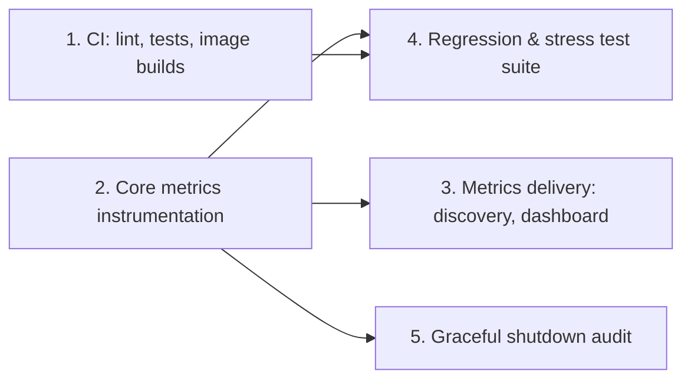

# Phase 6: Observability, Metrics & Hardening — Feature Slices

## Phase Summary

Phase 6 makes the already-fast, already-correct planned-mode pipeline
operable: an operator must be able to see it running (throughput, lag, write
latency, lock/retry/DLQ counters, plan progress), trust that regressions are
caught before merge, and trust that shutdown is safe. None of this changes
how records are written to Neo4j.

**Current state vs. epic.** The library already does most of the hard
concurrency work the epic worries about:

* Planned mode is **structurally** lock-free (disjoint resources per chunk),
  not just deadlock-avoiding — Neo4j's query log already shows 0 ms lock
  waiting on real loads (`docs/USAGE.md` §6, §9). The epic's acceptance
  criterion ("1,000,000 edges to one node, zero unhandled deadlocks") is true
  today for planned mode; it is a real risk only for the classic
  `shared`-overlap and label-serialized modes, where `apoc.lock.nodes`
  ordered locking already prevents deadlocks but not lock *waiting*.
* Graceful shutdown is **largely built**, not missing: `src/cli.py`,
  `src/loader/node_loader.py`, `src/loader/edge_loader.py`,
  `src/loader/planned_writer.py`, `src/orchestrator/clock_runner.py`,
  `src/orchestrator/lease_server.py` and `src/orchestrator/planned_dispatcher.py`
  all install `SIGTERM`/`SIGINT` handlers today and drain in place. Phase 6's
  job here is to audit for gaps, not to design shutdown from scratch.
* Nothing in the epic's "Metrics Dashboard" feature exists yet: no
  `prometheus_client` dependency, no port, no `src/utils/metrics.py`, no
  `graph_loader_*` series. This is genuinely greenfield.
* Nothing in the epic's "CI/CD" feature exists yet: no `.github/`, no lint
  config (`pyproject.toml` has no `[tool.ruff]`/`[tool.black]`/flake8
  section), no image-build automation. Also greenfield.
* The repo already has two integration-test patterns to build on: most
  `@pytest.mark.integration` tests use self-contained `testcontainers`
  fixtures (`tests/conftest.py`: `neo4j_driver`, `kafka_bootstrap`,
  `kafka_topic`) that skip cleanly without Docker — these are CI-friendly out
  of the box. One test (`tests/test_social_planned_integration.py`) instead
  requires a pre-existing named scratch Kafka/Neo4j environment
  (`GRAPH_LOADER_IT_*` env vars) and is not something a hosted CI runner can
  satisfy without a dedicated scratch stack; it will keep skipping in CI
  unless that stack is provided out-of-band.
* Phase 5 (parallel work: row-level DLQs, a node/malformed-record DLQ
  replacing today's rejection-file sink, a retry consumer with backoff and a
  parking-lot topic, lock-free streaming via the bucket-lease coordinator)
  is **not merged yet** (`plan/v5/slices.md` does not exist at time of
  writing). The code already anticipates it: `node_loader.py` and
  `edge_loader.py` log malformed/unmatched records with
  `phase5_action=route_to_dlq` while still writing to the rejection-log file.
  Phase 6 defines `dlq_routed_total`, `retry_total` and `parked_total` metric
  names and label shapes now, registered but held at zero, so Phase 5 only
  has to call an existing counter rather than invent one — this keeps every
  Phase 6 slice deployable on its own before Phase 5 lands.
* Container port precedent already exists: `src/orchestrator/lease_server.py`
  (port 7700) and `src/orchestrator/planned_dispatcher.py` (port 7701) are
  already published with `ports={f"{port}/tcp": ("127.0.0.1", None)}` —
  a fixed container-internal port, Docker-assigned ephemeral host port,
  discovered afterward from the container's own network settings
  (`bucket_lease_address`, `dispatcher_address`). Phase 6 metrics reuse this
  exact pattern instead of inventing a second port-allocation scheme, and it
  is also the answer to the epic's literal "port 9090 for every container"
  instruction, which cannot work unmodified once more than one loader runs
  on one Docker network.

## Slice 1: CI Pipeline — Lint, Unit Tests, Image Builds

**As a** Maintainer,
**I want** every pull request against this library to run linting, the ~900
unit tests, and a build of every container image,
**so that** a regression on this actively-changing branch is caught before
merge instead of after a production load.

### Scope

**IN scope:**

- Add a lint configuration (`ruff`, replacing the epic's garbled
  "lake8/lack" with one modern tool that covers both flake8- and
  black-equivalent checks) to `pyproject.toml`, tuned to pass on the current
  tree with no behavior changes, or documented pre-existing exceptions.
- Add `.github/workflows/ci.yml`: on push/PR, run `ruff check`, then
  `pytest -m "not integration"` (the fast, Docker-free unit suite).
- Build `Dockerfile.node_loader`, `Dockerfile.edge_loader` and
  `Dockerfile.clock` in CI (matching `tests/test_docker_build.py`'s existing
  entrypoint assertions), failing the job on any build error.
- Add a second, non-blocking CI job that runs `pytest -m integration` on the
  hosted runner's own Docker daemon: this exercises every `testcontainers`-
  backed integration test end to end; `test_social_planned_integration.py`
  keeps skipping (no `GRAPH_LOADER_IT_*` scratch stack in CI) exactly as it
  does locally without one.
- Document the new pipeline and how to run each job locally in
  `docs/USAGE.md` (a short pointer, not a rewrite).

**OUT of scope:** Any new tests beyond what already exists (Slice 4 adds
tests); publishing images to a registry; a scratch-cluster-backed CI job for
`test_social_planned_integration.py`; metrics (Slices 2–3).

### Definition of Done

- [ ] A pull request with a lint violation fails CI before tests run.
- [ ] A pull request that breaks any current unit test fails CI.
- [ ] A pull request that breaks the node, edge or clock image build fails CI.
- [ ] The integration job runs the `testcontainers`-backed tests on a stock
      GitHub-hosted runner with no external environment variables set, and
      its failure does not block merge (advisory status check).
- [ ] `main`'s current tree passes the blocking job (lint + unit + builds).

### Dependencies

None. Fully independent; can ship first.

### Rough Effort

**M**

## Slice 2: Core Metrics Instrumentation

**As an** Operator,
**I want** every loader, planned writer, dispatcher, lease server and the
CLI/orchestrator process itself to expose a Prometheus metrics endpoint,
**so that** I can see throughput, latency, lag, and error/lock counters for a
run without grepping container logs.

### Scope

**IN scope:**

- Add `prometheus_client` to `requirements.txt`.
- Create `src/utils/metrics.py`: one shared registry, and constructors for
  the epic's required series plus the operator-value series the owner asked
  for, all with bounded label sets (loader/process **kind** and **name**,
  node **label** or relationship **type** — never a raw record or node key):
  - `graph_loader_records_consumed_total{kind,name,label_or_type}` (counter)
  - `graph_loader_neo4j_write_duration_seconds{kind,name,stage}` (histogram;
    `stage` is `node-write` or `edge-write`, matching the existing
    `GRAPH_LOADER_TIMING_DIR` log field so the two sources agree)
  - `graph_loader_deadlocks_recovered_total{kind,name}` (counter; only the
    classic/lease modes' retry-on-`TransientError` path in
    `src/loader/edge_execution.py` increments this — planned mode's counter
    stays at 0 by construction, which is itself a useful health signal)
  - `graph_loader_retry_total{kind,name,reason}` (counter; node-write retries
    today, Phase 5's retry consumer later)
  - `graph_loader_dlq_routed_total{kind,name}` / `graph_loader_parked_total`
    (counters; registered now, incremented by Phase 5 when it lands — until
    then they read 0, which is correct, not fake)
  - `graph_loader_consumer_lag_records{kind,name,topic}` (gauge, sampled from
    each consumer's own assignment)
  - `graph_loader_plan_chunks_total` / `graph_loader_plan_chunks_committed`
    (gauges, sourced from the existing `edge-plan.json.progress` heartbeat
    and completion ledger — no new bookkeeping, just exposing what already
    exists)
- Start one `prometheus_client` HTTP server per process
  (`start_http_server`-equivalent, bindable to `0.0.0.0` inside the
  container) in: node loader, edge loader, planned writer, planned
  dispatcher, lease server, and the CLI/orchestrator's own long-lived
  process (bulk-run and stream-run). Internal port fixed at `9090` by
  default, overridable by `GRAPH_LOADER_METRICS_PORT`; disable entirely with
  `GRAPH_LOADER_METRICS_ENABLED=0` for tests or overhead-sensitive runs.
- Instrument the hot write paths (`node_loader.py`, `edge_loader.py`,
  `planned_writer.py`) by wrapping the existing timed sections that already
  feed `write_timing_capture.py`, so metrics cost is one counter/histogram
  observe alongside a log line already being written — not a second timer.
- Unit tests: registry contains exactly the documented series and labels;
  label cardinality is bounded (a test asserts no label is record- or
  node-key-shaped); histogram buckets are sane for millisecond-to-second
  write latency; the metrics server can be disabled and its absence doesn't
  break the loader.

**OUT of scope:** How the endpoint is discovered on the Docker network or
displayed on a dashboard (Slice 3); the stress-test assertions that consume
these counters (Slice 4); Phase 5 actually calling the DLQ/retry/parked
counters (Phase 5's own slices).

### Definition of Done

- [ ] Every one of the six process kinds serves `/metrics` in Prometheus
      text format on its container's internal port when enabled.
- [ ] `graph_loader_records_consumed_total`,
      `graph_loader_neo4j_write_duration_seconds`,
      `graph_loader_deadlocks_recovered_total` and
      `graph_loader_dlq_routed_total` exist with exactly the epic's names.
- [ ] No metric label is derived from a record's key, id or free-text
      property; label sets are bounded by the schema (label/type count),
      not by record volume.
- [ ] `GRAPH_LOADER_METRICS_ENABLED=0` fully disables the HTTP server with
      no change to write behavior or exit codes.
- [ ] A one-run local smoke test (documented, not automated in CI) shows
      `graph_loader_records_consumed_total` incrementing during a bulk load.

### Dependencies

None (independent of Slice 1). Blocks: Slices 3 and 4's metrics assertions.

### Rough Effort

**L**

## Slice 3: Metrics Delivery — Discovery, Pushgateway, Starter Dashboard

**As an** Operator,
**I want** Prometheus to actually find and scrape every short-lived loader
container on the shared Docker network, and a Grafana starting point,
**so that** the metrics from Slice 2 are graphable and alertable, not just
theoretically present.

### Scope

**IN scope:**

- Publish the fixed metrics port per container the same way
  `lease_server`/`planned_dispatcher` already do:
  `ports={"9090/tcp": ("127.0.0.1", None)}` (Docker-assigned ephemeral host
  port; no collision no matter how many loaders share one host), plus a
  Docker label (`graph_loader.metrics_port`, `graph_loader.kind`,
  `graph_loader.run_id`) on every container `docker_service.py` launches, so
  Prometheus's own `docker_sd_configs` can discover targets by label without
  any code polling the Docker API.
- Add an **optional** `docker-compose.yaml` profile (`--profile observability`
  or a separate `docker-compose.observability.yaml`) with Prometheus
  (Docker SD pointed at `graph-loader-net`, short `refresh_interval`) and
  Grafana, plus one starter dashboard JSON (records/s, write-latency
  histogram, lock-wait/deadlock/retry counters, DLQ/parked counts, plan
  progress). Off by default; `docker compose up` alone is unaffected.
- Add an **optional** Pushgateway target for bulk runs: because a bulk
  run's containers can exit before Prometheus's next scrape (the IMDb
  20k-seed load finishes in ~60 s end-to-end), the CLI's orchestrator
  pushes each container's final metrics snapshot to a configured
  Pushgateway URL (`GRAPH_LOADER_PUSHGATEWAY_URL`, unset = disabled) right
  before stopping it. Streaming mode does not need this — its containers are
  long-lived and Docker SD/pull scraping is sufficient.
- Document the whole discovery story in `docs/USAGE.md` §8 (a new
  subsection), including the cardinality budget (labels are bounded by
  schema size, never by run size) and the overhead budget (one counter
  increment per already-timed write; no new socket per write).

**OUT of scope:** Alerting rules and SLOs — no target values are defined
here without operator input (see Open Questions). A hosted/managed
Prometheus integration. Any change to metric names or label shapes defined
in Slice 2.

### Definition of Done

- [ ] With the observability profile up, Prometheus's own target list shows
      every loader/writer/dispatcher/lease-server container as healthy,
      discovered by label, with no manually maintained target list.
- [ ] Two loaders of the same label/type on one host never collide on a host
      port.
- [ ] A bulk run shorter than one scrape interval still has its final
      counters visible somewhere (Pushgateway) when
      `GRAPH_LOADER_PUSHGATEWAY_URL` is set; unset, behavior is unchanged
      from Slice 2.
- [ ] The starter Grafana dashboard renders all named metric families
      against a live local run with no manual query editing.
- [ ] `docker compose up` (no profile flag) starts exactly the same services
      as before this slice.

### Dependencies

Depends on: Slice 2 (the metric names/ports it wires up). Independent of
Slice 1.

### Rough Effort

**M**

## Slice 4: Regression & Stress Test Suite

**As a** Maintainer,
**I want** an automated test that proves the star-topology/hub-node
acceptance criterion at real scale, and a scaffold for the edge-before-node
DLQ case,
**so that** "no deadlocks under contention" and "no lost edges" are
continuously verified claims, not one-time measurements in `docs/USAGE.md`.

### Scope

**IN scope:**

- A stress test (`tests/test_star_topology_stress.py`, marked `integration`,
  using the existing `testcontainers` fixtures from `tests/conftest.py`) that
  publishes on the order of 10⁵–10⁶ relationship records all targeting one
  hub node (matching the epic's `1,000,000` scale; the exact number is tuned
  to what runs in a CI job's time budget — see Open Questions), runs planned
  mode, and asserts: the run exits `0`; the final relationship count equals
  the input exactly; Neo4j's query log / `SHOW TRANSACTIONS` shows 0 ms lock
  waiting (this is provable *today*, per `docs/USAGE.md` §6, because hubs
  already get their own resource); with Slice 2 present, the run's own
  `graph_loader_deadlocks_recovered_total` stays at 0 and
  `graph_loader_records_consumed_total` matches the input count.
  Add a second run of the same dataset through `--edge-leases`/`shared`
  overlap (deliberately contended) asserting zero *unhandled* deadlocks
  (retries succeed) even though lock waiting is expected there — this is the
  part of the epic's AC that is not already proven.
  Store the run stress test as a make target or CI-optional job (heavy,
  should not run on every PR); wire it into Slice 1's advisory integration
  job.
- A DLQ/retry regression test scaffold
  (`tests/test_edge_before_node_dlq.py`), written against the interface
  Phase 5 has committed to (a `dead_letter` topic per relationship type, a
  retry consumer, `_retry_after`): emit an edge, assert it currently reaches
  the rejection-log sink (today's behavior) or a `pytest.mark.xfail(...,
  reason="Phase 5 DLQ not yet merged")`/skip once Phase 5's DLQ topic exists,
  emit the missing node, assert the edge is retried and lands. This test is
  **not required to pass** before Phase 5 merges; its job is to activate
  automatically the day Phase 5's DLQ lands, per the owner's brief.

**OUT of scope:** Redesigning the deadlock-avoidance strategy (already
correct); Phase 5's actual DLQ/retry implementation; any change to
production code paths — this slice is tests only.

### Definition of Done

- [ ] The star-topology stress test runs green against planned mode in the
      advisory CI job and fails loudly (not silently skips) if a future
      change reintroduces lock waiting on a hub.
- [ ] The same dataset run in a deliberately contended mode shows zero
      *unhandled* `DeadlockDetectedException` reaching the top level (all
      recovered by retry).
- [ ] The edge-before-node scaffold exists, is collected by pytest today
      without erroring the suite, and documents exactly what Phase 5 must
      ship for it to turn green.
- [ ] Neither new test touches production `src/` code.

### Dependencies

Depends on: Slice 2 (soft — the deadlock/records counters make the
assertion source-of-truth cleaner than log-scraping, but the test could
fall back to query-log parsing if Slice 2 is reordered). Depends on: Slice 1
(to actually run in CI). The edge-before-node half depends on Phase 5
landing to ever go green, but its presence does not block this slice's own
deployment.

### Rough Effort

**L**

## Slice 5: Graceful Shutdown Audit & Gap Closure

**As an** Operator,
**I want** confirmation — not a redesign — that every process type commits
offsets and closes connections cleanly on `SIGTERM`/`SIGINT`, including the
new metrics HTTP server threads,
**so that** a rolling deploy or an operator-issued stop never loses or
duplicates work.

### Scope

**IN scope:**

- Audit, with a short written note per process kind (in code comments or a
  test docstring, not a new doc), the existing `signal.signal(SIGTERM, ...)`
  handling already present in `cli.py`, `node_loader.py`, `edge_loader.py`,
  `planned_writer.py`, `clock_runner.py`, `lease_server.py` and
  `planned_dispatcher.py`: confirm each restores the previous handler,
  confirm each has a test proving offsets aren't committed early and
  connections close (several already do — this step is verification, not
  authorship).
  Also cover the two known-thin spots called out in the codebase itself:
  `bulk_monitor.py`'s per-label sequential `SIGTERM` comment (confirm it's
  intentional, not a queuing bug worth fixing) and `lease_server.py`'s
  `serve()`/signal interaction under concurrent connections.
- Close any gap found — expected to be small, given the owner's assessment
  that this is "largely done" — rather than introduce new shutdown
  machinery.
- Verify the Slice 2 metrics HTTP server thread in every process: it must
  not keep the process alive after the main work loop exits (daemon
  thread or explicit `server.shutdown()` on the same signal path), and must
  not delay a `SIGTERM`-driven exit past the existing Docker stop timeout.
- Add or extend unit tests only where a gap was found; do not duplicate
  existing shutdown tests.

**OUT of scope:** Any change to what "graceful" means (offset-commit-then-
close is the existing contract); Kafka rebalance listener semantics (already
covered by Phase 4/5 work); new orchestrator halt behavior beyond what
`cli.py` already does for "halt spin-ups, shut down active workers."

### Definition of Done

- [ ] Every one of the seven process kinds has a passing test proving no
      early offset commit and a clean connection close on `SIGTERM`.
- [ ] The metrics server added in Slice 2 is confirmed not to block or delay
      shutdown in any of them, with a test where one didn't already exist.
- [ ] Every gap found is either fixed with a passing regression test, or
      recorded here as an accepted, intentional behavior with its rationale.
- [ ] No change in this slice alters the write-safety guarantees documented
      in `docs/USAGE.md` §6 ("Crash safety").

### Dependencies

Depends on: Slice 2 (needs the metrics server to exist to audit its
shutdown interaction). Otherwise independent.

### Rough Effort

**S**

## Slice Map

`S1` and `S2` can ship in either order or in parallel; `S3`, `S4` and `S5`
each need `S2`'s metric names/ports to exist first.

## Open Questions / Risks

These are product decisions the Navigator should not invent; flagging for
the owner or the Slice Cartographer to resolve before or during
implementation:

1. **Scrape/discovery interval vs. bulk-run lifetime.** Slice 3 proposes a
   Pushgateway for bulk runs because containers can exit before a normal
   scrape interval elapses, but Pushgateway introduces a second metrics
   pathway (push vs. pull) with its own staleness semantics. If the operator
   is satisfied with the existing per-run Markdown report (`docs/USAGE.md`
   §8) as the durable record for a *specific* bulk run, and only wants
   live Prometheus/Grafana for streaming fleets and repeated bulk runs over
   time, the Pushgateway piece could be dropped. Needs an owner call.
2. **CI cost/flakiness of Neo4j Enterprise in the integration job.** The
   `testcontainers` Neo4j fixture pulls `neo4j:5.21-enterprise` and accepts
   the license at container start; APOC/GDS/genai plugin auto-install
   requires internet access on first pull (per `docker-compose.yaml`'s own
   comment). This is workable on GitHub-hosted runners but adds real minutes
   and a real (if small) external-network flakiness surface to every PR's
   advisory job. Confirm the advisory (non-blocking) status is acceptable
   long-term, or whether it should be nightly-only instead of per-PR.
3. **Star-topology test scale in CI.** The epic's AC is 1,000,000 edges to
   one node; running that scale on every advisory CI job may be too slow.
   Needs an explicit tiered decision: a smaller N (e.g. 100k) gating PRs,
   the full 1M reserved for a nightly/manual job against the pinned
   `docker-compose.yaml` hardware profile (`docs/USAGE.md` §9's own
   benchmark host).
4. **Alert thresholds / SLOs.** Slice 3 delivers metrics and a starter
   dashboard, deliberately with no alert rules, because "backlog" or
   "deadlock rate" thresholds are operator- and workload-specific. Someone
   with production SLOs needs to define these; Phase 6 only instruments.
5. **Cross-phase naming lock-in.** Slice 2 fixes the names
   `graph_loader_dlq_routed_total`, `graph_loader_retry_total{reason}` and
   `graph_loader_parked_total` ahead of Phase 5's own design. If Phase 5's
   slices (not yet written) land with different label shapes for retry
   reasons or parking-lot semantics, someone has to reconcile the two plans
   rather than silently diverging — flagging so the Slice Cartographer for
   Phase 5 is made aware these names already exist.
6. **CI image scope beyond the epic's literal wording.** The epic's AC says
   "node/edge images"; Slice 1 also builds the `clock` image because
   `docker_service.py` launches it as a third distinct image for streaming
   mode. Confirm this scope expansion is wanted (it costs a little CI time)
   rather than assumed.
